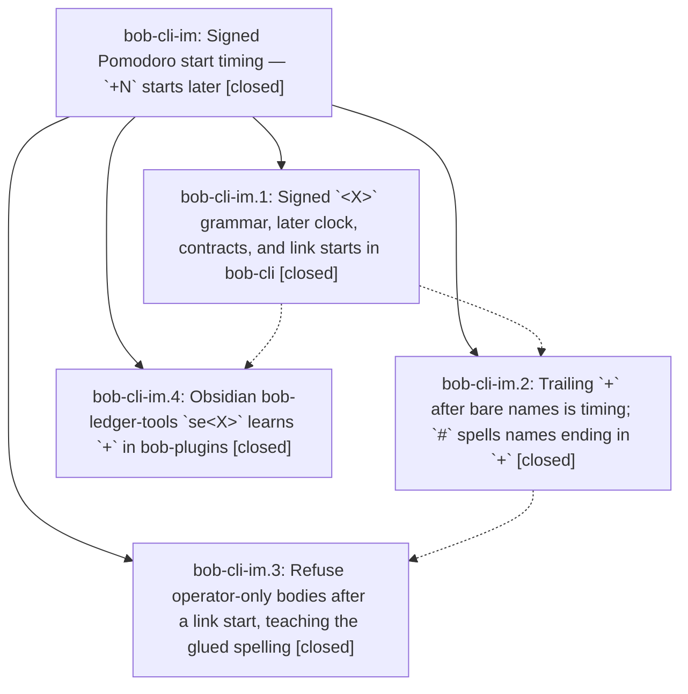

# Bead: bob-cli-im — Signed Pomodoro start timing — \`+N\` starts later

[Bead Pages](../README.md) / bob-cli-im

**Status:** ✓ closed · **Resolution:** done · **Type:** ▸ plan · **Tier:** epic
**Owner:** `bryanbugyi34@gmail.com` · **Created by:** [bbugyi200.athena.research.5x.linker.w0](https://github.com/bobs-org/bob-cli--agents/blob/main/sessions/bbugyi200.athena.research.5x.linker.w0.md) · **Assignee:** `bob-cli-im.land`
**Created:** 2026-11-08 05:50:21 EST · **Closed:** 2026-11-08 11:59:56 EST
**Plan:** [202611/start\_timing\_later\_offset.md](https://github.com/bobs-org/bob-cli--plans/blob/main/202611/start_timing_later_offset.md)

<!-- sase:links:start -->

## Links

| Relation | Artifact | Why |
| --- | --- | --- |
| implemented-by | [plan:202611/start_timing_later_offset.md][1] | derived from the plan's `bead_id:` frontmatter field |

[1]: https://github.com/bobs-org/bob-cli--plans/blob/main/202611/start_timing_later_offset.md

<!-- sase:links:end -->

## Description

Inside a start's `<X>`, `-` starts earlier and `+` starts later (a lone sign is one five-minute unit), so `=fix2+` writes exactly what `=fix2 ++` writes, `@foo:bar=+3` links and starts a task 15 minutes later in one item, `x=` stays a past-only record with teaching refusals, and Obsidian `se<X>` keeps byte-for-byte parity.

## Notes

[2026-11-08T14:55:17Z · bob-cli-im.land] FOLLOW-UP TRIAGE COMPLETE: Read every note on im.1-.4. im.2 #1 (Gmail real_lock_contention_and_release fail under full just check, isolated pass) routed with proposing-bead attribution to active completion epic bob-cli-in and original owner bob-cli-ii.3.1, whose prior landing note already requires deterministic guard coverage; no duplicate task. im.4 #1 (frees-marks 200-link/2000-task 187ms versus 25ms, isolated 17/17 pass) filed as small ready flake bob-cli-io, related to f8 for measurement context but distinct from its CPU-timed ranking nodes. Current focused plugin control passes 80/80 including 17 frees-mark tests. Same/all-type searches, last-week sweeps, source blame, and active-epic review completed. No proposals declined. Reviewer decision record_signed_start_timing=no honored; no memory edits in epic commits.

[2026-11-08T14:57:06Z · bob-cli-im.land] LAND AUDIT / REMAINING WORK: Verified every child and note, approved plan and research, CLI commits f9601b70/b4163548/572ce974, plugin 9003569 and current source. Grammar 17/18/19, additive later_units, checked signed clock, fresh swap/restart/explicit MEET timing, name peel, completion, fit tokens, and plugin parity are implemented. Focused plugin 80/80 passes; vector copies byte-identical. Fetched origin/master=HEAD 572ce974; reviewed non-epic commits 3ff3c4fe,809c0fc7,063f9c23,e5a7b2a3,5ed31c13 and plugin aaece06: Gmail transport/recovery and relation-key updates need no signed-start integration. Remaining epic defects reproduced with the current-built binary: @foo:bar=#deep-work ++3 suggests @foo:bar=#deep-work+3 (changes name, later_units absent); quoted DEEP WORK hint truncates to @foo:bar=#"DEEP+3; ++3 @foo:bar= uses invalid_pomodoro_shift over whole item instead of the promised link-body diagnostic/fold; =fix2+00 suggests the same invalid token and =fix2+00+; named two-sign errors omit the name and range only the equals sign for trailing timing; x=bugs+ hard-codes x=#c++ rather than preserving the typed name. Operator-body refusals and +00 refusal write nothing; prose-body control still writes. Differential tests do not cover the original full base-by-N matrix. All three CLI commits omitted required breaking ! marker: forward repair commit must carry it, without rewriting history/version/changelog. No epic-symbol entries and no parent_bead. Keep epic open for one bounded repair tale that performs its own final closeout.

[2026-11-08T14:59:16Z · bob-cli-im.land] ADDITIONAL VERIFICATION: The current-built binary passed 18 fixed-time scratch-vault differential pairs (N omitted/1/3 for numeric, leading bare, hash, trailing bare, numeric link and empty link starts), comparing both day and task note bytes. The repair tale will add missing persistent matrix coverage. No just check run is claimed in this audit; it is an explicit repair-tale gate before close.

[2026-11-08T14:59:47Z · bob-cli-im.land] REMAINING-WORK HANDOFF: Validated medium tale sase_plan_signed_start_landing_repairs.md covers only structural link-body folds/position handling, typed-name and all-zero-offset teaching errors, precise timing ranges, missing persistent differential cells, and this epic closeout. Its last step explicitly resolves/re-keys epic symbols, closes bob-cli-im normally, runs symvision if available, and marks plan:202611/start_timing_later_offset.md done; no parent exists. A forward breaking-marker commit repairs release classification without history rewriting. npm run validate also passed on bob-plugins aaece06 (generated builds, docs inventory, 9/9 manifests). Epic remains open pending these verified defects; both unrelated proposals were triaged before proposal.

[2026-11-08T16:59:56Z · bob-cli-im.land--4] Verification green: env RUSTC_WRAPPER= just check; native operator-fold and named-timing regressions; 23 capture-parse diagnostics; all 32 Pomodoro-link tests; signed-start byte differentials; all 5 past-start tests; just docs-gen and just docs-check (447 passed, 1 expected skip). Reviewed post-audit drift: no commits after 572ce974; previously audited Gmail transport/recovery and relation-key commits require no signed-start integration. All four phases are closed, parent_id is null, and the epic-symbol audit found none; just symvision is unavailable. Follow-up outcomes remain recorded: Gmail guard contention routed to bob-cli-in and bob-cli-ii.3.1; frees-mark timing filed as ready bob-cli-io related to f8. No proposals were declined.

## Phases

| Bead | Title | Status | Size | Created | Agents | Commits |
|---|---|---|---|---|---:|---:|
| [bob-cli-im.1](bob-cli-im.1.md) | Signed \`\<X\>\` grammar, later clock, contracts, and link starts in bob-cli | ✓ closed | medium | 2026-11-08 | 1 | 1 |
| [bob-cli-im.2](bob-cli-im.2.md) | Trailing \`+\` after bare names is timing; \`#\` spells names ending in \`+\` | ✓ closed | medium | 2026-11-08 | 1 | 1 |
| [bob-cli-im.3](bob-cli-im.3.md) | Refuse operator-only bodies after a link start, teaching the glued spelling | ✓ closed | small | 2026-11-08 | 1 | 1 |
| [bob-cli-im.4](bob-cli-im.4.md) | Obsidian bob-ledger-tools \`se\<X\>\` learns \`+\` in bob-plugins | ✓ closed | small | 2026-11-08 | 1 | 1 |

## Lineage

## Agents

| Agent | Bead | Commits |
|---|---|---:|
| [bbugyi200.athena.bob-cli-im.1](https://github.com/bobs-org/bob-cli--agents/blob/main/agents/bbugyi200.athena.bob-cli-im.1/README.md) | [bob-cli-im.1](bob-cli-im.1.md) | 1 |
| [bbugyi200.athena.bob-cli-im.2](https://github.com/bobs-org/bob-cli--agents/blob/main/sessions/bbugyi200.athena.bob-cli-im.2.md) | [bob-cli-im.2](bob-cli-im.2.md) | 1 |
| [bbugyi200.athena.bob-cli-im.3](https://github.com/bobs-org/bob-cli--agents/blob/main/sessions/bbugyi200.athena.bob-cli-im.3.md) | [bob-cli-im.3](bob-cli-im.3.md) | 1 |
| [bbugyi200.athena.bob-cli-im.4](https://github.com/bobs-org/bob-cli--agents/blob/main/agents/bbugyi200.athena.bob-cli-im.4/README.md) | [bob-cli-im.4](bob-cli-im.4.md) | 1 |
| [bbugyi200.athena.bob-cli-im.land](https://github.com/bobs-org/bob-cli--agents/blob/main/sessions/bbugyi200.athena.bob-cli-im.land.md) | [bob-cli-im](README.md) | 2 |

## Commits

| Repo | Commit | Subject | Bead | Committed |
|---|---|---|---|---|
| bob-cli | [`f9601b7`](https://github.com/bobs-org/bob-cli/commit/f9601b704b23f6857cb26cef45a2c870afbdd1b6) | feat(capture): add signed later Pomodoro starts | [bob-cli-im.1](bob-cli-im.1.md) | 2026-11-08 06:55:19 EST |
| bob-plugins | [`bob-plugins@9003569`](https://github.com/bobs-org/bob-plugins/commit/9003569c6aea6b31d16da0e4ada017c05218bbd5) | feat(ledger-tools): support later (+) offsets in se\<X\> starts | [bob-cli-im.4](bob-cli-im.4.md) | 2026-11-08 07:13:41 EST |
| bob-cli | [`b416354`](https://github.com/bobs-org/bob-cli/commit/b4163548b5025573256ad2a9ec5fdedbb526cd53) | feat(capture): treat trailing plus after a bare start name as later timing | [bob-cli-im.2](bob-cli-im.2.md) | 2026-11-08 08:27:48 EST |
| bob-cli | [`572ce97`](https://github.com/bobs-org/bob-cli/commit/572ce974c9d933e8bb0547418fd421d22e2957b3) | feat(capture): refuse operator-only link-start bodies | [bob-cli-im.3](bob-cli-im.3.md) | 2026-11-08 09:42:54 EST |
| bob-cli | [`984f819`](https://github.com/bobs-org/bob-cli/commit/984f8196a816c43100757190c6a9361fe653e797) | fix(capture)!: finish signed-start diagnostics and landing | [bob-cli-im](README.md) | 2026-11-08 12:01:13 EST |
| bob-cli--plans | [`bob-cli--plans@3214e55`](https://github.com/bobs-org/bob-cli--plans/commit/3214e557d65301d0a378f3e062124d53f8f84f20) | docs(plan): mark signed start timing plan done | [bob-cli-im](README.md) | 2026-11-08 12:01:32 EST |
