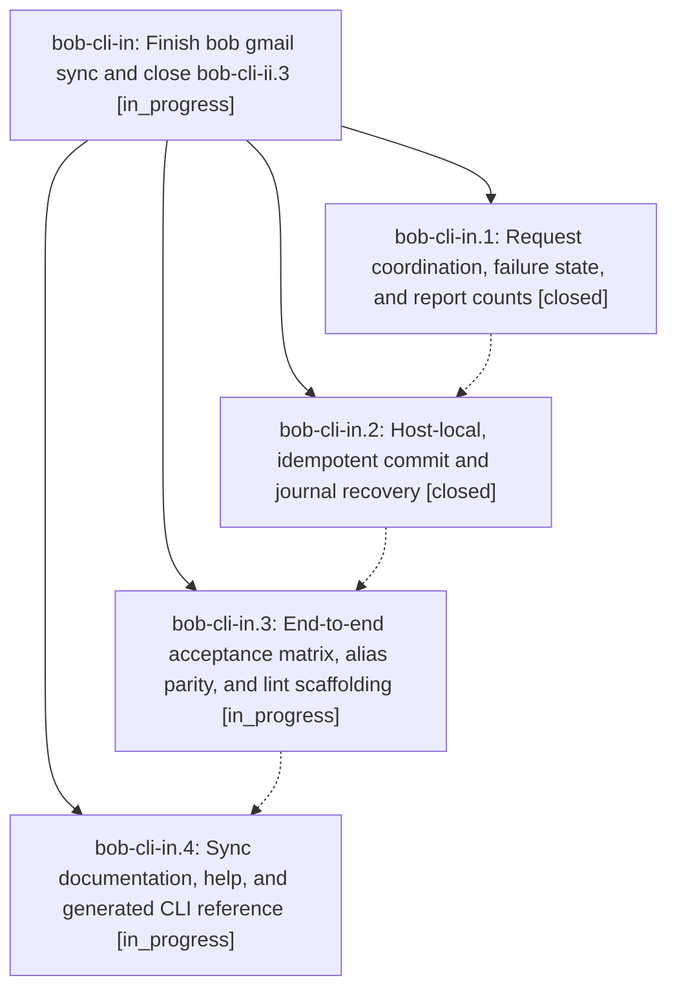

# Bead: bob-cli-in — Finish bob gmail sync and close bob-cli-ii.3

[Bead Pages](../README.md) / bob-cli-in

**Status:** ◐ in_progress · **Type:** ▸ plan · **Tier:** epic
**Owner:** `bryanbugyi34@gmail.com` · **Created by:** [bbugyi200.athena.19v](https://github.com/bobs-org/bob-cli--agents/blob/main/sessions/bbugyi200.athena.19v.md) · **Assignee:** `bob-cli-in.land`
**Created:** 2026-11-08 06:23:52 EST
**Plan:** [202611/gmail\_sync\_ii3\_completion.md](https://github.com/bobs-org/bob-cli--plans/blob/main/202611/gmail_sync_ii3_completion.md)

<!-- sase:links:start -->

## Links

| Relation | Artifact | Why |
| --- | --- | --- |
| implemented-by | [plan:202611/gmail_sync_ii3_completion.md][1] | derived from the plan's `bead_id:` frontmatter field |

[1]: https://github.com/bobs-org/bob-cli--plans/blob/main/202611/gmail_sync_ii3_completion.md

<!-- sase:links:end -->

## Description

bob gmail sync meets its approved filing, coordination, reporting, recovery, alias, and documentation contract with the acceptance coverage the repair tale promised, so bob-cli-ii.3.1 and phase bob-cli-ii.3 close with verified evidence.

## Phases

| Bead | Title | Status | Size | Created | Agents | Commits |
|---|---|---|---|---|---:|---:|
| [bob-cli-in.1](bob-cli-in.1.md) | Request coordination, failure state, and report counts | ✓ closed | medium | 2026-11-08 | 1 | 1 |
| [bob-cli-in.2](bob-cli-in.2.md) | Host-local, idempotent commit and journal recovery | ✓ closed | medium | 2026-11-08 | 1 | 1 |
| [bob-cli-in.3](bob-cli-in.3.md) | End-to-end acceptance matrix, alias parity, and lint scaffolding | ◐ in_progress | medium | 2026-11-08 | 1 | 0 |
| [bob-cli-in.4](bob-cli-in.4.md) | Sync documentation, help, and generated CLI reference | ◐ in_progress | small | 2026-11-08 | 1 | 0 |

## Lineage

## Agents

| Agent | Bead | Commits |
|---|---|---:|
| [bbugyi200.athena.bob-cli-in.1](https://github.com/bobs-org/bob-cli--agents/blob/main/sessions/bbugyi200.athena.bob-cli-in.1.md) | [bob-cli-in.1](bob-cli-in.1.md) | 1 |
| [bbugyi200.athena.bob-cli-in.2](https://github.com/bobs-org/bob-cli--agents/blob/main/agents/bbugyi200.athena.bob-cli-in.2/README.md) | [bob-cli-in.2](bob-cli-in.2.md) | 1 |
| [bbugyi200.athena.bob-cli-in.3](https://github.com/bobs-org/bob-cli--agents/blob/main/agents/bbugyi200.athena.bob-cli-in.3/README.md) | [bob-cli-in.3](bob-cli-in.3.md) | 0 |
| [bbugyi200.athena.bob-cli-in.4](https://github.com/bobs-org/bob-cli--agents/blob/main/agents/bbugyi200.athena.bob-cli-in.4/README.md) | [bob-cli-in.4](bob-cli-in.4.md) | 0 |
| [bbugyi200.athena.bob-cli-in.land](https://github.com/bobs-org/bob-cli--agents/blob/main/agents/bbugyi200.athena.bob-cli-in.land/README.md) | [bob-cli-in](README.md) | 0 |

## Commits

| Repo | Commit | Subject | Bead | Committed |
|---|---|---|---|---|
| bob-cli | [`3ff3c4f`](https://github.com/bobs-org/bob-cli/commit/3ff3c4fe6c3a45ca52f267702e4e51d5f4e1b2df) | feat(gmail): coordinate every sync Gmail read through one retry layer | [bob-cli-in.1](bob-cli-in.1.md) | 2026-11-08 07:38:41 EST |
| bob-cli | [`e5a7b2a`](https://github.com/bobs-org/bob-cli/commit/e5a7b2a32ac7195f11914e0e85cdd50b5e1386d9) | fix(gmail): host-local idempotent sync recovery evidence | [bob-cli-in.2](bob-cli-in.2.md) | 2026-11-08 09:26:02 EST |
