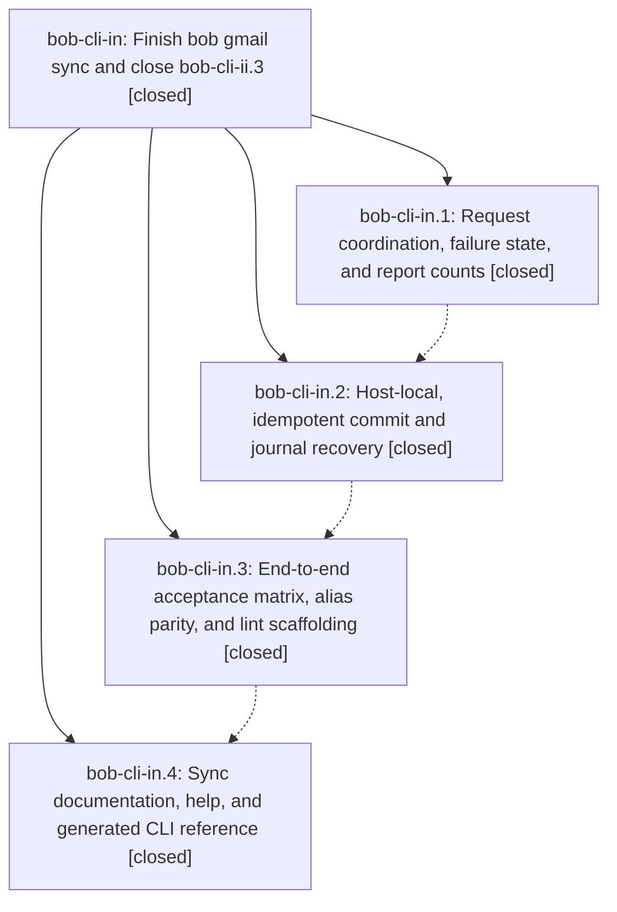

# Bead: bob-cli-in — Finish bob gmail sync and close bob-cli-ii.3

[Bead Pages](../README.md) / bob-cli-in

**Status:** ✓ closed · **Resolution:** done · **Type:** ▸ plan · **Tier:** epic
**Owner:** `bryanbugyi34@gmail.com` · **Created by:** [bbugyi200.athena.19v](https://github.com/bobs-org/bob-cli--agents/blob/main/sessions/bbugyi200.athena.19v.md) · **Assignee:** `bob-cli-in.land`
**Created:** 2026-11-08 06:23:52 EST · **Closed:** 2026-11-08 11:49:11 EST
**Plan:** [202611/gmail\_sync\_ii3\_completion.md](https://github.com/bobs-org/bob-cli--plans/blob/main/202611/gmail_sync_ii3_completion.md)

<!-- sase:links:start -->

## Links

| Relation | Artifact | Why |
| --- | --- | --- |
| implemented-by | [plan:202611/gmail_sync_ii3_completion.md][1] | derived from the plan's `bead_id:` frontmatter field |

_Plus 3 automatic references — see [Referenced By](#referenced-by)._

[1]: https://github.com/bobs-org/bob-cli--plans/blob/main/202611/gmail_sync_ii3_completion.md

<!-- sase:links:end -->

## Description

bob gmail sync meets its approved filing, coordination, reporting, recovery, alias, and documentation contract with the acceptance coverage the repair tale promised, so bob-cli-ii.3.1 and phase bob-cli-ii.3 close with verified evidence.

## Notes

[2026-11-08T14:54:39Z · bob-cli-im.land] DISCOVERED ISSUE: Landing triage of bob-cli-im.2 note #1: native::gmail::sync::guard::tests::real_lock_contention_and_release failed under just check with release frees the guard, then passed in isolation on the unchanged phase tree. This corroborates bob-cli-ii.3.1 landing note #2, which already assigns deterministic guard coverage to Gmail acceptance. Current guard.rs still acquires the same account twice under TestEnvGuard then drops/reacquires; bob-cli-im only removed blank lines here, so this is unrelated to signed timing. Please include the guard fail/pass observation in the active bob-cli-in.3 acceptance verification. No standalone duplicate task created; lander has not independently reproduced the failure.

[2026-11-08T15:43:04Z · bob-cli-in.land] LANDING REVIEW at 59ba11a6: Read this epic and every note on phases bob-cli-in.1-.4, their commits 3ff3c4fe/e5a7b2a3/51d572d5/59ba11a6, the completion and earlier repair/filing plans, and bob-cli-ii.3.1 plus bob-cli-ii.3 notes/DECISIONS. Source confirms coordinator/raw-auth latches, wait-only budget, adoption-before-limit, host-local hash-scoped recovery, normal scoped writes, hidden alias parity fixtures, narrow outer-watch allowances, and corrected docs. Inherited decisions remain cron_enabled=no, gmail_watch_record=no, reply_hold_record=yes owned by ii.4, inbox_glossary=yes already handled; no memory changes. Fetched origin/master equals HEAD. Reviewed intervening 809c0fc7 (configured gog propagated to sync), 063f9c23 (threads.list remains behind coordinator and read allowlist), f9601b70/b4163548/572ce974 (capture timing/grammar changes do not replace sync staged-task insertion), and 5ed31c13 (relation docs). No missing integration wiring found. Remaining epic work from source: retry.rs paces only before execute_with_retry, so retry timestamps and a final backoff shorter than 200ms break the promised request gap; discover.rs cap_has_more counts unvalidated trailing duplicates/invalid ids; has_pending_recovery suppresses read errors and skips authoritative recovery on otherwise idle runs; commit-failure write_recovery errors are discarded; attachment origins are checkpointed only after the whole batch, and checkpoint failures leave already-appended save/origin events eligible for replay; report watching_count unconditionally counts recovered filed/adopted rows even when their task was closed before replay, and save/origin failure can block enrollment without excluding that row. Acceptance still lacks several required orchestration failure vectors, and guard test note #1 remains unresolved (51d572d5 only removed guard allowances; passing retries are not a fix). These findings prevent closure. No fresh check/docs pass claimed: a local binary probe proved target/debug/bob stale (it has no gmail command), not a feature reproduction. All three epic-symbol checks (in, ii.3.1, ii.3) are empty; justfile has no symvision recipe. A bounded medium tale will repair these gaps, run check/docs, and own the full nested closeout.

[2026-11-08T15:43:08Z · bob-cli-in.land] FOLLOW-UP TRIAGE COMPLETE: Reviewed all notes on bob-cli-in.1, .2, .3, and .4; there are zero PROPOSED FOLLOW-UP entries. No genuinely distinct unrelated defect was established, so no sase_new_task action or new task is warranted and no proposal was declined. The guard failure corroboration in epic note #1 and ii.3.1 notes #2/#3 is already assigned to this sync acceptance work, not an unrelated task. All remaining landing findings are unmet requirements of this epic and stay in its repair tale. The tale coder must close bob-cli-in, then recheck and close bob-cli-ii.3.1 and phase bob-cli-ii.3 under the approved completion plan; leave outer bob-cli-ii for its own land agent.

[2026-11-08T16:49:11Z · bob-cli-in.land--1] LANDING COMPLETE. Phases bob-cli-in.1-.4 were already closed (coordination 3ff3c4fe, recovery e5a7b2a3, acceptance 51d572d5, docs 59ba11a6). Source review of remaining landing defects plus commit 1cf8d96b, then a clippy repair in src/native/gmail/sync/file.rs (needless_return on the recovery I/O seam; bind_instead_of_map on save_event_present). Repairs: CoordinatedRead paces every retry attempt; discover cap warnings ignore trailing duplicates/invalid ids; recovery presence distinguishes Absent/Pending/Unreadable so idle -l 0 still enters apply; commit-failure diagnostics include evidence-write errors; origins checkpoint one at a time and a checkpoint failure stops later journal stages; replay skips already-present gmail.save and origin events only when from_recovery; FilingResult.watch_member plus post-persist re-scan keep recovered closed/deleted tasks and pending save/origin/enrollment out of watching/awaiting; guard tests use unique accounts and require GuardAttempt::Acquired; CLI vectors cover metadata/policy auth abort, search-failure adoption, unreadable recovery at -l 0, two-thread -r 0, and hydration give-up. Post-review origin drift 971214d8 (capture hard-link new notes) and c4d81e17 (ref annotation Cmd+Enter contract) do not overlap gmail/sync paths. Follow-up triage: zero PROPOSED FOLLOW-UP on .1-.4; no host tale bead; no new unrelated task. Guard corroboration from epic note #1 and ii.3.1 notes #2/#3 is covered by the unique-account GuardAttempt::Acquired tests. epic-symbols bob-cli-in is empty. justfile still has no symvision recipe. Verification: cargo test --lib native::gmail::sync 105 passed; cargo test --test gmail_sync 26 passed; sase tool run check 2a2cd2b5b05843b1f6f54d0d47fd7248 succeeded; just docs-check passed.

## Phases

| Bead | Title | Status | Size | Created | Agents | Commits |
|---|---|---|---|---|---:|---:|
| [bob-cli-in.1](bob-cli-in.1.md) | Request coordination, failure state, and report counts | ✓ closed | medium | 2026-11-08 | 1 | 1 |
| [bob-cli-in.2](bob-cli-in.2.md) | Host-local, idempotent commit and journal recovery | ✓ closed | medium | 2026-11-08 | 1 | 1 |
| [bob-cli-in.3](bob-cli-in.3.md) | End-to-end acceptance matrix, alias parity, and lint scaffolding | ✓ closed | medium | 2026-11-08 | 1 | 1 |
| [bob-cli-in.4](bob-cli-in.4.md) | Sync documentation, help, and generated CLI reference | ✓ closed | small | 2026-11-08 | 1 | 1 |

## Lineage

## Agents

| Agent | Bead | Commits |
|---|---|---:|
| [bbugyi200.athena.bob-cli-in.1](https://github.com/bobs-org/bob-cli--agents/blob/main/sessions/bbugyi200.athena.bob-cli-in.1.md) | [bob-cli-in.1](bob-cli-in.1.md) | 1 |
| [bbugyi200.athena.bob-cli-in.2](https://github.com/bobs-org/bob-cli--agents/blob/main/agents/bbugyi200.athena.bob-cli-in.2/README.md) | [bob-cli-in.2](bob-cli-in.2.md) | 1 |
| [bbugyi200.athena.bob-cli-in.3](https://github.com/bobs-org/bob-cli--agents/blob/main/agents/bbugyi200.athena.bob-cli-in.3/README.md) | [bob-cli-in.3](bob-cli-in.3.md) | 1 |
| [bbugyi200.athena.bob-cli-in.4](https://github.com/bobs-org/bob-cli--agents/blob/main/agents/bbugyi200.athena.bob-cli-in.4/README.md) | [bob-cli-in.4](bob-cli-in.4.md) | 1 |
| [bbugyi200.athena.bob-cli-in.land](https://github.com/bobs-org/bob-cli--agents/blob/main/sessions/bbugyi200.athena.bob-cli-in.land.md) | [bob-cli-in](README.md) | 3 |

## Commits

| Repo | Commit | Subject | Bead | Committed |
|---|---|---|---|---|
| bob-cli | [`3ff3c4f`](https://github.com/bobs-org/bob-cli/commit/3ff3c4fe6c3a45ca52f267702e4e51d5f4e1b2df) | feat(gmail): coordinate every sync Gmail read through one retry layer | [bob-cli-in.1](bob-cli-in.1.md) | 2026-11-08 07:38:41 EST |
| bob-cli | [`e5a7b2a`](https://github.com/bobs-org/bob-cli/commit/e5a7b2a32ac7195f11914e0e85cdd50b5e1386d9) | fix(gmail): host-local idempotent sync recovery evidence | [bob-cli-in.2](bob-cli-in.2.md) | 2026-11-08 09:26:02 EST |
| bob-cli | [`51d572d`](https://github.com/bobs-org/bob-cli/commit/51d572d59075cc1b9363051ec453b4d3ee3e1ed4) | test(gmail): expand sync acceptance coverage | [bob-cli-in.3](bob-cli-in.3.md) | 2026-11-08 10:08:18 EST |
| bob-cli | [`59ba11a`](https://github.com/bobs-org/bob-cli/commit/59ba11a6ab09cd7dba5b8a753f51d456348ed288) | docs(gmail): document sync JSON, host-local state, and watch-only -l 0 | [bob-cli-in.4](bob-cli-in.4.md) | 2026-11-08 10:29:45 EST |
| bob-cli | [`1cf8d96`](https://github.com/bobs-org/bob-cli/commit/1cf8d96b37fa250521d77990e5da19f40b79f233) | fix(gmail): land remaining sync retry, recovery, and watch-membership defects | [bob-cli-in](README.md) | 2026-11-08 11:23:11 EST |
| bob-cli | [`32c241a`](https://github.com/bobs-org/bob-cli/commit/32c241af95e2818ebd7635295ee96ca2ab38bc26) | fix(gmail): land remaining sync retry, recovery, and watch-membership lint | [bob-cli-in](README.md) | 2026-11-08 11:51:36 EST |
| bob-cli--plans | [`bob-cli--plans@b93cb9c`](https://github.com/bobs-org/bob-cli--plans/commit/b93cb9cfd764d8b45dc8c10415a601e6e8110def) | docs(plans): mark Gmail sync completion and filing epics done | [bob-cli-in](README.md) | 2026-11-08 11:51:57 EST |

<!-- sase:referenced-by:start -->

## Referenced By

| Relation | Artifact | Why | Uses |
| --- | --- | --- | ---: |
| read-by | [agent:bob-cli-in.2][1] | Need parent epic notes and DECISIONS for recovery phase | 2 |
| read-by | [agent:bob-cli-in.3][2] | Need the parent epic decisions and acceptance context for this phase | 1 |
| read-by | [agent:bob-cli-in.4][3] | Need parent epic DECISIONS that this phase must honor | 1 |

[1]: https://github.com/bobs-org/bob-cli--agents/blob/main/agents/bbugyi200.athena.bob-cli-in.2/README.md
[2]: https://github.com/bobs-org/bob-cli--agents/blob/main/agents/bbugyi200.athena.bob-cli-in.3/README.md
[3]: https://github.com/bobs-org/bob-cli--agents/blob/main/agents/bbugyi200.athena.bob-cli-in.4/README.md

<!-- sase:referenced-by:end -->
