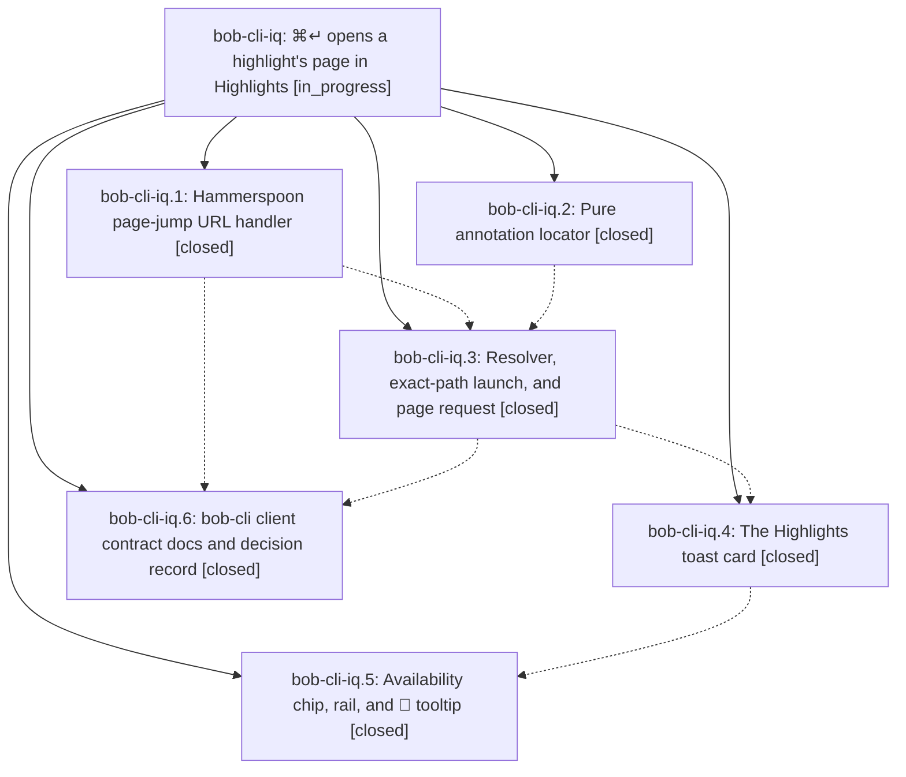

# Bead: bob-cli-iq — ⌘↵ opens a highlight's page in Highlights

[Bead Pages](../README.md) / bob-cli-iq

**Status:** ◐ in_progress · **Type:** ▸ plan · **Tier:** epic
**Owner:** `bryanbugyi34@gmail.com` · **Created by:** [bbugyi200.apollo.research.3o.linker.w0](https://github.com/bobs-org/bob-cli--agents/blob/main/sessions/bbugyi200.apollo.research.3o.linker.w0.md) · **Assignee:** `bob-cli-iq.land`
**Created:** 2026-11-08 10:40:42 EST
**Plan:** [202611/highlights\_annotation\_page\_jump.md](https://github.com/bobs-org/bob-cli--plans/blob/main/202611/highlights_annotation_page_jump.md)

<!-- sase:links:start -->

## Links

| Relation | Artifact | Why |
| --- | --- | --- |
| implemented-by | [plan:202611/highlights_annotation_page_jump.md][1] | derived from the plan's `bead_id:` frontmatter field |

_Plus 2 automatic references — see [Referenced By](#referenced-by)._

[1]: https://github.com/bobs-org/bob-cli--plans/blob/main/202611/highlights_annotation_page_jump.md

<!-- sase:links:end -->

## Description

In Obsidian, ⌘↵ on a reference-note highlight, a 🔖 bookmark line, or a Task Link to an annotation task opens the exact PDF in Highlights and lands on that highlight's page. A status-bar chip and a highlighter rail show beforehand what ⌘↵ will do, on reading tasks too. One Bob toast announces each press before Highlights takes focus.

## Phases

| Bead | Title | Status | Size | Created | Agents | Commits |
|---|---|---|---|---|---:|---:|
| [bob-cli-iq.1](bob-cli-iq.1.md) | Hammerspoon page-jump URL handler | ✓ closed | medium | 2026-11-08 | 1 | 0 |
| [bob-cli-iq.2](bob-cli-iq.2.md) | Pure annotation locator | ✓ closed | medium | 2026-11-08 | 1 | 1 |
| [bob-cli-iq.3](bob-cli-iq.3.md) | Resolver, exact-path launch, and page request | ✓ closed | medium | 2026-11-08 | 1 | 1 |
| [bob-cli-iq.4](bob-cli-iq.4.md) | The Highlights toast card | ✓ closed | small | 2026-11-08 | 1 | 1 |
| [bob-cli-iq.5](bob-cli-iq.5.md) | Availability chip, rail, and 📖 tooltip | ✓ closed | medium | 2026-11-08 | 1 | 1 |
| [bob-cli-iq.6](bob-cli-iq.6.md) | bob-cli client contract docs and decision record | ✓ closed | small | 2026-11-08 | 1 | 1 |

## Lineage

## Agents

| Agent | Bead | Commits |
|---|---|---:|
| [bbugyi200.apollo.bob-cli-iq.1](https://github.com/bobs-org/bob-cli--agents/blob/main/sessions/bbugyi200.apollo.bob-cli-iq.1.md) | [bob-cli-iq.1](bob-cli-iq.1.md) | 0 |
| [bbugyi200.apollo.bob-cli-iq.2](https://github.com/bobs-org/bob-cli--agents/blob/main/agents/bbugyi200.apollo.bob-cli-iq.2/README.md) | [bob-cli-iq.2](bob-cli-iq.2.md) | 1 |
| [bbugyi200.apollo.bob-cli-iq.3](https://github.com/bobs-org/bob-cli--agents/blob/main/agents/bbugyi200.apollo.bob-cli-iq.3/README.md) | [bob-cli-iq.3](bob-cli-iq.3.md) | 1 |
| [bbugyi200.apollo.bob-cli-iq.4](https://github.com/bobs-org/bob-cli--agents/blob/main/agents/bbugyi200.apollo.bob-cli-iq.4/README.md) | [bob-cli-iq.4](bob-cli-iq.4.md) | 1 |
| [bbugyi200.apollo.bob-cli-iq.5](https://github.com/bobs-org/bob-cli--agents/blob/main/agents/bbugyi200.apollo.bob-cli-iq.5/README.md) | [bob-cli-iq.5](bob-cli-iq.5.md) | 1 |
| [bbugyi200.apollo.bob-cli-iq.6](https://github.com/bobs-org/bob-cli--agents/blob/main/agents/bbugyi200.apollo.bob-cli-iq.6/README.md) | [bob-cli-iq.6](bob-cli-iq.6.md) | 1 |
| [bbugyi200.apollo.bob-cli-iq.land](https://github.com/bobs-org/bob-cli--agents/blob/main/agents/bbugyi200.apollo.bob-cli-iq.land/README.md) | [bob-cli-iq](README.md) | 0 |

## Commits

| Repo | Commit | Subject | Bead | Committed |
|---|---|---|---|---|
| bob-plugins | [`bob-plugins@cedcb1c`](https://github.com/bobs-org/bob-plugins/commit/cedcb1c6b36b2021b94254c688fc1e0444ecfad0) | feat(navigation): add pure ref annotation locator for Highlights page jumps | [bob-cli-iq.2](bob-cli-iq.2.md) | 2026-11-08 10:55:05 EST |
| bob-plugins | [`bob-plugins@e16f794`](https://github.com/bobs-org/bob-plugins/commit/e16f7944494aea3a900785c81ff62f1846603a39) | feat(navigation): resolve highlight targets and open exact PDF at page | [bob-cli-iq.3](bob-cli-iq.3.md) | 2026-11-08 11:27:39 EST |
| bob-cli | [`c4d81e1`](https://github.com/bobs-org/bob-cli/commit/c4d81e177158cdc165aeb34aa125771e1cde5d9f) | docs(ref): declare generated annotation shapes as a Cmd+Enter client contract | [bob-cli-iq.6](bob-cli-iq.6.md) | 2026-11-08 11:37:05 EST |
| bob-plugins | [`bob-plugins@6390587`](https://github.com/bobs-org/bob-plugins/commit/6390587b15a771ecd7b188e01bb93d9bbee170f5) | feat(navigation): add Highlights toast card | [bob-cli-iq.4](bob-cli-iq.4.md) | 2026-11-08 11:45:15 EST |
| bob-plugins | [`bob-plugins@fbf45e2`](https://github.com/bobs-org/bob-plugins/commit/fbf45e2572366d28cb7237d031d8e521dc9254f2) | feat(navigation): add Highlights availability chip, rail, and tooltip | [bob-cli-iq.5](bob-cli-iq.5.md) | 2026-11-08 12:16:26 EST |

<!-- sase:referenced-by:start -->

## Referenced By

| Relation | Artifact | Why | Uses |
| --- | --- | --- | ---: |
| read-by | [agent:bob-cli-iq.2][1] | need epic plan and decisions | 1 |
| read-by | [agent:bob-cli-iq.3][2] | Need parent epic status and remaining work | 1 |

[1]: https://github.com/bobs-org/bob-cli--agents/blob/main/agents/bbugyi200.apollo.bob-cli-iq.2/README.md
[2]: https://github.com/bobs-org/bob-cli--agents/blob/main/agents/bbugyi200.apollo.bob-cli-iq.3/README.md

<!-- sase:referenced-by:end -->
