# Bead: bob-cli-ir — Record Notes — capture and manage custom-typed notes

[Bead Pages](../README.md) / bob-cli-ir

**Status:** ◐ in_progress · **Type:** ▸ plan · **Tier:** epic
**Owner:** `bryanbugyi34@gmail.com` · **Created by:** [bbugyi200.athena.1a0](https://github.com/bobs-org/bob-cli--agents/blob/main/sessions/bbugyi200.athena.1a0.md) · **Assignee:** `bob-cli-ir.land`
**Created:** 2026-11-08 11:06:11 EST
**Plan:** [202611/record\_notes.md](https://github.com/bobs-org/bob-cli--plans/blob/main/202611/record_notes.md)

<!-- sase:links:start -->

## Links

| Relation | Artifact | Why |
| --- | --- | --- |
| implemented-by | [plan:202611/record_notes.md][1] | derived from the plan's `bead_id:` frontmatter field |

_Plus 6 automatic references — see [Referenced By](#referenced-by)._

[1]: https://github.com/bobs-org/bob-cli--plans/blob/main/202611/record_notes.md

<!-- sase:links:end -->

## Description

Bryan can create and update notes of config-declared record types (restaurants, podcasts, TV shows, movies) from one capture spelling, `<title> @<dir>/`, with bob guiding every required field. The same engine powers a `bob records` CLI for agents and a lint that keeps every writer honest. The Mac panel shows a Record Card and a whole-note preview. Every write is planned in full, never replaces a file, and refuses duplicates.

## Notes

[2026-11-08T16:27:23Z · bryanbugyi34@gmail.com] The epic lander agent should add an excellent new glossary term for 'record note' before landing.

## Phases

| Bead | Title | Status | Size | Created | Agents | Commits |
|---|---|---|---|---|---:|---:|
| [bob-cli-ir.1](bob-cli-ir.1.md) | Capture installs new files without ever replacing one | ✓ closed | small | 2026-11-08 | 1 | 1 |
| [bob-cli-ir.10](bob-cli-ir.10.md) | Mac Record Card and guided entry | ◐ in_progress | large | 2026-11-08 | 1 | 0 |
| [bob-cli-ir.11](bob-cli-ir.11.md) | Mac new-note preview and success line | ◐ in_progress | large | 2026-11-08 | 1 | 0 |
| [bob-cli-ir.12](bob-cli-ir.12.md) | Mac updates, existing-record rows, and Similar records | ◐ in_progress | medium | 2026-11-08 | 1 | 0 |
| [bob-cli-ir.13](bob-cli-ir.13.md) | Guide, documentation audit, end-to-end proof, and memory | ◐ in_progress | small | 2026-11-08 | 1 | 0 |
| [bob-cli-ir.2](bob-cli-ir.2.md) | Records schema, catalog, renderer, and planner | ✓ closed | large | 2026-11-08 | 1 | 0 |
| [bob-cli-ir.3](bob-cli-ir.3.md) | bob records list, show, check, and new | ✓ closed | medium | 2026-11-08 | 1 | 1 |
| [bob-cli-ir.4](bob-cli-ir.4.md) | Restaurant and podcast schemas go live in config and the vault | ✓ closed | small | 2026-11-08 | 1 | 0 |
| [bob-cli-ir.5](bob-cli-ir.5.md) | Capture grammar for new records | ✓ closed | large | 2026-11-08 | 1 | 0 |
| [bob-cli-ir.6](bob-cli-ir.6.md) | Guided field entry in capture-complete | ✓ closed | large | 2026-11-08 | 1 | 1 |
| [bob-cli-ir.7](bob-cli-ir.7.md) | Add to an existing record with @dir/stem | ◐ in_progress | large | 2026-11-08 | 1 | 0 |
| [bob-cli-ir.8](bob-cli-ir.8.md) | Similar records in capture-related | ◐ in_progress | medium | 2026-11-08 | 1 | 0 |
| [bob-cli-ir.9](bob-cli-ir.9.md) | bob records init plus show and movie types | ◐ in_progress | medium | 2026-11-08 | 1 | 0 |

## Lineage

```mermaid
flowchart TD
    n0["bob-cli-ir: Record Notes — capture and manage custom-typed notes [in_progress]"]
    n1["bob-cli-ir.1: Capture installs new files without ever replacing one [closed]"]
    n2["bob-cli-ir.10: Mac Record Card and guided entry [in_progress]"]
    n3["bob-cli-ir.10.1: Mac Record Card and guided entry [in_progress]"]
    n4["bob-cli-ir.10.1.1: Address Record Card fields through Bob completion [closed]"]
    n5["bob-cli-ir.10.1.2: Decode records and define portable card state [in_progress]"]
    n6["bob-cli-ir.10.1.3: Connect record completion and keyboard entry [in_progress]"]
    n7["bob-cli-ir.10.1.4: Render the Record Card and semantic editor styling [in_progress]"]
    n8["bob-cli-ir.11: Mac new-note preview and success line [in_progress]"]
    n9["bob-cli-ir.12: Mac updates, existing-record rows, and Similar records [in_progress]"]
    n10["bob-cli-ir.13: Guide, documentation audit, end-to-end proof, and memory [in_progress]"]
    n11["bob-cli-ir.2: Records schema, catalog, renderer, and planner [closed]"]
    n12["bob-cli-ir.2.1: Records engine schema, indexing, rendering, and planning [closed]"]
    n13["bob-cli-ir.2.1.1: Records schema, value validation, and filename fixtures [closed]"]
    n14["bob-cli-ir.2.1.2: Lazy per-folder records index and suggestions [closed]"]
    n15["bob-cli-ir.2.1.3: Typed record rendering and byte-preserving updates [closed]"]
    n16["bob-cli-ir.2.1.4: Records planner, engine integration, and contract documentation [closed]"]
    n17["bob-cli-ir.3: bob records list, show, check, and new [closed]"]
    n18["bob-cli-ir.4: Restaurant and podcast schemas go live in config and the vault [closed]"]
    n19["bob-cli-ir.5: Capture grammar for new records [closed]"]
    n20["bob-cli-ir.5.1: Capture creates record notes [closed]"]
    n21["bob-cli-ir.5.1.1: Recognize record items before task marker parsing [closed]"]
    n22["bob-cli-ir.5.1.2: Resolve record metadata and expose discovery rows [closed]"]
    n23["bob-cli-ir.5.1.3: Create records through the capture transaction [closed]"]
    n24["bob-cli-ir.5.1.4: Publish the record capture contract and acceptance evidence [closed]"]
    n25["bob-cli-ir.6: Guided field entry in capture-complete [closed]"]
    n26["bob-cli-ir.7: Add to an existing record with @dir/stem [in_progress]"]
    n27["bob-cli-ir.7.1: Existing-record updates through capture and the records CLI [in_progress]"]
    n28["bob-cli-ir.7.1.1: Shared snapshot-based record update planner [closed]"]
    n29["bob-cli-ir.7.1.2: Record update grammar and editor parse [in_progress]"]
    n30["bob-cli-ir.7.1.3: Transactional capture updates and exact previews [in_progress]"]
    n31["bob-cli-ir.7.1.4: Existing-record completion and Add to it fixes [in_progress]"]
    n32["bob-cli-ir.7.1.5: Records update CLI and dependent shell completion [in_progress]"]
    n33["bob-cli-ir.8: Similar records in capture-related [in_progress]"]
    n34["bob-cli-ir.9: bob records init plus show and movie types [in_progress]"]
    n0 --> n1
    n0 --> n2
    n2 --> n3
    n3 --> n4
    n3 --> n5
    n3 --> n6
    n3 --> n7
    n0 --> n8
    n0 --> n9
    n0 --> n10
    n0 --> n11
    n11 --> n12
    n12 --> n13
    n12 --> n14
    n12 --> n15
    n12 --> n16
    n0 --> n17
    n0 --> n18
    n0 --> n19
    n19 --> n20
    n20 --> n21
    n20 --> n22
    n20 --> n23
    n20 --> n24
    n0 --> n25
    n0 --> n26
    n26 --> n27
    n27 --> n28
    n27 --> n29
    n27 --> n30
    n27 --> n31
    n27 --> n32
    n0 --> n33
    n0 --> n34
    n1 -.-> n17
    n1 -.-> n19
    n2 -.-> n8
    n4 -.-> n5
    n5 -.-> n6
    n6 -.-> n7
    n8 -.-> n9
    n9 -.-> n10
    n11 -.-> n17
    n11 -.-> n19
    n13 -.-> n14
    n13 -.-> n15
    n14 -.-> n16
    n15 -.-> n16
    n17 -.-> n18
    n18 -.-> n34
    n19 -.-> n8
    n19 -.-> n25
    n21 -.-> n22
    n22 -.-> n23
    n23 -.-> n24
    n25 -.-> n2
    n25 -.-> n26
    n26 -.-> n33
    n26 -.-> n34
    n28 -.-> n29
    n29 -.-> n30
    n30 -.-> n31
    n30 -.-> n32
    n33 -.-> n9
    n34 -.-> n10
```

## Agents

| Agent | Bead | Commits |
|---|---|---:|
| [bbugyi200.athena.bob-cli-ir.1](https://github.com/bobs-org/bob-cli--agents/blob/main/agents/bbugyi200.athena.bob-cli-ir.1/README.md) | [bob-cli-ir.1](bob-cli-ir.1.md) | 1 |
| [bbugyi200.athena.bob-cli-ir.10](https://github.com/bobs-org/bob-cli--agents/blob/main/sessions/bbugyi200.athena.bob-cli-ir.10.md) | [bob-cli-ir.10](bob-cli-ir.10.md) | 0 |
| [bbugyi200.athena.bob-cli-ir.10.1.1](https://github.com/bobs-org/bob-cli--agents/blob/main/agents/bbugyi200.athena.bob-cli-ir.10.1.1/README.md) | [bob-cli-ir.10.1.1](bob-cli-ir.10.1.1.md) | 1 |
| [bbugyi200.athena.bob-cli-ir.10.1.2](https://github.com/bobs-org/bob-cli--agents/blob/main/agents/bbugyi200.athena.bob-cli-ir.10.1.2/README.md) | [bob-cli-ir.10.1.2](bob-cli-ir.10.1.2.md) | 0 |
| [bbugyi200.athena.bob-cli-ir.10.1.3](https://github.com/bobs-org/bob-cli--agents/blob/main/agents/bbugyi200.athena.bob-cli-ir.10.1.3/README.md) | [bob-cli-ir.10.1.3](bob-cli-ir.10.1.3.md) | 0 |
| [bbugyi200.athena.bob-cli-ir.10.1.4](https://github.com/bobs-org/bob-cli--agents/blob/main/agents/bbugyi200.athena.bob-cli-ir.10.1.4/README.md) | [bob-cli-ir.10.1.4](bob-cli-ir.10.1.4.md) | 0 |
| [bbugyi200.athena.bob-cli-ir.10.1.land](https://github.com/bobs-org/bob-cli--agents/blob/main/agents/bbugyi200.athena.bob-cli-ir.10.1.land/README.md) | [bob-cli-ir.10.1](bob-cli-ir.10.1.md) | 0 |
| [bbugyi200.athena.bob-cli-ir.11](https://github.com/bobs-org/bob-cli--agents/blob/main/agents/bbugyi200.athena.bob-cli-ir.11/README.md) | [bob-cli-ir.11](bob-cli-ir.11.md) | 0 |
| [bbugyi200.athena.bob-cli-ir.12](https://github.com/bobs-org/bob-cli--agents/blob/main/agents/bbugyi200.athena.bob-cli-ir.12/README.md) | [bob-cli-ir.12](bob-cli-ir.12.md) | 0 |
| [bbugyi200.athena.bob-cli-ir.13](https://github.com/bobs-org/bob-cli--agents/blob/main/agents/bbugyi200.athena.bob-cli-ir.13/README.md) | [bob-cli-ir.13](bob-cli-ir.13.md) | 0 |
| [bbugyi200.athena.bob-cli-ir.2](https://github.com/bobs-org/bob-cli--agents/blob/main/sessions/bbugyi200.athena.bob-cli-ir.2.md) | [bob-cli-ir.2](bob-cli-ir.2.md) | 0 |
| [bbugyi200.athena.bob-cli-ir.2.1.1](https://github.com/bobs-org/bob-cli--agents/blob/main/agents/bbugyi200.athena.bob-cli-ir.2.1.1/README.md) | [bob-cli-ir.2.1.1](bob-cli-ir.2.1.1.md) | 1 |
| [bbugyi200.athena.bob-cli-ir.2.1.2](https://github.com/bobs-org/bob-cli--agents/blob/main/agents/bbugyi200.athena.bob-cli-ir.2.1.2/README.md) | [bob-cli-ir.2.1.2](bob-cli-ir.2.1.2.md) | 1 |
| [bbugyi200.athena.bob-cli-ir.2.1.3](https://github.com/bobs-org/bob-cli--agents/blob/main/agents/bbugyi200.athena.bob-cli-ir.2.1.3/README.md) | [bob-cli-ir.2.1.3](bob-cli-ir.2.1.3.md) | 1 |
| [bbugyi200.athena.bob-cli-ir.2.1.4](https://github.com/bobs-org/bob-cli--agents/blob/main/agents/bbugyi200.athena.bob-cli-ir.2.1.4/README.md) | [bob-cli-ir.2.1.4](bob-cli-ir.2.1.4.md) | 1 |
| [bbugyi200.athena.bob-cli-ir.2.1.land](https://github.com/bobs-org/bob-cli--agents/blob/main/agents/bbugyi200.athena.bob-cli-ir.2.1.land/README.md) | [bob-cli-ir.2.1](bob-cli-ir.2.1.md) | 3 |
| [bbugyi200.athena.bob-cli-ir.3](https://github.com/bobs-org/bob-cli--agents/blob/main/agents/bbugyi200.athena.bob-cli-ir.3/README.md) | [bob-cli-ir.3](bob-cli-ir.3.md) | 1 |
| [bbugyi200.athena.bob-cli-ir.4](https://github.com/bobs-org/bob-cli--agents/blob/main/agents/bbugyi200.athena.bob-cli-ir.4/README.md) | [bob-cli-ir.4](bob-cli-ir.4.md) | 0 |
| [bbugyi200.athena.bob-cli-ir.5](https://github.com/bobs-org/bob-cli--agents/blob/main/sessions/bbugyi200.athena.bob-cli-ir.5.md) | [bob-cli-ir.5](bob-cli-ir.5.md) | 0 |
| [bbugyi200.athena.bob-cli-ir.5.1.1](https://github.com/bobs-org/bob-cli--agents/blob/main/agents/bbugyi200.athena.bob-cli-ir.5.1.1/README.md) | [bob-cli-ir.5.1.1](bob-cli-ir.5.1.1.md) | 1 |
| [bbugyi200.athena.bob-cli-ir.5.1.2](https://github.com/bobs-org/bob-cli--agents/blob/main/agents/bbugyi200.athena.bob-cli-ir.5.1.2/README.md) | [bob-cli-ir.5.1.2](bob-cli-ir.5.1.2.md) | 1 |
| [bbugyi200.athena.bob-cli-ir.5.1.3](https://github.com/bobs-org/bob-cli--agents/blob/main/agents/bbugyi200.athena.bob-cli-ir.5.1.3/README.md) | [bob-cli-ir.5.1.3](bob-cli-ir.5.1.3.md) | 1 |
| [bbugyi200.athena.bob-cli-ir.5.1.4](https://github.com/bobs-org/bob-cli--agents/blob/main/sessions/bbugyi200.athena.bob-cli-ir.5.1.4.md) | [bob-cli-ir.5.1.4](bob-cli-ir.5.1.4.md) | 1 |
| [bbugyi200.athena.bob-cli-ir.5.1.land](https://github.com/bobs-org/bob-cli--agents/blob/main/sessions/bbugyi200.athena.bob-cli-ir.5.1.land.md) | [bob-cli-ir.5.1](bob-cli-ir.5.1.md) | 2 |
| [bbugyi200.athena.bob-cli-ir.6](https://github.com/bobs-org/bob-cli--agents/blob/main/sessions/bbugyi200.athena.bob-cli-ir.6.md) | [bob-cli-ir.6](bob-cli-ir.6.md) | 1 |
| [bbugyi200.athena.bob-cli-ir.7](https://github.com/bobs-org/bob-cli--agents/blob/main/sessions/bbugyi200.athena.bob-cli-ir.7.md) | [bob-cli-ir.7](bob-cli-ir.7.md) | 0 |
| [bbugyi200.athena.bob-cli-ir.7.1.1](https://github.com/bobs-org/bob-cli--agents/blob/main/agents/bbugyi200.athena.bob-cli-ir.7.1.1/README.md) | [bob-cli-ir.7.1.1](bob-cli-ir.7.1.1.md) | 1 |
| [bbugyi200.athena.bob-cli-ir.7.1.2](https://github.com/bobs-org/bob-cli--agents/blob/main/agents/bbugyi200.athena.bob-cli-ir.7.1.2/README.md) | [bob-cli-ir.7.1.2](bob-cli-ir.7.1.2.md) | 0 |
| [bbugyi200.athena.bob-cli-ir.7.1.3](https://github.com/bobs-org/bob-cli--agents/blob/main/agents/bbugyi200.athena.bob-cli-ir.7.1.3/README.md) | [bob-cli-ir.7.1.3](bob-cli-ir.7.1.3.md) | 0 |
| [bbugyi200.athena.bob-cli-ir.7.1.4](https://github.com/bobs-org/bob-cli--agents/blob/main/agents/bbugyi200.athena.bob-cli-ir.7.1.4/README.md) | [bob-cli-ir.7.1.4](bob-cli-ir.7.1.4.md) | 0 |
| [bbugyi200.athena.bob-cli-ir.7.1.5](https://github.com/bobs-org/bob-cli--agents/blob/main/agents/bbugyi200.athena.bob-cli-ir.7.1.5/README.md) | [bob-cli-ir.7.1.5](bob-cli-ir.7.1.5.md) | 0 |
| [bbugyi200.athena.bob-cli-ir.7.1.land](https://github.com/bobs-org/bob-cli--agents/blob/main/agents/bbugyi200.athena.bob-cli-ir.7.1.land/README.md) | [bob-cli-ir.7.1](bob-cli-ir.7.1.md) | 0 |
| [bbugyi200.athena.bob-cli-ir.8](https://github.com/bobs-org/bob-cli--agents/blob/main/agents/bbugyi200.athena.bob-cli-ir.8/README.md) | [bob-cli-ir.8](bob-cli-ir.8.md) | 0 |
| [bbugyi200.athena.bob-cli-ir.9](https://github.com/bobs-org/bob-cli--agents/blob/main/agents/bbugyi200.athena.bob-cli-ir.9/README.md) | [bob-cli-ir.9](bob-cli-ir.9.md) | 0 |
| [bbugyi200.athena.bob-cli-ir.land](https://github.com/bobs-org/bob-cli--agents/blob/main/agents/bbugyi200.athena.bob-cli-ir.land/README.md) | [bob-cli-ir](README.md) | 0 |

## Commits

| Repo | Commit | Subject | Bead | Committed |
|---|---|---|---|---|
| bob-cli | [`971214d`](https://github.com/bobs-org/bob-cli/commit/971214d88b0eb9c7fe2a0199be7f6670645c668c) | feat(capture): install new notes without replacing existing files | [bob-cli-ir.1](bob-cli-ir.1.md) | 2026-11-08 11:29:27 EST |
| bob-cli | [`cd8a031`](https://github.com/bobs-org/bob-cli/commit/cd8a031f9bad5e5aee4ab88e3671e3d8afb9beb0) | feat(records): add schema validation and stem fixtures | [bob-cli-ir.2.1.1](bob-cli-ir.2.1.1.md) | 2026-11-08 11:52:23 EST |
| bob-cli | [`93c7c11`](https://github.com/bobs-org/bob-cli/commit/93c7c1145eeda40335a0c7002239ab3ae0221eff) | feat(records): add typed rendering and byte-preserving updates | [bob-cli-ir.2.1.3](bob-cli-ir.2.1.3.md) | 2026-11-08 12:32:57 EST |
| bob-cli | [`b9db700`](https://github.com/bobs-org/bob-cli/commit/b9db7007934c7ef97343ba998704934374cf8732) | feat(records): add lazy per-folder catalog index and suggestions | [bob-cli-ir.2.1.2](bob-cli-ir.2.1.2.md) | 2026-11-08 12:46:11 EST |
| bob-cli | [`a8ccf5e`](https://github.com/bobs-org/bob-cli/commit/a8ccf5ed100eedab812b56093ae890d39a29b047) | feat(records): add side-effect-free creation planner | [bob-cli-ir.2.1.4](bob-cli-ir.2.1.4.md) | 2026-11-08 13:23:14 EST |
| bob-cli | [`8ff0d8e`](https://github.com/bobs-org/bob-cli/commit/8ff0d8ed5a43b34977a6acaf4473159fe977e600) | feat(records): harden planning and byte-preserving updates | [bob-cli-ir.2.1](bob-cli-ir.2.1.md) | 2026-11-08 14:25:40 EST |
| bob-cli | [`361974f`](https://github.com/bobs-org/bob-cli/commit/361974f48eef7e2ba1fdc8ad97a1916835a6d20b) | fix(records): map stemless titles to record\_title and document engine allowances | [bob-cli-ir.2.1](bob-cli-ir.2.1.md) | 2026-11-08 18:15:09 EST |
| bob-cli--plans | [`bob-cli--plans@1b530a4`](https://github.com/bobs-org/bob-cli--plans/commit/1b530a431b8b0a68bc5d28f1671910b224f30036) | chore(plans): mark records engine epic done | [bob-cli-ir.2.1](bob-cli-ir.2.1.md) | 2026-11-08 18:15:40 EST |
| bob-cli | [`3e68a53`](https://github.com/bobs-org/bob-cli/commit/3e68a53acd5c75feaf4f26fb6dab206f2a1a84aa) | feat(records): add records CLI and docs | [bob-cli-ir.3](bob-cli-ir.3.md) | 2026-11-08 19:04:25 EST |
| bob-cli | [`83ad74e`](https://github.com/bobs-org/bob-cli/commit/83ad74e2f8138b6d94ba745380a9f012ce08d104) | feat(capture): add shared record route classifier with fail-closed execution | [bob-cli-ir.5.1.1](bob-cli-ir.5.1.1.md) | 2026-11-08 19:56:49 EST |
| bob-cli | [`4c97ed4`](https://github.com/bobs-org/bob-cli/commit/4c97ed416f3cc8fa066353a34d52d7757b845009) | feat(capture): resolve record metadata and expose targets | [bob-cli-ir.5.1.2](bob-cli-ir.5.1.2.md) | 2026-11-08 20:52:30 EST |
| bob-cli | [`f2561f9`](https://github.com/bobs-org/bob-cli/commit/f2561f962f5f91392d9721e094ac71f31e6832b3) | feat(capture): create record notes through the capture transaction | [bob-cli-ir.5.1.3](bob-cli-ir.5.1.3.md) | 2026-11-08 21:49:05 EST |
| bob-cli | [`e081e72`](https://github.com/bobs-org/bob-cli/commit/e081e729c5d30152df19e2a9173d067be6dacd8d) | docs(capture): publish the record note capture contract | [bob-cli-ir.5.1.4](bob-cli-ir.5.1.4.md) | 2026-11-08 22:59:07 EST |
| bob-cli | [`80c9320`](https://github.com/bobs-org/bob-cli/commit/80c93209aa6857a178beba3ba293755198300848) | fix(capture)!: complete record claiming and preview contracts | [bob-cli-ir.5.1](bob-cli-ir.5.1.md) | 2026-11-09 00:30:51 EST |
| bob-cli--plans | [`bob-cli--plans@903dd39`](https://github.com/bobs-org/bob-cli--plans/commit/903dd39e46ee3ab3f21e34f3f97208acf6715a55) | docs(plans): mark record capture creation phase done | [bob-cli-ir.5.1](bob-cli-ir.5.1.md) | 2026-11-09 00:31:31 EST |
| bob-cli | [`07ff3bf`](https://github.com/bobs-org/bob-cli/commit/07ff3bf01fd4dad8d8ebf287035877bfd43df90b) | feat(capture): add guided record field completion | [bob-cli-ir.6](bob-cli-ir.6.md) | 2026-11-09 02:34:23 EST |
| bob-cli | [`8cc4a75`](https://github.com/bobs-org/bob-cli/commit/8cc4a754ef194cc89d6e0f5df66c5fc8d3e31378) | feat(records): add shared plan update target resolution over byte-preserving edit | [bob-cli-ir.7.1.1](bob-cli-ir.7.1.1.md) | 2026-11-09 03:16:39 EST |
| bob-cli | [`5e49fa5`](https://github.com/bobs-org/bob-cli/commit/5e49fa5e5309347f4b9f6854b6dc5d4a67658d7c) | feat(capture): address named Record Card fields in complete | [bob-cli-ir.10.1.1](bob-cli-ir.10.1.1.md) | 2026-11-09 03:38:41 EST |

<!-- sase:referenced-by:start -->

## Referenced By

| Relation | Artifact | Why | Uses |
| --- | --- | --- | ---: |
| read-by | [agent:bob-cli-ir.2.1.3][1] | Need top epic decisions | 1 |
| read-by | [agent:research.3t.cdx][2] | Understand record notes scope, existing design, and intended workflows for independent cdx research | 1 |
| read-by | [agent:research.3t.cld][3] | Research context: user asked about record notes epic to evaluate its potential | 1 |
| read-by | [agent:research.3t.final][4] | Ground consolidated record-notes research in the epic's scope and status | 1 |
| read-by | [agent:research.3t.grk][5] | Need the Record Notes epic bead description, decisions, and notes as primary context | 2 |
| read-by | [agent:research.3t.mus][6] | research record notes unlock potential | 1 |

[1]: https://github.com/bobs-org/bob-cli--agents/blob/main/agents/bbugyi200.athena.bob-cli-ir.2.1.3/README.md
[2]: https://github.com/bobs-org/bob-cli--agents/blob/main/agents/bbugyi200.athena.research.3t.cdx/README.md
[3]: https://github.com/bobs-org/bob-cli--agents/blob/main/agents/bbugyi200.athena.research.3t.cld/README.md
[4]: https://github.com/bobs-org/bob-cli--agents/blob/main/agents/bbugyi200.athena.research.3t.final/README.md
[5]: https://github.com/bobs-org/bob-cli--agents/blob/main/agents/bbugyi200.athena.research.3t.grk/README.md
[6]: https://github.com/bobs-org/bob-cli--agents/blob/main/agents/bbugyi200.athena.research.3t.mus/README.md

<!-- sase:referenced-by:end -->
