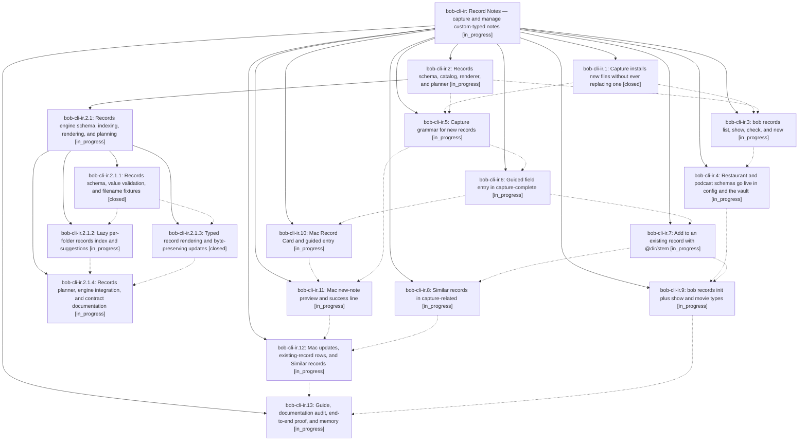

# Bead: bob-cli-ir — Record Notes — capture and manage custom-typed notes

[Bead Pages](../README.md) / bob-cli-ir

**Status:** ◐ in_progress · **Type:** ▸ plan · **Tier:** epic
**Owner:** `bryanbugyi34@gmail.com` · **Created by:** [bbugyi200.athena.1a0](https://github.com/bobs-org/bob-cli--agents/blob/main/sessions/bbugyi200.athena.1a0.md) · **Assignee:** `bob-cli-ir.land`
**Created:** 2026-11-08 11:06:11 EST
**Plan:** [202611/record\_notes.md](https://github.com/bobs-org/bob-cli--plans/blob/main/202611/record_notes.md)

<!-- sase:links:start -->

## Links

| Relation | Artifact | Why |
| --- | --- | --- |
| implemented-by | [plan:202611/record_notes.md][1] | derived from the plan's `bead_id:` frontmatter field |

_Plus 5 automatic references — see [Referenced By](#referenced-by)._

[1]: https://github.com/bobs-org/bob-cli--plans/blob/main/202611/record_notes.md

<!-- sase:links:end -->

## Description

Bryan can create and update notes of config-declared record types (restaurants, podcasts, TV shows, movies) from one capture spelling, `<title> @<dir>/`, with bob guiding every required field. The same engine powers a `bob records` CLI for agents and a lint that keeps every writer honest. The Mac panel shows a Record Card and a whole-note preview. Every write is planned in full, never replaces a file, and refuses duplicates.

## Notes

[2026-11-08T16:27:23Z · bryanbugyi34@gmail.com] The epic lander agent should add an excellent new glossary term for 'record note' before landing.

## Phases

| Bead | Title | Status | Size | Created | Agents | Commits |
|---|---|---|---|---|---:|---:|
| [bob-cli-ir.1](bob-cli-ir.1.md) | Capture installs new files without ever replacing one | ✓ closed | small | 2026-11-08 | 1 | 1 |
| [bob-cli-ir.10](bob-cli-ir.10.md) | Mac Record Card and guided entry | ◐ in_progress | large | 2026-11-08 | 1 | 0 |
| [bob-cli-ir.11](bob-cli-ir.11.md) | Mac new-note preview and success line | ◐ in_progress | large | 2026-11-08 | 1 | 0 |
| [bob-cli-ir.12](bob-cli-ir.12.md) | Mac updates, existing-record rows, and Similar records | ◐ in_progress | medium | 2026-11-08 | 1 | 0 |
| [bob-cli-ir.13](bob-cli-ir.13.md) | Guide, documentation audit, end-to-end proof, and memory | ◐ in_progress | small | 2026-11-08 | 1 | 0 |
| [bob-cli-ir.2](bob-cli-ir.2.md) | Records schema, catalog, renderer, and planner | ◐ in_progress | large | 2026-11-08 | 1 | 0 |
| [bob-cli-ir.3](bob-cli-ir.3.md) | bob records list, show, check, and new | ◐ in_progress | medium | 2026-11-08 | 1 | 0 |
| [bob-cli-ir.4](bob-cli-ir.4.md) | Restaurant and podcast schemas go live in config and the vault | ◐ in_progress | small | 2026-11-08 | 1 | 0 |
| [bob-cli-ir.5](bob-cli-ir.5.md) | Capture grammar for new records | ◐ in_progress | large | 2026-11-08 | 1 | 0 |
| [bob-cli-ir.6](bob-cli-ir.6.md) | Guided field entry in capture-complete | ◐ in_progress | large | 2026-11-08 | 1 | 0 |
| [bob-cli-ir.7](bob-cli-ir.7.md) | Add to an existing record with @dir/stem | ◐ in_progress | large | 2026-11-08 | 1 | 0 |
| [bob-cli-ir.8](bob-cli-ir.8.md) | Similar records in capture-related | ◐ in_progress | medium | 2026-11-08 | 1 | 0 |
| [bob-cli-ir.9](bob-cli-ir.9.md) | bob records init plus show and movie types | ◐ in_progress | medium | 2026-11-08 | 1 | 0 |

## Lineage

## Agents

| Agent | Bead | Commits |
|---|---|---:|
| [bbugyi200.athena.bob-cli-ir.1](https://github.com/bobs-org/bob-cli--agents/blob/main/agents/bbugyi200.athena.bob-cli-ir.1/README.md) | [bob-cli-ir.1](bob-cli-ir.1.md) | 1 |
| [bbugyi200.athena.bob-cli-ir.10](https://github.com/bobs-org/bob-cli--agents/blob/main/agents/bbugyi200.athena.bob-cli-ir.10/README.md) | [bob-cli-ir.10](bob-cli-ir.10.md) | 0 |
| [bbugyi200.athena.bob-cli-ir.11](https://github.com/bobs-org/bob-cli--agents/blob/main/agents/bbugyi200.athena.bob-cli-ir.11/README.md) | [bob-cli-ir.11](bob-cli-ir.11.md) | 0 |
| [bbugyi200.athena.bob-cli-ir.12](https://github.com/bobs-org/bob-cli--agents/blob/main/agents/bbugyi200.athena.bob-cli-ir.12/README.md) | [bob-cli-ir.12](bob-cli-ir.12.md) | 0 |
| [bbugyi200.athena.bob-cli-ir.13](https://github.com/bobs-org/bob-cli--agents/blob/main/agents/bbugyi200.athena.bob-cli-ir.13/README.md) | [bob-cli-ir.13](bob-cli-ir.13.md) | 0 |
| [bbugyi200.athena.bob-cli-ir.2](https://github.com/bobs-org/bob-cli--agents/blob/main/sessions/bbugyi200.athena.bob-cli-ir.2.md) | [bob-cli-ir.2](bob-cli-ir.2.md) | 0 |
| [bbugyi200.athena.bob-cli-ir.2.1.1](https://github.com/bobs-org/bob-cli--agents/blob/main/agents/bbugyi200.athena.bob-cli-ir.2.1.1/README.md) | [bob-cli-ir.2.1.1](bob-cli-ir.2.1.1.md) | 1 |
| [bbugyi200.athena.bob-cli-ir.2.1.2](https://github.com/bobs-org/bob-cli--agents/blob/main/agents/bbugyi200.athena.bob-cli-ir.2.1.2/README.md) | [bob-cli-ir.2.1.2](bob-cli-ir.2.1.2.md) | 0 |
| [bbugyi200.athena.bob-cli-ir.2.1.3](https://github.com/bobs-org/bob-cli--agents/blob/main/agents/bbugyi200.athena.bob-cli-ir.2.1.3/README.md) | [bob-cli-ir.2.1.3](bob-cli-ir.2.1.3.md) | 1 |
| [bbugyi200.athena.bob-cli-ir.2.1.4](https://github.com/bobs-org/bob-cli--agents/blob/main/agents/bbugyi200.athena.bob-cli-ir.2.1.4/README.md) | [bob-cli-ir.2.1.4](bob-cli-ir.2.1.4.md) | 0 |
| [bbugyi200.athena.bob-cli-ir.2.1.land](https://github.com/bobs-org/bob-cli--agents/blob/main/agents/bbugyi200.athena.bob-cli-ir.2.1.land/README.md) | [bob-cli-ir.2.1](bob-cli-ir.2.1.md) | 0 |
| [bbugyi200.athena.bob-cli-ir.3](https://github.com/bobs-org/bob-cli--agents/blob/main/agents/bbugyi200.athena.bob-cli-ir.3/README.md) | [bob-cli-ir.3](bob-cli-ir.3.md) | 0 |
| [bbugyi200.athena.bob-cli-ir.4](https://github.com/bobs-org/bob-cli--agents/blob/main/agents/bbugyi200.athena.bob-cli-ir.4/README.md) | [bob-cli-ir.4](bob-cli-ir.4.md) | 0 |
| [bbugyi200.athena.bob-cli-ir.5](https://github.com/bobs-org/bob-cli--agents/blob/main/agents/bbugyi200.athena.bob-cli-ir.5/README.md) | [bob-cli-ir.5](bob-cli-ir.5.md) | 0 |
| [bbugyi200.athena.bob-cli-ir.6](https://github.com/bobs-org/bob-cli--agents/blob/main/agents/bbugyi200.athena.bob-cli-ir.6/README.md) | [bob-cli-ir.6](bob-cli-ir.6.md) | 0 |
| [bbugyi200.athena.bob-cli-ir.7](https://github.com/bobs-org/bob-cli--agents/blob/main/agents/bbugyi200.athena.bob-cli-ir.7/README.md) | [bob-cli-ir.7](bob-cli-ir.7.md) | 0 |
| [bbugyi200.athena.bob-cli-ir.8](https://github.com/bobs-org/bob-cli--agents/blob/main/agents/bbugyi200.athena.bob-cli-ir.8/README.md) | [bob-cli-ir.8](bob-cli-ir.8.md) | 0 |
| [bbugyi200.athena.bob-cli-ir.9](https://github.com/bobs-org/bob-cli--agents/blob/main/agents/bbugyi200.athena.bob-cli-ir.9/README.md) | [bob-cli-ir.9](bob-cli-ir.9.md) | 0 |
| [bbugyi200.athena.bob-cli-ir.land](https://github.com/bobs-org/bob-cli--agents/blob/main/agents/bbugyi200.athena.bob-cli-ir.land/README.md) | [bob-cli-ir](README.md) | 0 |

## Commits

| Repo | Commit | Subject | Bead | Committed |
|---|---|---|---|---|
| bob-cli | [`971214d`](https://github.com/bobs-org/bob-cli/commit/971214d88b0eb9c7fe2a0199be7f6670645c668c) | feat(capture): install new notes without replacing existing files | [bob-cli-ir.1](bob-cli-ir.1.md) | 2026-11-08 11:29:27 EST |
| bob-cli | [`cd8a031`](https://github.com/bobs-org/bob-cli/commit/cd8a031f9bad5e5aee4ab88e3671e3d8afb9beb0) | feat(records): add schema validation and stem fixtures | [bob-cli-ir.2.1.1](bob-cli-ir.2.1.1.md) | 2026-11-08 11:52:23 EST |
| bob-cli | [`93c7c11`](https://github.com/bobs-org/bob-cli/commit/93c7c1145eeda40335a0c7002239ab3ae0221eff) | feat(records): add typed rendering and byte-preserving updates | [bob-cli-ir.2.1.3](bob-cli-ir.2.1.3.md) | 2026-11-08 12:32:57 EST |

<!-- sase:referenced-by:start -->

## Referenced By

| Relation | Artifact | Why | Uses |
| --- | --- | --- | ---: |
| read-by | [agent:research.3t.cdx][1] | Understand record notes scope, existing design, and intended workflows for independent cdx research | 1 |
| read-by | [agent:research.3t.cld][2] | Research context: user asked about record notes epic to evaluate its potential | 1 |
| read-by | [agent:research.3t.final][3] | Ground consolidated record-notes research in the epic's scope and status | 1 |
| read-by | [agent:research.3t.grk][4] | Need the Record Notes epic bead description, decisions, and notes as primary context | 2 |
| read-by | [agent:research.3t.mus][5] | research record notes unlock potential | 1 |

[1]: https://github.com/bobs-org/bob-cli--agents/blob/main/agents/bbugyi200.athena.research.3t.cdx/README.md
[2]: https://github.com/bobs-org/bob-cli--agents/blob/main/agents/bbugyi200.athena.research.3t.cld/README.md
[3]: https://github.com/bobs-org/bob-cli--agents/blob/main/agents/bbugyi200.athena.research.3t.final/README.md
[4]: https://github.com/bobs-org/bob-cli--agents/blob/main/agents/bbugyi200.athena.research.3t.grk/README.md
[5]: https://github.com/bobs-org/bob-cli--agents/blob/main/agents/bbugyi200.athena.research.3t.mus/README.md

<!-- sase:referenced-by:end -->
