# Bead: bob-cli-ir — Record Notes — capture and manage custom-typed notes

[Bead Pages](../README.md) / bob-cli-ir

**Status:** ✓ closed · **Resolution:** done · **Type:** ▸ plan · **Tier:** epic
**Owner:** `bryanbugyi34@gmail.com` · **Created by:** [bbugyi200.athena.1a0](https://github.com/bobs-org/bob-cli--agents/blob/main/sessions/bbugyi200.athena.1a0.md) · **Assignee:** `bob-cli-ir.land`
**Created:** 2026-11-08 11:06:11 EST · **Closed:** 2026-11-09 14:42:43 EST
**Plan:** [202611/record\_notes.md](https://github.com/bobs-org/bob-cli--plans/blob/main/202611/record_notes.md)

<!-- sase:links:start -->

## Links

| Relation | Artifact | Why |
| --- | --- | --- |
| implemented-by | [plan:202611/record_notes.md][1] | derived from the plan's `bead_id:` frontmatter field |

_Plus 11 automatic references — see [Referenced By](#referenced-by)._

[1]: https://github.com/bobs-org/bob-cli--plans/blob/main/202611/record_notes.md

<!-- sase:links:end -->

## Description

Bryan can create and update notes of config-declared record types (restaurants, podcasts, TV shows, movies) from one capture spelling, `<title> @<dir>/`, with bob guiding every required field. The same engine powers a `bob records` CLI for agents and a lint that keeps every writer honest. The Mac panel shows a Record Card and a whole-note preview. Every write is planned in full, never replaces a file, and refuses duplicates.

## Notes

[2026-11-08T16:27:23Z · bryanbugyi34@gmail.com] The epic lander agent should add an excellent new glossary term for 'record note' before landing.

[2026-11-09T13:59:48Z · bob-cli-ix.land] DISCOVERED ISSUE: Proposed by bob-cli-ix.3 note #1 and independently source-verified by bob-cli-ix.land on 7fe12b33: 44427b30 (bob-cli-ir.8) changed src/runner.rs capture-related about to List existing tasks and record notes a new capture may duplicate, but tests/fixtures/help/root-long.txt still says List existing tasks that a new capture may duplicate. Phase ix.3 reported help::root_help_matches_sectioned_short_and_long_snapshots failing. 262f3cfc refreshed only the records row, leaving this mismatch. Repair the capture-related root-long fixture within the causally owning Record Notes epic; no duplicate task was found by same-type/all-type searches or the one-week sweep. This lander did not rerun the Rust suite.

[2026-11-09T15:10:49Z · 1ac] DISCOVERED ISSUE: tests/cli/help.rs help::root_help_matches_sectioned_short_and_long_snapshots fails on master (7fe12b33). Phase bob-cli-ir.8 (commit 44427b30, 'feat(capture)!: show similar records in capture-related') changed the capture-related about text to 'List existing tasks and record notes a new capture may duplicate' in src/runner.rs:1012 and src/native/capture_related.rs:77, but did not refresh tests/fixtures/help/root-long.txt (still 'List existing tasks that a new capture may duplicate'). Repro: cargo test --test cli help::root_help_matches_sectioned_short_and_long_snapshots. Fix: refresh the root long-help snapshot (and check root-short.txt).

[2026-11-09T16:20:10Z · d5] DISCOVERED ISSUE: A record update that adds a NEW ALL-CAPS section (for example `@@eat/ninja_sushi` with `- MUST ORDER` / `  - Dragon roll`) writes `## Must Order` with no blank line before it: directly after the closing code fence of `## Source` on migrated notes, or after the last `## Notes` bullet on bob-created notes. Create inserts the blank line correctly.

Repro on master f231b9d3 with installed bob 0.5.0 in a throwaway vault: bob capture --dry-run -- "$(printf '%s\n' '@eat/ninja_sushi' '- MUST ORDER' '  - Dragon roll')" prints the fence line immediately followed by '## Must Order'; a real commit writes the same bytes.

Root cause: src/native/records/render.rs append_section_bullets, no-matching-heading branch (~line 1552), pushes the blank separator only when the last body line is non-blank AND has an empty line ending (a file without a trailing newline). A normal file ending in a newline skips the separator.

Fix: push a blank line whenever the last body line is non-blank, regardless of its ending; add goldens for notes ending in a fence and in a bullet. Impact: cosmetic (Obsidian still renders the heading) but breaks the note style. Found while researching record-note UX (research:202611/record_notes_capture_ux.md).

[2026-11-09T18:31:04Z · bob-cli-j6.land] DISCOVERED ISSUE: j6 landing audit reproduced just docs-check failures on bob-cli 4b59ae81 plus Mac ef5dc4a: json-outputs.md 6024, Mac capture-previews.md 6424, protocol.md 6048 (6000-word cap). bob-cli 84ff0bb8 (ir.11) added the record_note/refusal paragraph to json-outputs; Mac fe9ce15 (ir.11) and a5152aa (ir.12) grew record previews/protocol. Mac-page overages corroborated on existing bob-cli-h9 (+4); no duplicate task. Please reconcile these record-doc budgets as part of the Record Notes landing. j6 reduced its panel/keyboard edits and did not cause this growth.

[2026-11-09T18:31:08Z · bob-cli-j6.land] DISCOVERED ISSUE: j6 landing audit inspected exact-SHA Mac CI run 42673185238 for ef5dc4ab02138241f3f73b83e54df67d623fd00a (https://github.com/bobs-org/bob-mac-capture/actions/runs/42673185238). Build fails at CapturePanelModel.swift:15612 and CapturePanelView.swift:2096,2151: switch must be exhaustive; add missing case .addTo. CaptureRelatedAction.addTo was added by ir.12 commit a5152aa; these three AppKit/SwiftUI Add block ID prompt switches were not adapted. Tests/Bundle/Install were skipped. No duplicate found in ci/all-type searches or the one-week sweep. j6 closeout will accept an owning fix, or apply the minimal compile adaptation if still needed to verify aliases: addTo is a record splice and must not manufacture a task block-ID replacement.

[2026-11-09T19:09:42Z · bob-cli-ir.land] LANDER TRIAGE (bob-cli-ir.land, master 0a74731b + bob-mac-capture ef5dc4a). PROPOSED FOLLOW-UPs: (1) ir.3 #1 + ir.13 #1 Mac Capture pages over 6000 words: +1 on bob-cli-h9 (+5) for the pre-existing capture-panel.md 6013 / keyboard.md 6028; protocol.md 6048 and capture-previews.md 6424 were grown by ir.11 fe9ce15 / ir.12 a5152aa and are remaining epic work in the landing tale. (2) ir.4 #1 records CLI clippy redundant_closure: epic-caused, already fixed (project clippy gate passes); closed the stale task bob-cli-iw with that evidence. (3) ir.6 #2 ref_library timing flake: unrelated, +1 on existing bob-cli-hr. (4) ir.11 #1 SwiftUI preview, refusal card, success wiring, Mac verification: declined, completed later inside ir.11 (notes #3-#7, CI run 42663652552 green). ir.11 #1 docs-budget item: json-outputs record growth was trimmed by ir.13 4321fd70; the Mac part is item (1). (5) ir.11 #2 root help snapshot: declined, fixed by cb27f8bc (same as epic notes #2/#3; CLI help snapshot test passes). DISCOVERED ISSUES: #4 blank line before a new update section and #6 the Mac .addTo exhaustive-switch build break both reproduce and are remaining epic work; #5 json-outputs is now over again (6117) because of j8.1 0a74731b, not Record Notes, recorded as DISCOVERED ISSUE on bob-cli-j8 together with j8.1's four just check lib failures. Integration: the vault-free capture-rewrite spaced aliases (iu.1 '.'->'@', j6 '.'->'&' and ';'->'*') fire inside opaque record field values, recorded as DISCOVERED ISSUE on active bob-cli-j6 rather than edited here, to avoid colliding with j6's in-flight landing tale. Declined consolidating ad-hoc no-clobber hard-link installs (capture/commit.rs, gmail, periods, j5 archive engine): each has distinct fallback/recovery semantics and no defect. Note #1's record-note glossary request goes to the landing tale as a requested memory decision, because the original reviewer decision was no.

[2026-11-09T19:36:23Z · bob-cli-ir.land] PROPOSED FOLLOW-UP: add glossary:record-note (aliases: record, record type) — landing auto-decision memory_glossary_record_note was no with no human review, so this lander did not create the strand. Bryan's epic note #1 still asks the lander to add it before landing. When a later worker does this, use /sase_memory_write, model the strand on glossary:notebook after reading glossary:notebook and glossary:capture, define it from docs/records.md (~120–180 words: config-declared type, dir/stem path, YAML type+fields, H1 plus ## Notes dated bullets, capture `<title> @<dir>/` create and `@<dir>/<stem>` update, `bob records list|show|check|new|update|init`, planned full writes that never replace a file, not a project-note/reference-note/notebook/task residence), then `sase memory init` and `just docs-gen`.

[2026-11-09T19:38:06Z · 1al--code] RESOLVED (note #6): the .addTo exhaustive-switch build break is fixed on master by 3131414 (j9.3 typing-tips commit, which bundled the adaptation). Root cause: ir.12 commit a5152aa added case addTo to CaptureRelatedAction in Sources/CaptureCore/CaptureRelatedModels.swift without adapting the three exhaustive switches in the BobMacCapture target (CapturePanelModel.completeSimilarTaskIDAssignment, CapturePanelView.linkInsertsLine(for:) inner switch under case .similarTask, CapturePanelView.similarTaskInsertsText(route:typed:action:)). Why it shipped: ir.12 note #1 claims 'swift build + swift test green' with 'Mac typecheck/macos-ci not run from Linux'; just portable-check cannot type-check Sources/BobMacCapture*, and the scratch Mac compile plus Scripts/macos-ci-check that bob-mac-capture AGENTS.md requires never ran before the phase closed. Impact: master red at Build since a5152aa (runs 42672189863 and 42673185238), and Bryan's just install-all failed on the Mac 2026-11-09 13:54 EST. The fix adds no-task-ID .addTo cases in all three switches (landed bodies return empty rather than the tale's draft 'Updates record text'; equivalent since unreachable: record rows emit requires_block_id None in src/native/capture_related/records.rs, so similarApply and the pending-action path only present the ID prompt when requiresBlockID is true, and the model branch reports the update-Bob error and never splices). Verification: exact-SHA CI run 42680342242 for 3131414 has Build success (Lint success, Check scripts success); Test has 2 failures recorded separately below/on j6. Mac just portable-check green on the linked checkout (2390 tests, 0 failures). install_excerpt outcome: fixed in bob-cli scripts/lib/install_ui/live.py _failure_excerpt, which now starts the 40-line excerpt at the first case-sensitive real diagnostic label ((?:^|[\s:])error(?:\[[^\]]*\])?: matching swiftc file:line:col error:, rustc error[E...]:, cargo/just error:, Swift caret |- error:) before falling back to the old case-insensitive substring and then the last 20 lines. This is why the reported output hid the errors: every Swift 6 warning ends 'this is an error in the Swift 6 language mode', so the old substring search started the excerpt at the first Sendable warning (log line 7) and the real errors at lines 496-558 were never shown. Unit tests FailureExcerptTests added in scripts/lib/install_ui/tests/test_live.py (4 tests pass; the Swift-6-skipping test fails on the old code). just check-scripts passes except pre-existing PTY-timing test_real_cargo_install_transcript, which fails identically on the untouched base.

[2026-11-09T19:38:18Z · 1al--code] DISCOVERED ISSUE (record_row_gaps = note; source-verified only, not reproduced; neither affects the build): two latent record-row Add to it defects. D1, native-editor range: in CapturePan

… and 4402 more characters

## Phases

| Bead | Title | Status | Size | Created | Agents | Commits |
|---|---|---|---|---|---:|---:|
| [bob-cli-ir.1](bob-cli-ir.1.md) | Capture installs new files without ever replacing one | ✓ closed | small | 2026-11-08 | 1 | 1 |
| [bob-cli-ir.10](bob-cli-ir.10.md) | Mac Record Card and guided entry | ✓ closed | large | 2026-11-08 | 1 | 0 |
| [bob-cli-ir.11](bob-cli-ir.11.md) | Mac new-note preview and success line | ✓ closed | large | 2026-11-08 | 1 | 3 |
| [bob-cli-ir.12](bob-cli-ir.12.md) | Mac updates, existing-record rows, and Similar records | ✓ closed | medium | 2026-11-08 | 1 | 1 |
| [bob-cli-ir.13](bob-cli-ir.13.md) | Guide, documentation audit, end-to-end proof, and memory | ✓ closed | small | 2026-11-08 | 1 | 1 |
| [bob-cli-ir.2](bob-cli-ir.2.md) | Records schema, catalog, renderer, and planner | ✓ closed | large | 2026-11-08 | 1 | 0 |
| [bob-cli-ir.3](bob-cli-ir.3.md) | bob records list, show, check, and new | ✓ closed | medium | 2026-11-08 | 1 | 1 |
| [bob-cli-ir.4](bob-cli-ir.4.md) | Restaurant and podcast schemas go live in config and the vault | ✓ closed | small | 2026-11-08 | 1 | 0 |
| [bob-cli-ir.5](bob-cli-ir.5.md) | Capture grammar for new records | ✓ closed | large | 2026-11-08 | 1 | 0 |
| [bob-cli-ir.6](bob-cli-ir.6.md) | Guided field entry in capture-complete | ✓ closed | large | 2026-11-08 | 1 | 1 |
| [bob-cli-ir.7](bob-cli-ir.7.md) | Add to an existing record with @dir/stem | ✓ closed | large | 2026-11-08 | 1 | 0 |
| [bob-cli-ir.8](bob-cli-ir.8.md) | Similar records in capture-related | ✓ closed | medium | 2026-11-08 | 1 | 1 |
| [bob-cli-ir.9](bob-cli-ir.9.md) | bob records init plus show and movie types | ✓ closed | medium | 2026-11-08 | 1 | 1 |

## Lineage

```mermaid
flowchart TD
    n0["bob-cli-ir: Record Notes — capture and manage custom-typed notes [closed]"]
    n1["bob-cli-ir.1: Capture installs new files without ever replacing one [closed]"]
    n2["bob-cli-ir.10: Mac Record Card and guided entry [closed]"]
    n3["bob-cli-ir.10.1: Mac Record Card and guided entry [closed]"]
    n4["bob-cli-ir.10.1.1: Address Record Card fields through Bob completion [closed]"]
    n5["bob-cli-ir.10.1.2: Decode records and define portable card state [closed]"]
    n6["bob-cli-ir.10.1.3: Connect record completion and keyboard entry [closed]"]
    n7["bob-cli-ir.10.1.4: Render the Record Card and semantic editor styling [closed]"]
    n8["bob-cli-ir.11: Mac new-note preview and success line [closed]"]
    n9["bob-cli-ir.12: Mac updates, existing-record rows, and Similar records [closed]"]
    n10["bob-cli-ir.13: Guide, documentation audit, end-to-end proof, and memory [closed]"]
    n11["bob-cli-ir.2: Records schema, catalog, renderer, and planner [closed]"]
    n12["bob-cli-ir.2.1: Records engine schema, indexing, rendering, and planning [closed]"]
    n13["bob-cli-ir.2.1.1: Records schema, value validation, and filename fixtures [closed]"]
    n14["bob-cli-ir.2.1.2: Lazy per-folder records index and suggestions [closed]"]
    n15["bob-cli-ir.2.1.3: Typed record rendering and byte-preserving updates [closed]"]
    n16["bob-cli-ir.2.1.4: Records planner, engine integration, and contract documentation [closed]"]
    n17["bob-cli-ir.3: bob records list, show, check, and new [closed]"]
    n18["bob-cli-ir.4: Restaurant and podcast schemas go live in config and the vault [closed]"]
    n19["bob-cli-ir.5: Capture grammar for new records [closed]"]
    n20["bob-cli-ir.5.1: Capture creates record notes [closed]"]
    n21["bob-cli-ir.5.1.1: Recognize record items before task marker parsing [closed]"]
    n22["bob-cli-ir.5.1.2: Resolve record metadata and expose discovery rows [closed]"]
    n23["bob-cli-ir.5.1.3: Create records through the capture transaction [closed]"]
    n24["bob-cli-ir.5.1.4: Publish the record capture contract and acceptance evidence [closed]"]
    n25["bob-cli-ir.6: Guided field entry in capture-complete [closed]"]
    n26["bob-cli-ir.7: Add to an existing record with @dir/stem [closed]"]
    n27["bob-cli-ir.7.1: Existing-record updates through capture and the records CLI [closed]"]
    n28["bob-cli-ir.7.1.1: Shared snapshot-based record update planner [closed]"]
    n29["bob-cli-ir.7.1.2: Record update grammar and editor parse [closed]"]
    n30["bob-cli-ir.7.1.3: Transactional capture updates and exact previews [closed]"]
    n31["bob-cli-ir.7.1.4: Existing-record completion and Add to it fixes [closed]"]
    n32["bob-cli-ir.7.1.5: Records update CLI and dependent shell completion [closed]"]
    n33["bob-cli-ir.8: Similar records in capture-related [closed]"]
    n34["bob-cli-ir.9: bob records init plus show and movie types [closed]"]
    n0 --> n1
    n0 --> n2
    n2 --> n3
    n3 --> n4
    n3 --> n5
    n3 --> n6
    n3 --> n7
    n0 --> n8
    n0 --> n9
    n0 --> n10
    n0 --> n11
    n11 --> n12
    n12 --> n13
    n12 --> n14
    n12 --> n15
    n12 --> n16
    n0 --> n17
    n0 --> n18
    n0 --> n19
    n19 --> n20
    n20 --> n21
    n20 --> n22
    n20 --> n23
    n20 --> n24
    n0 --> n25
    n0 --> n26
    n26 --> n27
    n27 --> n28
    n27 --> n29
    n27 --> n30
    n27 --> n31
    n27 --> n32
    n0 --> n33
    n0 --> n34
    n1 -.-> n17
    n1 -.-> n19
    n2 -.-> n8
    n4 -.-> n5
    n5 -.-> n6
    n6 -.-> n7
    n8 -.-> n9
    n9 -.-> n10
    n11 -.-> n17
    n11 -.-> n19
    n13 -.-> n14
    n13 -.-> n15
    n14 -.-> n16
    n15 -.-> n16
    n17 -.-> n18
    n18 -.-> n34
    n19 -.-> n8
    n19 -.-> n25
    n21 -.-> n22
    n22 -.-> n23
    n23 -.-> n24
    n25 -.-> n2
    n25 -.-> n26
    n26 -.-> n33
    n26 -.-> n34
    n28 -.-> n29
    n29 -.-> n30
    n30 -.-> n31
    n30 -.-> n32
    n33 -.-> n9
    n34 -.-> n10
```

## Agents

| Agent | Bead | Commits |
|---|---|---:|
| [bbugyi200.athena.bob-cli-ir.1](https://github.com/bobs-org/bob-cli--agents/blob/main/agents/bbugyi200.athena.bob-cli-ir.1/README.md) | [bob-cli-ir.1](bob-cli-ir.1.md) | 1 |
| [bbugyi200.athena.bob-cli-ir.10](https://github.com/bobs-org/bob-cli--agents/blob/main/sessions/bbugyi200.athena.bob-cli-ir.10.md) | [bob-cli-ir.10](bob-cli-ir.10.md) | 0 |
| [bbugyi200.athena.bob-cli-ir.10.1.1](https://github.com/bobs-org/bob-cli--agents/blob/main/agents/bbugyi200.athena.bob-cli-ir.10.1.1/README.md) | [bob-cli-ir.10.1.1](bob-cli-ir.10.1.1.md) | 1 |
| [bbugyi200.athena.bob-cli-ir.10.1.2](https://github.com/bobs-org/bob-cli--agents/blob/main/agents/bbugyi200.athena.bob-cli-ir.10.1.2/README.md) | [bob-cli-ir.10.1.2](bob-cli-ir.10.1.2.md) | 1 |
| [bbugyi200.athena.bob-cli-ir.10.1.3](https://github.com/bobs-org/bob-cli--agents/blob/main/agents/bbugyi200.athena.bob-cli-ir.10.1.3/README.md) | [bob-cli-ir.10.1.3](bob-cli-ir.10.1.3.md) | 1 |
| [bbugyi200.athena.bob-cli-ir.10.1.4](https://github.com/bobs-org/bob-cli--agents/blob/main/sessions/bbugyi200.athena.bob-cli-ir.10.1.4.md) | [bob-cli-ir.10.1.4](bob-cli-ir.10.1.4.md) | 2 |
| [bbugyi200.athena.bob-cli-ir.10.1.land](https://github.com/bobs-org/bob-cli--agents/blob/main/sessions/bbugyi200.athena.bob-cli-ir.10.1.land.md) | [bob-cli-ir.10.1](bob-cli-ir.10.1.md) | 3 |
| [bbugyi200.athena.bob-cli-ir.11](https://github.com/bobs-org/bob-cli--agents/blob/main/sessions/bbugyi200.athena.bob-cli-ir.11.md) | [bob-cli-ir.11](bob-cli-ir.11.md) | 3 |
| [bbugyi200.athena.bob-cli-ir.12](https://github.com/bobs-org/bob-cli--agents/blob/main/agents/bbugyi200.athena.bob-cli-ir.12/README.md) | [bob-cli-ir.12](bob-cli-ir.12.md) | 1 |
| [bbugyi200.athena.bob-cli-ir.13](https://github.com/bobs-org/bob-cli--agents/blob/main/agents/bbugyi200.athena.bob-cli-ir.13/README.md) | [bob-cli-ir.13](bob-cli-ir.13.md) | 1 |
| [bbugyi200.athena.bob-cli-ir.2](https://github.com/bobs-org/bob-cli--agents/blob/main/sessions/bbugyi200.athena.bob-cli-ir.2.md) | [bob-cli-ir.2](bob-cli-ir.2.md) | 0 |
| [bbugyi200.athena.bob-cli-ir.2.1.1](https://github.com/bobs-org/bob-cli--agents/blob/main/agents/bbugyi200.athena.bob-cli-ir.2.1.1/README.md) | [bob-cli-ir.2.1.1](bob-cli-ir.2.1.1.md) | 1 |
| [bbugyi200.athena.bob-cli-ir.2.1.2](https://github.com/bobs-org/bob-cli--agents/blob/main/agents/bbugyi200.athena.bob-cli-ir.2.1.2/README.md) | [bob-cli-ir.2.1.2](bob-cli-ir.2.1.2.md) | 1 |
| [bbugyi200.athena.bob-cli-ir.2.1.3](https://github.com/bobs-org/bob-cli--agents/blob/main/agents/bbugyi200.athena.bob-cli-ir.2.1.3/README.md) | [bob-cli-ir.2.1.3](bob-cli-ir.2.1.3.md) | 1 |
| [bbugyi200.athena.bob-cli-ir.2.1.4](https://github.com/bobs-org/bob-cli--agents/blob/main/agents/bbugyi200.athena.bob-cli-ir.2.1.4/README.md) | [bob-cli-ir.2.1.4](bob-cli-ir.2.1.4.md) | 1 |
| [bbugyi200.athena.bob-cli-ir.2.1.land](https://github.com/bobs-org/bob-cli--agents/blob/main/agents/bbugyi200.athena.bob-cli-ir.2.1.land/README.md) | [bob-cli-ir.2.1](bob-cli-ir.2.1.md) | 3 |
| [bbugyi200.athena.bob-cli-ir.3](https://github.com/bobs-org/bob-cli--agents/blob/main/agents/bbugyi200.athena.bob-cli-ir.3/README.md) | [bob-cli-ir.3](bob-cli-ir.3.md) | 1 |
| [bbugyi200.athena.bob-cli-ir.4](https://github.com/bobs-org/bob-cli--agents/blob/main/agents/bbugyi200.athena.bob-cli-ir.4/README.md) | [bob-cli-ir.4](bob-cli-ir.4.md) | 0 |
| [bbugyi200.athena.bob-cli-ir.5](https://github.com/bobs-org/bob-cli--agents/blob/main/sessions/bbugyi200.athena.bob-cli-ir.5.md) | [bob-cli-ir.5](bob-cli-ir.5.md) | 0 |
| [bbugyi200.athena.bob-cli-ir.5.1.1](https://github.com/bobs-org/bob-cli--agents/blob/main/agents/bbugyi200.athena.bob-cli-ir.5.1.1/README.md) | [bob-cli-ir.5.1.1](bob-cli-ir.5.1.1.md) | 1 |
| [bbugyi200.athena.bob-cli-ir.5.1.2](https://github.com/bobs-org/bob-cli--agents/blob/main/agents/bbugyi200.athena.bob-cli-ir.5.1.2/README.md) | [bob-cli-ir.5.1.2](bob-cli-ir.5.1.2.md) | 1 |
| [bbugyi200.athena.bob-cli-ir.5.1.3](https://github.com/bobs-org/bob-cli--agents/blob/main/agents/bbugyi200.athena.bob-cli-ir.5.1.3/README.md) | [bob-cli-ir.5.1.3](bob-cli-ir.5.1.3.md) | 1 |
| [bbugyi200.athena.bob-cli-ir.5.1.4](https://github.com/bobs-org/bob-cli--agents/blob/main/sessions/bbugyi200.athena.bob-cli-ir.5.1.4.md) | [bob-cli-ir.5.1.4](bob-cli-ir.5.1.4.md) | 1 |
| [bbugyi200.athena.bob-cli-ir.5.1.land](https://github.com/bobs-org/bob-cli--agents/blob/main/sessions/bbugyi200.athena.bob-cli-ir.5.1.land.md) | [bob-cli-ir.5.1](bob-cli-ir.5.1.md) | 2 |
| [bbugyi200.athena.bob-cli-ir.6](https://github.com/bobs-org/bob-cli--agents/blob/main/sessions/bbugyi200.athena.bob-cli-ir.6.md) | [bob-cli-ir.6](bob-cli-ir.6.md) | 1 |
| [bbugyi200.athena.bob-cli-ir.7](https://github.com/bobs-org/bob-cli--agents/blob/main/sessions/bbugyi200.athena.bob-cli-ir.7.md) | [bob-cli-ir.7](bob-cli-ir.7.md) | 0 |
| [bbugyi200.athena.bob-cli-ir.7.1.1](https://github.com/bobs-org/bob-cli--agents/blob/main/agents/bbugyi200.athena.bob-cli-ir.7.1.1/README.md) | [bob-cli-ir.7.1.1](bob-cli-ir.7.1.1.md) | 1 |
| [bbugyi200.athena.bob-cli-ir.7.1.2](https://github.com/bobs-org/bob-cli--agents/blob/main/agents/bbugyi200.athena.bob-cli-ir.7.1.2/README.md) | [bob-cli-ir.7.1.2](bob-cli-ir.7.1.2.md) | 1 |
| [bbugyi200.athena.bob-cli-ir.7.1.3](https://github.com/bobs-org/bob-cli--agents/blob/main/agents/bbugyi200.athena.bob-cli-ir.7.1.3/README.md) | [bob-cli-ir.7.1.3](bob-cli-ir.7.1.3.md) | 1 |
| [bbugyi200.athena.bob-cli-ir.7.1.4](https://github.com/bobs-org/bob-cli--agents/blob/main/agents/bbugyi200.athena.bob-cli-ir.7.1.4/README.md) | [bob-cli-ir.7.1.4](bob-cli-ir.7.1.4.md) | 1 |
| [bbugyi200.athena.bob-cli-ir.7.1.5](https://github.com/bobs-org/bob-cli--agents/blob/main/agents/bbugyi200.athena.bob-cli-ir.7.1.5/README.md) | [bob-cli-ir.7.1.5](bob-cli-ir.7.1.5.md) | 1 |
| [bbugyi200.athena.bob-cli-ir.7.1.land](https://github.com/bobs-org/bob-cli--agents/blob/main/sessions/bbugyi200.athena.bob-cli-ir.7.1.land.md) | [bob-cli-ir.7.1](bob-cli-ir.7.1.md) | 2 |
| [bbugyi200.athena.bob-cli-ir.8](https://github.com/bobs-org/bob-cli--agents/blob/main/agents/bbugyi200.athena.bob-cli-ir.8/README.md) | [bob-cli-ir.8](bob-cli-ir.8.md) | 1 |
| [bbugyi200.athena.bob-cli-ir.9](https://github.com/bobs-org/bob-cli--agents/blob/main/sessions/bbugyi200.athena.bob-cli-ir.9.md) | [bob-cli-ir.9](bob-cli-ir.9.md) | 1 |
| [bbugyi200.athena.bob-cli-ir.land](https://github.com/bobs-org/bob-cli--agents/blob/main/sessions/bbugyi200.athena.bob-cli-ir.land.md) | [bob-cli-ir](README.md) | 3 |

## Commits

| Repo | Commit | Subject | Bead | Committed |
|---|---|---|---|---|
| bob-cli | [`971214d`](https://github.com/bobs-org/bob-cli/commit/971214d88b0eb9c7fe2a0199be7f6670645c668c) | feat(capture): install new notes without replacing existing files | [bob-cli-ir.1](bob-cli-ir.1.md) | 2026-11-08 11:29:27 EST |
| bob-cli | [`cd8a031`](https://github.com/bobs-org/bob-cli/commit/cd8a031f9bad5e5aee4ab88e3671e3d8afb9beb0) | feat(records): add schema validation and stem fixtures | [bob-cli-ir.2.1.1](bob-cli-ir.2.1.1.md) | 2026-11-08 11:52:23 EST |
| bob-cli | [`93c7c11`](https://github.com/bobs-org/bob-cli/commit/93c7c1145eeda40335a0c7002239ab3ae0221eff) | feat(records): add typed rendering and byte-preserving updates | [bob-cli-ir.2.1.3](bob-cli-ir.2.1.3.md) | 2026-11-08 12:32:57 EST |
| bob-cli | [`b9db700`](https://github.com/bobs-org/bob-cli/commit/b9db7007934c7ef97343ba998704934374cf8732) | feat(records): add lazy per-folder catalog index and suggestions | [bob-cli-ir.2.1.2](bob-cli-ir.2.1.2.md) | 2026-11-08 12:46:11 EST |
| bob-cli | [`a8ccf5e`](https://github.com/bobs-org/bob-cli/commit/a8ccf5ed100eedab812b56093ae890d39a29b047) | feat(records): add side-effect-free creation planner | [bob-cli-ir.2.1.4](bob-cli-ir.2.1.4.md) | 2026-11-08 13:23:14 EST |
| bob-cli | [`8ff0d8e`](https://github.com/bobs-org/bob-cli/commit/8ff0d8ed5a43b34977a6acaf4473159fe977e600) | feat(records): harden planning and byte-preserving updates | [bob-cli-ir.2.1](bob-cli-ir.2.1.md) | 2026-11-08 14:25:40 EST |
| bob-cli | [`361974f`](https://github.com/bobs-org/bob-cli/commit/361974f48eef7e2ba1fdc8ad97a1916835a6d20b) | fix(records): map stemless titles to record\_title and document engine allowances | [bob-cli-ir.2.1](bob-cli-ir.2.1.md) | 2026-11-08 18:15:09 EST |
| bob-cli--plans | [`bob-cli--plans@1b530a4`](https://github.com/bobs-org/bob-cli--plans/commit/1b530a431b8b0a68bc5d28f1671910b224f30036) | chore(plans): mark records engine epic done | [bob-cli-ir.2.1](bob-cli-ir.2.1.md) | 2026-11-08 18:15:40 EST |
| bob-cli | [`3e68a53`](https://github.com/bobs-org/bob-cli/commit/3e68a53acd5c75feaf4f26fb6dab206f2a1a84aa) | feat(records): add records CLI and docs | [bob-cli-ir.3](bob-cli-ir.3.md) | 2026-11-08 19:04:25 EST |
| bob-cli | [`83ad74e`](https://github.com/bobs-org/bob-cli/commit/83ad74e2f8138b6d94ba745380a9f012ce08d104) | feat(capture): add shared record route classifier with fail-closed execution | [bob-cli-ir.5.1.1](bob-cli-ir.5.1.1.md) | 2026-11-08 19:56:49 EST |
| bob-cli | [`4c97ed4`](https://github.com/bobs-org/bob-cli/commit/4c97ed416f3cc8fa066353a34d52d7757b845009) | feat(capture): resolve record metadata and expose targets | [bob-cli-ir.5.1.2](bob-cli-ir.5.1.2.md) | 2026-11-08 20:52:30 EST |
| bob-cli | [`f2561f9`](https://github.com/bobs-org/bob-cli/commit/f2561f962f5f91392d9721e094ac71f31e6832b3) | feat(capture): create record notes through the capture transaction | [bob-cli-ir.5.1.3](bob-cli-ir.5.1.3.md) | 2026-11-08 21:49:05 EST |
| bob-cli | [`e081e72`](https://github.com/bobs-org/bob-cli/commit/e081e729c5d30152df19e2a9173d067be6dacd8d) | docs(capture): publish the record note capture contract | [bob-cli-ir.5.1.4](bob-cli-ir.5.1.4.md) | 2026-11-08 22:59:07 EST |
| bob-cli | [`80c9320`](https://github.com/bobs-org/bob-cli/commit/80c93209aa6857a178beba3ba293755198300848) | fix(capture)!: complete record claiming and preview contracts | [bob-cli-ir.5.1](bob-cli-ir.5.1.md) | 2026-11-09 00:30:51 EST |
| bob-cli--plans | [`bob-cli--plans@903dd39`](https://github.com/bobs-org/bob-cli--plans/commit/903dd39e46ee3ab3f21e34f3f97208acf6715a55) | docs(plans): mark record capture creation phase done | [bob-cli-ir.5.1](bob-cli-ir.5.1.md) | 2026-11-09 00:31:31 EST |
| bob-cli | [`07ff3bf`](https://github.com/bobs-org/bob-cli/commit/07ff3bf01fd4dad8d8ebf287035877bfd43df90b) | feat(capture): add guided record field completion | [bob-cli-ir.6](bob-cli-ir.6.md) | 2026-11-09 02:34:23 EST |
| bob-cli | [`8cc4a75`](https://github.com/bobs-org/bob-cli/commit/8cc4a754ef194cc89d6e0f5df66c5fc8d3e31378) | feat(records): add shared plan update target resolution over byte-preserving edit | [bob-cli-ir.7.1.1](bob-cli-ir.7.1.1.md) | 2026-11-09 03:16:39 EST |
| bob-cli | [`5e49fa5`](https://github.com/bobs-org/bob-cli/commit/5e49fa5e5309347f4b9f6854b6dc5d4a67658d7c) | feat(capture): address named Record Card fields in complete | [bob-cli-ir.10.1.1](bob-cli-ir.10.1.1.md) | 2026-11-09 03:38:41 EST |
| bob-mac-capture | [`bob-mac-capture@1e6fb18`](https://github.com/bobs-org/bob-mac-capture/commit/1e6fb187bb0a2725608255db40b8088a8ac4008f) | feat(mac-capture): decode records and define portable card state | [bob-cli-ir.10.1.2](bob-cli-ir.10.1.2.md) | 2026-11-09 04:06:33 EST |
| bob-cli | [`1264176`](https://github.com/bobs-org/bob-cli/commit/126417682efc6774a8257e6abef6c638d6e24fb7) | feat(capture): parse existing record updates | [bob-cli-ir.7.1.2](bob-cli-ir.7.1.2.md) | 2026-11-09 04:19:04 EST |
| bob-cli | [`9619605`](https://github.com/bobs-org/bob-cli/commit/9619605252da7e0a67c9172a12bd745c0561cbd1) | feat(capture): write existing record updates transactionally | [bob-cli-ir.7.1.3](bob-cli-ir.7.1.3.md) | 2026-11-09 05:03:01 EST |
| bob-mac-capture | [`bob-mac-capture@7933c7e`](https://github.com/bobs-org/bob-mac-capture/commit/7933c7e01f291d688e8d7aad8b4c1f3713a2229e) | feat(capture): complete record card keyboard flow | [bob-cli-ir.10.1.3](bob-cli-ir.10.1.3.md) | 2026-11-09 05:12:40 EST |
| bob-cli | [`1c4939b`](https://github.com/bobs-org/bob-cli/commit/1c4939b9135043ed99019ce5886799487e0b202c) | feat(records)!: add records update CLI with shell completion | [bob-cli-ir.7.1.5](bob-cli-ir.7.1.5.md) | 2026-11-09 05:45:03 EST |
| bob-cli | [`a729a8f`](https://github.com/bobs-org/bob-cli/commit/a729a8fdc448d047413d67330cd683f1cc176b59) | feat(capture): add update-aware record assistance | [bob-cli-ir.7.1.4](bob-cli-ir.7.1.4.md) | 2026-11-09 05:50:38 EST |
| bob-mac-capture | [`bob-mac-capture@8c13ac4`](https://github.com/bobs-org/bob-mac-capture/commit/8c13ac44c1e318be27b60c3b9007f9cc904fbe54) | feat(capture): render the Record Card in the picker slot | [bob-cli-ir.10.1.4](bob-cli-ir.10.1.4.md) | 2026-11-09 06:06:23 EST |
| bob-mac-capture | [`bob-mac-capture@4bca5da`](https://github.com/bobs-org/bob-mac-capture/commit/4bca5da078afd182d3bf38b5eac1219db338008d) | fix(capture): distinguish set-value tints from the record route chip | [bob-cli-ir.10.1.4](bob-cli-ir.10.1.4.md) | 2026-11-09 06:40:45 EST |
| bob-cli | [`941ee72`](https://github.com/bobs-org/bob-cli/commit/941ee724de7c4767e02623585ad62a0893ca98d2) | feat(capture): land existing-record update fixes | [bob-cli-ir.7.1](bob-cli-ir.7.1.md) | 2026-11-09 07:07:20 EST |
| bob-cli--plans | [`bob-cli--plans@2c460ed`](https://github.com/bobs-org/bob-cli--plans/commit/2c460ed80578757da28538e6fab158886d7d3e74) | docs(plans): mark record append landing done | [bob-cli-ir.7.1](bob-cli-ir.7.1.md) | 2026-11-09 07:08:07 EST |
| bob-cli | [`44427b3`](https://github.com/bobs-org/bob-cli/commit/44427b30fab9705a7f0569d8588a1d9767d57d34) | feat(capture)!: show similar records in capture-related | [bob-cli-ir.8](bob-cli-ir.8.md) | 2026-11-09 07:47:09 EST |
| bob-cli | [`262f3cf`](https://github.com/bobs-org/bob-cli/commit/262f3cfcbf594449a247bb5925e10ba7ca89fb34) | feat(records): add records init CLI to scaffold type notes and Bases | [bob-cli-ir.9](bob-cli-ir.9.md) | 2026-11-09 08:25:16 EST |
| bob-mac-capture | [`bob-mac-capture@c09e2bc`](https://github.com/bobs-org/bob-mac-capture/commit/c09e2bcd6538e90c56030374900550a1d6053817) | fix(capture): agree Record Card completion with keyboard acceptance | [bob-cli-ir.10.1](bob-cli-ir.10.1.md) | 2026-11-09 08:28:34 EST |
| bob-mac-capture | [`bob-mac-capture@eded3b9`](https://github.com/bobs-org/bob-mac-capture/commit/eded3b9ca680244939ec9c69a71dac7484e4b683) | fix(capture): keep Record Return through last-field analysis | [bob-cli-ir.10.1](bob-cli-ir.10.1.md) | 2026-11-09 09:10:10 EST |
| bob-cli--plans | [`bob-cli--plans@9b8ff3a`](https://github.com/bobs-org/bob-cli--plans/commit/9b8ff3a160676ea8b2ecad76bca8316fc064ae96) | docs(plans): mark mac\_record\_card epic plan done | [bob-cli-ir.10.1](bob-cli-ir.10.1.md) | 2026-11-09 09:40:12 EST |
| bob-cli | [`84ff0bb`](https://github.com/bobs-org/bob-cli/commit/84ff0bb8ed9dd12bfc9dc5741319b30ccf26a93a) | feat(capture): add per-item record\_note summary to record JSON output | [bob-cli-ir.11](bob-cli-ir.11.md) | 2026-11-09 11:38:45 EST |
| bob-mac-capture | [`bob-mac-capture@fe9ce15`](https://github.com/bobs-org/bob-mac-capture/commit/fe9ce1533d87fb6179adf4b49327869af2850165) | feat(capture): add record preview presentation, SwiftUI views, and fixtures | [bob-cli-ir.11](bob-cli-ir.11.md) | 2026-11-09 11:39:24 EST |
| bob-mac-capture | [`bob-mac-capture@2f1d6dd`](https://github.com/bobs-org/bob-mac-capture/commit/2f1d6dd8b32771ee8f24550947fa831c8bfed04d) | test(capture): settle record preview panel tests on CI | [bob-cli-ir.11](bob-cli-ir.11.md) | 2026-11-09 12:47:23 EST |
| bob-mac-capture | [`bob-mac-capture@a5152aa`](https://github.com/bobs-org/bob-mac-capture/commit/a5152aa516fce9644c77624022f78973f8f9517b) | feat(mac-capture): show record updates, existing-record rows, and Similar records | [bob-cli-ir.12](bob-cli-ir.12.md) | 2026-11-09 13:13:48 EST |
| bob-cli | [`4321fd7`](https://github.com/bobs-org/bob-cli/commit/4321fd707f4e5da53d33bf483a3411e2ef5615d2) | docs(records): trim JSON reference under budget | [bob-cli-ir.13](bob-cli-ir.13.md) | 2026-11-09 13:28:08 EST |
| bob-cli | [`d7b339d`](https://github.com/bobs-org/bob-cli/commit/d7b339d0c0f76fb35dc907d065bc684ea6738f26) | fix(records): insert a blank line before a new named update section | [bob-cli-ir](README.md) | 2026-11-09 14:43:59 EST |
| bob-mac-capture | [`bob-mac-capture@5987de4`](https://github.com/bobs-org/bob-mac-capture/commit/5987de454a1c6846c7ec37559b2284b47da5003f) | docs: trim protocol and capture-previews under the 6000-word cap | [bob-cli-ir](README.md) | 2026-11-09 14:44:46 EST |
| bob-cli--plans | [`bob-cli--plans@f9ec4e2`](https://github.com/bobs-org/bob-cli--plans/commit/f9ec4e21ce29dba45de124eac8ff8b72ad3b3490) | chore: mark Record Notes epic and landing tale done | [bob-cli-ir](README.md) | 2026-11-09 14:45:34 EST |

<!-- sase:referenced-by:start -->

## Referenced By

| Relation | Artifact | Why | Uses |
| --- | --- | --- | ---: |
| read-by | [agent:1ac][1] | Check whether the capture-related help snapshot break belongs to the Record Notes epic | 1 |
| read-by | [agent:1al--code][2] | Implement mac_add_to_build_fix plan: check newer notes on ownership | 1 |
| read-by | [agent:bob-cli-ir.10.1.land--2][3] | Confirm containing epic remains open for waiting land agent | 1 |
| read-by | [agent:bob-cli-ir.2.1.3][4] | Need top epic decisions | 1 |
| read-by | [agent:bob-cli-j6.land--1][5] | Record the .addTo compile-fix disposition after the approved landing | 1 |
| read-by | [agent:d5][6] | Check whether the discovered-issue note was recorded before retrying | 2 |
| read-by | [agent:research.3t.cdx][7] | Understand record notes scope, existing design, and intended workflows for independent cdx research | 1 |
| read-by | [agent:research.3t.cld][8] | Research context: user asked about record notes epic to evaluate its potential | 1 |
| read-by | [agent:research.3t.final][9] | Ground consolidated record-notes research in the epic's scope and status | 1 |
| read-by | [agent:research.3t.grk][10] | Need the Record Notes epic bead description, decisions, and notes as primary context | 2 |
| read-by | [agent:research.3t.mus][11] | research record notes unlock potential | 1 |

[1]: https://github.com/bobs-org/bob-cli--agents/blob/main/sessions/bbugyi200.athena.1ac.md
[2]: https://github.com/bobs-org/bob-cli--agents/blob/main/sessions/bbugyi200.athena.1al.md
[3]: https://github.com/bobs-org/bob-cli--agents/blob/main/sessions/bbugyi200.athena.bob-cli-ir.10.1.land.md
[4]: https://github.com/bobs-org/bob-cli--agents/blob/main/agents/bbugyi200.athena.bob-cli-ir.2.1.3/README.md
[5]: https://github.com/bobs-org/bob-cli--agents/blob/main/sessions/bbugyi200.athena.bob-cli-j6.land.md
[6]: https://github.com/bobs-org/bob-cli--agents/blob/main/agents/bbugyi200.athena.d5/README.md
[7]: https://github.com/bobs-org/bob-cli--agents/blob/main/agents/bbugyi200.athena.research.3t.cdx/README.md
[8]: https://github.com/bobs-org/bob-cli--agents/blob/main/agents/bbugyi200.athena.research.3t.cld/README.md
[9]: https://github.com/bobs-org/bob-cli--agents/blob/main/agents/bbugyi200.athena.research.3t.final/README.md
[10]: https://github.com/bobs-org/bob-cli--agents/blob/main/agents/bbugyi200.athena.research.3t.grk/README.md
[11]: https://github.com/bobs-org/bob-cli--agents/blob/main/agents/bbugyi200.athena.research.3t.mus/README.md

<!-- sase:referenced-by:end -->
