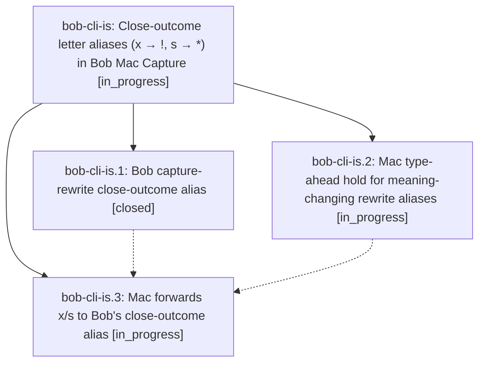

# Bead: bob-cli-is — Close-outcome letter aliases (x → !, s → \*) in Bob Mac Capture

[Bead Pages](../README.md) / bob-cli-is

**Status:** ◐ in_progress · **Type:** ▸ plan · **Tier:** epic
**Owner:** `bryanbugyi34@gmail.com` · **Created by:** [bbugyi200.apollo.research.3r.linker.w0](https://github.com/bobs-org/bob-cli--agents/blob/main/sessions/bbugyi200.apollo.research.3r.linker.w0.md) · **Assignee:** `bob-cli-is.land`
**Created:** 2026-11-08 11:42:40 EST
**Plan:** [202611/close\_outcome\_x\_s\_typing\_aliases.md](https://github.com/bobs-org/bob-cli--plans/blob/main/202611/close_outcome_x_s_typing_aliases.md)

<!-- sase:links:start -->

## Links

| Relation | Artifact | Why |
| --- | --- | --- |
| implemented-by | [plan:202611/close_outcome_x_s_typing_aliases.md][1] | derived from the plan's `bead_id:` frontmatter field |

[1]: https://github.com/bobs-org/bob-cli--plans/blob/main/202611/close_outcome_x_s_typing_aliases.md

<!-- sase:links:end -->

## Description

In the Bob Mac Capture editor, a plain lowercase `x` typed where a close selection accepts an outcome marker becomes `!`, and a plain lowercase `s` becomes `*`. Examples: `xx` → `x!`, `xs` → `x*`, `x1s` → `x1*`, `x=1=s` → `x=1=*`, and `@r:id=xx` → `@r:id=x!`. Bob's `capture-rewrite` alone decides where the alias fires. `bob capture`, `capture-parse`, paste, and CLI text keep the letters. Typing speed never changes the outcome: keys typed before Bob answers are held and replayed, and a fast Return never files the literal draft.

## Phases

| Bead | Title | Status | Size | Created | Agents | Commits |
|---|---|---|---|---|---:|---:|
| [bob-cli-is.1](bob-cli-is.1.md) | Bob capture-rewrite close-outcome alias | ✓ closed | medium | 2026-11-08 | 1 | 1 |
| [bob-cli-is.2](bob-cli-is.2.md) | Mac type-ahead hold for meaning-changing rewrite aliases | ◐ in_progress | medium | 2026-11-08 | 1 | 0 |
| [bob-cli-is.3](bob-cli-is.3.md) | Mac forwards x/s to Bob's close-outcome alias | ◐ in_progress | medium | 2026-11-08 | 1 | 0 |

## Lineage

## Agents

| Agent | Bead | Commits |
|---|---|---:|
| [bbugyi200.apollo.bob-cli-is.1](https://github.com/bobs-org/bob-cli--agents/blob/main/agents/bbugyi200.apollo.bob-cli-is.1/README.md) | [bob-cli-is.1](bob-cli-is.1.md) | 1 |
| [bbugyi200.apollo.bob-cli-is.2](https://github.com/bobs-org/bob-cli--agents/blob/main/agents/bbugyi200.apollo.bob-cli-is.2/README.md) | [bob-cli-is.2](bob-cli-is.2.md) | 0 |
| [bbugyi200.apollo.bob-cli-is.3](https://github.com/bobs-org/bob-cli--agents/blob/main/agents/bbugyi200.apollo.bob-cli-is.3/README.md) | [bob-cli-is.3](bob-cli-is.3.md) | 0 |
| [bbugyi200.apollo.bob-cli-is.land](https://github.com/bobs-org/bob-cli--agents/blob/main/agents/bbugyi200.apollo.bob-cli-is.land/README.md) | [bob-cli-is](README.md) | 0 |

## Commits

| Repo | Commit | Subject | Bead | Committed |
|---|---|---|---|---|
| bob-cli | [`23217c1`](https://github.com/bobs-org/bob-cli/commit/23217c1d78cafa2fe3a78ce5199653306169cca2) | feat(capture): alias x and s to close outcomes while typing | [bob-cli-is.1](bob-cli-is.1.md) | 2026-11-08 12:30:09 EST |
