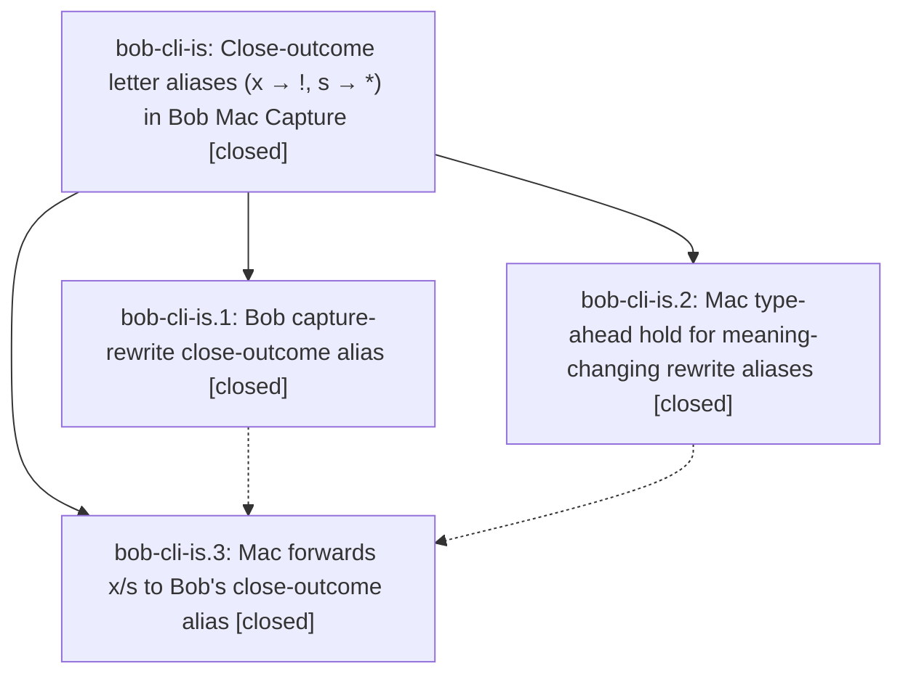

# Bead: bob-cli-is — Close-outcome letter aliases (x → !, s → \*) in Bob Mac Capture

[Bead Pages](../README.md) / bob-cli-is

**Status:** ✓ closed · **Resolution:** done · **Type:** ▸ plan · **Tier:** epic
**Owner:** `bryanbugyi34@gmail.com` · **Created by:** [bbugyi200.apollo.research.3r.linker.w0](https://github.com/bobs-org/bob-cli--agents/blob/main/sessions/bbugyi200.apollo.research.3r.linker.w0.md) · **Assignee:** `bob-cli-is.land`
**Created:** 2026-11-08 11:42:40 EST · **Closed:** 2026-11-08 19:42:26 EST
**Plan:** [202611/close\_outcome\_x\_s\_typing\_aliases.md](https://github.com/bobs-org/bob-cli--plans/blob/main/202611/close_outcome_x_s_typing_aliases.md)

<!-- sase:links:start -->

## Links

| Relation | Artifact | Why |
| --- | --- | --- |
| implemented-by | [plan:202611/close_outcome_x_s_typing_aliases.md][1] | derived from the plan's `bead_id:` frontmatter field |

_Plus 1 automatic references — see [Referenced By](#referenced-by)._

[1]: https://github.com/bobs-org/bob-cli--plans/blob/main/202611/close_outcome_x_s_typing_aliases.md

<!-- sase:links:end -->

## Description

In the Bob Mac Capture editor, a plain lowercase `x` typed where a close selection accepts an outcome marker becomes `!`, and a plain lowercase `s` becomes `*`. Examples: `xx` → `x!`, `xs` → `x*`, `x1s` → `x1*`, `x=1=s` → `x=1=*`, and `@r:id=xx` → `@r:id=x!`. Bob's `capture-rewrite` alone decides where the alias fires. `bob capture`, `capture-parse`, paste, and CLI text keep the letters. Typing speed never changes the outcome: keys typed before Bob answers are held and replayed, and a fast Return never files the literal draft.

## Notes

[2026-11-08T23:10:56Z · bob-cli-iu.land] DISCOVERED ISSUE: bob-cli-iu land triage of bob-cli-iu.2 PROPOSED FOLLOW-UP notes #3/#5 independently compared macOS CI base run 42523594058 (2a39c2f, https://github.com/bobs-org/bob-mac-capture/actions/runs/42523594058) and dot snapshot run 42531359678 (https://github.com/bobs-org/bob-mac-capture/actions/runs/42531359678). Snapshot has 16 failing test methods: 14 CaptureSeparatorToggleTests (blank slash; close comma parity; close repeat/modifier/IME guards; close emoji; old-Bob warning; native undo/redo; picker-accepted-ID plus; caret-ID plus; plus undo; seal key; subsequent typing; hash/move/slash undo), CapturePanelModelTests.testPlusCommitsPartialCachedRouteCompletionAndOpensTaskPicker, CapturePanelAgendaLayoutTests.testClearWhilePreviewFinishingKeepsGeometryValid. All 16 fail in the base run (which has 19 failing methods); all 17 new dot tests pass. The phase note incorrectly calls all 16 separator tests and calls the sets identical. Source 2a39c2f adds the eager captureRewrite(xx) capability probe; legacy failures include observed rewrite count 2 vs 1 and unexpected nonempty logs. Your is.3 notes #2-4 already identify and repair that lifecycle/count/agenda cluster. Route this to the active causal epic; no new task and no +1 to h7/f3 for these different failures. Recheck against your repaired snapshot before closing.

[2026-11-08T23:48:14Z · bob-cli-is.land] LAND FOLLOW-UP TRIAGE: Read every note on bob-cli-is and is.1/is.2/is.3. The only PROPOSED FOLLOW-UP is is.1 note #1: gmail/sync/file.rs bind_instead_of_map and needless_return from 1cf8d96b. DECLINED as already resolved: 32c241af replaces the exact and_then(Some(...)) with map and removes both needless returns; those fixes remain in current source. Searched CI and all task types, swept all tasks created in the last week, and inspected active epic scopes; no matching unresolved task merits creation or corroboration. Later Gmail lint cleanup 25c02232 and completed ii.4.1 just-check evidence also reviewed. No new task, +1, or new issue on Gmail is needed. The epic note #1 probe/count/agenda failures are addressed by 0f6753b; independently fetched macOS run 42534561890 and every required gate is green for exactly 0f6753bf429b9b1b86454fb8d95a17ce965a8f1c. Earlier hold SHA 03392a55eb87577ac8bd1b69c381949cc9e2024b is likewise green in 42519302906. Remaining findings belong to this epic and will be handled by a repair tale, not task beads.

[2026-11-08T23:48:20Z · bob-cli-is.land] LAND AUDIT / REMAINING WORK: Verified Rust commit 23217c1d and Mac commits 03392a5, 2a39c2f, 0f6753b against the approved plan and all phase notes. Bob owns the close lexer and single-byte rewrite; Mac send filtering, identity-cached probe, separate probe lane, native undo and held burst tests are present. No epic commit edits memory, version, or changelog; memory_close_alias_record=no honored. Reviewed intervening primary commits through 361974f4, plus fetched base drift 8427bd96 (Gmail-only); records/Gmail changes need no alias wiring. Reviewed dot-route integration 0b8b913f and e7ddfc6 in the merged Mac tree; preserve its fast-dot/restore routing in the repair. BLOCKERS FOUND BY SOURCE AUDIT: CapturePanelController.endTypeAheadHold finishes the bounded hold then schedules typeAheadReplayQueue across turns. flushTypeAheadHoldBeforeFocusOrDismissal only drains typeAheadHold; typeAheadReplayTask is canceled only in deinit. Once Bob replies, click/focus/resign/close and direct/setProcessClient replacement cannot retire the scheduled queue; queued Return can still route through submitAfterTypeAheadReplay against a retained or replaced context. Existing testCaretFocusClientReplacementAndDismissalFlushBeforeActing interrupts before the reply only. Add deterministic after-reply interruption tests and retire/drain pending replay safely. Also fulfill the omitted plan doc requirement: docs/reference/capture-syntax.md x-close still says xx never closes without distinguishing editor typing from grammar/CLI. epic-symbols currently empty; no parent_bead is present. Leave epic and plan wip pending the medium repair tale, which must perform final closeout itself.

[2026-11-08T23:50:29Z · bob-cli-is.land] COORDINATION: Read bob-cli-iu landing notes #1-2 after the audit. Its pending tale owns dot-arm modifier/pre-reply invalidation and the existing Mac docs budget overages; those are distinct from this epic replay-tail lifecycle gap. No duplicate task or issue note is needed for already-recorded iu findings. The is repair tale must preserve/merge iu controller changes and report any persisting known docs-check overages with their owner. No new AppKit tests or just check were executed in this source-review/planning turn; the linked exact-SHA CI results were independently checked.

[2026-11-09T00:42:26Z · bob-cli-is.land] Close-outcome x/s aliases are landed and remaining replay interruption is repaired.

Scope verified: Bob capture-rewrite 23217c1d owns the close lexer and one-byte x→! / s→* edits; Mac 0f6753b plus this repair own send filtering, identity-cached probe, hold, and replay. Grammar version 19 and rewrite schema 1 unchanged. No memory, version, or CHANGELOG edits (memory_close_alias_record=no).

Replay repair: after Bob replies, interruption now invalidates the scheduled typeAheadReplayTask and comma-assist wait, drains pending edit keys in order into the original editor (native insert, not routeKeyDown), and drops pending Return/Command-Return while keeping dropped-submit status. Non-bufferable commands flush first. Actual process-client replacement (didSet !==) notifies the controller even after the hold has ended; same-object Recheck does not flush and still skips re-probe when identity is cached. Stale scheduled dispatch cannot resurrect after flush. Chained alias replay, comma-assist, timestamps, fast-dot/restore, and native undo preserved. Intervening Gmail 8427bd96 and records need no alias wiring; dot-route e7ddfc6 paths kept.

Tests: CaptureCloseAliasTests uses an injected scheduleTypeAheadReplay seam (no 16 ms races or wall-clock sleeps) covering after-reply interrupt, after-one-edit interrupt, Command-Z flush, same-object Recheck, and replayed ./ = order.

Docs: docs/reference/capture-syntax.md x-close now scopes “xx never closes” to grammar/paste/capture-parse/bob capture and states Mac typing maps eligible xx/xs to x!/x* with a link to the sigil-alias contract. Counted 6000/6000 words.

Verification: bob-cli just check passed. just docs-check fails only the known iu-owned Mac page-budget overages (capture-panel 6088, keyboard 6060, protocol 6014 at e7ddfc6); capture-syntax did not fail. Athena just portable-check: 2269 tests, 1 skipped, 0 failures. Mac host SSH timed out, so scratch Scripts/bundle.sh + just typecheck-tests was not run; macOS compile targets on Bryan’s Mac are unverified. Scripts/macos-ci-check snapshot 2ca9e5510c430b0b973e6450453ddb9de56ab8e1, GitHub run 42539597935, passed every required macOS gate (lint, build, test including new AppKit regressions, bundle, plist/signature, launch smoke, install/reinstall).

is.1 PROPOSED FOLLOW-UP (gmail/sync/file.rs bind_instead_of_map and needless_return) declined: 32c241af already fixed those sites. Epic probe/count/agenda note resolved by 0f6753b and exact-SHA CI 42534561890. epic-symbols reports no entries. just symvision is not a recipe in bob-cli or bob-mac-capture. No parent_bead. No new task beads. Parent plan status marked done. Closing does not wait for this tale’s own commit, push, or post-push CI.

## Phases

| Bead | Title | Status | Size | Created | Agents | Commits |
|---|---|---|---|---|---:|---:|
| [bob-cli-is.1](bob-cli-is.1.md) | Bob capture-rewrite close-outcome alias | ✓ closed | medium | 2026-11-08 | 1 | 1 |
| [bob-cli-is.2](bob-cli-is.2.md) | Mac type-ahead hold for meaning-changing rewrite aliases | ✓ closed | medium | 2026-11-08 | 1 | 1 |
| [bob-cli-is.3](bob-cli-is.3.md) | Mac forwards x/s to Bob's close-outcome alias | ✓ closed | medium | 2026-11-08 | 1 | 2 |

## Lineage

## Agents

| Agent | Bead | Commits |
|---|---|---:|
| [bbugyi200.apollo.bob-cli-is.1](https://github.com/bobs-org/bob-cli--agents/blob/main/agents/bbugyi200.apollo.bob-cli-is.1/README.md) | [bob-cli-is.1](bob-cli-is.1.md) | 1 |
| [bbugyi200.apollo.bob-cli-is.2](https://github.com/bobs-org/bob-cli--agents/blob/main/sessions/bbugyi200.apollo.bob-cli-is.2.md) | [bob-cli-is.2](bob-cli-is.2.md) | 1 |
| [bbugyi200.apollo.bob-cli-is.3](https://github.com/bobs-org/bob-cli--agents/blob/main/sessions/bbugyi200.apollo.bob-cli-is.3.md) | [bob-cli-is.3](bob-cli-is.3.md) | 2 |
| [bbugyi200.apollo.bob-cli-is.land](https://github.com/bobs-org/bob-cli--agents/blob/main/sessions/bbugyi200.apollo.bob-cli-is.land.md) | [bob-cli-is](README.md) | 1 |

## Commits

| Repo | Commit | Subject | Bead | Committed |
|---|---|---|---|---|
| bob-cli | [`23217c1`](https://github.com/bobs-org/bob-cli/commit/23217c1d78cafa2fe3a78ce5199653306169cca2) | feat(capture): alias x and s to close outcomes while typing | [bob-cli-is.1](bob-cli-is.1.md) | 2026-11-08 12:30:09 EST |
| bob-mac-capture | [`bob-mac-capture@03392a5`](https://github.com/bobs-org/bob-mac-capture/commit/03392a55eb87577ac8bd1b69c381949cc9e2024b) | feat(mac-capture): hold type-ahead keys during dash rewrite | [bob-cli-is.2](bob-cli-is.2.md) | 2026-11-08 15:16:44 EST |
| bob-mac-capture | [`bob-mac-capture@2a39c2f`](https://github.com/bobs-org/bob-mac-capture/commit/2a39c2ffac859a2d1594171ef835b8d6a7b9c6f3) | feat(mac-capture): alias x and s to close outcomes | [bob-cli-is.3](bob-cli-is.3.md) | 2026-11-08 16:07:25 EST |
| bob-mac-capture | [`bob-mac-capture@0f6753b`](https://github.com/bobs-org/bob-mac-capture/commit/0f6753bf429b9b1b86454fb8d95a17ce965a8f1c) | fix(mac-capture): verify close aliases and isolate probe and replay races | [bob-cli-is.3](bob-cli-is.3.md) | 2026-11-08 18:18:45 EST |
| bob-cli | [`274eeae`](https://github.com/bobs-org/bob-cli/commit/274eeae7e910526bd6b534a703f83759a5a1463d) | docs(capture): distinguish Mac xx/xs typing from grammar close | [bob-cli-is](README.md) | 2026-11-08 19:43:57 EST |

<!-- sase:referenced-by:start -->

## Referenced By

| Relation | Artifact | Why | Uses |
| --- | --- | --- | ---: |
| read-by | [agent:bob-cli-is.3][1] | epic scope for phase 3 | 1 |

[1]: https://github.com/bobs-org/bob-cli--agents/blob/main/sessions/bbugyi200.apollo.bob-cli-is.3.md

<!-- sase:referenced-by:end -->
