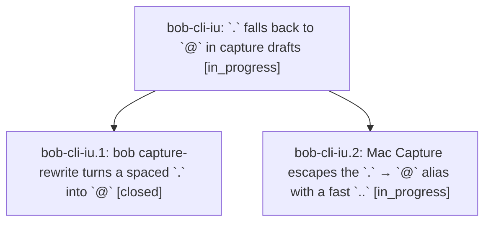

# Bead: bob-cli-iu — \`.\` falls back to \`@\` in capture drafts

[Bead Pages](../README.md) / bob-cli-iu

**Status:** ◐ in_progress · **Type:** ▸ plan · **Tier:** epic
**Owner:** `bryanbugyi34@gmail.com` · **Created by:** [bbugyi200.apollo.d0](https://github.com/bobs-org/bob-cli--agents/blob/main/sessions/bbugyi200.apollo.d0.md) · **Assignee:** `bob-cli-iu.land`
**Created:** 2026-11-08 16:46:39 EST
**Plan:** [202611/dot\_route\_alias.md](https://github.com/bobs-org/bob-cli--plans/blob/main/202611/dot_route_alias.md)

<!-- sase:links:start -->

## Links

| Relation | Artifact | Why |
| --- | --- | --- |
| implemented-by | [plan:202611/dot_route_alias.md][1] | derived from the plan's `bead_id:` frontmatter field |

[1]: https://github.com/bobs-org/bob-cli--plans/blob/main/202611/dot_route_alias.md

<!-- sase:links:end -->

## Description

Typing `.sase.foo ` after task text in Bob Mac Capture renders `@sase^foo `; the first `.` opens route completion, and a fast `..` types one literal `.`.

## Phases

| Bead | Title | Status | Size | Created | Agents | Commits |
|---|---|---|---|---|---:|---:|
| [bob-cli-iu.1](bob-cli-iu.1.md) | bob capture-rewrite turns a spaced \`.\` into \`@\` | ✓ closed | small | 2026-11-08 | 1 | 1 |
| [bob-cli-iu.2](bob-cli-iu.2.md) | Mac Capture escapes the \`.\` → \`@\` alias with a fast \`..\` | ◐ in_progress | medium | 2026-11-08 | 1 | 0 |

## Lineage

## Agents

| Agent | Bead | Commits |
|---|---|---:|
| [bbugyi200.apollo.bob-cli-iu.1](https://github.com/bobs-org/bob-cli--agents/blob/main/agents/bbugyi200.apollo.bob-cli-iu.1/README.md) | [bob-cli-iu.1](bob-cli-iu.1.md) | 1 |
| [bbugyi200.apollo.bob-cli-iu.2](https://github.com/bobs-org/bob-cli--agents/blob/main/sessions/bbugyi200.apollo.bob-cli-iu.2.md) | [bob-cli-iu.2](bob-cli-iu.2.md) | 0 |
| [bbugyi200.apollo.bob-cli-iu.land](https://github.com/bobs-org/bob-cli--agents/blob/main/agents/bbugyi200.apollo.bob-cli-iu.land/README.md) | [bob-cli-iu](README.md) | 0 |

## Commits

| Repo | Commit | Subject | Bead | Committed |
|---|---|---|---|---|
| bob-cli | [`0b8b913`](https://github.com/bobs-org/bob-cli/commit/0b8b913ff65e256ac8f4a4741841386aee9c800f) | feat(capture): alias spaced dot to @ where route completion opens | [bob-cli-iu.1](bob-cli-iu.1.md) | 2026-11-08 17:37:01 EST |
