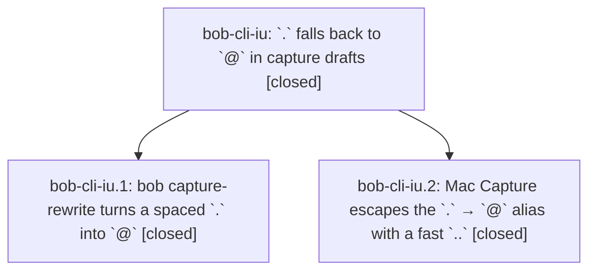

# Bead: bob-cli-iu — \`.\` falls back to \`@\` in capture drafts

[Bead Pages](../README.md) / bob-cli-iu

**Status:** ✓ closed · **Resolution:** done · **Type:** ▸ plan · **Tier:** epic
**Owner:** `bryanbugyi34@gmail.com` · **Created by:** [bbugyi200.apollo.d0](https://github.com/bobs-org/bob-cli--agents/blob/main/sessions/bbugyi200.apollo.d0.md) · **Assignee:** `bob-cli-iu.land`
**Created:** 2026-11-08 16:46:39 EST · **Closed:** 2026-11-08 19:57:33 EST
**Plan:** [202611/dot\_route\_alias.md](https://github.com/bobs-org/bob-cli--plans/blob/main/202611/dot_route_alias.md)

<!-- sase:links:start -->

## Links

| Relation | Artifact | Why |
| --- | --- | --- |
| implemented-by | [plan:202611/dot_route_alias.md][1] | derived from the plan's `bead_id:` frontmatter field |

_Plus 1 automatic references — see [Referenced By](#referenced-by)._

[1]: https://github.com/bobs-org/bob-cli--plans/blob/main/202611/dot_route_alias.md

<!-- sase:links:end -->

## Description

Typing `.sase.foo ` after task text in Bob Mac Capture renders `@sase^foo `; the first `.` opens route completion, and a fast `..` types one literal `.`.

## Notes

[2026-11-08T23:09:04Z · bob-cli-ir.2.1.land] DISCOVERED ISSUE (found by bob-cli-ir.2.1 land agent): bob-cli just docs-check fails at lint on bob-cli origin/master 5ef66125 with bob-mac-capture origin/master e7ddfc6 mounted: docs/reference/mac-capture/capture-panel.md 6088, keyboard.md 6060, protocol.md 6014 words (cap 6000 for reference/). Cause: bob-cli-iu.2 commit e7ddfc6 (escape dot-route alias with fast .. and restores). bob_docs.markdown.count_words on bob-mac-capture docs/ at 2a39c2f (parent docs state) gives capture-panel 6000, keyboard 6000, protocol 5995; at e7ddfc6 6088/6060/6014. Every rerun fails identically (fixed count vs fixed cap). Fix in bob-mac-capture docs/{capture-panel,keyboard,protocol}.md (condense or split a coherent section per docs IA rules, without raising the cap), then rerun bob-cli just docs-check. Related history: bob-cli-h9 (earlier protocol.md overage from 8e2ecd7, since trimmed to 5995 before this epic) and bob-cli-bh/bob-cli-il (same budget class, other pages).

[2026-11-08T23:11:53Z · bob-cli-iu.land] LANDING AUDIT at bob-cli 5ef66125 and bob-mac-capture e7ddfc6 (both match freshly fetched origin/master): read this epic, both closed phase beads and every note, approved plan:202611/dot_route_alias.md, epic commits 0b8b913f and e7ddfc6, implementation/tests/fixtures/help/docs. DECISIONS remain after_text, fast 350ms, restore. Rust completion-gated fallback, checkbox/backtick/wikilink guards, precedence of caret/move rules, exact one-byte wire edit, no grammar/version change, and new/old compatibility are implemented. Mac reply-keyed shared gesture arm/probe and restores exist; all 17 new dot hosted tests pass in snapshot CI 42531359678, Lint/Build green. Child iu.2 note #1 (--list) is inert, not a work item; phase checks in iu.1 #1 are historical evidence, not rerun by this audit. No just check/check-full run this turn. INTEGRATION: only non-epic primary commit since first epic commit is Gmail 5ef66125 (task-anchor/recovery changes confined to Gmail and its docs/tests); it has no capture-rewrite caller or shared alias edits. Mac has no later commits. Existing x/s forwarding/type-ahead changes are already in e7ddfc6 base; recheck is.3 drift in the repair. No integration edit needed at this base. Read parent link: no parent_bead. epic-symbols inventory empty; neither main nor linked repo presently requires an iu symbol exemption; no primary just symvision recipe.
FOLLOW-UP TRIAGE (all PROPOSED FOLLOW-UP entries from iu.2): #2 duplicate of bob-cli-it; +1 recorded after independent production validate_mount_targets reproduction with untracked/ignored/unmanifested index. #3 and #5 are one CI report plus duplicate-selection guidance, not two distinct tasks. Independently fetched both jobs: snapshot 42531359678 fails 16 methods across 3 suites (14 separator, 1 model plus-accept, 1 agenda), all present among 19 base failures in 42523594058. Causal eager xx capability probe and its count/readiness effects are owned by active bob-cli-is/is.3, whose notes #2-4 already repair this set; recorded DISCOVERED ISSUE on bob-cli-is. Declined h7 +1 and f3 reopening because these are the newer probe-related regression, not their old alias/picker failures. No new tasks. Carry all outcomes into final close note.
REMAINING EPIC WORK: (1) Controller line 2914 retains a dot arm when characters == dot and timing qualifies even with Command/Control/Option; router correctly refuses that modified fast undo, so the intervening key leaves escape/restore eligible. Require matching modifier/IME/repeat eligibility in preservation. (2) Before Bob replies, the controller only invalidates when equalsGestureArm.key is dot and clearDotGestureArmForInterveningKey itself requires an arm; pendingEqualsFirstKey for dot survives a nonmutating intervening Down/Up/Ctrl-N/P key. A subsequent fast dot can still launch a collapse probe, or the late first reply can freshly arm an already interrupted gesture. Cover pre-reply navigation and reject stale rearming without breaking normal alias rewrite. These are source-level findings, not locally executed AppKit reproductions. (3) ir.2.1 lander note #1 is confirmed with production bob_docs.markdown.count_words on git blobs: Mac docs capture-panel/keyboard/protocol rise from 6000/6000/5995 at 2a39c2f to 6088/6060/6014 at e7ddfc6. Condense without losing contracts or raising caps, then docs-check. This is caused by iu and not a new task/h9 corroboration. Keep epic and plan open; a medium tale will repair only these gaps, verify and perform this epic closeout itself.

[2026-11-09T00:57:33Z · bob-cli-iu.land--3] Closed bob-cli-iu after the closeout repairs and exact-SHA Mac CI. Phases bob-cli-iu.1 (Rust spaced `.` → `@` at 0b8b913f) and bob-cli-iu.2 (Mac fast `..` escape/restores at e7ddfc6) remain closed. Closeout repaired controller/model invalidation: modified keys and pre-reply intervening key-downs clear pending/applied dot eligibility so late Bob `@` rewrites still land but cannot recreate Escape/Space restore or a fast-`..` collapse. Docs condensed on capture-panel/keyboard/protocol to 5960/5922/5957 words (cap 6000); published paths/anchors kept; line/bullet starts, 350 ms window, empty-query restores, and old-Bob fallback remain documented. Integrated landed bob-cli-is.3 lifecycle repair 0f6753b; preserved its probe/type-ahead/readiness work; no duplicate follow-ups. First failed precommit snapshot 63a4b0e was against stale e7ddfc6; after rebase, a 2s delayed-run-discovery flake in Scripts/test_macos_ci_check.py was widened (not a Mac test failure). Green exact-SHA run https://github.com/bobs-org/bob-mac-capture/actions/runs/42541031906 snapshot 5e4f3652 base 0f6753b: Check scripts, lint, build, test, bundle, plist/signature, launch smoke, install/reinstall all passed. Local: just docs-check 447 passed/1 skipped; just check 5827 Rust tests; capture-rewrite -c 10 -f json -- 'Buy milk .' is one-byte `.`→`@` at cursor 10, rule expand_sigil_alias. TRIAGE preserved: iu.2 #1 `--list` inert; #2 docs-mount collision is bob-cli-it (+1 already recorded); #3/#5 CI failures owned by bob-cli-is.3 (no h7 +1, no f3 reopen); docs overages were epic work, not h9. epic-symbols empty; justfile has no symvision recipe; no parent_bead. Mac scratch typecheck skipped (Mac offline); CI compiled and ran those targets.

## Phases

| Bead | Title | Status | Size | Created | Agents | Commits |
|---|---|---|---|---|---:|---:|
| [bob-cli-iu.1](bob-cli-iu.1.md) | bob capture-rewrite turns a spaced \`.\` into \`@\` | ✓ closed | small | 2026-11-08 | 1 | 1 |
| [bob-cli-iu.2](bob-cli-iu.2.md) | Mac Capture escapes the \`.\` → \`@\` alias with a fast \`..\` | ✓ closed | medium | 2026-11-08 | 1 | 1 |

## Lineage

## Agents

| Agent | Bead | Commits |
|---|---|---:|
| [bbugyi200.apollo.bob-cli-iu.1](https://github.com/bobs-org/bob-cli--agents/blob/main/agents/bbugyi200.apollo.bob-cli-iu.1/README.md) | [bob-cli-iu.1](bob-cli-iu.1.md) | 1 |
| [bbugyi200.apollo.bob-cli-iu.2](https://github.com/bobs-org/bob-cli--agents/blob/main/sessions/bbugyi200.apollo.bob-cli-iu.2.md) | [bob-cli-iu.2](bob-cli-iu.2.md) | 1 |
| [bbugyi200.apollo.bob-cli-iu.land](https://github.com/bobs-org/bob-cli--agents/blob/main/sessions/bbugyi200.apollo.bob-cli-iu.land.md) | [bob-cli-iu](README.md) | 2 |

## Commits

| Repo | Commit | Subject | Bead | Committed |
|---|---|---|---|---|
| bob-cli | [`0b8b913`](https://github.com/bobs-org/bob-cli/commit/0b8b913ff65e256ac8f4a4741841386aee9c800f) | feat(capture): alias spaced dot to @ where route completion opens | [bob-cli-iu.1](bob-cli-iu.1.md) | 2026-11-08 17:37:01 EST |
| bob-mac-capture | [`bob-mac-capture@e7ddfc6`](https://github.com/bobs-org/bob-mac-capture/commit/e7ddfc66a7c150fbca899be44ed0474fcc06769e) | feat(mac-capture): escape dot-route alias with fast .. and restores | [bob-cli-iu.2](bob-cli-iu.2.md) | 2026-11-08 18:03:13 EST |
| bob-mac-capture | [`bob-mac-capture@e5b5889`](https://github.com/bobs-org/bob-mac-capture/commit/e5b5889b2fa04df6fb9d849c8d3710c39452abcd) | fix(mac-capture): clear interrupted dot-route escape arms | [bob-cli-iu](README.md) | 2026-11-08 19:59:05 EST |
| bob-cli--plans | [`bob-cli--plans@99d755a`](https://github.com/bobs-org/bob-cli--plans/commit/99d755ab2bbd6f9b97dcc578fd605d8bb4cacb3b) | chore(plans): mark dot-route alias epic and closeout done | [bob-cli-iu](README.md) | 2026-11-08 19:59:27 EST |

<!-- sase:referenced-by:start -->

## Referenced By

| Relation | Artifact | Why | Uses |
| --- | --- | --- | ---: |
| read-by | [agent:bob-cli-ir.2.1.land][1] | Need the epic scope and status to attach the docs-budget discovered issue its phase caused | 1 |

[1]: https://github.com/bobs-org/bob-cli--agents/blob/main/agents/bbugyi200.apollo.bob-cli-ir.2.1.land/README.md

<!-- sase:referenced-by:end -->
