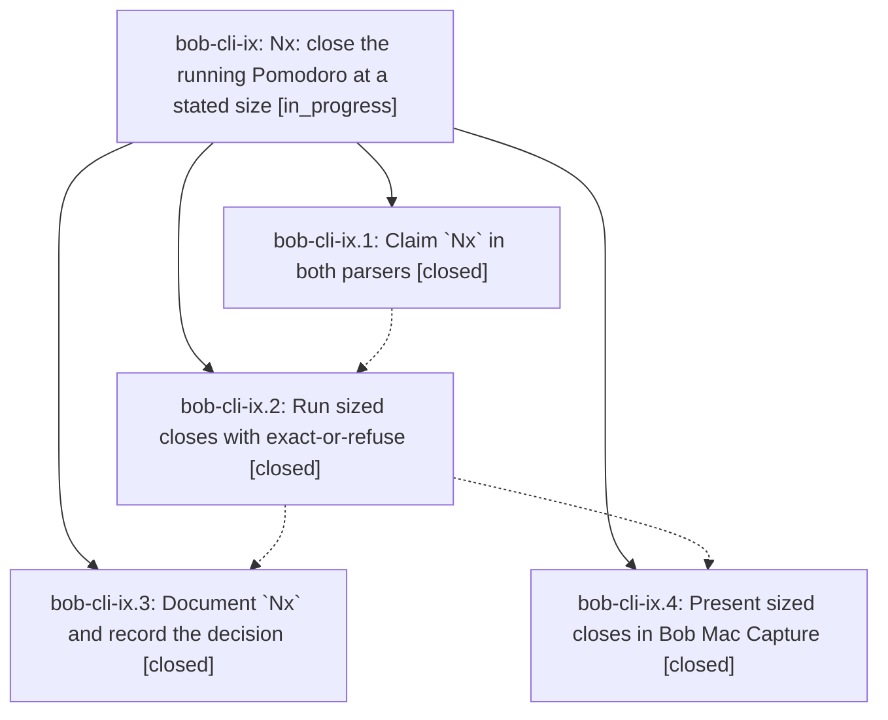

# Bead: bob-cli-ix — Nx: close the running Pomodoro at a stated size

[Bead Pages](../README.md) / bob-cli-ix

**Status:** ◐ in_progress · **Type:** ▸ plan · **Tier:** epic
**Owner:** `bryanbugyi34@gmail.com` · **Created by:** [bbugyi200.apollo.research.3s.linker.w0](https://github.com/bobs-org/bob-cli--agents/blob/main/sessions/bbugyi200.apollo.research.3s.linker.w0.md) · **Assignee:** `bob-cli-ix.land`
**Created:** 2026-11-09 05:24:37 EST
**Plan:** [202611/sized\_pomodoro\_close.md](https://github.com/bobs-org/bob-cli--plans/blob/main/202611/sized_pomodoro_close.md)

<!-- sase:links:start -->

## Links

| Relation | Artifact | Why |
| --- | --- | --- |
| implemented-by | [plan:202611/sized_pomodoro_close.md][1] | derived from the plan's `bead_id:` frontmatter field |

[1]: https://github.com/bobs-org/bob-cli--plans/blob/main/202611/sized_pomodoro_close.md

<!-- sase:links:end -->

## Description

Typing `2x!2` closes the running Pomodoro at exactly 2 five-minute blocks from its start (or refuses with a named fix), with honest clocks, one card, additive JSON, documented grammar, a decision record, and a Bob Mac Capture card that shows the size.

## Phases

| Bead | Title | Status | Size | Created | Agents | Commits |
|---|---|---|---|---|---:|---:|
| [bob-cli-ix.1](bob-cli-ix.1.md) | Claim \`Nx\` in both parsers | ✓ closed | large | 2026-11-09 | 1 | 1 |
| [bob-cli-ix.2](bob-cli-ix.2.md) | Run sized closes with exact-or-refuse | ✓ closed | large | 2026-11-09 | 1 | 1 |
| [bob-cli-ix.3](bob-cli-ix.3.md) | Document \`Nx\` and record the decision | ✓ closed | medium | 2026-11-09 | 1 | 0 |
| [bob-cli-ix.4](bob-cli-ix.4.md) | Present sized closes in Bob Mac Capture | ✓ closed | medium | 2026-11-09 | 1 | 1 |

## Lineage

## Agents

| Agent | Bead | Commits |
|---|---|---:|
| [bbugyi200.apollo.bob-cli-ix.1](https://github.com/bobs-org/bob-cli--agents/blob/main/sessions/bbugyi200.apollo.bob-cli-ix.1.md) | [bob-cli-ix.1](bob-cli-ix.1.md) | 1 |
| [bbugyi200.apollo.bob-cli-ix.2](https://github.com/bobs-org/bob-cli--agents/blob/main/sessions/bbugyi200.apollo.bob-cli-ix.2.md) | [bob-cli-ix.2](bob-cli-ix.2.md) | 1 |
| [bbugyi200.apollo.bob-cli-ix.3](https://github.com/bobs-org/bob-cli--agents/blob/main/agents/bbugyi200.apollo.bob-cli-ix.3/README.md) | [bob-cli-ix.3](bob-cli-ix.3.md) | 0 |
| [bbugyi200.apollo.bob-cli-ix.4](https://github.com/bobs-org/bob-cli--agents/blob/main/sessions/bbugyi200.apollo.bob-cli-ix.4.md) | [bob-cli-ix.4](bob-cli-ix.4.md) | 1 |
| [bbugyi200.apollo.bob-cli-ix.land](https://github.com/bobs-org/bob-cli--agents/blob/main/agents/bbugyi200.apollo.bob-cli-ix.land/README.md) | [bob-cli-ix](README.md) | 0 |

## Commits

| Repo | Commit | Subject | Bead | Committed |
|---|---|---|---|---|
| bob-cli | [`070d2aa`](https://github.com/bobs-org/bob-cli/commit/070d2aacbfb2ee7b481eabe3db0ecd5c417fd00f) | feat(capture)!: claim the sized Nx close in the capture grammar | [bob-cli-ix.1](bob-cli-ix.1.md) | 2026-11-09 06:54:48 EST |
| bob-cli | [`135793b`](https://github.com/bobs-org/bob-cli/commit/135793bf355c18cf44788d0114c68549bcb0d9bb) | feat(capture): close the running Pomodoro at a stated size | [bob-cli-ix.2](bob-cli-ix.2.md) | 2026-11-09 07:49:26 EST |
| bob-mac-capture | [`bob-mac-capture@8cc25b3`](https://github.com/bobs-org/bob-mac-capture/commit/8cc25b315086b4bd7fce2725f82a279ceb07a8da) | feat(mac-capture): present sized pomodoro closes | [bob-cli-ix.4](bob-cli-ix.4.md) | 2026-11-09 08:51:38 EST |
