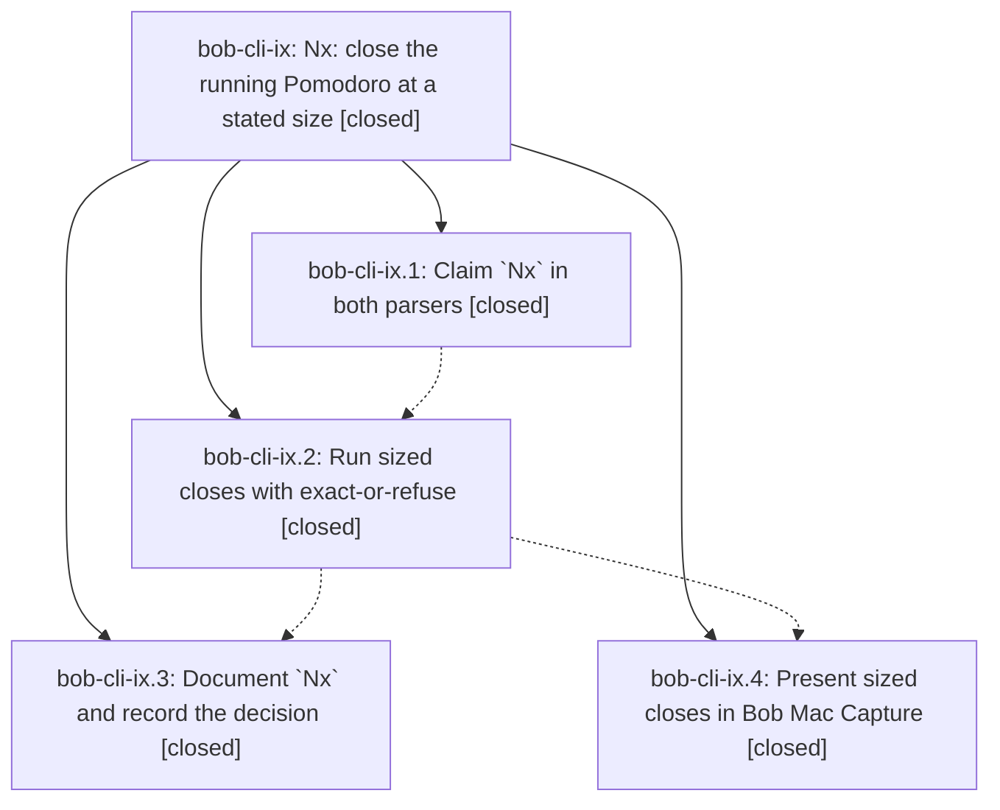

# Bead: bob-cli-ix — Nx: close the running Pomodoro at a stated size

[Bead Pages](../README.md) / bob-cli-ix

**Status:** ✓ closed · **Resolution:** done · **Type:** ▸ plan · **Tier:** epic
**Owner:** `bryanbugyi34@gmail.com` · **Created by:** [bbugyi200.apollo.research.3s.linker.w0](https://github.com/bobs-org/bob-cli--agents/blob/main/sessions/bbugyi200.apollo.research.3s.linker.w0.md) · **Assignee:** `bob-cli-ix.land`
**Created:** 2026-11-09 05:24:37 EST · **Closed:** 2026-11-09 10:01:09 EST
**Plan:** [202611/sized\_pomodoro\_close.md](https://github.com/bobs-org/bob-cli--plans/blob/main/202611/sized_pomodoro_close.md)

<!-- sase:links:start -->

## Links

| Relation | Artifact | Why |
| --- | --- | --- |
| implemented-by | [plan:202611/sized_pomodoro_close.md][1] | derived from the plan's `bead_id:` frontmatter field |

[1]: https://github.com/bobs-org/bob-cli--plans/blob/main/202611/sized_pomodoro_close.md

<!-- sase:links:end -->

## Description

Typing `2x!2` closes the running Pomodoro at exactly 2 five-minute blocks from its start (or refuses with a named fix), with honest clocks, one card, additive JSON, documented grammar, a decision record, and a Bob Mac Capture card that shows the size.

## Notes

[2026-11-09T14:01:01Z · bob-cli-ix.land] FOLLOW-UP TRIAGE: Reviewed all seven child note entries. ix.1 notes #1/#2 are the same grammar-revision proposal; resolved in 135793bf by advancing 21 to 22 after record-update revisions 20/21, so declined as new work. ix.1 #3 matches grammar commit 070d2aac. ix.2 #1 describes the implemented shared timing helper and three entry points; remaining acceptance-test gaps are epic work, retained in the repair tale. ix.3 #1 root-long help fixture drift was independently confirmed in source at 7fe12b33; sase_new_task same-type/all-type searches and one-week sweep found no duplicate, and the causal active epic is bob-cli-ir via 44427b30 / phase ir.8. Recorded DISCOVERED ISSUE on bob-cli-ir; no standalone task. ix.3 #2 docs and decision_record=no verified. ix.4 #1 compilation/precommit-check report does not establish final presentation completeness or post-push CI: current exact-SHA run 42629185109 for 8cc25b3 was still in progress during audit. Mac card, accessibility, docs, fixture, and test omissions remain ix work, not follow-ups. No other PROPOSED FOLLOW-UP entries.

[2026-11-09T14:01:08Z · bob-cli-ix.land] LANDING AUDIT: Read full approved plan:202611/sized_pomodoro_close.md, epic and all four child beads/notes, bob-cli commits 070d2aac/135793bf/5f361c5a and Mac 8cc25b3, plus current grammar, staging, reset, JSON/human output, docs, tests, and Mac presentation/alias source. chain_scope=front is implemented through the shared position predicate; decision_record=no honored, no memory/version/changelog edits. Sizing preserves clock metadata, refuses before batch commit, and passes C to all three ordinary close planners and summaries; 2x0 bypasses reset. Remaining work: Mac view always renders timingText plus sizeChipText (secondary tint), instead of one session-tinted size chip; accessibilitySummary appends raw chip text instead of the blocks/delta sentence. Mac docs and generator have no sized rows; refusal/same-size/comma-guard fixtures/tests missing. Rust promised coverage is incomplete: no sized two-meeting C classification or explicit selection test; equivalence only asserts range, 2x0 wrongly permits in_progress, composition only checks that JSON exists, no new-task close, several negative assertions are conditional or missing. A medium tale will finish only these gaps and close this epic itself. No code changes or new Rust verification run in this audit.

[2026-11-09T14:01:15Z · bob-cli-ix.land] INTEGRATION AUDIT: Fetched bob-cli origin/master=7fe12b33 and Mac origin/master=8cc25b3, both matching checkouts. Since first ix commit 070d2aac, reviewed non-ix 941ee724 (record update fixes), c28edbee (Templater guard), 44427b30 (Similar records), 262f3cfc (records init), a449193b (calendar skip journal), 7fe12b33 (task-loss tripwire). Shared capture changes preserve sized grammar and use the same editor mode owner; Similar records excludes pomodoro_close, and new records/calendar/vault-sync paths neither duplicate nor bypass sizing. Recent Mac c09e2bc record-card acceptance changes touch separate keyboard/record paths; no later Mac drift after ix.4. No integration code change identified. epic-symbols bob-cli-ix has no entries. Epic has no parent_bead. Keep epic and its plan open for the bounded completion tale.

[2026-11-09T14:04:08Z · bob-cli-ix.land] ADDITIONAL ACCEPTANCE DETAIL: The same-size Mac card also omits its duration: the view renders sessionPlannedText and appends duration only through non-nil sessionChangeText. The repair will keep Nm visible for equal sized spans. docs/capture.md calls C the sized end even when round-up caps C at now, and documents extra.close_size although print_capture_error inserts close_size at the top level; the tale corrects only those narrow ambiguities. No wire-format change or new memory is planned. Remaining scope is a medium single-coder tale whose final step closes bob-cli-ix, runs symvision if present, and marks plan:202611/sized_pomodoro_close.md done; no parent_bead.

[2026-11-09T15:01:09Z · bob-cli-ix.land] Finished sized-close acceptance: Mac presentation now renders one Nx-as-of-HH:MM chip in session tint replacing timing chip, equal-size keeps duration without arrow, accessibility sentence uses minutes/blocks/delta (Close BUILD at 10m/2 blocks/15m shorter etc., longer/as-planned variants, closed_at for round-up 09:08); Rust strengthened equivalence (task_links/carry/tasks/day bytes, sized vs unsized, strict 2x0 deferred non-empty), two-meeting 6x at 10:15 (Design complete ended_inside, Vendor deferred not_started, explicit !2 completes, round-up C=0908 running not future), post-link lineup/timestamps C with rollback for link/new-task, exact 2x = (0900-0910 closed 0910, next 0950-1015 no overlap) plus --1 2x (0855-0905) and 2x x=fix~ (0910-0935), tip requires success for sized chain and excludes shift/link/trim/sized/JSON, unconditional unnamed/several-running with vault-byte checks, off-clock caption and additive size JSON; docs fixed C=min(S+5N,now) with 09:08 case and top-level close_size; Mac generator/fake-bob/fixtures/docs updated. Verified: cargo test pomodoro_close_size 14 passed; root_help snapshot refreshed (44427b30 drift from ir.8) now passes; just check 3394 passed except pre-existing docs word-budget (4 files) and that one drift now fixed; Mac scratch bundle.sh and just typecheck-tests PASS (all suites); portable-check on Linux Swift 6 fails pre-existing Sendable strictness, macOS CI gate via macos-ci-check not run for throwaway (exact-SHA push CI remains required separately). No parent_bead. Follow-ups: ix.1 declined, ix.3 drift coordinated via ir note with fixture refresh recorded here.

## Phases

| Bead | Title | Status | Size | Created | Agents | Commits |
|---|---|---|---|---|---:|---:|
| [bob-cli-ix.1](bob-cli-ix.1.md) | Claim \`Nx\` in both parsers | ✓ closed | large | 2026-11-09 | 1 | 1 |
| [bob-cli-ix.2](bob-cli-ix.2.md) | Run sized closes with exact-or-refuse | ✓ closed | large | 2026-11-09 | 1 | 1 |
| [bob-cli-ix.3](bob-cli-ix.3.md) | Document \`Nx\` and record the decision | ✓ closed | medium | 2026-11-09 | 1 | 1 |
| [bob-cli-ix.4](bob-cli-ix.4.md) | Present sized closes in Bob Mac Capture | ✓ closed | medium | 2026-11-09 | 1 | 1 |

## Lineage

## Agents

| Agent | Bead | Commits |
|---|---|---:|
| [bbugyi200.apollo.bob-cli-ix.1](https://github.com/bobs-org/bob-cli--agents/blob/main/sessions/bbugyi200.apollo.bob-cli-ix.1.md) | [bob-cli-ix.1](bob-cli-ix.1.md) | 1 |
| [bbugyi200.apollo.bob-cli-ix.2](https://github.com/bobs-org/bob-cli--agents/blob/main/sessions/bbugyi200.apollo.bob-cli-ix.2.md) | [bob-cli-ix.2](bob-cli-ix.2.md) | 1 |
| [bbugyi200.apollo.bob-cli-ix.3](https://github.com/bobs-org/bob-cli--agents/blob/main/agents/bbugyi200.apollo.bob-cli-ix.3/README.md) | [bob-cli-ix.3](bob-cli-ix.3.md) | 1 |
| [bbugyi200.apollo.bob-cli-ix.4](https://github.com/bobs-org/bob-cli--agents/blob/main/sessions/bbugyi200.apollo.bob-cli-ix.4.md) | [bob-cli-ix.4](bob-cli-ix.4.md) | 1 |
| [bbugyi200.apollo.bob-cli-ix.land](https://github.com/bobs-org/bob-cli--agents/blob/main/sessions/bbugyi200.apollo.bob-cli-ix.land.md) | [bob-cli-ix](README.md) | 3 |

## Commits

| Repo | Commit | Subject | Bead | Committed |
|---|---|---|---|---|
| bob-cli | [`070d2aa`](https://github.com/bobs-org/bob-cli/commit/070d2aacbfb2ee7b481eabe3db0ecd5c417fd00f) | feat(capture)!: claim the sized Nx close in the capture grammar | [bob-cli-ix.1](bob-cli-ix.1.md) | 2026-11-09 06:54:48 EST |
| bob-cli | [`135793b`](https://github.com/bobs-org/bob-cli/commit/135793bf355c18cf44788d0114c68549bcb0d9bb) | feat(capture): close the running Pomodoro at a stated size | [bob-cli-ix.2](bob-cli-ix.2.md) | 2026-11-09 07:49:26 EST |
| bob-cli | [`5f361c5`](https://github.com/bobs-org/bob-cli/commit/5f361c5a253f6e7022d61c98bd6dc0068717d663) | docs(capture): document the sized Nx close | [bob-cli-ix.3](bob-cli-ix.3.md) | 2026-11-09 08:25:49 EST |
| bob-mac-capture | [`bob-mac-capture@8cc25b3`](https://github.com/bobs-org/bob-mac-capture/commit/8cc25b315086b4bd7fce2725f82a279ceb07a8da) | feat(mac-capture): present sized pomodoro closes | [bob-cli-ix.4](bob-cli-ix.4.md) | 2026-11-09 08:51:38 EST |
| bob-cli | [`2a0c258`](https://github.com/bobs-org/bob-cli/commit/2a0c258fab15ae45b8e7a195e53c6cced904695b) | feat(capture): finish sized-close acceptance and land bob-cli-ix | [bob-cli-ix](README.md) | 2026-11-09 10:03:28 EST |
| bob-mac-capture | [`bob-mac-capture@b81302b`](https://github.com/bobs-org/bob-mac-capture/commit/b81302b2610d31bbc9caa4c9c245097b16b0b884) | feat(mac-capture): present sized closes with one chip and docs | [bob-cli-ix](README.md) | 2026-11-09 10:04:09 EST |
| bob-cli--plans | [`bob-cli--plans@d47f175`](https://github.com/bobs-org/bob-cli--plans/commit/d47f1751e8c6d6e341fea69e0ee034943da41de8) | chore(plans): mark sized\_pomodoro\_close done for bob-cli-ix | [bob-cli-ix](README.md) | 2026-11-09 10:04:41 EST |
