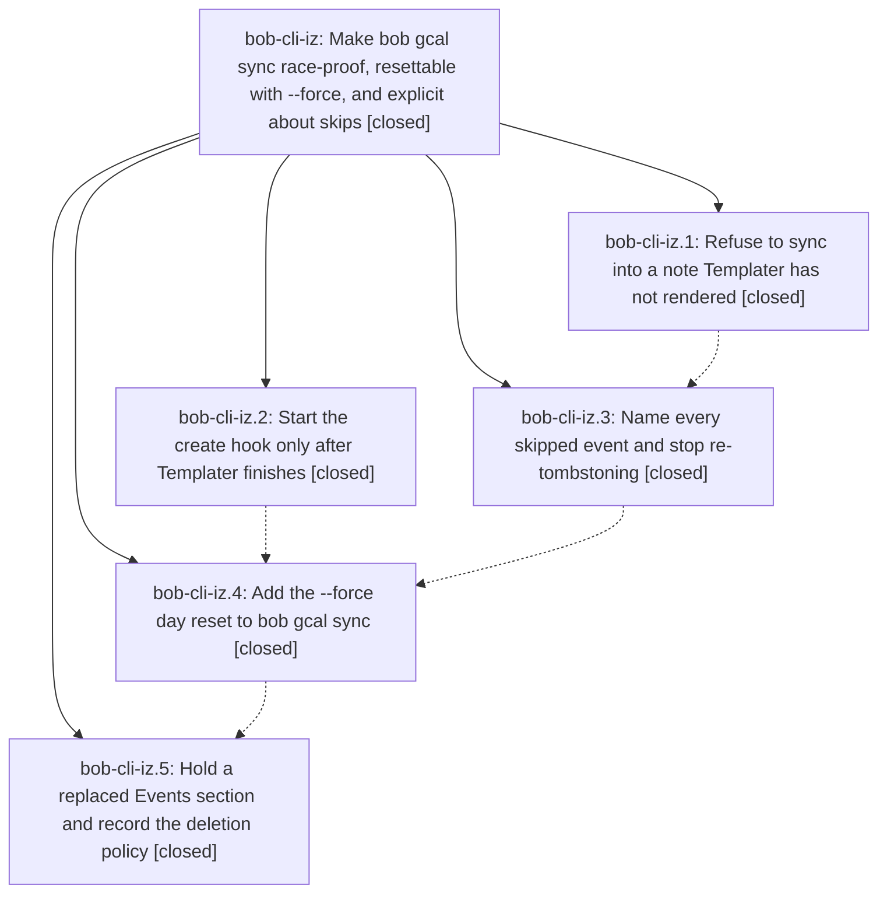

# Bead: bob-cli-iz — Make bob gcal sync race-proof, resettable with --force, and explicit about skips

[Bead Pages](../README.md) / bob-cli-iz

**Status:** ✓ closed · **Resolution:** done · **Type:** ▸ plan · **Tier:** epic
**Owner:** `bryanbugyi34@gmail.com` · **Created by:** [bbugyi200.athena.1aa](https://github.com/bobs-org/bob-cli--agents/blob/main/sessions/bbugyi200.athena.1aa.md) · **Assignee:** `bob-cli-iz.land`
**Created:** 2026-11-09 07:12:09 EST · **Closed:** 2026-11-09 21:35:00 EST
**Plan:** [202611/gcal\_sync\_race\_force\_and\_skip\_reasons.md](https://github.com/bobs-org/bob-cli--plans/blob/main/202611/gcal_sync_race_force_and_skip_reasons.md)

<!-- sase:links:start -->

## Links

| Relation | Artifact | Why |
| --- | --- | --- |
| implemented-by | [plan:202611/gcal_sync_race_force_and_skip_reasons.md][1] | derived from the plan's `bead_id:` frontmatter field |
| related | [bead:bob-cli-jf][2] | Incident surfaced while landing this epic; phase bob-cli-iz.5's commit only reached bob-mac-capture and was re-landed by the lander |

_Plus 1 automatic references — see [Referenced By](#referenced-by)._

[1]: https://github.com/bobs-org/bob-cli--plans/blob/main/202611/gcal_sync_race_force_and_skip_reasons.md
[2]: https://github.com/bobs-org/bob-cli--beads/blob/main/pages/bob-cli-jf/README.md

<!-- sase:links:end -->

## Description

A daily-note creation race can never again erase synced Event Tasks for good, `bob gcal sync --force` rewrites a day from Google as on its first sync, and every Google event sync leaves out is listed with a specific reason and fix.

## Notes

[2026-11-10T02:06:19Z · bob-cli-iz.land] LAND TRIAGE (bob-cli-iz.land, 2026-11-09)

Verified: all five phases are closed, and none left a PROPOSED FOLLOW-UP note.
- Phases 1, 3, and 4 are on bob-cli master as c28edbee, a449193b, and 97f0b8f1.
- Phase 2 is in bob-plugins as 77c34f1. It adds the readiness fragment with a 500 ms settle and 60 s bound, spawns `--format json`, has the decoder accept `held`, and shows waiting/held notices.
- The code honors every decision: force_edits=reset (reset.rs rebases spans and root so Google re-applies), replaced_events=hold, and force_short=capital_f (`-F`, alphabetical between --dry-run and --format). Both memory decisions are applied.

DISCOVERED ISSUE: phase 5 (9a0bb25c) never reached bob-cli. Workspace bob-cli_10's origin had been rewritten to bob-mac-capture, so that commit and a rebased bob-cli history were pushed onto bob-mac-capture's master. Filed as bug bob-cli-jf. I filed restore gate custom-192d8c97 for Bryan's approval and changed nothing remote. Locally I set origin back to bob-cli, kept the mixed master as refs/incident/bob-cli-10-mixed-master, reset to bob-cli 12692ebb, and re-applied phase 5 for this land turn's commit. On that tree `just check` passes fmt, lint, and every gcal suite.

Remaining epic work, planned as a tale:
- The replaced-section detector is not the one shared helper the plan asked for.
  - `list` infers held from status.json and re-reads it once per event. Before any sync it shows a clobbered section's rows as "removed by you" while sync would hold, and it keeps showing held after the note is fixed.
  - The helper finds rows only by block id, so a day with only block-less context rows whose ↻ stamp is deleted falsely holds.
  - No unit tests cover each trigger condition, and there is no "emptied section keeps its stamp" test.
- docs/gcal.md: "### Replaced Events sections" sits inside § Sync, ahead of the § Sync examples, and says "at least one journaled row" where it means every row. `events_replaced` is missing from the Skipped events table and actionable list, `lost · run sync -F` and the held header are missing from § List, held is missing from § Doctor, the `-q` sentence, and § JSON output, and docs/reference/json-outputs.md's gcal sync row lacks force/in_sync/skipped/waiting/held.

Integration: of the commits since the epic started (records, capture sized close, capture docs, vault-sync task losses), only de2f3215 (vault-sync lost tasks) intersects. docs/vault-git-sync.md § Lost tasks now points lost Event Tasks at `bob gcal sync -F` (Reset a day) instead of a hand restore. Committed in this land turn.

Follow-up triage:
1. The plan's conditional Gmail Templater-guard follow-up is declined. bob gmail sync writes mail notes and edits held task lines wherever they live, and it only reads today's Pomodoros. It never writes into the newly created daily note, so the trigger does not apply.
2. A true failure on master unrelated to this epic, task_merge mg18_merge_source_with_descendant_anchor_archives_through_bound_pair (3/3 deterministic), is recorded as a DISCOVERED ISSUE on in-progress epic bob-cli-j5.4.1 instead of a new task.
3. `just docs-check` fails on the bob-mac-capture mount: the cache clone holds bob-cli's tree because of bob-cli-jf. It is tracked there, related to bob-cli-it.

epic-symbols: none.

[2026-11-10T02:35:00Z · bob-cli-iz.land] Shared replaced-Events detector is live: `src/native/gcal/replaced.rs` is the one pure helper, used by both `sync` and `list`. Presence uses `plan::find_row_line` (block id, then 📅 URL). URL-less context rows inside an existing Events section count as present, so deleting only the stamp on a context-only day restores the stamp instead of holding; a missing Events section still holds, including for those rows. `list` computes held once from the note and journal (no `status.json`), so a clobbered note shows `held · Events replaced` / `lost · run sync -F` before any held sync, and the header clears once the note is restored.

Tests: 11 unit cases in `replaced.rs` (the plan's ten trigger conditions plus missing-section + URL-less context). Integration: `list_reads_a_replaced_section_before_any_held_sync`, `emptied_section_that_keeps_its_stamp_tombstones`, `context_only_stamp_deletion_restores_stamp_without_hold`. Existing `replaced_events_section_holds_until_force_reset` and `force_reset_restores_clobbered_rows_with_old_ids_and_then_noops` still pass.

Docs: `### Replaced Events sections` is now `## Replaced Events sections` after Reconciling; trigger is every journaled row gone and the stamp/section gone. `events_replaced` is in the skipped table and actionable list; list/doctor/`-q`/JSON cover held; `docs/reference/json-outputs.md` lists force/in_sync/skipped/waiting/held.

Verification: `cargo fmt --all -- --check` clean; clippy workspace clean of new denies; `cargo test --lib native::gcal` 224 passed; every `tests/gcal_*.rs` suite passed (auth 57, cli 6, diagnostics 4, lifecycle 44, list 12, sync 69). `just check` fails only on `native::task_merge::tests::mg18_merge_source_with_descendant_anchor_archives_through_bound_pair` (bob-cli-j5.4.1). `just docs-check` is blocked by bob-cli-jf (bob-mac-capture mount ships index.md colliding with the committed landing page). `just symvision` recipe does not exist. epic-symbols: none.

Phases 1–5 and the land triage were already verified (epic note #1).

## Phases

| Bead | Title | Status | Size | Created | Agents | Commits |
|---|---|---|---|---|---:|---:|
| [bob-cli-iz.1](bob-cli-iz.1.md) | Refuse to sync into a note Templater has not rendered | ✓ closed | small | 2026-11-09 | 1 | 1 |
| [bob-cli-iz.2](bob-cli-iz.2.md) | Start the create hook only after Templater finishes | ✓ closed | small | 2026-11-09 | 1 | 1 |
| [bob-cli-iz.3](bob-cli-iz.3.md) | Name every skipped event and stop re-tombstoning | ✓ closed | medium | 2026-11-09 | 1 | 1 |
| [bob-cli-iz.4](bob-cli-iz.4.md) | Add the --force day reset to bob gcal sync | ✓ closed | medium | 2026-11-09 | 1 | 1 |
| [bob-cli-iz.5](bob-cli-iz.5.md) | Hold a replaced Events section and record the deletion policy | ✓ closed | small | 2026-11-09 | 1 | 0 |

## Lineage

## Agents

| Agent | Bead | Commits |
|---|---|---:|
| [bbugyi200.athena.bob-cli-iz.1](https://github.com/bobs-org/bob-cli--agents/blob/main/agents/bbugyi200.athena.bob-cli-iz.1/README.md) | [bob-cli-iz.1](bob-cli-iz.1.md) | 1 |
| [bbugyi200.athena.bob-cli-iz.2](https://github.com/bobs-org/bob-cli--agents/blob/main/agents/bbugyi200.athena.bob-cli-iz.2/README.md) | [bob-cli-iz.2](bob-cli-iz.2.md) | 1 |
| [bbugyi200.athena.bob-cli-iz.3](https://github.com/bobs-org/bob-cli--agents/blob/main/agents/bbugyi200.athena.bob-cli-iz.3/README.md) | [bob-cli-iz.3](bob-cli-iz.3.md) | 1 |
| [bbugyi200.athena.bob-cli-iz.4](https://github.com/bobs-org/bob-cli--agents/blob/main/agents/bbugyi200.athena.bob-cli-iz.4/README.md) | [bob-cli-iz.4](bob-cli-iz.4.md) | 1 |
| [bbugyi200.athena.bob-cli-iz.5](https://github.com/bobs-org/bob-cli--agents/blob/main/agents/bbugyi200.athena.bob-cli-iz.5/README.md) | [bob-cli-iz.5](bob-cli-iz.5.md) | 0 |
| [bbugyi200.athena.bob-cli-iz.land](https://github.com/bobs-org/bob-cli--agents/blob/main/sessions/bbugyi200.athena.bob-cli-iz.land.md) | [bob-cli-iz](README.md) | 2 |

## Commits

| Repo | Commit | Subject | Bead | Committed |
|---|---|---|---|---|
| bob-plugins | [`bob-plugins@77c34f1`](https://github.com/bobs-org/bob-plugins/commit/77c34f163521dbddbd1955bcc04104398b83c375) | feat(ledger-tools): start the create hook only after Templater finishes | [bob-cli-iz.2](bob-cli-iz.2.md) | 2026-11-09 07:29:59 EST |
| bob-cli | [`c28edbe`](https://github.com/bobs-org/bob-cli/commit/c28edbeeb9834ccb515d1d25716dbb3d86bb6b2d) | feat(gcal): refuse to sync into a note Templater has not rendered | [bob-cli-iz.1](bob-cli-iz.1.md) | 2026-11-09 07:40:18 EST |
| bob-cli | [`a449193`](https://github.com/bobs-org/bob-cli/commit/a449193baa2ecd454b62e924e291d0745fbad614) | feat(gcal): name every skipped event and stop re-tombstoning | [bob-cli-iz.3](bob-cli-iz.3.md) | 2026-11-09 08:37:19 EST |
| bob-cli | [`97f0b8f`](https://github.com/bobs-org/bob-cli/commit/97f0b8f19b75c90e81e875c87462ae65850956db) | feat(gcal): add forced day reset | [bob-cli-iz.4](bob-cli-iz.4.md) | 2026-11-09 09:47:37 EST |
| bob-cli | [`d3f022a`](https://github.com/bobs-org/bob-cli/commit/d3f022a45cfa247305ec729b32168698dc42bb51) | feat(gcal)!: hold replaced Events sections | [bob-cli-iz](README.md) | 2026-11-09 21:08:39 EST |
| bob-cli | [`8ad8e27`](https://github.com/bobs-org/bob-cli/commit/8ad8e2703c1a9d52f5a5cd8ef4dc77e8009788e4) | fix(gcal): share the replaced-Events detector between sync and list | [bob-cli-iz](README.md) | 2026-11-09 21:36:20 EST |

<!-- sase:referenced-by:start -->

## Referenced By

| Relation | Artifact | Why | Uses |
| --- | --- | --- | ---: |
| read-by | [agent:bob-cli-iz.land][1] | Need the parent link | 2 |

[1]: https://github.com/bobs-org/bob-cli--agents/blob/main/sessions/bbugyi200.athena.bob-cli-iz.land.md

<!-- sase:referenced-by:end -->
