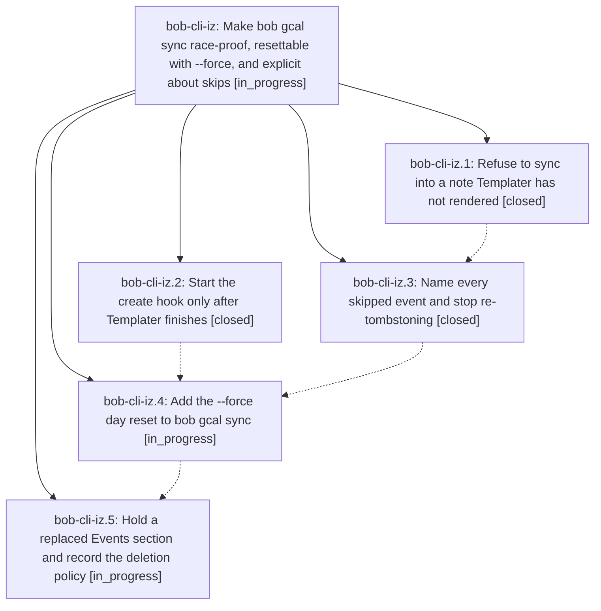

# Bead: bob-cli-iz — Make bob gcal sync race-proof, resettable with --force, and explicit about skips

[Bead Pages](../README.md) / bob-cli-iz

**Status:** ◐ in_progress · **Type:** ▸ plan · **Tier:** epic
**Owner:** `bryanbugyi34@gmail.com` · **Created by:** [bbugyi200.athena.1aa](https://github.com/bobs-org/bob-cli--agents/blob/main/sessions/bbugyi200.athena.1aa.md) · **Assignee:** `bob-cli-iz.land`
**Created:** 2026-11-09 07:12:09 EST
**Plan:** [202611/gcal\_sync\_race\_force\_and\_skip\_reasons.md](https://github.com/bobs-org/bob-cli--plans/blob/main/202611/gcal_sync_race_force_and_skip_reasons.md)

<!-- sase:links:start -->

## Links

| Relation | Artifact | Why |
| --- | --- | --- |
| implemented-by | [plan:202611/gcal_sync_race_force_and_skip_reasons.md][1] | derived from the plan's `bead_id:` frontmatter field |

[1]: https://github.com/bobs-org/bob-cli--plans/blob/main/202611/gcal_sync_race_force_and_skip_reasons.md

<!-- sase:links:end -->

## Description

A daily-note creation race can never again erase synced Event Tasks for good, `bob gcal sync --force` rewrites a day from Google as on its first sync, and every Google event sync leaves out is listed with a specific reason and fix.

## Phases

| Bead | Title | Status | Size | Created | Agents | Commits |
|---|---|---|---|---|---:|---:|
| [bob-cli-iz.1](bob-cli-iz.1.md) | Refuse to sync into a note Templater has not rendered | ✓ closed | small | 2026-11-09 | 1 | 1 |
| [bob-cli-iz.2](bob-cli-iz.2.md) | Start the create hook only after Templater finishes | ✓ closed | small | 2026-11-09 | 1 | 0 |
| [bob-cli-iz.3](bob-cli-iz.3.md) | Name every skipped event and stop re-tombstoning | ✓ closed | medium | 2026-11-09 | 1 | 1 |
| [bob-cli-iz.4](bob-cli-iz.4.md) | Add the --force day reset to bob gcal sync | ◐ in_progress | medium | 2026-11-09 | 1 | 0 |
| [bob-cli-iz.5](bob-cli-iz.5.md) | Hold a replaced Events section and record the deletion policy | ◐ in_progress | small | 2026-11-09 | 1 | 0 |

## Lineage

## Agents

| Agent | Bead | Commits |
|---|---|---:|
| [bbugyi200.athena.bob-cli-iz.1](https://github.com/bobs-org/bob-cli--agents/blob/main/agents/bbugyi200.athena.bob-cli-iz.1/README.md) | [bob-cli-iz.1](bob-cli-iz.1.md) | 1 |
| [bbugyi200.athena.bob-cli-iz.2](https://github.com/bobs-org/bob-cli--agents/blob/main/agents/bbugyi200.athena.bob-cli-iz.2/README.md) | [bob-cli-iz.2](bob-cli-iz.2.md) | 0 |
| [bbugyi200.athena.bob-cli-iz.3](https://github.com/bobs-org/bob-cli--agents/blob/main/agents/bbugyi200.athena.bob-cli-iz.3/README.md) | [bob-cli-iz.3](bob-cli-iz.3.md) | 1 |
| [bbugyi200.athena.bob-cli-iz.4](https://github.com/bobs-org/bob-cli--agents/blob/main/agents/bbugyi200.athena.bob-cli-iz.4/README.md) | [bob-cli-iz.4](bob-cli-iz.4.md) | 0 |
| [bbugyi200.athena.bob-cli-iz.5](https://github.com/bobs-org/bob-cli--agents/blob/main/agents/bbugyi200.athena.bob-cli-iz.5/README.md) | [bob-cli-iz.5](bob-cli-iz.5.md) | 0 |
| [bbugyi200.athena.bob-cli-iz.land](https://github.com/bobs-org/bob-cli--agents/blob/main/agents/bbugyi200.athena.bob-cli-iz.land/README.md) | [bob-cli-iz](README.md) | 0 |

## Commits

| Repo | Commit | Subject | Bead | Committed |
|---|---|---|---|---|
| bob-cli | [`c28edbe`](https://github.com/bobs-org/bob-cli/commit/c28edbeeb9834ccb515d1d25716dbb3d86bb6b2d) | feat(gcal): refuse to sync into a note Templater has not rendered | [bob-cli-iz.1](bob-cli-iz.1.md) | 2026-11-09 07:40:18 EST |
| bob-cli | [`a449193`](https://github.com/bobs-org/bob-cli/commit/a449193baa2ecd454b62e924e291d0745fbad614) | feat(gcal): name every skipped event and stop re-tombstoning | [bob-cli-iz.3](bob-cli-iz.3.md) | 2026-11-09 08:37:19 EST |
