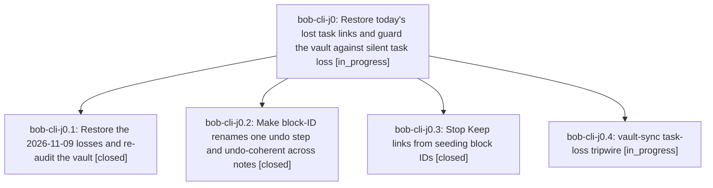

# Bead: bob-cli-j0 — Restore today's lost task links and guard the vault against silent task loss

[Bead Pages](../README.md) / bob-cli-j0

**Status:** ◐ in_progress · **Type:** ▸ plan · **Tier:** epic
**Owner:** `bryanbugyi34@gmail.com` · **Created by:** [bbugyi200.apollo.d4](https://github.com/bobs-org/bob-cli--agents/blob/main/sessions/bbugyi200.apollo.d4.md) · **Assignee:** `bob-cli-j0.land`
**Created:** 2026-11-09 07:43:10 EST
**Plan:** [202611/lost\_task\_guards.md](https://github.com/bobs-org/bob-cli--plans/blob/main/202611/lost_task_guards.md)

<!-- sase:links:start -->

## Links

| Relation | Artifact | Why |
| --- | --- | --- |
| implemented-by | [plan:202611/lost_task_guards.md][1] | derived from the plan's `bead_id:` frontmatter field |

[1]: https://github.com/bobs-org/bob-cli--plans/blob/main/202611/lost_task_guards.md

<!-- sase:links:end -->

## Description

The task links lost on 2026-11-09 resolve again. A block-ID rename becomes one unit: a single undo either reverts it in every note or leaves no link dangling. Keep-linked tasks stop getting URL-derived IDs like ^https-keep-google-com. And any future change that removes a linked task, or quietly drops an open one, is named by bob vault-sync within a minute, with the commit to restore it from, instead of being discovered by accident days later.

## Phases

| Bead | Title | Status | Size | Created | Agents | Commits |
|---|---|---|---|---|---:|---:|
| [bob-cli-j0.1](bob-cli-j0.1.md) | Restore the 2026-11-09 losses and re-audit the vault | ✓ closed | small | 2026-11-09 | 1 | 0 |
| [bob-cli-j0.2](bob-cli-j0.2.md) | Make block-ID renames one undo step and undo-coherent across notes | ✓ closed | medium | 2026-11-09 | 1 | 1 |
| [bob-cli-j0.3](bob-cli-j0.3.md) | Stop Keep links from seeding block IDs | ✓ closed | small | 2026-11-09 | 1 | 1 |
| [bob-cli-j0.4](bob-cli-j0.4.md) | vault-sync task-loss tripwire | ◐ in_progress | medium | 2026-11-09 | 1 | 0 |

## Lineage

## Agents

| Agent | Bead | Commits |
|---|---|---:|
| [bbugyi200.apollo.bob-cli-j0.1](https://github.com/bobs-org/bob-cli--agents/blob/main/agents/bbugyi200.apollo.bob-cli-j0.1/README.md) | [bob-cli-j0.1](bob-cli-j0.1.md) | 0 |
| [bbugyi200.apollo.bob-cli-j0.2](https://github.com/bobs-org/bob-cli--agents/blob/main/agents/bbugyi200.apollo.bob-cli-j0.2/README.md) | [bob-cli-j0.2](bob-cli-j0.2.md) | 1 |
| [bbugyi200.apollo.bob-cli-j0.3](https://github.com/bobs-org/bob-cli--agents/blob/main/agents/bbugyi200.apollo.bob-cli-j0.3/README.md) | [bob-cli-j0.3](bob-cli-j0.3.md) | 1 |
| [bbugyi200.apollo.bob-cli-j0.4](https://github.com/bobs-org/bob-cli--agents/blob/main/agents/bbugyi200.apollo.bob-cli-j0.4/README.md) | [bob-cli-j0.4](bob-cli-j0.4.md) | 0 |
| [bbugyi200.apollo.bob-cli-j0.land](https://github.com/bobs-org/bob-cli--agents/blob/main/agents/bbugyi200.apollo.bob-cli-j0.land/README.md) | [bob-cli-j0](README.md) | 0 |

## Commits

| Repo | Commit | Subject | Bead | Committed |
|---|---|---|---|---|
| bob-plugins | [`bob-plugins@94c6df5`](https://github.com/bobs-org/bob-plugins/commit/94c6df5be8172c017a7855510c2fa2679858b735) | fix(navigation): derive dependency IDs from task prose | [bob-cli-j0.3](bob-cli-j0.3.md) | 2026-11-09 07:52:18 EST |
| bob-plugins | [`bob-plugins@5e5e33b`](https://github.com/bobs-org/bob-plugins/commit/5e5e33b60f008c95fcd14b2ecbc2d71a9c30dfcd) | feat(block-id-prompt): make block-ID renames one undo step across notes | [bob-cli-j0.2](bob-cli-j0.2.md) | 2026-11-09 08:15:12 EST |
