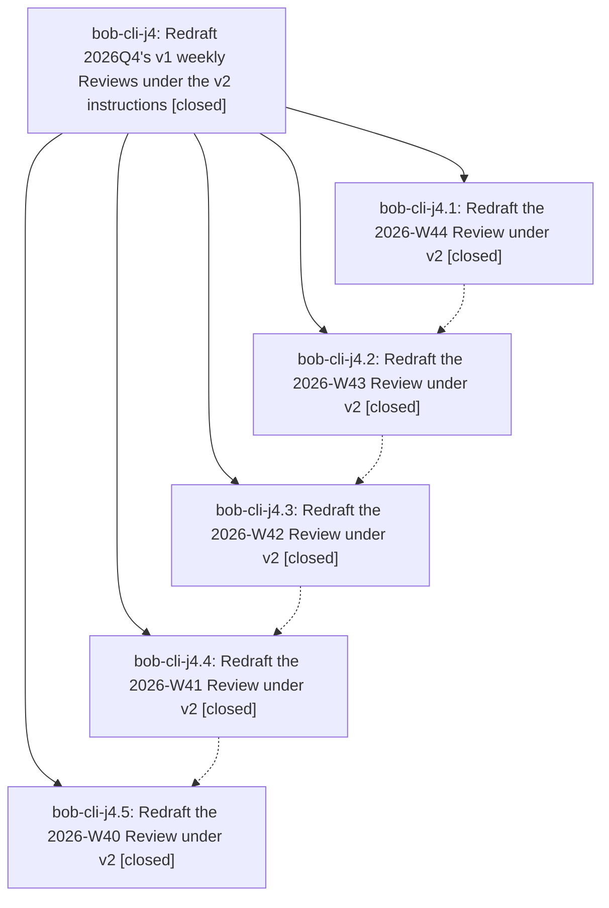

# Bead: bob-cli-j4 — Redraft 2026Q4's v1 weekly Reviews under the v2 instructions

[Bead Pages](../README.md) / bob-cli-j4

**Status:** ✓ closed · **Resolution:** done · **Type:** ▸ plan · **Tier:** epic
**Owner:** `bryanbugyi34@gmail.com` · **Created by:** [bbugyi200.athena.1ac.f0](https://github.com/bobs-org/bob-cli--agents/blob/main/sessions/bbugyi200.athena.1ac.f0.md) · **Assignee:** `bob-cli-j4.land`
**Created:** 2026-11-09 10:48:48 EST · **Closed:** 2026-11-09 12:01:47 EST
**Plan:** [202611/q4\_weekly\_reviews\_v2\_redraft.md](https://github.com/bobs-org/bob-cli--plans/blob/main/202611/q4_weekly_reviews_v2_redraft.md)

<!-- sase:links:start -->

## Links

| Relation | Artifact | Why |
| --- | --- | --- |
| implemented-by | [plan:202611/q4_weekly_reviews_v2_redraft.md][1] | derived from the plan's `bead_id:` frontmatter field |

[1]: https://github.com/bobs-org/bob-cli--plans/blob/main/202611/q4_weekly_reviews_v2_redraft.md

<!-- sase:links:end -->

## Description

Every closed 2026-Q4 week still carrying a v1 Review (W40–W44) has a v2 Review saved through `bob periods draft`, so the first quarterly review on 2027-01-04 reads work-first, one-line Headlines instead of stats-first ones.

## Notes

[2026-11-09T17:01:33Z · bob-cli-j4.land] DISCOVERED ISSUE: two stale 'also carried' marks follow from the newest-first redraft order. (1) bob-cli-j4.1: 2026-W45 Review marks [[sase_memory_plan#^ref-docs-backed-memory-and-agent-maintained]] (Docs as Memory) 'also carried in W44', but W44's v2 Carried forward (vault bbde9e626) correctly leaves it out (kept only 2x by Nov 1, under the callout's 3+ keep bar). (2) bob-cli-j4.5: 2026-W41 Carried forward lists [[done/sase_done#^release-v18]] without 'also carried in W40'. W40's v1 Review had no Still open list, but its v2 (vault cc0d1f8d3) now carries ^release-v18. Triage outcome: declined both as edits and as new task beads. The approved plan made step 11 report-only ('Do not edit the other note'), put W45 and every other vault note out of scope, and allowed new beads only for bob defects that block a draft. Bryan also approved W41's exact text through its phase tale. Each fix is a one-clause re-save through 'bob periods draft 2026-W41|2026-W45 -i <file>', which keeps the drafted state; it is left to Bryan.

[2026-11-09T17:01:47Z · bob-cli-j4.land] Verified all 5 phases against the vault. In bob periods list, W40-W44 now read drafted with v2 work-first one-line Headlines of 20-23 words. No Review has a gtd_daily or routine row, and each uses the v2 Shipped / Carried forward / Questions parts with 0-2 numbered Questions. Each redraft commit touches only its own note: W44 bbde9e626, W43 f60676d7f, W42 d8ad9475e, W41 ae317accc, W40 cc0d1f8d3. The hunks touch only review_digest/review_drafted and ## Review. -F was used only on W44 and W41, after git evidence that their false edited state came from archive link moves (f84e23596, 7b414a272) and the cf0e7a67d callout refresh. W39 (Q3) remains v1, and W45-W47 are untouched. Integration: the epic made no bob-cli commits, by design. The bob-cli commits since it started (f231b9d3, 0f31c592, 84ff0bb8: capture aliases, record_note) and the vault commits since then do not touch period notes or periods code. Nothing to integrate. No epic symbols. Follow-ups: j4.1's stale W45 'also carried in W44' mark and j4.5's unmarked W41 ^release-v18 item are caused by this epic's newest-first order. Both were declined as edits and as task beads: the approved plan made next-week checks report-only, put W45 out of scope, allowed new beads only for blocking bob defects, and Bryan approved W41's exact text. Both are recorded in a DISCOVERED ISSUE note for Bryan to decide.

## Phases

| Bead | Title | Status | Size | Created | Agents | Commits |
|---|---|---|---|---|---:|---:|
| [bob-cli-j4.1](bob-cli-j4.1.md) | Redraft the 2026-W44 Review under v2 | ✓ closed | xlarge | 2026-11-09 | 1 | 0 |
| [bob-cli-j4.2](bob-cli-j4.2.md) | Redraft the 2026-W43 Review under v2 | ✓ closed | xlarge | 2026-11-09 | 1 | 0 |
| [bob-cli-j4.3](bob-cli-j4.3.md) | Redraft the 2026-W42 Review under v2 | ✓ closed | xlarge | 2026-11-09 | 1 | 0 |
| [bob-cli-j4.4](bob-cli-j4.4.md) | Redraft the 2026-W41 Review under v2 | ✓ closed | xlarge | 2026-11-09 | 1 | 0 |
| [bob-cli-j4.5](bob-cli-j4.5.md) | Redraft the 2026-W40 Review under v2 | ✓ closed | xlarge | 2026-11-09 | 1 | 0 |

## Lineage

## Agents

| Agent | Bead | Commits |
|---|---|---:|
| [bbugyi200.athena.bob-cli-j4.1](https://github.com/bobs-org/bob-cli--agents/blob/main/sessions/bbugyi200.athena.bob-cli-j4.1.md) | [bob-cli-j4.1](bob-cli-j4.1.md) | 0 |
| [bbugyi200.athena.bob-cli-j4.2](https://github.com/bobs-org/bob-cli--agents/blob/main/sessions/bbugyi200.athena.bob-cli-j4.2.md) | [bob-cli-j4.2](bob-cli-j4.2.md) | 0 |
| [bbugyi200.athena.bob-cli-j4.3](https://github.com/bobs-org/bob-cli--agents/blob/main/sessions/bbugyi200.athena.bob-cli-j4.3.md) | [bob-cli-j4.3](bob-cli-j4.3.md) | 0 |
| [bbugyi200.athena.bob-cli-j4.4](https://github.com/bobs-org/bob-cli--agents/blob/main/sessions/bbugyi200.athena.bob-cli-j4.4.md) | [bob-cli-j4.4](bob-cli-j4.4.md) | 0 |
| [bbugyi200.athena.bob-cli-j4.5](https://github.com/bobs-org/bob-cli--agents/blob/main/sessions/bbugyi200.athena.bob-cli-j4.5.md) | [bob-cli-j4.5](bob-cli-j4.5.md) | 0 |
| [bbugyi200.athena.bob-cli-j4.land](https://github.com/bobs-org/bob-cli--agents/blob/main/agents/bbugyi200.athena.bob-cli-j4.land/README.md) | [bob-cli-j4](README.md) | 1 |

## Commits

| Repo | Commit | Subject | Bead | Committed |
|---|---|---|---|---|
| bob-cli--plans | [`bob-cli--plans@9478be3`](https://github.com/bobs-org/bob-cli--plans/commit/9478be34e5f65492c53dd4444132682d29842f86) | chore(plans): mark q4\_weekly\_reviews\_v2\_redraft done after bob-cli-j4 landed | [bob-cli-j4](README.md) | 2026-11-09 12:02:29 EST |
