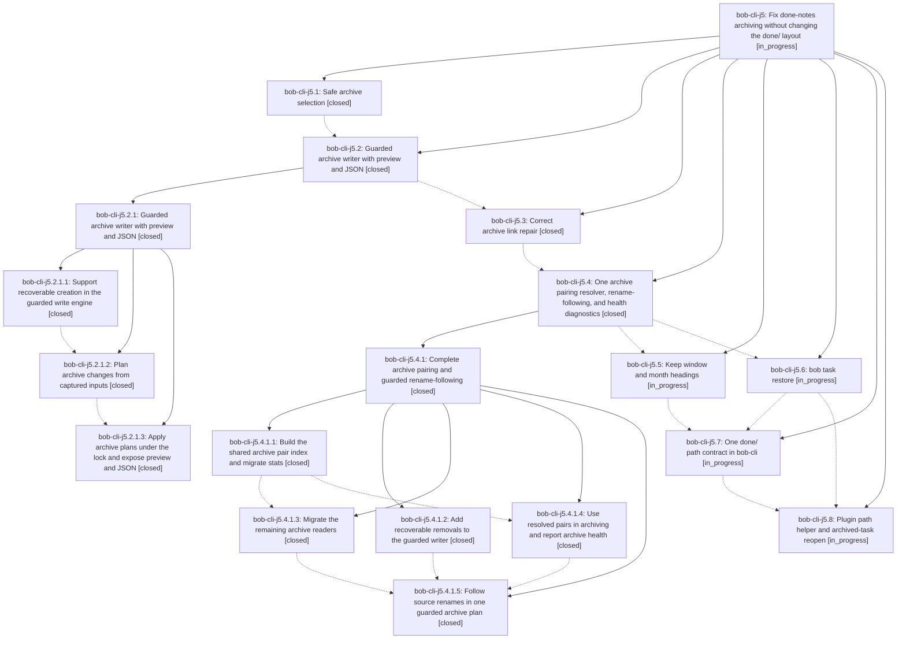

# Bead: bob-cli-j5 — Fix done-notes archiving without changing the done/ layout

[Bead Pages](../README.md) / bob-cli-j5

**Status:** ◐ in_progress · **Type:** ▸ plan · **Tier:** epic
**Owner:** `bryanbugyi34@gmail.com` · **Created by:** [bbugyi200.athena.1ai](https://github.com/bobs-org/bob-cli--agents/blob/main/sessions/bbugyi200.athena.1ai.md) · **Assignee:** `bob-cli-j5.land`
**Created:** 2026-11-09 11:04:08 EST
**Plan:** [202611/done\_notes\_archiving\_fixes.md](https://github.com/bobs-org/bob-cli--plans/blob/main/202611/done_notes_archiving_fixes.md)

<!-- sase:links:start -->

## Links

| Relation | Artifact | Why |
| --- | --- | --- |
| implemented-by | [plan:202611/done_notes_archiving_fixes.md][1] | derived from the plan's `bead_id:` frontmatter field |
| related | file:explicit:82c6a707ddd506f8b0f9d403 | attached via sase artifact create --bead |

[1]: https://github.com/bobs-org/bob-cli--plans/blob/main/202611/done_notes_archiving_fixes.md

<!-- sase:links:end -->

## Description

`bob task archive` moves only what it should, from notes that should feed done/, at a predictable time, through a writer as safe as `bob task move`. Archive pairing survives renames, every Bob path check agrees on what done/ means, and an archived task can come back with one command or one plugin gesture.

## Notes

[2026-11-10T03:22:59Z · bob-cli-j8.3.1.land] DISCOVERED ISSUE: Independent reproduction in the approved notebook-capture workspace: cargo test --lib mg18_merge_source_with_descendant_anchor_archives_through_bound_pair -- --nocapture exits 101 with only that test failing (6,248 filtered). The test expects its fixture's done/custom_archive destination, but copied links remain on done/src_done; source: src/native/task_merge/tests.rs:3042. Neither task_merge nor collect_done is changed by this notebook work. Durable reproduction: file:explicit:82c6a707ddd506f8b0f9d403. This corroborates the already-recorded custom archive pairing issue; no new task bead filed.

## Phases

| Bead | Title | Status | Size | Created | Agents | Commits |
|---|---|---|---|---|---:|---:|
| [bob-cli-j5.1](bob-cli-j5.1.md) | Safe archive selection | ✓ closed | medium | 2026-11-09 | 1 | 1 |
| [bob-cli-j5.2](bob-cli-j5.2.md) | Guarded archive writer with preview and JSON | ✓ closed | large | 2026-11-09 | 1 | 0 |
| [bob-cli-j5.3](bob-cli-j5.3.md) | Correct archive link repair | ✓ closed | medium | 2026-11-09 | 1 | 1 |
| [bob-cli-j5.4](bob-cli-j5.4.md) | One archive pairing resolver, rename-following, and health diagnostics | ✓ closed | large | 2026-11-09 | 1 | 0 |
| [bob-cli-j5.5](bob-cli-j5.5.md) | Keep window and month headings | ◐ in_progress | medium | 2026-11-09 | 1 | 0 |
| [bob-cli-j5.6](bob-cli-j5.6.md) | bob task restore | ◐ in_progress | medium | 2026-11-09 | 1 | 0 |
| [bob-cli-j5.7](bob-cli-j5.7.md) | One done/ path contract in bob-cli | ◐ in_progress | medium | 2026-11-09 | 1 | 0 |
| [bob-cli-j5.8](bob-cli-j5.8.md) | Plugin path helper and archived-task reopen | ◐ in_progress | medium | 2026-11-09 | 1 | 0 |

## Lineage

## Agents

| Agent | Bead | Commits |
|---|---|---:|
| [bbugyi200.athena.bob-cli-j5.1](https://github.com/bobs-org/bob-cli--agents/blob/main/agents/bbugyi200.athena.bob-cli-j5.1/README.md) | [bob-cli-j5.1](bob-cli-j5.1.md) | 1 |
| [bbugyi200.athena.bob-cli-j5.2](https://github.com/bobs-org/bob-cli--agents/blob/main/sessions/bbugyi200.athena.bob-cli-j5.2.md) | [bob-cli-j5.2](bob-cli-j5.2.md) | 0 |
| [bbugyi200.athena.bob-cli-j5.2.1.1](https://github.com/bobs-org/bob-cli--agents/blob/main/sessions/bbugyi200.athena.bob-cli-j5.2.1.1.md) | [bob-cli-j5.2.1.1](bob-cli-j5.2.1.1.md) | 1 |
| [bbugyi200.athena.bob-cli-j5.2.1.2](https://github.com/bobs-org/bob-cli--agents/blob/main/agents/bbugyi200.athena.bob-cli-j5.2.1.2/README.md) | [bob-cli-j5.2.1.2](bob-cli-j5.2.1.2.md) | 1 |
| [bbugyi200.athena.bob-cli-j5.2.1.3](https://github.com/bobs-org/bob-cli--agents/blob/main/agents/bbugyi200.athena.bob-cli-j5.2.1.3/README.md) | [bob-cli-j5.2.1.3](bob-cli-j5.2.1.3.md) | 1 |
| [bbugyi200.athena.bob-cli-j5.2.1.land](https://github.com/bobs-org/bob-cli--agents/blob/main/sessions/bbugyi200.athena.bob-cli-j5.2.1.land.md) | [bob-cli-j5.2.1](bob-cli-j5.2.1.md) | 2 |
| [bbugyi200.athena.bob-cli-j5.3](https://github.com/bobs-org/bob-cli--agents/blob/main/agents/bbugyi200.athena.bob-cli-j5.3/README.md) | [bob-cli-j5.3](bob-cli-j5.3.md) | 1 |
| [bbugyi200.athena.bob-cli-j5.4](https://github.com/bobs-org/bob-cli--agents/blob/main/sessions/bbugyi200.athena.bob-cli-j5.4.md) | [bob-cli-j5.4](bob-cli-j5.4.md) | 0 |
| [bbugyi200.athena.bob-cli-j5.4.1.1](https://github.com/bobs-org/bob-cli--agents/blob/main/agents/bbugyi200.athena.bob-cli-j5.4.1.1/README.md) | [bob-cli-j5.4.1.1](bob-cli-j5.4.1.1.md) | 1 |
| [bbugyi200.athena.bob-cli-j5.4.1.2](https://github.com/bobs-org/bob-cli--agents/blob/main/sessions/bbugyi200.athena.bob-cli-j5.4.1.2.md) | [bob-cli-j5.4.1.2](bob-cli-j5.4.1.2.md) | 1 |
| [bbugyi200.athena.bob-cli-j5.4.1.3](https://github.com/bobs-org/bob-cli--agents/blob/main/agents/bbugyi200.athena.bob-cli-j5.4.1.3/README.md) | [bob-cli-j5.4.1.3](bob-cli-j5.4.1.3.md) | 1 |
| [bbugyi200.athena.bob-cli-j5.4.1.4](https://github.com/bobs-org/bob-cli--agents/blob/main/agents/bbugyi200.athena.bob-cli-j5.4.1.4/README.md) | [bob-cli-j5.4.1.4](bob-cli-j5.4.1.4.md) | 1 |
| [bbugyi200.athena.bob-cli-j5.4.1.5](https://github.com/bobs-org/bob-cli--agents/blob/main/agents/bbugyi200.athena.bob-cli-j5.4.1.5/README.md) | [bob-cli-j5.4.1.5](bob-cli-j5.4.1.5.md) | 1 |
| [bbugyi200.athena.bob-cli-j5.4.1.land](https://github.com/bobs-org/bob-cli--agents/blob/main/sessions/bbugyi200.athena.bob-cli-j5.4.1.land.md) | [bob-cli-j5.4.1](bob-cli-j5.4.1.md) | 3 |
| [bbugyi200.athena.bob-cli-j5.5](https://github.com/bobs-org/bob-cli--agents/blob/main/agents/bbugyi200.athena.bob-cli-j5.5/README.md) | [bob-cli-j5.5](bob-cli-j5.5.md) | 0 |
| [bbugyi200.athena.bob-cli-j5.6](https://github.com/bobs-org/bob-cli--agents/blob/main/agents/bbugyi200.athena.bob-cli-j5.6/README.md) | [bob-cli-j5.6](bob-cli-j5.6.md) | 0 |
| [bbugyi200.athena.bob-cli-j5.7](https://github.com/bobs-org/bob-cli--agents/blob/main/agents/bbugyi200.athena.bob-cli-j5.7/README.md) | [bob-cli-j5.7](bob-cli-j5.7.md) | 0 |
| [bbugyi200.athena.bob-cli-j5.8](https://github.com/bobs-org/bob-cli--agents/blob/main/agents/bbugyi200.athena.bob-cli-j5.8/README.md) | [bob-cli-j5.8](bob-cli-j5.8.md) | 0 |
| [bbugyi200.athena.bob-cli-j5.land](https://github.com/bobs-org/bob-cli--agents/blob/main/agents/bbugyi200.athena.bob-cli-j5.land/README.md) | [bob-cli-j5](README.md) | 0 |

## Commits

| Repo | Commit | Subject | Bead | Committed |
|---|---|---|---|---|
| bob-cli | [`f1ee393`](https://github.com/bobs-org/bob-cli/commit/f1ee393db4cfe49a78e75af68b3e1a5e3b5b61fd) | feat(archive): select only area and project notes for done/ | [bob-cli-j5.1](bob-cli-j5.1.md) | 2026-11-09 12:08:49 EST |
| bob-cli | [`2b5b832`](https://github.com/bobs-org/bob-cli/commit/2b5b8328777bece6483df518bada4f0b9143ff01) | feat(archive): create missing files in the guarded write engine | [bob-cli-j5.2.1.1](bob-cli-j5.2.1.1.md) | 2026-11-09 13:11:02 EST |
| bob-cli | [`37df0e5`](https://github.com/bobs-org/bob-cli/commit/37df0e52cf364c82bf5017ea8ee74d9443f66801) | feat(collect-done): snapshot inputs with exact replay and plan-wide refusal | [bob-cli-j5.2.1.2](bob-cli-j5.2.1.2.md) | 2026-11-09 14:18:18 EST |
| bob-cli | [`e802071`](https://github.com/bobs-org/bob-cli/commit/e802071f8d39039a5ae7c8b191ec456ca8557db0) | feat(archive): apply plans under the lock with dry-run preview and JSON report | [bob-cli-j5.2.1.3](bob-cli-j5.2.1.3.md) | 2026-11-09 15:10:57 EST |
| bob-cli | [`2455d9d`](https://github.com/bobs-org/bob-cli/commit/2455d9dbcaaa67936cf9b1eaaa8e842cd409422b) | fix(archive): repair guarded landing validation | [bob-cli-j5.2.1](bob-cli-j5.2.1.md) | 2026-11-09 16:06:02 EST |
| bob-cli--plans | [`bob-cli--plans@1e8d36a`](https://github.com/bobs-org/bob-cli--plans/commit/1e8d36a191d0f57d0dcceaa3c1b11c77d1d71516) | docs(plan): mark guarded archive writer done | [bob-cli-j5.2.1](bob-cli-j5.2.1.md) | 2026-11-09 16:06:34 EST |
| bob-cli | [`a846a23`](https://github.com/bobs-org/bob-cli/commit/a846a23b73a07956bdf2bd4ca0026f8d20ca2d9d) | feat(archive)!: correct archive link repair | [bob-cli-j5.3](bob-cli-j5.3.md) | 2026-11-09 16:32:51 EST |
| bob-cli | [`b97d8d4`](https://github.com/bobs-org/bob-cli/commit/b97d8d4c3b214d1f73f0627f868a108ff6755a66) | feat(archive): add recoverable removals to the guarded writer | [bob-cli-j5.4.1.2](bob-cli-j5.4.1.2.md) | 2026-11-09 17:29:23 EST |
| bob-cli | [`0ed552a`](https://github.com/bobs-org/bob-cli/commit/0ed552a5e997c30bb78dd909eea91f957e012024) | feat(archive)!: resolve archive pairs from metadata first | [bob-cli-j5.4.1.1](bob-cli-j5.4.1.1.md) | 2026-11-09 17:58:46 EST |
| bob-cli | [`0996111`](https://github.com/bobs-org/bob-cli/commit/0996111cd31bd514c23760f2c53385003a1439df) | feat(archive): migrate remaining archive readers | [bob-cli-j5.4.1.3](bob-cli-j5.4.1.3.md) | 2026-11-09 18:43:43 EST |
| bob-cli | [`2327590`](https://github.com/bobs-org/bob-cli/commit/2327590f2caabced31e6320a232d57355dfe2007) | feat(archive): report health findings and use bound pair destinations | [bob-cli-j5.4.1.4](bob-cli-j5.4.1.4.md) | 2026-11-09 19:00:25 EST |
| bob-cli | [`03dfe6d`](https://github.com/bobs-org/bob-cli/commit/03dfe6deb86d6accfc825dc107136b198f5438be) | feat(collect-done): rename-following archive plan with link repair | [bob-cli-j5.4.1.5](bob-cli-j5.4.1.5.md) | 2026-11-09 19:50:15 EST |
| bob-cli | [`eba2bd5`](https://github.com/bobs-org/bob-cli/commit/eba2bd59a6fa6fdf8e827adbda1d42c03d97519b) | test(archive): cover stats attribution and Git commit across archive renames | [bob-cli-j5.4.1](bob-cli-j5.4.1.md) | 2026-11-09 20:28:56 EST |
| bob-cli | [`d65be1c`](https://github.com/bobs-org/bob-cli/commit/d65be1ce02b66f9a08c6a31049990aa74cccca65) | perf(archive): cache pair facts for read-only consumers | [bob-cli-j5.4.1](bob-cli-j5.4.1.md) | 2026-11-09 22:24:11 EST |
| bob-cli--plans | [`bob-cli--plans@60fec5c`](https://github.com/bobs-org/bob-cli--plans/commit/60fec5ca8562af388a55802c9d99427d292b97ca) | docs(plans): mark archive pairing plan done | [bob-cli-j5.4.1](bob-cli-j5.4.1.md) | 2026-11-09 22:24:47 EST |
