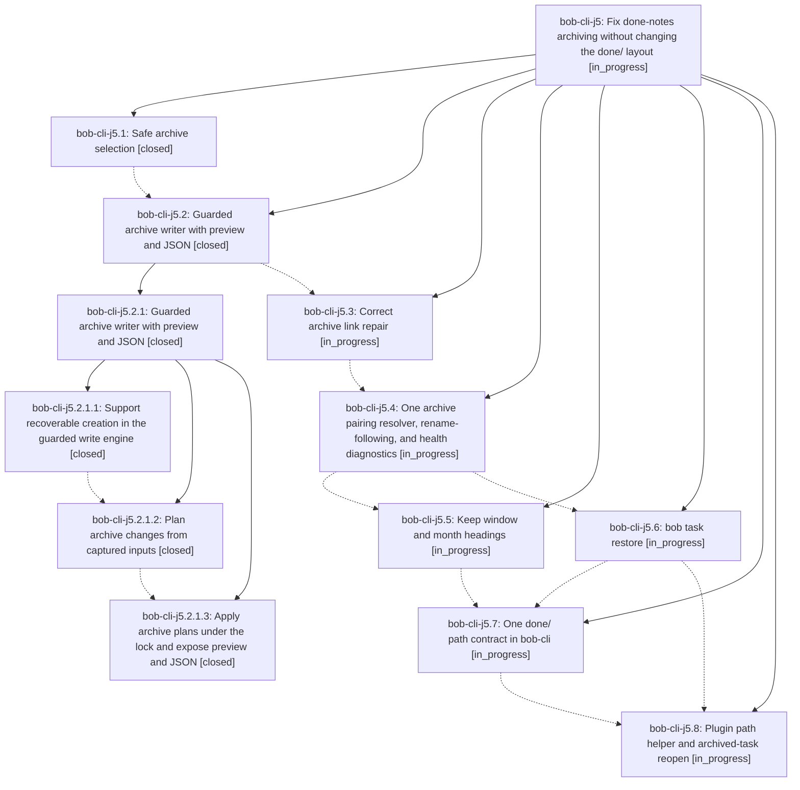

# Bead: bob-cli-j5 — Fix done-notes archiving without changing the done/ layout

[Bead Pages](../README.md) / bob-cli-j5

**Status:** ◐ in_progress · **Type:** ▸ plan · **Tier:** epic
**Owner:** `bryanbugyi34@gmail.com` · **Created by:** [bbugyi200.athena.1ai](https://github.com/bobs-org/bob-cli--agents/blob/main/sessions/bbugyi200.athena.1ai.md) · **Assignee:** `bob-cli-j5.land`
**Created:** 2026-11-09 11:04:08 EST
**Plan:** [202611/done\_notes\_archiving\_fixes.md](https://github.com/bobs-org/bob-cli--plans/blob/main/202611/done_notes_archiving_fixes.md)

<!-- sase:links:start -->

## Links

| Relation | Artifact | Why |
| --- | --- | --- |
| implemented-by | [plan:202611/done_notes_archiving_fixes.md][1] | derived from the plan's `bead_id:` frontmatter field |

[1]: https://github.com/bobs-org/bob-cli--plans/blob/main/202611/done_notes_archiving_fixes.md

<!-- sase:links:end -->

## Description

`bob task archive` moves only what it should, from notes that should feed done/, at a predictable time, through a writer as safe as `bob task move`. Archive pairing survives renames, every Bob path check agrees on what done/ means, and an archived task can come back with one command or one plugin gesture.

## Phases

| Bead | Title | Status | Size | Created | Agents | Commits |
|---|---|---|---|---|---:|---:|
| [bob-cli-j5.1](bob-cli-j5.1.md) | Safe archive selection | ✓ closed | medium | 2026-11-09 | 1 | 1 |
| [bob-cli-j5.2](bob-cli-j5.2.md) | Guarded archive writer with preview and JSON | ✓ closed | large | 2026-11-09 | 1 | 0 |
| [bob-cli-j5.3](bob-cli-j5.3.md) | Correct archive link repair | ◐ in_progress | medium | 2026-11-09 | 1 | 0 |
| [bob-cli-j5.4](bob-cli-j5.4.md) | One archive pairing resolver, rename-following, and health diagnostics | ◐ in_progress | large | 2026-11-09 | 1 | 0 |
| [bob-cli-j5.5](bob-cli-j5.5.md) | Keep window and month headings | ◐ in_progress | medium | 2026-11-09 | 1 | 0 |
| [bob-cli-j5.6](bob-cli-j5.6.md) | bob task restore | ◐ in_progress | medium | 2026-11-09 | 1 | 0 |
| [bob-cli-j5.7](bob-cli-j5.7.md) | One done/ path contract in bob-cli | ◐ in_progress | medium | 2026-11-09 | 1 | 0 |
| [bob-cli-j5.8](bob-cli-j5.8.md) | Plugin path helper and archived-task reopen | ◐ in_progress | medium | 2026-11-09 | 1 | 0 |

## Lineage

## Agents

| Agent | Bead | Commits |
|---|---|---:|
| [bbugyi200.athena.bob-cli-j5.1](https://github.com/bobs-org/bob-cli--agents/blob/main/agents/bbugyi200.athena.bob-cli-j5.1/README.md) | [bob-cli-j5.1](bob-cli-j5.1.md) | 1 |
| [bbugyi200.athena.bob-cli-j5.2](https://github.com/bobs-org/bob-cli--agents/blob/main/sessions/bbugyi200.athena.bob-cli-j5.2.md) | [bob-cli-j5.2](bob-cli-j5.2.md) | 0 |
| [bbugyi200.athena.bob-cli-j5.2.1.1](https://github.com/bobs-org/bob-cli--agents/blob/main/sessions/bbugyi200.athena.bob-cli-j5.2.1.1.md) | [bob-cli-j5.2.1.1](bob-cli-j5.2.1.1.md) | 1 |
| [bbugyi200.athena.bob-cli-j5.2.1.2](https://github.com/bobs-org/bob-cli--agents/blob/main/agents/bbugyi200.athena.bob-cli-j5.2.1.2/README.md) | [bob-cli-j5.2.1.2](bob-cli-j5.2.1.2.md) | 1 |
| [bbugyi200.athena.bob-cli-j5.2.1.3](https://github.com/bobs-org/bob-cli--agents/blob/main/agents/bbugyi200.athena.bob-cli-j5.2.1.3/README.md) | [bob-cli-j5.2.1.3](bob-cli-j5.2.1.3.md) | 1 |
| [bbugyi200.athena.bob-cli-j5.2.1.land](https://github.com/bobs-org/bob-cli--agents/blob/main/sessions/bbugyi200.athena.bob-cli-j5.2.1.land.md) | [bob-cli-j5.2.1](bob-cli-j5.2.1.md) | 2 |
| [bbugyi200.athena.bob-cli-j5.3](https://github.com/bobs-org/bob-cli--agents/blob/main/agents/bbugyi200.athena.bob-cli-j5.3/README.md) | [bob-cli-j5.3](bob-cli-j5.3.md) | 0 |
| [bbugyi200.athena.bob-cli-j5.4](https://github.com/bobs-org/bob-cli--agents/blob/main/agents/bbugyi200.athena.bob-cli-j5.4/README.md) | [bob-cli-j5.4](bob-cli-j5.4.md) | 0 |
| [bbugyi200.athena.bob-cli-j5.5](https://github.com/bobs-org/bob-cli--agents/blob/main/agents/bbugyi200.athena.bob-cli-j5.5/README.md) | [bob-cli-j5.5](bob-cli-j5.5.md) | 0 |
| [bbugyi200.athena.bob-cli-j5.6](https://github.com/bobs-org/bob-cli--agents/blob/main/agents/bbugyi200.athena.bob-cli-j5.6/README.md) | [bob-cli-j5.6](bob-cli-j5.6.md) | 0 |
| [bbugyi200.athena.bob-cli-j5.7](https://github.com/bobs-org/bob-cli--agents/blob/main/agents/bbugyi200.athena.bob-cli-j5.7/README.md) | [bob-cli-j5.7](bob-cli-j5.7.md) | 0 |
| [bbugyi200.athena.bob-cli-j5.8](https://github.com/bobs-org/bob-cli--agents/blob/main/agents/bbugyi200.athena.bob-cli-j5.8/README.md) | [bob-cli-j5.8](bob-cli-j5.8.md) | 0 |
| [bbugyi200.athena.bob-cli-j5.land](https://github.com/bobs-org/bob-cli--agents/blob/main/agents/bbugyi200.athena.bob-cli-j5.land/README.md) | [bob-cli-j5](README.md) | 0 |

## Commits

| Repo | Commit | Subject | Bead | Committed |
|---|---|---|---|---|
| bob-cli | [`f1ee393`](https://github.com/bobs-org/bob-cli/commit/f1ee393db4cfe49a78e75af68b3e1a5e3b5b61fd) | feat(archive): select only area and project notes for done/ | [bob-cli-j5.1](bob-cli-j5.1.md) | 2026-11-09 12:08:49 EST |
| bob-cli | [`2b5b832`](https://github.com/bobs-org/bob-cli/commit/2b5b8328777bece6483df518bada4f0b9143ff01) | feat(archive): create missing files in the guarded write engine | [bob-cli-j5.2.1.1](bob-cli-j5.2.1.1.md) | 2026-11-09 13:11:02 EST |
| bob-cli | [`37df0e5`](https://github.com/bobs-org/bob-cli/commit/37df0e52cf364c82bf5017ea8ee74d9443f66801) | feat(collect-done): snapshot inputs with exact replay and plan-wide refusal | [bob-cli-j5.2.1.2](bob-cli-j5.2.1.2.md) | 2026-11-09 14:18:18 EST |
| bob-cli | [`e802071`](https://github.com/bobs-org/bob-cli/commit/e802071f8d39039a5ae7c8b191ec456ca8557db0) | feat(archive): apply plans under the lock with dry-run preview and JSON report | [bob-cli-j5.2.1.3](bob-cli-j5.2.1.3.md) | 2026-11-09 15:10:57 EST |
| bob-cli | [`2455d9d`](https://github.com/bobs-org/bob-cli/commit/2455d9dbcaaa67936cf9b1eaaa8e842cd409422b) | fix(archive): repair guarded landing validation | [bob-cli-j5.2.1](bob-cli-j5.2.1.md) | 2026-11-09 16:06:02 EST |
| bob-cli--plans | [`bob-cli--plans@1e8d36a`](https://github.com/bobs-org/bob-cli--plans/commit/1e8d36a191d0f57d0dcceaa3c1b11c77d1d71516) | docs(plan): mark guarded archive writer done | [bob-cli-j5.2.1](bob-cli-j5.2.1.md) | 2026-11-09 16:06:34 EST |
