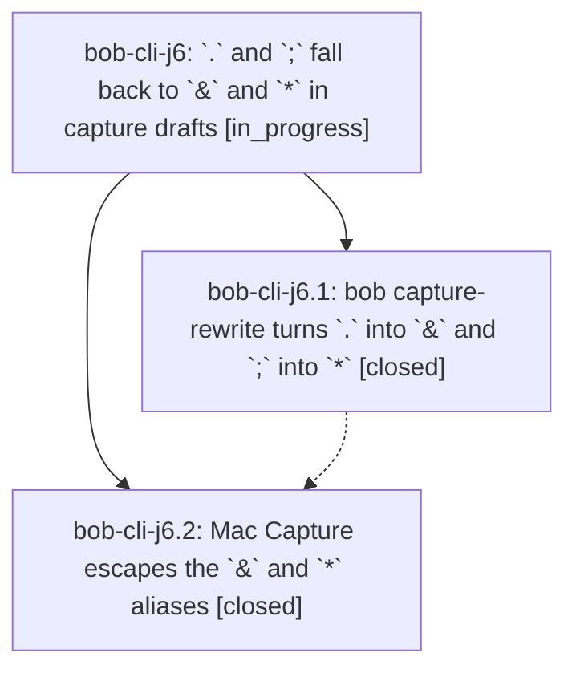

# Bead: bob-cli-j6 — \`.\` and \`;\` fall back to \`&\` and \`\*\` in capture drafts

[Bead Pages](../README.md) / bob-cli-j6

**Status:** ◐ in_progress · **Type:** ▸ plan · **Tier:** epic
**Owner:** `bryanbugyi34@gmail.com` · **Created by:** [bbugyi200.athena.1aj](https://github.com/bobs-org/bob-cli--agents/blob/main/sessions/bbugyi200.athena.1aj.md) · **Assignee:** `bob-cli-j6.land`
**Created:** 2026-11-09 11:06:45 EST
**Plan:** [202611/dot\_semicolon\_modifier\_aliases.md](https://github.com/bobs-org/bob-cli--plans/blob/main/202611/dot_semicolon_modifier_aliases.md)

<!-- sase:links:start -->

## Links

| Relation | Artifact | Why |
| --- | --- | --- |
| implemented-by | [plan:202611/dot_semicolon_modifier_aliases.md][1] | derived from the plan's `bead_id:` frontmatter field |

_Plus 2 automatic references — see [Referenced By](#referenced-by)._

[1]: https://github.com/bobs-org/bob-cli--plans/blob/main/202611/dot_semicolon_modifier_aliases.md

<!-- sase:links:end -->

## Description

In Bob Mac Capture, a `.` or `;` typed where the `^`, `@`, and `:` aliases do not apply, but a bare `&` or `*` would open the Depends On or Blocks picker, becomes that sigil and opens that picker (`@home .` → `@home &`, `Buy milk ;` → `Buy milk *`). It escapes the same way the spaced `.` → `@` alias does.

## Phases

| Bead | Title | Status | Size | Created | Agents | Commits |
|---|---|---|---|---|---:|---:|
| [bob-cli-j6.1](bob-cli-j6.1.md) | bob capture-rewrite turns \`.\` into \`&\` and \`;\` into \`\*\` | ✓ closed | medium | 2026-11-09 | 1 | 1 |
| [bob-cli-j6.2](bob-cli-j6.2.md) | Mac Capture escapes the \`&\` and \`\*\` aliases | ✓ closed | medium | 2026-11-09 | 1 | 2 |

## Lineage

## Agents

| Agent | Bead | Commits |
|---|---|---:|
| [bbugyi200.athena.bob-cli-j6.1](https://github.com/bobs-org/bob-cli--agents/blob/main/agents/bbugyi200.athena.bob-cli-j6.1/README.md) | [bob-cli-j6.1](bob-cli-j6.1.md) | 1 |
| [bbugyi200.athena.bob-cli-j6.2](https://github.com/bobs-org/bob-cli--agents/blob/main/sessions/bbugyi200.athena.bob-cli-j6.2.md) | [bob-cli-j6.2](bob-cli-j6.2.md) | 2 |
| [bbugyi200.athena.bob-cli-j6.land](https://github.com/bobs-org/bob-cli--agents/blob/main/agents/bbugyi200.athena.bob-cli-j6.land/README.md) | [bob-cli-j6](README.md) | 0 |

## Commits

| Repo | Commit | Subject | Bead | Committed |
|---|---|---|---|---|
| bob-cli | [`0f31c59`](https://github.com/bobs-org/bob-cli/commit/0f31c592fc22800923e556b70066704603fad526) | feat(capture): alias . to & and ; to \* in capture drafts | [bob-cli-j6.1](bob-cli-j6.1.md) | 2026-11-09 11:32:59 EST |
| bob-cli | [`3c1b645`](https://github.com/bobs-org/bob-cli/commit/3c1b6451d49ea71b24c21cb33643c42977d191e5) | docs(glossary): describe capture modifier aliases | [bob-cli-j6.2](bob-cli-j6.2.md) | 2026-11-09 12:48:11 EST |
| bob-mac-capture | [`bob-mac-capture@ef5dc4a`](https://github.com/bobs-org/bob-mac-capture/commit/ef5dc4ab02138241f3f73b83e54df67d623fd00a) | feat(capture): support modifier alias escapes | [bob-cli-j6.2](bob-cli-j6.2.md) | 2026-11-09 13:20:29 EST |

<!-- sase:referenced-by:start -->

## Referenced By

| Relation | Artifact | Why | Uses |
| --- | --- | --- | ---: |
| read-by | [agent:bob-cli-j6.1][1] | epic context | 1 |
| read-by | [agent:research.3x.final][2] | Check whether the in-progress . / ; alias epic affects notebook alias recommendations | 1 |

[1]: https://github.com/bobs-org/bob-cli--agents/blob/main/agents/bbugyi200.athena.bob-cli-j6.1/README.md
[2]: https://github.com/bobs-org/bob-cli--agents/blob/main/agents/bbugyi200.athena.research.3x.final/README.md

<!-- sase:referenced-by:end -->
