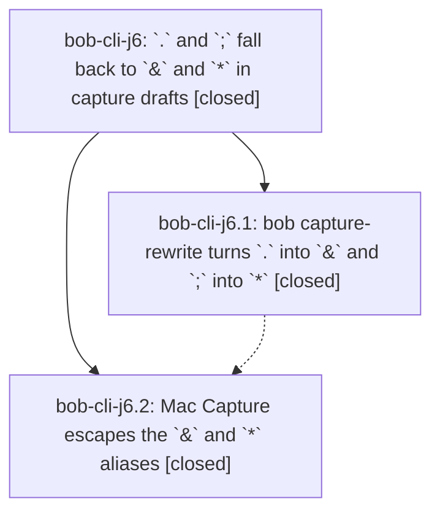

# Bead: bob-cli-j6 — \`.\` and \`;\` fall back to \`&\` and \`\*\` in capture drafts

[Bead Pages](../README.md) / bob-cli-j6

**Status:** ✓ closed · **Resolution:** done · **Type:** ▸ plan · **Tier:** epic
**Owner:** `bryanbugyi34@gmail.com` · **Created by:** [bbugyi200.athena.1aj](https://github.com/bobs-org/bob-cli--agents/blob/main/sessions/bbugyi200.athena.1aj.md) · **Assignee:** `bob-cli-j6.land`
**Created:** 2026-11-09 11:06:45 EST · **Closed:** 2026-11-09 15:13:10 EST
**Plan:** [202611/dot\_semicolon\_modifier\_aliases.md](https://github.com/bobs-org/bob-cli--plans/blob/main/202611/dot_semicolon_modifier_aliases.md)

<!-- sase:links:start -->

## Links

| Relation | Artifact | Why |
| --- | --- | --- |
| implemented-by | [plan:202611/dot_semicolon_modifier_aliases.md][1] | derived from the plan's `bead_id:` frontmatter field |
| related | [bead:bob-cli-ja][2] | The j6 epic introduced the . -> & and ; -> * fallbacks; ir.land recorded this as DISCOVERED ISSUE note #3 on it |
| related | [bead:bob-cli-jb][3] | Failed in the j6 landing gate on a tree identical to a passing master run; j6.2 does not change the = path |

_Plus 4 automatic references — see [Referenced By](#referenced-by)._

[1]: https://github.com/bobs-org/bob-cli--plans/blob/main/202611/dot_semicolon_modifier_aliases.md
[2]: https://github.com/bobs-org/bob-cli--beads/blob/main/pages/bob-cli-ja/README.md
[3]: https://github.com/bobs-org/bob-cli--beads/blob/main/pages/bob-cli-jb/README.md

<!-- sase:links:end -->

## Description

In Bob Mac Capture, a `.` or `;` typed where the `^`, `@`, and `:` aliases do not apply, but a bare `&` or `*` would open the Depends On or Blocks picker, becomes that sigil and opens that picker (`@home .` → `@home &`, `Buy milk ;` → `Buy milk *`). It escapes the same way the spaced `.` → `@` alias does.

## Notes

[2026-11-09T18:33:01Z · bob-cli-j6.land] FOLLOW-UP TRIAGE (before tale proposal): reviewed every note on j6.1 and j6.2. The sole PROPOSED FOLLOW-UP is j6.2 note #1, mounted Mac docs word budgets. Used sase_new_task; searched same-type and all-type candidates, swept the last week, and inspected active epics. Corroborated existing bob-cli-h9 (+4) with current just docs-check: Mac panel 6013, previews 6424, keyboard 6028, protocol 6048. No duplicate task was created; the proposal is accepted as existing work, not declined. Historical count_words confirms j6 reduces panel 6020->6013, keyboard 6029->6028, protocol 6062->6048. Later Record Notes growth (json-outputs 5999->6024 by 84ff0bb8; previews 6174->6314->6424 and protocol 5996->6062 by fe9ce15/a5152aa) was recorded as DISCOVERED ISSUE on bob-cli-ir; Mac overlap is also corroborated on h9. Separately routed exact-SHA CI 42673185238 missing .addTo switch cases to owning active epic bob-cli-ir, rather than creating an unrelated CI task. Alias restore/fixture/docs defects found here are remaining j6 work and will be fixed by the closeout tale, not filed away.

[2026-11-09T18:33:23Z · bob-cli-j6.land] LAND AUDIT: reviewed approved plan, final DECISIONS, both closed phase scopes and every note, Rust commits 0f31c592/3c1b6451, Mac ef5dc4a, and post-start history in both checkouts. Current heads bob-cli 4b59ae81 and Mac ef5dc4a include their origin/master refs. Rust precedence/shared completion gates, one-byte edits, Unicode/negative/idempotence tests and CLI cases implement after_text; the indented-semicolon plan correction is preserved. Only authorized capture-alias memory changed. Later typing-tip work 4b59ae81 and Mac bd06c21 already include dependency/blocked_task IDs and reverse-proof coverage; archive, Gmail and record-output changes do not need alias changes. Remaining j6 gaps: (1) relationEqualsOpenerRestorable rejects &, *, and ~ when no picker exists, regressing pre-picker Space/Escape; (2) fake-bob exits before modifier completion delay, measured 0.010/0.009s with 0.8s requested, so the race test is not effective; (3) ef5dc4a resurrected the 2Xx fixture branch deleted by 90fa59d, now exits 1 for a nonexistent file; (4) capture-panel.md wrongly says leading .bashrc/.5 needs .. despite after_text. Exact Mac CI 42673185238 is red at Build on unrelated ir.12 .addTo exhaustive-switch omissions, so phase scratch checks do not prove the integrated tree. just docs-check reproduces only five recorded budget failures; no current just check pass claimed. epic-symbols reports none, symvision recipe is absent in both checkouts, and j6 has no parent. Validated medium tale sase_plan_modifier_alias_landing.md fixes only remaining work, handles minimal compile integration if still needed, and explicitly finishes j6 closeout after working-tree/precommit verification without waiting on its own commit or push.

[2026-11-09T19:09:27Z · bob-cli-ir.land] DISCOVERED ISSUE (bob-cli-ir.land, Record Notes integration audit on master 0a74731b): the spaced-alias fallbacks fire inside record field values, where Bob's vault-aware completion reports the opaque record_value context and no picker opens. With records config restaurant (dir eat), bob capture-complete -c END on 'Ninja Sushi @eat/\n- category:: sushi &' returns context record_value, yet the vault-free bob capture-rewrite -c END turns 'Ninja Sushi @eat/\n- category:: sushi ;' into '... sushi *' (alias blocked_task) and '... sushi .' into '... sushi @' (route_after_text, from bob-cli-iu.1 0b8b913f). This contradicts the j6 gate's own rule ('only where a bare * would open the Blocks picker'): the lexical rewrite cannot classify @eat/ as a record route, and record values have been opaque since bob-cli-ir.6 07ff3bf0. Impact: rare (a space then . or ; inside a key:: value), and the Mac escape restores the literal, but the stored value gains a stray sigil. Fix direction: suppress the shared spaced-alias fallbacks inside first-level key:: value bullets of record items (the Mac already has the record_value context from capture-complete, or capture-rewrite learns the record route shape). No duplicate task found (searched record_value/capture-rewrite/alias with record, plus the one-week sweep). Record Notes is landing without changing alias code to avoid colliding with the in-flight j6 landing tale.

[2026-11-09T19:38:25Z · 1al--code] Coordination: the .addTo compile adaptation landed on master through 3131414 (Record Notes fix for ir note #6), so the j6 closeout incorporates it rather than reapplying. Note the landed bodies differ from the closeout's pending draft: all three switches use 'case .addTo, .open, .discard, .unknown' with empty returns (not 'Updates record text'); compile-equivalent and unreachable for record rows. Exact-SHA CI run 42680342242 for 3131414: Build success, Lint success; Test has 2 failures, one j6-owned: CaptureRelationEqualsAliasTests.testFastSpaceRestoresEqualsBeforeTheCompletionReplyOpens (XCTAssertNil/XCTAssertEqual, 'Fix it ~ ' vs 'Fix it = '). The other failure (CaptureRecordCardDesignTests.testRecordCardAccessibilityIdentitiesMatchPersistentState, 'Companions, kelly, optional, default' vs 'Companions, optional, default') is Record Notes area and was recorded on bob-cli-ir. Newer in-progress run 42684781881 (modifier alias picker keys) was left for its owner.

[2026-11-09T20:13:10Z · bob-cli-j6.land--2] LANDED by bob-cli-j6.land. Both phases were closed; the landing tale fixed the four remaining audit gaps (Space/Escape restore of &, *, and ~ before the picker exists; fake-bob completion delay now honored with an observable marker; resurrected 2Xx fixture branch removed; capture-panel.md leading-dot text corrected) and added the .addTo presentational case.

VERIFICATION
- just check (bob-cli, no Rust changes in the landing): passed. Main test suite 6040 passed, 3 ignored; every later Rust test summary was green. The monitor wrapper's first exit 127 was only its wrong path to target/debug/bob (the Cargo target dir is elsewhere); no check failed.
- bob capture-rewrite contract assertions against the built bob: all 11 passed ('@home .' -> '@home &', 'Buy milk ;' -> 'Buy milk *', 'Buy milk .' -> 'Buy milk @', '@errands.' -> '@errands^', ';' -> ':', '  ;' -> '  :', literal '.', '  .', '- .', '- [ ] .', and '@cash^goog-exit@\n- .' -> '...\n- ^').
- Mac platform gate (the Mac laptop was offline, so no scratch compile): the working-tree macos-ci-check run 42685512004 (snapshot b1ccc479, tree identical to b1a90fa) passed Lint, Build, Upload steps and failed Test with two tests, so Bundle, plist/signature, launch, and install were skipped there. Neither failure is an alias regression. (1) CaptureRecordCardDesignTests.testRecordCardAccessibilityIdentitiesMatchPersistentState expected a Companions label without the fixture default "kelly": a Record Notes card fixture, not alias code, fixed on master by 0eeba70 (bob-cli-j9.3). (2) CaptureRelationEqualsAliasTests.testFastDoubleEqualsBeforeReplyCollapsesToOne passed on the same tree in master run 42684781881 and in 34 of 36 recent runs, and j6.2 does not change the =/= path: a CI-load race in the test, filed as bob-cli-jb. Exact-SHA master run 42686284282 on 5987de4, which contains every j6 commit (b1a90fa) plus 0eeba70 and the ir docs trims, is green end to end: Lint Swift formatting, Build, Test (4561 tests, 1 skipped, 0 failures), Bundle, Verify plist and signature, Launch smoke test, Install and reinstall. Not waiting on CI for the finalizer commit.
- Docs: just docs-check with the Mac checkout mounted at 5987de4 reports only capture-panel.md 6006 (j6 lowered it from 6020) and keyboard.md 6028 (from 6029), both tracked by bob-cli-h9 (+4 corroboration from the earlier triage). Record Notes growth in protocol.md and capture-previews.md was cleared by 5987de4 and is recorded on bob-cli-ir note #12.
- .addTo compile fix: fixed on master by 3131414; j6's b1a90fa adds only the "Updates record text" case. Disposition appended to bob-cli-ir (note #12).
- just symvision: recipe absent in this checkout (and in the Mac checkout). sase bead epic-symbols bob-cli-j6 reports no entries.
- Follow-up tasks: bob-cli-ja (j6 note #3 DISCOVERED ISSUE: spaced . and ; fallbacks fire inside record key:: values; reproduced independently with a built bob) and bob-cli-jb (the flake above).

## Phases

| Bead | Title | Status | Size | Created | Agents | Commits |
|---|---|---|---|---|---:|---:|
| [bob-cli-j6.1](bob-cli-j6.1.md) | bob capture-rewrite turns \`.\` into \`&\` and \`;\` into \`\*\` | ✓ closed | medium | 2026-11-09 | 1 | 1 |
| [bob-cli-j6.2](bob-cli-j6.2.md) | Mac Capture escapes the \`&\` and \`\*\` aliases | ✓ closed | medium | 2026-11-09 | 1 | 2 |

## Lineage

## Agents

| Agent | Bead | Commits |
|---|---|---:|
| [bbugyi200.athena.bob-cli-j6.1](https://github.com/bobs-org/bob-cli--agents/blob/main/agents/bbugyi200.athena.bob-cli-j6.1/README.md) | [bob-cli-j6.1](bob-cli-j6.1.md) | 1 |
| [bbugyi200.athena.bob-cli-j6.2](https://github.com/bobs-org/bob-cli--agents/blob/main/sessions/bbugyi200.athena.bob-cli-j6.2.md) | [bob-cli-j6.2](bob-cli-j6.2.md) | 2 |
| [bbugyi200.athena.bob-cli-j6.land](https://github.com/bobs-org/bob-cli--agents/blob/main/sessions/bbugyi200.athena.bob-cli-j6.land.md) | [bob-cli-j6](README.md) | 2 |

## Commits

| Repo | Commit | Subject | Bead | Committed |
|---|---|---|---|---|
| bob-cli | [`0f31c59`](https://github.com/bobs-org/bob-cli/commit/0f31c592fc22800923e556b70066704603fad526) | feat(capture): alias . to & and ; to \* in capture drafts | [bob-cli-j6.1](bob-cli-j6.1.md) | 2026-11-09 11:32:59 EST |
| bob-cli | [`3c1b645`](https://github.com/bobs-org/bob-cli/commit/3c1b6451d49ea71b24c21cb33643c42977d191e5) | docs(glossary): describe capture modifier aliases | [bob-cli-j6.2](bob-cli-j6.2.md) | 2026-11-09 12:48:11 EST |
| bob-mac-capture | [`bob-mac-capture@ef5dc4a`](https://github.com/bobs-org/bob-mac-capture/commit/ef5dc4ab02138241f3f73b83e54df67d623fd00a) | feat(capture): support modifier alias escapes | [bob-cli-j6.2](bob-cli-j6.2.md) | 2026-11-09 13:20:29 EST |
| bob-mac-capture | [`bob-mac-capture@b1a90fa`](https://github.com/bobs-org/bob-mac-capture/commit/b1a90faf96d0483c87b844d77ce4456b4b01d2ab) | feat(capture): restore modifier alias picker keys (bob-cli-j6) | [bob-cli-j6](README.md) | 2026-11-09 14:35:09 EST |
| bob-cli--plans | [`bob-cli--plans@c938fe3`](https://github.com/bobs-org/bob-cli--plans/commit/c938fe376780fa1b21aed3468034de08ccef62b4) | docs(plans): mark the dot and semicolon modifier alias plan done (bob-cli-j6) | [bob-cli-j6](README.md) | 2026-11-09 15:14:10 EST |

<!-- sase:referenced-by:start -->

## Referenced By

| Relation | Artifact | Why | Uses |
| --- | --- | --- | ---: |
| read-by | [agent:1al--code][1] | Implement mac_add_to_build_fix plan: check newer notes on ownership | 1 |
| read-by | [agent:bob-cli-j6.1][2] | epic context | 1 |
| read-by | [agent:bob-cli-j6.land--1][3] | Re-read the landing epic and all attached notes before closeout | 1 |
| read-by | [agent:research.3x.final][4] | Check whether the in-progress . / ; alias epic affects notebook alias recommendations | 1 |

[1]: https://github.com/bobs-org/bob-cli--agents/blob/main/sessions/bbugyi200.athena.1al.md
[2]: https://github.com/bobs-org/bob-cli--agents/blob/main/agents/bbugyi200.athena.bob-cli-j6.1/README.md
[3]: https://github.com/bobs-org/bob-cli--agents/blob/main/sessions/bbugyi200.athena.bob-cli-j6.land.md
[4]: https://github.com/bobs-org/bob-cli--agents/blob/main/agents/bbugyi200.athena.research.3x.final/README.md

<!-- sase:referenced-by:end -->
