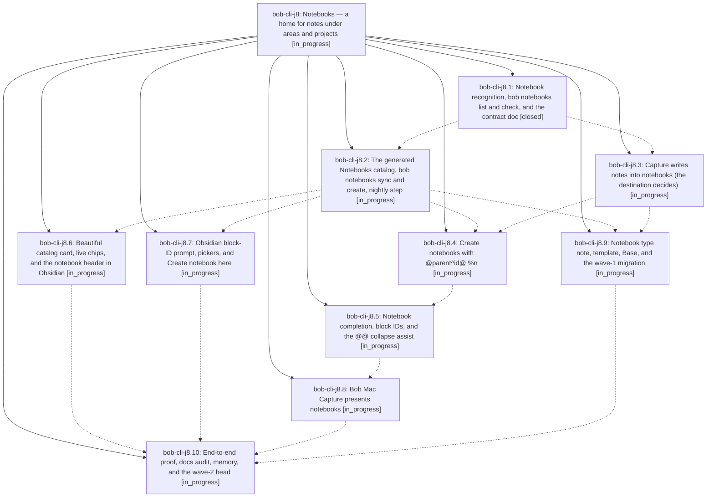

# Bead: bob-cli-j8 — Notebooks — a home for notes under areas and projects

[Bead Pages](../README.md) / bob-cli-j8

**Status:** ◐ in_progress · **Type:** ▸ plan · **Tier:** epic
**Owner:** `bryanbugyi34@gmail.com` · **Created by:** [bbugyi200.apollo.research.3x.linker.w0](https://github.com/bobs-org/bob-cli--agents/blob/main/sessions/bbugyi200.apollo.research.3x.linker.w0.md) · **Assignee:** `bob-cli-j8.land`
**Created:** 2026-11-09 12:11:27 EST
**Plan:** [202611/bob\_notebooks.md](https://github.com/bobs-org/bob-cli--plans/blob/main/202611/bob_notebooks.md)

<!-- sase:links:start -->

## Links

| Relation | Artifact | Why |
| --- | --- | --- |
| implemented-by | [plan:202611/bob_notebooks.md][1] | derived from the plan's `bead_id:` frontmatter field |

[1]: https://github.com/bobs-org/bob-cli--plans/blob/main/202611/bob_notebooks.md

<!-- sase:links:end -->

## Description

Bob gains a `type: "[[notebook]]"` note kind for task-free note bullets (optionally under `##` sections) that always hangs under an area, project, or notebook. Capture writes notes into notebooks through the existing `@nb` forms, creates notebooks with `@parent^id@ %n 
`, and every area or project shows a beautiful generated `## Notebooks` catalog. 26 existing notes, 11 of them rescued from the zorg dead end, become the first notebooks.

## Phases

| Bead | Title | Status | Size | Created | Agents | Commits |
|---|---|---|---|---|---:|---:|
| [bob-cli-j8.1](bob-cli-j8.1.md) | Notebook recognition, bob notebooks list and check, and the contract doc | ✓ closed | large | 2026-11-09 | 1 | 1 |
| [bob-cli-j8.10](bob-cli-j8.10.md) | End-to-end proof, docs audit, memory, and the wave-2 bead | ◐ in_progress | medium | 2026-11-09 | 1 | 0 |
| [bob-cli-j8.2](bob-cli-j8.2.md) | The generated Notebooks catalog, bob notebooks sync and create, nightly step | ◐ in_progress | large | 2026-11-09 | 1 | 0 |
| [bob-cli-j8.3](bob-cli-j8.3.md) | Capture writes notes into notebooks (the destination decides) | ◐ in_progress | large | 2026-11-09 | 1 | 0 |
| [bob-cli-j8.4](bob-cli-j8.4.md) | Create notebooks with @parent^id@ %n | ◐ in_progress | large | 2026-11-09 | 1 | 0 |
| [bob-cli-j8.5](bob-cli-j8.5.md) | Notebook completion, block IDs, and the @@ collapse assist | ◐ in_progress | large | 2026-11-09 | 1 | 0 |
| [bob-cli-j8.6](bob-cli-j8.6.md) | Beautiful catalog card, live chips, and the notebook header in Obsidian | ◐ in_progress | large | 2026-11-09 | 1 | 0 |
| [bob-cli-j8.7](bob-cli-j8.7.md) | Obsidian block-ID prompt, pickers, and Create notebook here | ◐ in_progress | medium | 2026-11-09 | 1 | 0 |
| [bob-cli-j8.8](bob-cli-j8.8.md) | Bob Mac Capture presents notebooks | ◐ in_progress | large | 2026-11-09 | 1 | 0 |
| [bob-cli-j8.9](bob-cli-j8.9.md) | Notebook type note, template, Base, and the wave-1 migration | ◐ in_progress | medium | 2026-11-09 | 1 | 0 |

## Lineage

## Agents

| Agent | Bead | Commits |
|---|---|---:|
| [bbugyi200.apollo.bob-cli-j8.1](https://github.com/bobs-org/bob-cli--agents/blob/main/sessions/bbugyi200.apollo.bob-cli-j8.1.md) | [bob-cli-j8.1](bob-cli-j8.1.md) | 1 |
| [bbugyi200.apollo.bob-cli-j8.10](https://github.com/bobs-org/bob-cli--agents/blob/main/agents/bbugyi200.apollo.bob-cli-j8.10/README.md) | [bob-cli-j8.10](bob-cli-j8.10.md) | 0 |
| [bbugyi200.apollo.bob-cli-j8.2](https://github.com/bobs-org/bob-cli--agents/blob/main/agents/bbugyi200.apollo.bob-cli-j8.2/README.md) | [bob-cli-j8.2](bob-cli-j8.2.md) | 0 |
| [bbugyi200.apollo.bob-cli-j8.3](https://github.com/bobs-org/bob-cli--agents/blob/main/agents/bbugyi200.apollo.bob-cli-j8.3/README.md) | [bob-cli-j8.3](bob-cli-j8.3.md) | 0 |
| [bbugyi200.apollo.bob-cli-j8.4](https://github.com/bobs-org/bob-cli--agents/blob/main/agents/bbugyi200.apollo.bob-cli-j8.4/README.md) | [bob-cli-j8.4](bob-cli-j8.4.md) | 0 |
| [bbugyi200.apollo.bob-cli-j8.5](https://github.com/bobs-org/bob-cli--agents/blob/main/agents/bbugyi200.apollo.bob-cli-j8.5/README.md) | [bob-cli-j8.5](bob-cli-j8.5.md) | 0 |
| [bbugyi200.apollo.bob-cli-j8.6](https://github.com/bobs-org/bob-cli--agents/blob/main/agents/bbugyi200.apollo.bob-cli-j8.6/README.md) | [bob-cli-j8.6](bob-cli-j8.6.md) | 0 |
| [bbugyi200.apollo.bob-cli-j8.7](https://github.com/bobs-org/bob-cli--agents/blob/main/agents/bbugyi200.apollo.bob-cli-j8.7/README.md) | [bob-cli-j8.7](bob-cli-j8.7.md) | 0 |
| [bbugyi200.apollo.bob-cli-j8.8](https://github.com/bobs-org/bob-cli--agents/blob/main/agents/bbugyi200.apollo.bob-cli-j8.8/README.md) | [bob-cli-j8.8](bob-cli-j8.8.md) | 0 |
| [bbugyi200.apollo.bob-cli-j8.9](https://github.com/bobs-org/bob-cli--agents/blob/main/agents/bbugyi200.apollo.bob-cli-j8.9/README.md) | [bob-cli-j8.9](bob-cli-j8.9.md) | 0 |
| [bbugyi200.apollo.bob-cli-j8.land](https://github.com/bobs-org/bob-cli--agents/blob/main/agents/bbugyi200.apollo.bob-cli-j8.land/README.md) | [bob-cli-j8](README.md) | 0 |

## Commits

| Repo | Commit | Subject | Bead | Committed |
|---|---|---|---|---|
| bob-cli | [`0a74731`](https://github.com/bobs-org/bob-cli/commit/0a74731b24809ad1b7572de977ac8c7a2f9cc59b) | feat(notebooks): recognize notebooks with list, check, and contract docs | [bob-cli-j8.1](bob-cli-j8.1.md) | 2026-11-09 13:41:47 EST |
