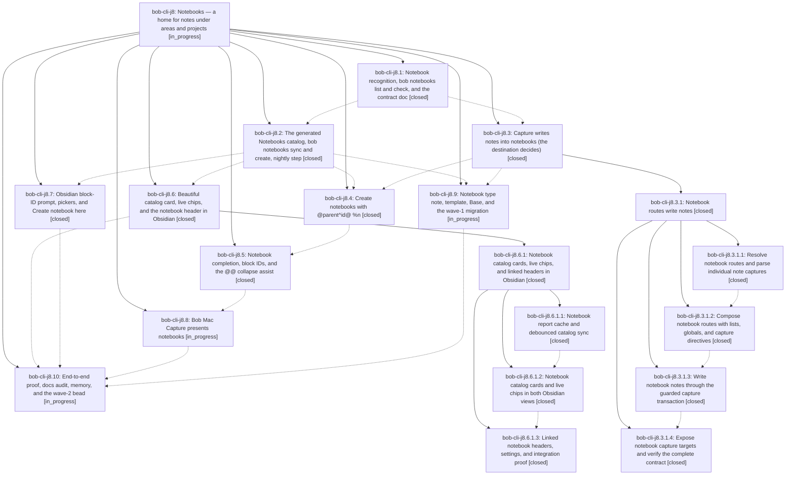

# Bead: bob-cli-j8 — Notebooks — a home for notes under areas and projects

[Bead Pages](../README.md) / bob-cli-j8

**Status:** ◐ in_progress · **Type:** ▸ plan · **Tier:** epic
**Owner:** `bryanbugyi34@gmail.com` · **Created by:** [bbugyi200.apollo.research.3x.linker.w0](https://github.com/bobs-org/bob-cli--agents/blob/main/sessions/bbugyi200.apollo.research.3x.linker.w0.md) · **Assignee:** `bob-cli-j8.land`
**Created:** 2026-11-09 12:11:27 EST
**Plan:** [202611/bob\_notebooks.md](https://github.com/bobs-org/bob-cli--plans/blob/main/202611/bob_notebooks.md)

<!-- sase:links:start -->

## Links

| Relation | Artifact | Why |
| --- | --- | --- |
| implemented-by | [plan:202611/bob_notebooks.md][1] | derived from the plan's `bead_id:` frontmatter field |

_Plus 1 automatic references — see [Referenced By](#referenced-by)._

[1]: https://github.com/bobs-org/bob-cli--plans/blob/main/202611/bob_notebooks.md

<!-- sase:links:end -->

## Description

Bob gains a `type: "[[notebook]]"` note kind for task-free note bullets (optionally under `##` sections) that always hangs under an area, project, or notebook. Capture writes notes into notebooks through the existing `@nb` forms, creates notebooks with `@parent^id@ %n 
`, and every area or project shows a beautiful generated `## Notebooks` catalog. 26 existing notes, 11 of them rescued from the zorg dead end, become the first notebooks.

## Notes

[2026-11-09T19:09:15Z · bob-cli-ir.land] DISCOVERED ISSUE (bob-cli-ir.land, Record Notes landing audit on master 0a74731b): j8.1 commit 0a74731b leaves just check red with four lib failures: native::catalog::tests::document_shape (87 vs 85), native::completion::kinds::tests::every_value_arg_has_a_decision (missing kinds decision for notebooks:root), runner::tests::every_native_command_is_on_exactly_one_canonical_path (72 vs 70), and runner::tests::subcommands_are_contiguous_in_section_order_and_alphabetical (notebooks out of alphabetical order in Vault). Repro: cargo test -p bob-obsidian --lib. Separately, just docs-check lint reports docs/reference/json-outputs.md at 6117 words (cap 6000): bob-cli-ir.13 4321fd70 had trimmed it under budget, and 0a74731b's Notebook reports section pushed it back over (the j8.1 note's 6390 base figure was a wc count, not bob-docs count_words). No duplicate task found (searched notebooks/document_shape/every_value_arg/subcommands_are_contiguous, plus the one-week sweep). The Record Notes landing does not touch these.

[2026-11-09T20:20:45Z · bob-cli-j5.2.1.land] DISCOVERED ISSUE: landing triage of bob-cli-j5.2.1.3 follow-up #2 independently confirms docs/reference/json-outputs.md is 6143 words on e802071f (fixed reference cap 6000, measured with bob_docs.markdown.count_words). History: 4321fd70 restored 6000; j8.1 0a74731b raised to 6117; j8.2 55468bff stayed 6117; archive e802071f adds 26 to 6143. Original overage belongs to the active notebooks epic and already matches note #1; no duplicate task. Keep the archive report contract while trimming. Follow-up #1 registration failures are already fixed by j8.2 55468bff (verified source changes and j8.2 note #2); no new task for resolved work.

[2026-11-10T01:42:57Z · bob-cli-j8.3.1.land] DISCOVERED ISSUE: reported by bob-cli-j8.3.1.land during capture landing at 12692ebb. The pre-existing notebook checker from bob-cli-j8.1 commit 0a74731b treats caret references as actual anchors. src/native/notebooks/rules.rs::extract_block_ids scans every caret, including inline code and wikilinks; duplicate_block_id_findings then reports notebook_duplicate_block_id. Executed the exact current extract_block_ids function in a standalone rustc probe: input '- Discuss `^x` and [[nb#^x]] ^real' returns ["x", "x", "real"], although the only actual anchor is real. This falsely rejects ordinary notebook explanations/backlinks. Fix the notebook checker to recognize real block anchors outside literal/code/link spans, preserve true duplicate detection, and add regressions. This predates the child capture epic, so it belongs to the causally responsible active bob-cli-j8 epic. /sase_new_task triage searched bug tasks, broadened to all task types, swept all tasks created in the past week, and inspected active epics and j8.1; no semantic duplicate found. No new task created under the active-epic rule.

[2026-11-10T11:18:44Z · bryanbugyi34@gmail.com] I'm seeing an error in my current daily file. See the 🔒 20261110\_061751.png screenshot for context. The epic lander agent should fix this before landing.

## Attachments

- 🔒 20261110\_061751.png · image/png · 2858×1728 · 297.947 KiB (private attachment)

## Phases

| Bead | Title | Status | Size | Created | Agents | Commits |
|---|---|---|---|---|---:|---:|
| [bob-cli-j8.1](bob-cli-j8.1.md) | Notebook recognition, bob notebooks list and check, and the contract doc | ✓ closed | large | 2026-11-09 | 1 | 1 |
| [bob-cli-j8.10](bob-cli-j8.10.md) | End-to-end proof, docs audit, memory, and the wave-2 bead | ◐ in_progress | medium | 2026-11-09 | 1 | 0 |
| [bob-cli-j8.2](bob-cli-j8.2.md) | The generated Notebooks catalog, bob notebooks sync and create, nightly step | ✓ closed | large | 2026-11-09 | 1 | 1 |
| [bob-cli-j8.3](bob-cli-j8.3.md) | Capture writes notes into notebooks (the destination decides) | ✓ closed | large | 2026-11-09 | 1 | 0 |
| [bob-cli-j8.4](bob-cli-j8.4.md) | Create notebooks with @parent^id@ %n | ✓ closed | large | 2026-11-09 | 1 | 1 |
| [bob-cli-j8.5](bob-cli-j8.5.md) | Notebook completion, block IDs, and the @@ collapse assist | ✓ closed | large | 2026-11-09 | 1 | 1 |
| [bob-cli-j8.6](bob-cli-j8.6.md) | Beautiful catalog card, live chips, and the notebook header in Obsidian | ✓ closed | large | 2026-11-09 | 1 | 0 |
| [bob-cli-j8.7](bob-cli-j8.7.md) | Obsidian block-ID prompt, pickers, and Create notebook here | ✓ closed | medium | 2026-11-09 | 1 | 0 |
| [bob-cli-j8.8](bob-cli-j8.8.md) | Bob Mac Capture presents notebooks | ◐ in_progress | large | 2026-11-09 | 1 | 3 |
| [bob-cli-j8.9](bob-cli-j8.9.md) | Notebook type note, template, Base, and the wave-1 migration | ◐ in_progress | medium | 2026-11-09 | 1 | 0 |

## Lineage

## Agents

| Agent | Bead | Commits |
|---|---|---:|
| [bbugyi200.apollo.bob-cli-j8.1](https://github.com/bobs-org/bob-cli--agents/blob/main/sessions/bbugyi200.apollo.bob-cli-j8.1.md) | [bob-cli-j8.1](bob-cli-j8.1.md) | 1 |
| [bbugyi200.apollo.bob-cli-j8.10](https://github.com/bobs-org/bob-cli--agents/blob/main/agents/bbugyi200.apollo.bob-cli-j8.10/README.md) | [bob-cli-j8.10](bob-cli-j8.10.md) | 0 |
| [bbugyi200.apollo.bob-cli-j8.2](https://github.com/bobs-org/bob-cli--agents/blob/main/sessions/bbugyi200.apollo.bob-cli-j8.2.md) | [bob-cli-j8.2](bob-cli-j8.2.md) | 1 |
| [bbugyi200.apollo.bob-cli-j8.3](https://github.com/bobs-org/bob-cli--agents/blob/main/sessions/bbugyi200.apollo.bob-cli-j8.3.md) | [bob-cli-j8.3](bob-cli-j8.3.md) | 0 |
| [bbugyi200.apollo.bob-cli-j8.3.1.1](https://github.com/bobs-org/bob-cli--agents/blob/main/sessions/bbugyi200.apollo.bob-cli-j8.3.1.1.md) | [bob-cli-j8.3.1.1](bob-cli-j8.3.1.1.md) | 2 |
| [bbugyi200.apollo.bob-cli-j8.3.1.2](https://github.com/bobs-org/bob-cli--agents/blob/main/agents/bbugyi200.apollo.bob-cli-j8.3.1.2/README.md) | [bob-cli-j8.3.1.2](bob-cli-j8.3.1.2.md) | 1 |
| [bbugyi200.apollo.bob-cli-j8.3.1.3](https://github.com/bobs-org/bob-cli--agents/blob/main/agents/bbugyi200.apollo.bob-cli-j8.3.1.3/README.md) | [bob-cli-j8.3.1.3](bob-cli-j8.3.1.3.md) | 1 |
| [bbugyi200.apollo.bob-cli-j8.3.1.4](https://github.com/bobs-org/bob-cli--agents/blob/main/agents/bbugyi200.apollo.bob-cli-j8.3.1.4/README.md) | [bob-cli-j8.3.1.4](bob-cli-j8.3.1.4.md) | 1 |
| [bbugyi200.apollo.bob-cli-j8.3.1.land](https://github.com/bobs-org/bob-cli--agents/blob/main/sessions/bbugyi200.apollo.bob-cli-j8.3.1.land.md) | [bob-cli-j8.3.1](bob-cli-j8.3.1.md) | 2 |
| [bbugyi200.apollo.bob-cli-j8.4](https://github.com/bobs-org/bob-cli--agents/blob/main/sessions/bbugyi200.apollo.bob-cli-j8.4.md) | [bob-cli-j8.4](bob-cli-j8.4.md) | 1 |
| [bbugyi200.apollo.bob-cli-j8.5](https://github.com/bobs-org/bob-cli--agents/blob/main/sessions/bbugyi200.apollo.bob-cli-j8.5.md) | [bob-cli-j8.5](bob-cli-j8.5.md) | 1 |
| [bbugyi200.apollo.bob-cli-j8.6](https://github.com/bobs-org/bob-cli--agents/blob/main/sessions/bbugyi200.apollo.bob-cli-j8.6.md) | [bob-cli-j8.6](bob-cli-j8.6.md) | 0 |
| [bbugyi200.apollo.bob-cli-j8.6.1.1](https://github.com/bobs-org/bob-cli--agents/blob/main/sessions/bbugyi200.apollo.bob-cli-j8.6.1.1.md) | [bob-cli-j8.6.1.1](bob-cli-j8.6.1.1.md) | 0 |
| [bbugyi200.apollo.bob-cli-j8.6.1.2](https://github.com/bobs-org/bob-cli--agents/blob/main/agents/bbugyi200.apollo.bob-cli-j8.6.1.2/README.md) | [bob-cli-j8.6.1.2](bob-cli-j8.6.1.2.md) | 0 |
| [bbugyi200.apollo.bob-cli-j8.6.1.3](https://github.com/bobs-org/bob-cli--agents/blob/main/agents/bbugyi200.apollo.bob-cli-j8.6.1.3/README.md) | [bob-cli-j8.6.1.3](bob-cli-j8.6.1.3.md) | 0 |
| [bbugyi200.apollo.bob-cli-j8.6.1.land](https://github.com/bobs-org/bob-cli--agents/blob/main/sessions/bbugyi200.apollo.bob-cli-j8.6.1.land.md) | [bob-cli-j8.6.1](bob-cli-j8.6.1.md) | 1 |
| [bbugyi200.apollo.bob-cli-j8.7](https://github.com/bobs-org/bob-cli--agents/blob/main/agents/bbugyi200.apollo.bob-cli-j8.7/README.md) | [bob-cli-j8.7](bob-cli-j8.7.md) | 0 |
| [bbugyi200.apollo.bob-cli-j8.8](https://github.com/bobs-org/bob-cli--agents/blob/main/sessions/bbugyi200.apollo.bob-cli-j8.8.md) | [bob-cli-j8.8](bob-cli-j8.8.md) | 3 |
| [bbugyi200.apollo.bob-cli-j8.9](https://github.com/bobs-org/bob-cli--agents/blob/main/sessions/bbugyi200.apollo.bob-cli-j8.9.md) | [bob-cli-j8.9](bob-cli-j8.9.md) | 0 |
| [bbugyi200.apollo.bob-cli-j8.land](https://github.com/bobs-org/bob-cli--agents/blob/main/agents/bbugyi200.apollo.bob-cli-j8.land/README.md) | [bob-cli-j8](README.md) | 0 |

## Commits

| Repo | Commit | Subject | Bead | Committed |
|---|---|---|---|---|
| bob-cli | [`0a74731`](https://github.com/bobs-org/bob-cli/commit/0a74731b24809ad1b7572de977ac8c7a2f9cc59b) | feat(notebooks): recognize notebooks with list, check, and contract docs | [bob-cli-j8.1](bob-cli-j8.1.md) | 2026-11-09 13:41:47 EST |
| bob-cli | [`55468bf`](https://github.com/bobs-org/bob-cli/commit/55468bffc8f5bbbbb5f7b2440c8cfbd9f1d32452) | feat(notebooks): generate Notebooks catalogs with sync, create, and a nightly step | [bob-cli-j8.2](bob-cli-j8.2.md) | 2026-11-09 15:05:58 EST |
| bob-cli | [`d906675`](https://github.com/bobs-org/bob-cli/commit/d90667549a46e559f077f96e0db78ec0c1999bb9) | feat(capture): add notebook route parsing | [bob-cli-j8.3.1.1](bob-cli-j8.3.1.1.md) | 2026-11-09 16:08:46 EST |
| bob-mac-capture | [`bob-mac-capture@a65fb6a`](https://github.com/bobs-org/bob-mac-capture/commit/a65fb6a06d6d50d88ab263cf58914108e2be73f4) | docs: clarify capture stash and keyboard behavior | [bob-cli-j8.3.1.1](bob-cli-j8.3.1.1.md) | 2026-11-09 16:16:18 EST |
| bob-cli | [`3f8c49d`](https://github.com/bobs-org/bob-cli/commit/3f8c49d4145ad5142cbca38b94bc8c3a3bea0c19) | feat(capture)!: compose notebook routes with lists, globals, and #section^id | [bob-cli-j8.3.1.2](bob-cli-j8.3.1.2.md) | 2026-11-09 18:28:21 EST |
| bob-cli | [`8d098e5`](https://github.com/bobs-org/bob-cli/commit/8d098e550588eafbcdc4788e7cbb6ce10024ad26) | feat(capture)!: write notebook notes through guarded transaction | [bob-cli-j8.3.1.3](bob-cli-j8.3.1.3.md) | 2026-11-09 19:31:54 EST |
| bob-cli--plans | [`bob-cli--plans@e2abff0`](https://github.com/bobs-org/bob-cli--plans/commit/e2abff08c97d314b215c515c46e2ae26c9e64c07) | chore(plans): mark notebook catalog UI plans done | [bob-cli-j8.6.1](bob-cli-j8.6.1.md) | 2026-11-09 20:24:05 EST |
| bob-cli | [`12692eb`](https://github.com/bobs-org/bob-cli/commit/12692ebb95db9b30704ab1e5dd9fc7df70509849) | feat(capture)!: expose notebook capture targets and verify contract | [bob-cli-j8.3.1.4](bob-cli-j8.3.1.4.md) | 2026-11-09 20:32:13 EST |
| bob-cli | [`843642f`](https://github.com/bobs-org/bob-cli/commit/843642f9fc34e0edf60b126751bb221d2fe6283c) | feat(capture)!: repair notebook capture landing | [bob-cli-j8.3.1](bob-cli-j8.3.1.md) | 2026-11-09 22:37:58 EST |
| bob-cli--plans | [`bob-cli--plans@e6b6782`](https://github.com/bobs-org/bob-cli--plans/commit/e6b678237e4eaf3ef3751e43a21cd22dd6155cfd) | docs(plans): mark notebook capture epic done | [bob-cli-j8.3.1](bob-cli-j8.3.1.md) | 2026-11-09 22:38:49 EST |
| bob-cli | [`ab021e2`](https://github.com/bobs-org/bob-cli/commit/ab021e2db09c3776d737e9380a236f823bcb42b4) | feat(capture)!: create notebooks from sealed @parent^id@ %n drafts | [bob-cli-j8.4](bob-cli-j8.4.md) | 2026-11-10 00:20:18 EST |
| bob-cli | [`93cf930`](https://github.com/bobs-org/bob-cli/commit/93cf930ca2a8221bdbe4b1dad602ef49669f3f18) | feat(capture)!: complete notebook capture assistance | [bob-cli-j8.5](bob-cli-j8.5.md) | 2026-11-10 02:30:29 EST |
| bob-cli | [`f2882ea`](https://github.com/bobs-org/bob-cli/commit/f2882ea6fc30894c848bafa4a68e4f81b7c148ed) | fix(ci): select Mac Capture workflow for exact-SHA checks | [bob-cli-j8.8](bob-cli-j8.8.md) | 2026-11-10 05:02:21 EST |
| bob-mac-capture | [`bob-mac-capture@b20ceca`](https://github.com/bobs-org/bob-mac-capture/commit/b20ceca5526c6f379f8d2983e70115f150a9ae48) | feat(capture): present notebook capture targets and previews | [bob-cli-j8.8](bob-cli-j8.8.md) | 2026-11-10 05:02:56 EST |
| bob-mac-capture | [`bob-mac-capture@3fb3a2b`](https://github.com/bobs-org/bob-mac-capture/commit/3fb3a2bea591fd9756722cf8b313d0394ffdf746) | fix(capture): name nested notebook parent and restore Mac tests | [bob-cli-j8.8](bob-cli-j8.8.md) | 2026-11-10 06:36:49 EST |

<!-- sase:referenced-by:start -->

## Referenced By

| Relation | Artifact | Why | Uses |
| --- | --- | --- | ---: |
| read-by | [agent:bob-cli-j8.6.1.2][1] | Need outer epic DECISIONS that remain final for catalog UI | 1 |

[1]: https://github.com/bobs-org/bob-cli--agents/blob/main/agents/bbugyi200.apollo.bob-cli-j8.6.1.2/README.md

<!-- sase:referenced-by:end -->
