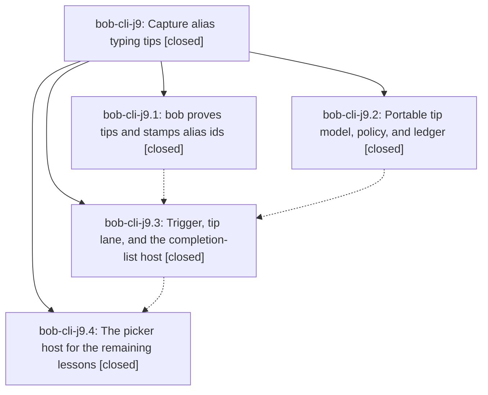

# Bead: bob-cli-j9 — Capture alias typing tips

[Bead Pages](../README.md) / bob-cli-j9

**Status:** ✓ closed · **Resolution:** done · **Type:** ▸ plan · **Tier:** epic
**Owner:** `bryanbugyi34@gmail.com` · **Created by:** [bbugyi200.apollo.research.3y.linker.w0](https://github.com/bobs-org/bob-cli--agents/blob/main/sessions/bbugyi200.apollo.research.3y.linker.w0.md) · **Assignee:** `bob-cli-j9.land`
**Created:** 2026-11-09 12:18:38 EST · **Closed:** 2026-11-09 18:39:19 EST
**Plan:** [202611/capture\_alias\_typing\_tips.md](https://github.com/bobs-org/bob-cli--plans/blob/main/202611/capture_alias_typing_tips.md)

<!-- sase:links:start -->

## Links

| Relation | Artifact | Why |
| --- | --- | --- |
| implemented-by | [plan:202611/capture_alias_typing_tips.md][1] | derived from the plan's `bead_id:` frontmatter field |

_Plus 1 automatic references — see [Referenced By](#referenced-by)._

[1]: https://github.com/bobs-org/bob-cli--plans/blob/main/202611/capture_alias_typing_tips.md

<!-- sase:links:end -->

## Description

When Bryan Shift-types a capture sigil that an unshifted alias key would have typed at that exact spot, the list or picker the sigil opens shows one bob-proved "Next time" line in its first frame. The tip fades as the alias becomes habit, and it never slows or changes capture.

## Notes

[2026-11-09T21:28:15Z · bob-cli-j9.land] LAND AUDIT before repair tale (bob-cli d7906813, linked bob-mac-capture a65fb6a). Read the epic, every original child and every note, the approved plan and research, governing alias/thin-client decisions, and actual Rust/Swift implementations and commits. All four original phases are closed. Verified Rust 4b59ae81 stamps every forward alias, classifies tipped IDs exhaustively, proves reverse tips with the entire rewrite pipeline, and serializes object/null/absence and UTF-8 ranges as specified. Reviewed the round-trip helper, negative corpus and CLI coverage. The phase-1 deviations (spaced next-parent is a valid parent_task alias, and hash keys may be backslash-only in =# / [[folder#) follow actual forward proof, not a duplicated eligibility table. Mac bd06c21/3131414/0eeba70/e5833d6 implement the portable model/policy/store, physical-key lane, Settings, list/picker card-foot rows, sizing and accessibility. The chosen card_foot branch is implemented; d7906813 changes only the authorized glossary:capture-alias sentence; no declined decision strand was added.

INTEGRATION: Reviewed commits since the first epic commits in both repos, including modifier escape ef5dc4a/b1a90fa, Record Notes a5152aa/2f1d6dd/5987de4, notebooks 0a74731b/55468bff/d9066754 and Mac a65fb6a, and archive/install changes. Shared modifier restore/fast-double paths already call hit withdrawal; the .addTo adaptation and later copy changes coexist. Notebook parse changes preserve the lexical reverse-proof path; archive and installer changes have no typing-tip consumers to migrate. The independent record-field alias bug remains existing task bob-cli-ja; no duplicate. No PR base divergence: audit used the checked-out master histories. Later notebook docs trimming makes the deferred j9 JSON table entry feasible again.

REMAINING EPIC WORK (source-confirmed, not new tasks): (1) applyAliasTipRewrite treats every missing capability key as old Bob, including changed:true separator-toggle replies where modern Bob deliberately omits the key; it must ignore changed replies before capability detection. (2) first-frame admission checks only current surface visibility, so an in-flight reply after open/dismiss can become pending for a later reopening; dispatchCapture does not retire this lane either. Bind display eligibility to the original opening and retire it on submit/accept/hide without blocking capture. (3) AliasTipLedger.withdrawHit only removes recent history, leaving weekly hits inflated after Undo/escape; also verify Undo after intervening edits because reconcileAliasTipHit clears the sole lastAliasHit token on any unrelated draft edit. Fix rollback of the specific credit and original week, plus regression coverage. (4) add the concise deferred JSON-reference fields now that the page fits. A medium tale plans only these repairs and explicitly owns this epic's final closeout before its code commit, with no dependency on its own future SHA/push/CI.

FOLLOW-UP TRIAGE — every original proposal:
1. j9.1 note #1, JSON reference alias/sigil_alias_tip fields: accepted into the repair tale as remaining documentation integration, not a separate task. d9066754 trims json-outputs to 5931 words, so the old budget blocker is gone.
2. j9.2 note #1, record-preview timeouts: declined as resolved. Inspected 2f1d6dd's observable-settle fixes and GitHub logs: both named tests pass in fully green run 42686284282 on 5987de4. No new task.
3. j9.2 note #2, unchanged-period separator sleep race: new small flake task bob-cli-jc, now ready, related to but distinct from bob-cli-jb. Source remains a fixed 200ms sleep in testUnchangedAliasReplyLeavesPeriodLiteralWithoutOpeningPicker; test file unchanged since 90fa59d. Independently read its failure in 42666675195 and passes in 42686284282/42696688042. Whole-tree retry parity and a serial repro were not established by this lander; task evidence says so. Exact excerpts preserved as file:explicit:1d6d71ab0242c32754b782ca.
4. j9.3 note #1, missing .addTo switch cases: declined as resolved. j9.3 note #2 and commit 3131414 implement the exhaustive cases; b1a90fa supplies Updates record text copy. ir notes #9/#12 and fully green 42686284282 confirm integration. No separate ID-prompt task: record matches do not request task block IDs.
5. j9.4 note #1, three-week stop-rule review: new small feature task bob-cli-jd, depends on j9, ready then snoozed until 2026-11-30 15:00 UTC. Its worker must verify the actual repaired-feature ship date and sufficient comparable weeks, deferring again if needed; no three-week observation is required to close the implementation epic.
6. j9.4 note #2, docs budgets: declined as resolved by intervening work. Measured with this checkout's bob_docs.markdown.count_words: json-outputs 5931 (d9066754), Mac capture-panel 5906 and keyboard 5981 (a65fb6a), typing-tips 722; all below 6000. Old json overage was already j8 notes #1/#2, Mac overages h9. No new task or +1 for a failure that no longer reproduces by the deterministic count.
7. j9.4 note #3, double-equals request-count flake: independently corroborated existing bob-cli-jb with +1 and the same CI excerpt artifact. Run 42696688042 job 129430304429 has exactly the known line-764 asks=1 vs 2 failure; all 15 alias-tip panel tests passed, lint/build passed, bundle/install skipped. No duplicate task.

VALIDATION LIMITS: Reviewed existing exact-SHA CI logs rather than claiming a fresh Mac run; Swift is absent locally. No application code changed this turn and just check has not been rerun; the repair tale requires just check (never check-full), portable-check, compiled Mac targets and the precommit exact-tree macos-ci-check gate, then docs checks. The existing target/debug/bob was stale (it omitted new fields even for eligible unchanged drafts) and is not current-checkout verification. git diff --check passed. sase bead epic-symbols bob-cli-j9 reports no entries; neither repo offers just symvision. j9 has no parent bead. The original plan remains unfinished until the tale repairs, verifies, closes j9 normally, and marks plan:202611/capture_alias_typing_tips.md status done.

[2026-11-09T23:39:19Z · bob-cli-j9.land--2] Completed and verified bob-cli-j9. Exact-tree macOS CI run 42718627051 passed on snapshot SHA a3a94d7e1b914bedbbbe319f757e1b979e40cbfa: lint, Build, Test, Bundle, signature/plist, launch smoke, and install/reinstall passed; temporary branch ci/precommit/d36f6e1d4d55445c8220aba39bf00754 was deleted. Existing gates are green: bob-cli just check; Mac just portable-check (2,394 tests, 1 skipped); just docs-check in both repositories; git diff --check. All four original phases are closed. Follow-up dispositions: j9.1 alias and sigil_alias_tip JSON reference fields landed in the repair tale; j9.2 record-preview timeouts were resolved; independent separator polling flake bob-cli-jc remains open; j9.3 addTo switches were resolved; bob-cli-jd remains snoozed for the post-shipping three-week review; docs budgets were resolved; bob-cli-jb retains the distinct double-equals request-count flake and its corroborating +1. epic-symbols is empty; just symvision is absent in CLI, Mac, and plans.

## Phases

| Bead | Title | Status | Size | Created | Agents | Commits |
|---|---|---|---|---|---:|---:|
| [bob-cli-j9.1](bob-cli-j9.1.md) | bob proves tips and stamps alias ids | ✓ closed | medium | 2026-11-09 | 1 | 1 |
| [bob-cli-j9.2](bob-cli-j9.2.md) | Portable tip model, policy, and ledger | ✓ closed | medium | 2026-11-09 | 1 | 1 |
| [bob-cli-j9.3](bob-cli-j9.3.md) | Trigger, tip lane, and the completion-list host | ✓ closed | medium | 2026-11-09 | 1 | 2 |
| [bob-cli-j9.4](bob-cli-j9.4.md) | The picker host for the remaining lessons | ✓ closed | medium | 2026-11-09 | 1 | 2 |

## Lineage

## Dependencies

- **Blocks:** [bob-cli-jd](../bob-cli-jd/README.md) ◈ · ⧖ 2026-11-09

## Agents

| Agent | Bead | Commits |
|---|---|---:|
| [bbugyi200.apollo.bob-cli-j9.1](https://github.com/bobs-org/bob-cli--agents/blob/main/agents/bbugyi200.apollo.bob-cli-j9.1/README.md) | [bob-cli-j9.1](bob-cli-j9.1.md) | 1 |
| [bbugyi200.apollo.bob-cli-j9.2](https://github.com/bobs-org/bob-cli--agents/blob/main/sessions/bbugyi200.apollo.bob-cli-j9.2.md) | [bob-cli-j9.2](bob-cli-j9.2.md) | 1 |
| [bbugyi200.apollo.bob-cli-j9.3](https://github.com/bobs-org/bob-cli--agents/blob/main/sessions/bbugyi200.apollo.bob-cli-j9.3.md) | [bob-cli-j9.3](bob-cli-j9.3.md) | 2 |
| [bbugyi200.apollo.bob-cli-j9.4](https://github.com/bobs-org/bob-cli--agents/blob/main/agents/bbugyi200.apollo.bob-cli-j9.4/README.md) | [bob-cli-j9.4](bob-cli-j9.4.md) | 2 |
| [bbugyi200.apollo.bob-cli-j9.land](https://github.com/bobs-org/bob-cli--agents/blob/main/sessions/bbugyi200.apollo.bob-cli-j9.land.md) | [bob-cli-j9](README.md) | 1 |

## Commits

| Repo | Commit | Subject | Bead | Committed |
|---|---|---|---|---|
| bob-mac-capture | [`bob-mac-capture@bd06c21`](https://github.com/bobs-org/bob-mac-capture/commit/bd06c21d9da1fbb883a6cd090cb49463d743174d) | feat(mac-capture): add portable alias-tip model, policy, and ledger | [bob-cli-j9.2](bob-cli-j9.2.md) | 2026-11-09 12:38:26 EST |
| bob-cli | [`4b59ae8`](https://github.com/bobs-org/bob-cli/commit/4b59ae8170499ebc6328bc66f437af56802cfab5) | feat(capture): prove sigil alias typing tips in capture-rewrite | [bob-cli-j9.1](bob-cli-j9.1.md) | 2026-11-09 13:11:25 EST |
| bob-mac-capture | [`bob-mac-capture@3131414`](https://github.com/bobs-org/bob-mac-capture/commit/3131414a168c70e6df535293a935204dc252dcef) | feat(mac-capture): show typing tips on the completion-list first frame | [bob-cli-j9.3](bob-cli-j9.3.md) | 2026-11-09 14:07:35 EST |
| bob-mac-capture | [`bob-mac-capture@0eeba70`](https://github.com/bobs-org/bob-mac-capture/commit/0eeba70f86aaa3b57072e8af9a734afbc836ce4f) | fix(mac-capture): restore equals Space before the picker opens | [bob-cli-j9.3](bob-cli-j9.3.md) | 2026-11-09 14:43:42 EST |
| bob-cli | [`d790681`](https://github.com/bobs-org/bob-cli/commit/d79068138e4336d6345475adafb4d880e47977d3) | docs(memory): clarify capture alias tip host | [bob-cli-j9.4](bob-cli-j9.4.md) | 2026-11-09 16:13:31 EST |
| bob-mac-capture | [`bob-mac-capture@e5833d6`](https://github.com/bobs-org/bob-mac-capture/commit/e5833d6b813ade33d8db0f73eef567c83d45fde5) | feat(capture): show alias tips in pickers | [bob-cli-j9.4](bob-cli-j9.4.md) | 2026-11-09 16:13:59 EST |
| bob-cli | [`b519670`](https://github.com/bobs-org/bob-cli/commit/b5196709021e4efb0d27c0547d6d9f84d6db31c2) | docs(capture): document alias typing tip JSON fields | [bob-cli-j9](README.md) | 2026-11-09 18:41:15 EST |

<!-- sase:referenced-by:start -->

## Referenced By

| Relation | Artifact | Why | Uses |
| --- | --- | --- | ---: |
| read-by | [agent:bob-cli-j9.1][1] | Epic context | 1 |

[1]: https://github.com/bobs-org/bob-cli--agents/blob/main/agents/bbugyi200.apollo.bob-cli-j9.1/README.md

<!-- sase:referenced-by:end -->
