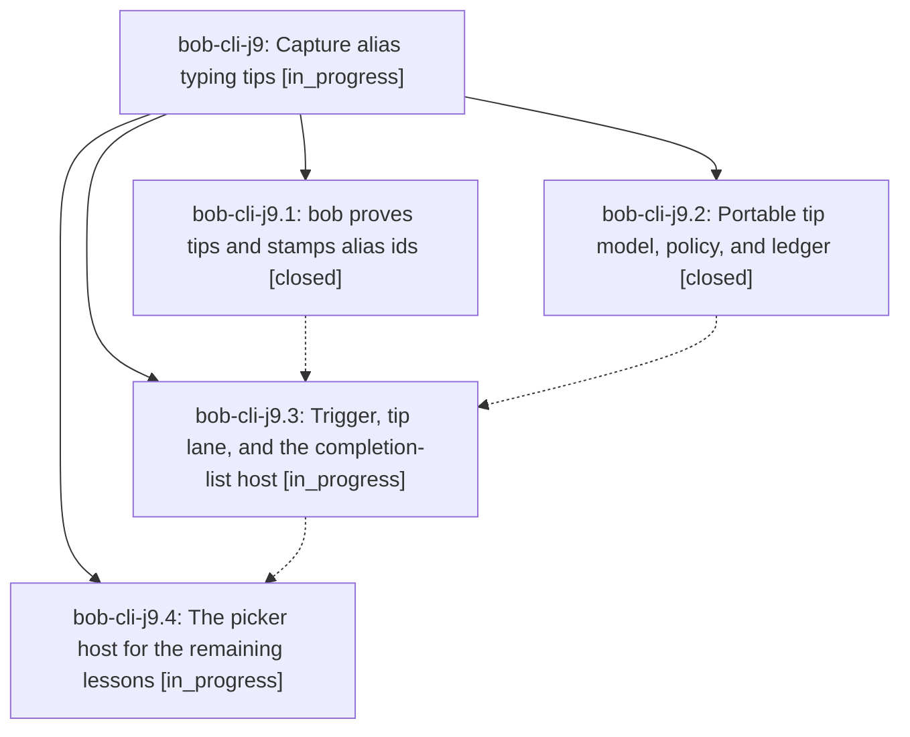

# Bead: bob-cli-j9 — Capture alias typing tips

[Bead Pages](../README.md) / bob-cli-j9

**Status:** ◐ in_progress · **Type:** ▸ plan · **Tier:** epic
**Owner:** `bryanbugyi34@gmail.com` · **Created by:** [bbugyi200.apollo.research.3y.linker.w0](https://github.com/bobs-org/bob-cli--agents/blob/main/sessions/bbugyi200.apollo.research.3y.linker.w0.md) · **Assignee:** `bob-cli-j9.land`
**Created:** 2026-11-09 12:18:38 EST
**Plan:** [202611/capture\_alias\_typing\_tips.md](https://github.com/bobs-org/bob-cli--plans/blob/main/202611/capture_alias_typing_tips.md)

## Description

When Bryan Shift-types a capture sigil that an unshifted alias key would have typed at that exact spot, the list or picker the sigil opens shows one bob-proved "Next time" line in its first frame. The tip fades as the alias becomes habit, and it never slows or changes capture.

## Phases

| Bead | Title | Status | Size | Created | Agents | Commits |
|---|---|---|---|---|---:|---:|
| [bob-cli-j9.1](bob-cli-j9.1.md) | bob proves tips and stamps alias ids | ✓ closed | medium | 2026-11-09 | 1 | 1 |
| [bob-cli-j9.2](bob-cli-j9.2.md) | Portable tip model, policy, and ledger | ✓ closed | medium | 2026-11-09 | 1 | 0 |
| [bob-cli-j9.3](bob-cli-j9.3.md) | Trigger, tip lane, and the completion-list host | ◐ in_progress | medium | 2026-11-09 | 1 | 0 |
| [bob-cli-j9.4](bob-cli-j9.4.md) | The picker host for the remaining lessons | ◐ in_progress | medium | 2026-11-09 | 1 | 0 |

## Lineage

## Agents

| Agent | Bead | Commits |
|---|---|---:|
| [bbugyi200.apollo.bob-cli-j9.1](https://github.com/bobs-org/bob-cli--agents/blob/main/agents/bbugyi200.apollo.bob-cli-j9.1/README.md) | [bob-cli-j9.1](bob-cli-j9.1.md) | 1 |
| [bbugyi200.apollo.bob-cli-j9.2](https://github.com/bobs-org/bob-cli--agents/blob/main/sessions/bbugyi200.apollo.bob-cli-j9.2.md) | [bob-cli-j9.2](bob-cli-j9.2.md) | 0 |
| [bbugyi200.apollo.bob-cli-j9.3](https://github.com/bobs-org/bob-cli--agents/blob/main/agents/bbugyi200.apollo.bob-cli-j9.3/README.md) | [bob-cli-j9.3](bob-cli-j9.3.md) | 0 |
| [bbugyi200.apollo.bob-cli-j9.4](https://github.com/bobs-org/bob-cli--agents/blob/main/agents/bbugyi200.apollo.bob-cli-j9.4/README.md) | [bob-cli-j9.4](bob-cli-j9.4.md) | 0 |
| [bbugyi200.apollo.bob-cli-j9.land](https://github.com/bobs-org/bob-cli--agents/blob/main/agents/bbugyi200.apollo.bob-cli-j9.land/README.md) | [bob-cli-j9](README.md) | 0 |

## Commits

| Repo | Commit | Subject | Bead | Committed |
|---|---|---|---|---|
| bob-cli | [`4b59ae8`](https://github.com/bobs-org/bob-cli/commit/4b59ae8170499ebc6328bc66f437af56802cfab5) | feat(capture): prove sigil alias typing tips in capture-rewrite | [bob-cli-j9.1](bob-cli-j9.1.md) | 2026-11-09 13:11:25 EST |
