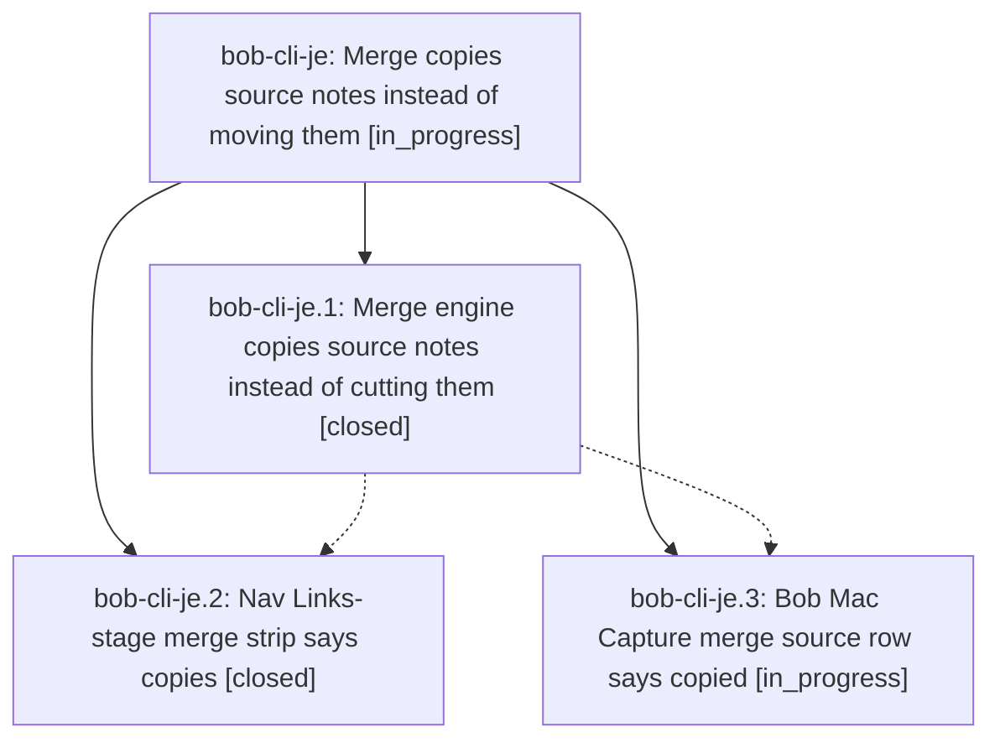

# Bead: bob-cli-je — Merge copies source notes instead of moving them

[Bead Pages](../README.md) / bob-cli-je

**Status:** ◐ in_progress · **Type:** ▸ plan · **Tier:** epic
**Owner:** `bryanbugyi34@gmail.com` · **Created by:** [bbugyi200.athena.1an](https://github.com/bobs-org/bob-cli--agents/blob/main/sessions/bbugyi200.athena.1an.md) · **Assignee:** `bob-cli-je.land`
**Created:** 2026-11-09 18:00:12 EST
**Plan:** [202611/merge\_copies\_source\_notes.md](https://github.com/bobs-org/bob-cli--plans/blob/main/202611/merge_copies_source_notes.md)

<!-- sase:links:start -->

## Links

| Relation | Artifact | Why |
| --- | --- | --- |
| implemented-by | [plan:202611/merge_copies_source_notes.md][1] | derived from the plan's `bead_id:` frontmatter field |

_Plus 1 automatic references — see [Referenced By](#referenced-by)._

[1]: https://github.com/bobs-org/bob-cli--plans/blob/main/202611/merge_copies_source_notes.md

<!-- sase:links:end -->

## Description

Every task merge, including the `merged into` relation label, copies the source task's notes to the destination while the cancelled source tombstone keeps its original notes, so links into those notes keep resolving where they always did.

## Phases

| Bead | Title | Status | Size | Created | Agents | Commits |
|---|---|---|---|---|---:|---:|
| [bob-cli-je.1](bob-cli-je.1.md) | Merge engine copies source notes instead of cutting them | ✓ closed | medium | 2026-11-09 | 1 | 1 |
| [bob-cli-je.2](bob-cli-je.2.md) | Nav Links-stage merge strip says copies | ✓ closed | small | 2026-11-09 | 1 | 1 |
| [bob-cli-je.3](bob-cli-je.3.md) | Bob Mac Capture merge source row says copied | ◐ in_progress | small | 2026-11-09 | 1 | 0 |

## Lineage

## Agents

| Agent | Bead | Commits |
|---|---|---:|
| [bbugyi200.athena.bob-cli-je.1](https://github.com/bobs-org/bob-cli--agents/blob/main/agents/bbugyi200.athena.bob-cli-je.1/README.md) | [bob-cli-je.1](bob-cli-je.1.md) | 1 |
| [bbugyi200.athena.bob-cli-je.2](https://github.com/bobs-org/bob-cli--agents/blob/main/agents/bbugyi200.athena.bob-cli-je.2/README.md) | [bob-cli-je.2](bob-cli-je.2.md) | 1 |
| [bbugyi200.athena.bob-cli-je.3](https://github.com/bobs-org/bob-cli--agents/blob/main/sessions/bbugyi200.athena.bob-cli-je.3.md) | [bob-cli-je.3](bob-cli-je.3.md) | 0 |
| [bbugyi200.athena.bob-cli-je.land](https://github.com/bobs-org/bob-cli--agents/blob/main/agents/bbugyi200.athena.bob-cli-je.land/README.md) | [bob-cli-je](README.md) | 0 |

## Commits

| Repo | Commit | Subject | Bead | Committed |
|---|---|---|---|---|
| bob-cli | [`076fdc4`](https://github.com/bobs-org/bob-cli/commit/076fdc484ff3920a40b5b16bae3dfe518cbdea92) | feat(task-merge)!: copy merged source notes instead of moving them | [bob-cli-je.1](bob-cli-je.1.md) | 2026-11-09 18:44:20 EST |
| bob-plugins | [`bob-plugins@f06c7e8`](https://github.com/bobs-org/bob-plugins/commit/f06c7e8ca58fc68236dd41a48bf4517b659a1faf) | feat(navigation): describe merge notes as copied | [bob-cli-je.2](bob-cli-je.2.md) | 2026-11-09 19:01:07 EST |

<!-- sase:referenced-by:start -->

## Referenced By

| Relation | Artifact | Why | Uses |
| --- | --- | --- | ---: |
| read-by | [agent:bob-cli-je.1][1] | Need parent epic DECISIONS, notes, and whether earlier work landed | 1 |

[1]: https://github.com/bobs-org/bob-cli--agents/blob/main/agents/bbugyi200.athena.bob-cli-je.1/README.md

<!-- sase:referenced-by:end -->
