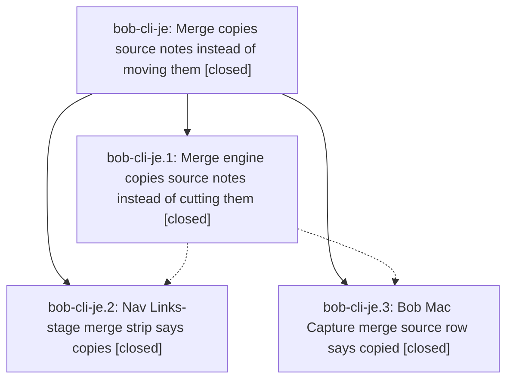

# Bead: bob-cli-je — Merge copies source notes instead of moving them

[Bead Pages](../README.md) / bob-cli-je

**Status:** ✓ closed · **Resolution:** done · **Type:** ▸ plan · **Tier:** epic
**Owner:** `bryanbugyi34@gmail.com` · **Created by:** [bbugyi200.athena.1an](https://github.com/bobs-org/bob-cli--agents/blob/main/sessions/bbugyi200.athena.1an.md) · **Assignee:** `bob-cli-je.land`
**Created:** 2026-11-09 18:00:12 EST · **Closed:** 2026-11-09 20:17:32 EST
**Plan:** [202611/merge\_copies\_source\_notes.md](https://github.com/bobs-org/bob-cli--plans/blob/main/202611/merge_copies_source_notes.md)

<!-- sase:links:start -->

## Links

| Relation | Artifact | Why |
| --- | --- | --- |
| implemented-by | [plan:202611/merge_copies_source_notes.md][1] | derived from the plan's `bead_id:` frontmatter field |
| related | file:explicit:072da7bba40ac9881322bb16 | attached via sase artifact create --bead |
| related | file:explicit:8f948c7f6873781d14e00111 | attached via sase artifact create --bead |
| related | file:explicit:daae807d6d6751409db0db84 | attached via sase artifact create --bead |

_Plus 1 automatic references — see [Referenced By](#referenced-by)._

[1]: https://github.com/bobs-org/bob-cli--plans/blob/main/202611/merge_copies_source_notes.md

<!-- sase:links:end -->

## Description

Every task merge, including the `merged into` relation label, copies the source task's notes to the destination while the cancelled source tombstone keeps its original notes, so links into those notes keep resolving where they always did.

## Notes

[2026-11-10T00:35:55Z · bob-cli-je.land] FOLLOW-UP TRIAGE COMPLETE: Reviewed every PROPOSED FOLLOW-UP from all children using /sase_new_task; searched same-type then cross-type tasks, swept the last week, and inspected all 17 active epic scopes. je.2 #1 index budget failures: +1 and new isolated evidence on bob-cli-f8 (cold chunk 16.1ms >16ms, snapshot/order 74.7ms >50ms, rank 15.1ms >12ms; file:explicit:072da7bba40ac9881322bb16). je.2 viewport/Live Preview timing: +1 on bob-cli-ej; isolated freshness and viewport tests pass, and the phase chat describes 3 index + 2 stylesheet + 1 Live Preview failure, so no distinct speculative freshness task. je.2 two stylesheet failures: DISCOVERED ISSUE corroboration on active bob-cli-j8.6.1, which already owns the #c98500 fallback introduced by its phase .2; declined duplicate task. je.3 #2 watchdog: +1 on existing bob-cli-h7 with phase-reported clean base 5a28892/run 42725629824 versus a5a0ffb/runs 42725854554 and 42725895948; no new CI run claimed. No genuinely new out-of-epic task warranted. Remaining sanitizer and doc defects are caused by this epic and stay here.

[2026-11-10T00:36:12Z · bob-cli-je.land] LAND AUDIT: Read epic, all three children and every note, approved plan, actual engine/capture/transplant code, JS and Swift presentation paths, and epic commits bob-cli 076fdc48 / bob-plugins f06c7e8 / bob-mac-capture a5a0ffb. DECISIONS honored: only task-merge/task-relation glossary corrections, no decision record. Primary origin/master equals 8728fe28 after fetch; reviewed drift since creation (3f8c49d4, b5196709, 0996111c, 2327590f, 8728fe28), plugin notebook 56b3604/32a8545, Mac 542a37d/5a28892. Notebook refusals and dot transfer guards do not need a merge mode; archive pairing needs a retained-descendant/noncanonical-archive integration regression. Found epic-caused defects: strip_copied_id_fields invokes a code-unaware field remover, deleting inline `[id:: literal]`; copied/fragment fence helpers lose opening length (triple closes quadruple); Mac source docs still describe removed source runs and mounted docs are stale. Exact extracted production helper repro: file:explicit:daae807d6d6751409db0db84, output file:explicit:8f948c7f6873781d14e00111. This is helper proof, not a full Rust engine run. 96 navigation merge/Links-stage tests and plugin build:check pass. Isolated performance control is 59/62 with only known f8 failures; no full npm or just check rerun before required repairs, and never check-full. Phase je.3 credential failure was retried; portable tests passed per phase, macOS watchdog remains separately tracked. epic-symbols returns none; no symvision recipe in current primary/Mac justfiles. parent_id is null. Keep epic and original plan open; one medium tale will fix code/docs, run just check/docs gates, then close bob-cli-je normally and mark plan:202611/merge_copies_source_notes.md done in the same coding turn.

[2026-11-10T01:17:32Z · bob-cli-je.land] Tale finish_merge_copy_landing closes epic: fixed merge-copy sanitization to strip only live identity outside inline/fenced code with real task-row recognition (plain #task prose untouched); made copied/fragment fence scanners length-aware so triple backtick no longer closes quadruple fence and tilde fences survive; applied same protection to shared transplant link repair without changing move/split relocation. Corrected docs/task-merge.md copy rule to explicitly protect code and fixed bare-note vocabulary; corrected bob-mac-capture docs/capture-transfers.md landing cards to show cancelled headline + LINKS and copied-note count, keeping removed-run fold for moves/older responses, regenerated mounts via docs tooling. Tests: new merge_copy_preserves_inline_code, merge_copy_fence_length (cross-note + same-note target-above-source, origin tracking, reconcile no-op, repeatability), and MG18 bound-archive regression using production pairing resolver (metadata-bound noncanonical archive, external + copied links follow bound archive, no duplicate identities); move/split regressions pass. Verification: just check passed, just docs-check passed in bob-cli and bob-mac-capture, scratch-vault binary shows '2 notes copied', literal [id::] preserved, live [id::]/^id stripped in copy only, source byte-identical apart from retirement, LINKED FROM/LINKS intact. Decisions: no memory changes in tale (glossary already done, no decision record). Follow-ups: je.2 index budgets corroborate bob-cli-f8 with fresh isolated evidence; viewport/Live Preview corroborates bob-cli-ej; stylesheet contracts owned by bob-cli-j8.6.1 phase .2; macOS watchdog corroborates bob-cli-h7 (clean 5a28892/run 42725824824 vs a5a0ffb runs); no duplicate tasks filed. epic-symbols none; just symvision absent.

## Phases

| Bead | Title | Status | Size | Created | Agents | Commits |
|---|---|---|---|---|---:|---:|
| [bob-cli-je.1](bob-cli-je.1.md) | Merge engine copies source notes instead of cutting them | ✓ closed | medium | 2026-11-09 | 1 | 1 |
| [bob-cli-je.2](bob-cli-je.2.md) | Nav Links-stage merge strip says copies | ✓ closed | small | 2026-11-09 | 1 | 1 |
| [bob-cli-je.3](bob-cli-je.3.md) | Bob Mac Capture merge source row says copied | ✓ closed | small | 2026-11-09 | 1 | 1 |

## Lineage

## Agents

| Agent | Bead | Commits |
|---|---|---:|
| [bbugyi200.athena.bob-cli-je.1](https://github.com/bobs-org/bob-cli--agents/blob/main/agents/bbugyi200.athena.bob-cli-je.1/README.md) | [bob-cli-je.1](bob-cli-je.1.md) | 1 |
| [bbugyi200.athena.bob-cli-je.2](https://github.com/bobs-org/bob-cli--agents/blob/main/agents/bbugyi200.athena.bob-cli-je.2/README.md) | [bob-cli-je.2](bob-cli-je.2.md) | 1 |
| [bbugyi200.athena.bob-cli-je.3](https://github.com/bobs-org/bob-cli--agents/blob/main/sessions/bbugyi200.athena.bob-cli-je.3.md) | [bob-cli-je.3](bob-cli-je.3.md) | 1 |
| [bbugyi200.athena.bob-cli-je.land](https://github.com/bobs-org/bob-cli--agents/blob/main/sessions/bbugyi200.athena.bob-cli-je.land.md) | [bob-cli-je](README.md) | 3 |

## Commits

| Repo | Commit | Subject | Bead | Committed |
|---|---|---|---|---|
| bob-cli | [`076fdc4`](https://github.com/bobs-org/bob-cli/commit/076fdc484ff3920a40b5b16bae3dfe518cbdea92) | feat(task-merge)!: copy merged source notes instead of moving them | [bob-cli-je.1](bob-cli-je.1.md) | 2026-11-09 18:44:20 EST |
| bob-plugins | [`bob-plugins@f06c7e8`](https://github.com/bobs-org/bob-plugins/commit/f06c7e8ca58fc68236dd41a48bf4517b659a1faf) | feat(navigation): describe merge notes as copied | [bob-cli-je.2](bob-cli-je.2.md) | 2026-11-09 19:01:07 EST |
| bob-mac-capture | [`bob-mac-capture@a5a0ffb`](https://github.com/bobs-org/bob-mac-capture/commit/a5a0ffb0198add4a8aa6fb1ef0f2852818abf8d9) | fix(capture): say copied notes on merge source rows | [bob-cli-je.3](bob-cli-je.3.md) | 2026-11-09 19:07:24 EST |
| bob-cli | [`6d063ff`](https://github.com/bobs-org/bob-cli/commit/6d063ff58f38b17d734528d54092dbc80b031b51) | fix(task-merge): preserve code text in merge copies and harden fence handling | [bob-cli-je](README.md) | 2026-11-09 20:18:50 EST |
| bob-mac-capture | [`bob-mac-capture@2914728`](https://github.com/bobs-org/bob-mac-capture/commit/29147289ca584953ce7f8cfd29b5ed60a5380f76) | docs(capture-transfers): merged sources keep notes, moves keep removed-run fold | [bob-cli-je](README.md) | 2026-11-09 20:19:27 EST |
| bob-cli--plans | [`bob-cli--plans@25fb0bc`](https://github.com/bobs-org/bob-cli--plans/commit/25fb0bcf03f08c7540a1e7fe9ca6bf4a7afbd5c0) | chore(plans): mark merge\_copies\_source\_notes done | [bob-cli-je](README.md) | 2026-11-09 20:19:48 EST |

<!-- sase:referenced-by:start -->

## Referenced By

| Relation | Artifact | Why | Uses |
| --- | --- | --- | ---: |
| read-by | [agent:bob-cli-je.1][1] | Need parent epic DECISIONS, notes, and whether earlier work landed | 1 |

[1]: https://github.com/bobs-org/bob-cli--agents/blob/main/agents/bbugyi200.athena.bob-cli-je.1/README.md

<!-- sase:referenced-by:end -->
