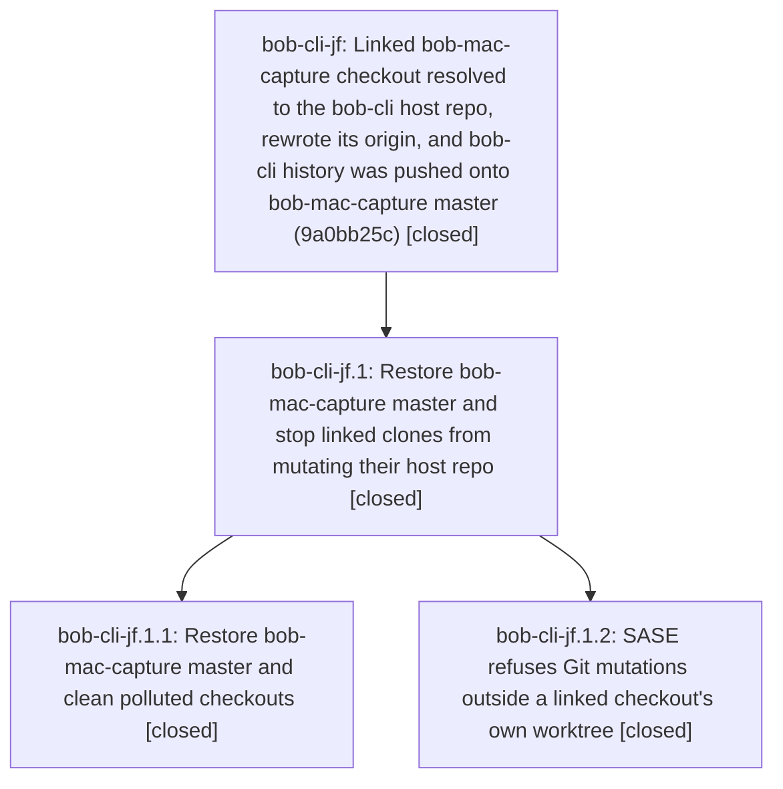

# Bead: bob-cli-jf — Linked bob-mac-capture checkout resolved to the bob-cli host repo, rewrote its origin, and bob-cli history was pushed onto bob-mac-capture master (9a0bb25c)

[Bead Pages](../README.md) / bob-cli-jf

**Status:** ✓ closed · **Resolution:** done · **Type:** ◆ task · **Task type:** ⨯ bug · **+1 reports:** +1
**Owner:** `bryanbugyi34@gmail.com` · **Created by:** [bbugyi200.athena.bob-cli-iz.land](https://github.com/bobs-org/bob-cli--agents/blob/main/sessions/bbugyi200.athena.bob-cli-iz.land.md) · **Assignee:** `bob-cli-jf` · **Size:** large
**Created:** 2026-11-09 21:02:52 EST · **Closed:** 2026-11-10 08:14:53 EST

<!-- sase:links:start -->

## Links

| Relation | Artifact | Why |
| --- | --- | --- |
| related | [bead:bob-cli-it][1] | Same docs-check 'collides with the committed landing page' error, different cause: here the bob-mac-capture mount resolves to bob-cli's own tree |
| related | [bead:bob-cli-iz][2] | Incident surfaced while landing this epic; phase bob-cli-iz.5's commit only reached bob-mac-capture and was re-landed by the lander |
| related | [bead:bob-cli-jk][3] | Observed during the bob-mac-capture history restore verification (phase bob-cli-jf.1.1) |
| related | [bead:bob-cli-jl][4] | Same root-cause class (Git discovery climbing into the host checkout); the jf.1.2 guard fixed linked/sidecar paths and added the is_worktree_root probe to reuse here |

_Plus 2 automatic references — see [Referenced By](#referenced-by)._

[1]: https://github.com/bobs-org/bob-cli--beads/blob/main/pages/bob-cli-it/README.md
[2]: https://github.com/bobs-org/bob-cli--beads/blob/main/pages/bob-cli-iz/README.md
[3]: https://github.com/bobs-org/bob-cli--beads/blob/main/pages/bob-cli-jk/README.md
[4]: https://github.com/bobs-org/bob-cli--beads/blob/main/pages/bob-cli-jl/README.md

<!-- sase:links:end -->

## Description

Proposed by the bob-cli-iz land agent (bob-cli-iz.land) while landing epic bob-cli-iz. Triggered during phase bob-cli-iz.5's run. The defect is in SASE linked-repo handling, not in bob-cli code.

\## What happened

1. Workspace bob-cli_10's primary checkout had `origin` = `git@github.com:bobs-org/bob-mac-capture.git`. The other 30 bob-cli workspaces use `bob-cli.git`.
2. `sase repo log --repo bob-mac-capture --workspace 10 --json` shows the last open there was by `bob-cli-iz.5` at 2026-11-09T15:11:58Z ("Need mounted sibling docs context for docs-check"). The phase's closing note says: "the mounted bob-mac-capture checkout resolves to the primary repo instead of its own Git worktree". So `sase/repos/linked/bob-mac-capture` in that workspace had no Git directory of its own, git walked up to the bob-cli_10 repo, and the linked-repo setup rewrote the HOST repo's origin.
3. bob-cli_10's reflog shows a long `rebase (continue)` sequence from 19:25 to 20:21 EST, then `rebase (start): checkout origin/master` at 20:21:36 onto 29147289 (bob-mac-capture's real master), with 4404 picks. It finished at 20:22:17 as 9a0bb25c, and then `branch: Reset to origin/master` at 20:27:21.
4. `git ls-remote https://github.com/bobs-org/bob-mac-capture` now reports `refs/heads/master` = 9a0bb25c4b55b547a6d92c35c93017471e74feff. That is bob-mac-capture's history plus 2253 bob-cli commits rebased on top, so the push was a fast-forward and nothing was destroyed. The genuine pre-incident master is 29147289ca584953ce7f8cfd29b5ed60a5380f76 ("docs(capture-transfers): merged sources keep notes, moves keep removed-run fold", 2026-11-09T20:19:27-05:00). It is an ancestor of 9a0bb25c and is still origin/master in bob-cli_12's linked bob-mac-capture checkout.
5. Side effects:
   - bob-cli-iz.5's commit ("feat(gcal)!: hold replaced Events sections") never reached bob-cli master. The bob-cli-iz land agent re-applied it onto bob-cli 12692ebb.
   - `just docs-check` fails for every bob-cli workspace: the bob-docs cache clone of bob-mac-capture (~/.cache/bob-docs/bob-mac-capture) now holds bob-cli's tree, so its docs/index.md collides with docs/reference/mac-capture/index.md ("source ships index.md, which collides with the committed landing page").
   - Any bob-mac-capture checkout that fast-forwards to the polluted master gets bob-cli content.

\## Already done (local only)

The bob-cli-iz land agent:
- reset bob-cli_10's origin to `git@github.com:bobs-org/bob-cli.git`;
- kept the mixed master as `refs/incident/bob-cli-10-mixed-master` (9a0bb25c) in that workspace;
- reset master to the real bob-cli origin/master.

Nothing remote was changed.

\## Remediation

1. With Bryan's approval, restore bob-mac-capture master to 29147289 with a lease on 9a0bb25c. The land agent proposed this as a gate. Then make sure no bob-mac-capture checkout (other bob-cli_N linked checkouts, the Mac's checkout) still has 9a0bb25c as local master, so nobody pushes it back. Also clear or refresh ~/.cache/bob-docs/bob-mac-capture so `just docs-check` stops failing.
2. Root cause in SASE (`sase repo open` / linked-repo materialization and the finalizer's repo obligations): refuse to run any git mutation (remote set-url, fetch/reset, commit, push) in a linked or sidecar path whose `git rev-parse --show-toplevel` is not that path, and fail loudly instead. Add a guard that the primary checkout's origin still matches the project's configured remote before any push.
3. Optionally add a bob-docs check that a mount's resolved repo is not the host repo (same toplevel or same root commit as bob-cli).

---

\## Bug

- **Location:** `sase linked-repo open/materialize for sase/repos/linked/bob-mac-capture in workspace bob-cli_10; GitHub bobs-org/bob-mac-capture refs/heads/master`

git ls-remote https://github.com/bobs-org/bob-mac-capture refs/heads/master  # 9a0bb25c..., a bob-cli commit whose ancestor 29147289 is the real Mac master; git -C <bob-cli_10> reflog shows rebase (start): checkout origin/master onto 29147289 at 20:21 EST and the push before 'Reset to origin/master' at 20:27

bob-mac-capture master carries bob-cli content (Mac checkouts that fast-forward get the wrong tree); just docs-check fails in every bob-cli workspace on the mac-capture mount index collision; bob-cli-iz.5's commit never reached bob-cli until re-landed

## Notes

[2026-11-10T02:05:57Z · bob-cli-iz.land] Restore gate filed for Bryan: custom-192d8c97-0890-447a-b76d-0c61fab910df ('Restore bob-mac-capture master from 9a0bb25c (bob-cli history) to 29147289'). It force-moves master via gh api only if master is still exactly 9a0bb25c and 29147289 is its ancestor.

[2026-11-10T11:45:42Z · bob-cli-jf] STATE RECHECK 2026-11-10 ~11:40 UTC (bob-cli-jf worker): GitHub master is now 3fb3a2be, not 9a0bb25c. Genuine Mac commits b20ceca5 and 3fb3a2be (apollo) landed on the polluted tip, so the dismissed gate custom-192d8c97 (lease on 9a0bb25c) is stale. Replaying 9a0bb25c..master onto 29147289 is clean, with zero diff on the 46 touched paths. Remote branch ci/precommit/14afa912… also contains 9a0bb25c. Polluted checkouts: three linked checkouts plus the bob-docs cache on athena, and one linked checkout plus the bob-docs cache on apollo; the Mac was not surveyed. SASE root cause found: ensure_git_clone_at (workspace_provider/_utils_checkout.py) treats a successful 'git status' in a linked dir with no .git (Git walks up to the host) as a reusable clone, then heal_clone_origin_if_needed (_utils_origin.py) runs 'git remote set-url origin' there and rewrites the HOST origin. Remediation proposed as an epic plan (restore + guard phases).

[2026-11-10T12:16:31Z · bob-cli-jf.1.1--1] HISTORY RESTORED by approved gate custom-79d25c9d-301c-4338-adf4-7fd429460d10 on 2026-11-10. Old master 2c406dd500915f4d8bee43cbae8f5bdbd985df1b -> restored master af604c6d9e05ec6440bfce5fa15ced97e388035c, based on unchanged GOOD 29147289ca584953ce7f8cfd29b5ed60a5380f76. Complete genuine Mac commit mapping:
- b20ceca5526c6f379f8d2983e70115f150a9ae48 -> 6dddea35b47bfc64c1295d547a3966c9e7a516e7 (feat(capture): present notebook capture targets and previews)
- 3fb3a2bea591fd9756722cf8b313d0394ffdf746 -> a36f3e8163357828e09b132a5fc2c9fdf77c2c05 (fix(capture): name nested notebook parent and restore Mac tests)
- 5e29dd26b1adb908cb402df83153b1c73c25164d -> 37933a1425f4fc8f2dcb1cb261dca065e9d7b7fd (fix(capture): show set Record Card values and conceal the route @)
- 2c406dd500915f4d8bee43cbae8f5bdbd985df1b -> af604c6d9e05ec6440bfce5fa15ced97e388035c (test(capture): fix notebook picker assertions and dotted type-through harness)
BAD 9a0bb25c4b55b547a6d92c35c93017471e74feff and the accidental bob-cli history are removed, not replayed. Gate verified fidelity on all 53 touched paths; scratch recovery backup remains /tmp/bob-mac-restore-0ig_wzuq. Deleted polluted remote branch refs/heads/ci/precommit/4f12681e038ad03a8ecb1de466d2a1ae (af75f0912ead90bad77bd8a6c0886409b2b00bd1). Live master verified equal to restored SHA; fetched every advertised head/tag and no remote ref contains BAD (4 heads, 0 tags). SHA searches found citations on bob-cli-jf, bob-cli-jf.1.1, and bob-cli-j8.8, so this full mapping is recorded on each. Exact-SHA CI run 42813392077 remains pending; this note does not claim CI is green. Run: https://github.com/bobs-org/bob-mac-capture/actions/runs/42813392077

[2026-11-10T12:39:53Z · bob-cli-jf.1.1--2] RESTORE VERIFICATION UPDATE: Cleanup and four-commit mapping remain verified (phase bob-cli-jf.1.1 notes). The first restored-SHA macOS CI run 42813392077 is red on three tests, not a hang: one highlight expectation now independently fixed by bob-cli-j8.8 in direct descendant 28aa5b32a62011266459e13723236e4caeda2478, known flake bob-cli-jb, and an alias-tip timeout under assessment. Current master and all 5 advertised heads remain free of BAD; no tags. Clean-base docs-check now gets past mount validation and fails only on four word budgets, recorded as PROPOSED FOLLOW-UP on the phase with h9/it distinctions. No source edits or further rewrite performed. Exact fixed-descendant run 42816665790 is pending; do not claim green yet. Durable evidence file:explicit:9c06ef579a77645b1ef8134e.

[2026-11-10T12:59:56Z · bob-cli-jf.1.1--3] RESTORE PHASE VERIFICATION COMPLETE: Green macOS CI at exact fixed descendant 28aa5b32a62011266459e13723236e4caeda2478: https://github.com/bobs-org/bob-mac-capture/actions/runs/42816665790 (completed 2026-11-10 12:52:56Z; Build/Test/Bundle/plist-signature/launch/install all SUCCESS; 4609 tests, 1 skipped, 0 failures). Original restored af604c6d run 42813392077 remains red; concurrent bob-cli-j8.8 fixed the highlight assertion in its direct child 28aa5b32, while unchanged alias-tip and double-equals tests passed. Alias-tip intermittent timeout is a PROPOSED FOLLOW-UP on bob-cli-jf.1.1; equals race stays covered by bob-cli-jb. Clean-base docs-check passed mount validation and failed only the four documented word budgets (h9 covers Mac pages; it did not reproduce). Complete four-commit mapping, no-BAD remote audit, and all 19 checkout surveys are recorded in phase notes; approved restore and cleanup are complete. Durable final evidence file:explicit:56505b5871a0c00d9ec89aa2; original CI/docs evidence file:explicit:9c06ef579a77645b1ef8134e. Only bob-cli-jf.1.1 is being closed; bob-cli-jf and bob-cli-jf.1 remain for the guard/land work.

[2026-11-10T13:14:53Z · bob-cli-jf.1.land] RESOLVED by epic bob-cli-jf.1 (landed and closed by bob-cli-jf.1.land, 2026-11-10), as the approved plan's Landing section directs.

- New master: bobs-org/bob-mac-capture master is 0958974f, a descendant of the restored af604c6d9e05ec6440bfce5fa15ced97e388035c built on GOOD 29147289. Mapping: b20ceca5->6dddea35, 3fb3a2be->a36f3e81, 5e29dd26->37933a14, 2c406dd5->af604c6d.
- Clean ls-remote check: I fetched every advertised head (master, ci/precommit/4c1e5994, mac-refs-hotkey-o, persist-canceled-draft-stash) and all 13 refs/pull/*/head. BAD 9a0bb25c is not reachable from any of them, and there are no tags. The 19 surveyed checkouts (athena, apollo, mac) carry no BAD refs or stashes, and the bob-docs caches were removed.
- docs-check: on bob-cli 1f912b8c, mount validation passes (the mac-capture index collision is gone). Lint fails only on pre-existing word budgets: Mac pages are tracked by bob-cli-h9 (+1 added) and json-outputs.md by active epic bob-cli-j8.
- Green macOS CI: run https://github.com/bobs-org/bob-mac-capture/actions/runs/42816665790 at 28aa5b32, the direct child of the restored tip (4609 tests, 0 failures).
- sase guard commit: a14bffcdbf "fix(workspaces): guard Git mutations and pushes by checkout identity" is on sase master. It adds a bounded worktree-root probe before every linked or sidecar origin, fetch, merge, or exclude mutation, plus an expected-origin push guard.

Optional item 3 (a bob-docs host-identity check) was declined as out of scope in the approved plan: bob-docs already refuses a mount whose toplevel is not itself (_worktree_failure), and a root-commit check cannot work on a depth-1 cache. Follow-ups: bob-cli-jk, bob-cli-jl (external-repo validator, same failure class), bob-cli-jm, and bob-cli-jn.

## +1 Evidence

> **+1** by `bob-cli-j5.land` · 2026-11-10 01:51:03 EST
> **Observed since:** 2026-11-10 01:19:52 EST
>
> Independent reproduction by the bob-cli-j5 land agent (bob-cli-j5.land) on bob-cli master 6a7afcd2, 2026-11-10: just docs-check exits 2 with "mount 'bob-mac-capture' -> 'reference/mac-capture': source ships index.md, which collides with the committed landing page docs/reference/mac-capture/index.md". git ls-remote bobs-org/bob-mac-capture refs/heads/master still reports 9a0bb25c (not restored to 29147289), and ~/.cache/bob-docs/bob-mac-capture HEAD is 9a0bb25 'feat(gcal)!: hold replaced Events sections' with 912 tracked src/native/ files (bob-cli's tree). The same failure was proposed as a follow-up by three bob-cli-j5 phases (j5.5 note #2, j5.6 note #1, j5.8 note #1), each verified on a clean base; this is the same root cause, so no new task was filed. Impact: docs-check cannot validate any bob-cli docs change until the remote is restored and the cache refreshed.

## Lineage

## Agents

| Agent | Bead | Commits |
|---|---|---:|
| [bbugyi200.athena.bob-cli-jf](https://github.com/bobs-org/bob-cli--agents/blob/main/sessions/bbugyi200.athena.bob-cli-jf.md) | [bob-cli-jf](README.md) | 0 |
| [bbugyi200.athena.bob-cli-jf.1.1](https://github.com/bobs-org/bob-cli--agents/blob/main/sessions/bbugyi200.athena.bob-cli-jf.1.1.md) | [bob-cli-jf.1.1](bob-cli-jf.1.1.md) | 0 |
| [bbugyi200.athena.bob-cli-jf.1.2](https://github.com/bobs-org/bob-cli--agents/blob/main/agents/bbugyi200.athena.bob-cli-jf.1.2/README.md) | [bob-cli-jf.1.2](bob-cli-jf.1.2.md) | 0 |
| [bbugyi200.athena.bob-cli-jf.1.land](https://github.com/bobs-org/bob-cli--agents/blob/main/agents/bbugyi200.athena.bob-cli-jf.1.land/README.md) | [bob-cli-jf.1](bob-cli-jf.1.md) | 1 |

## Commits

| Repo | Commit | Subject | Bead | Committed |
|---|---|---|---|---|
| bob-cli--plans | [`bob-cli--plans@1faead0`](https://github.com/bobs-org/bob-cli--plans/commit/1faead0bfb5224fb6dd7b7a2fafa7596f9a5c783) | chore(plans): mark bob-mac-capture history restore epic done | [bob-cli-jf.1](bob-cli-jf.1.md) | 2026-11-10 08:15:29 EST |

<!-- sase:referenced-by:start -->

## Referenced By

| Relation | Artifact | Why | Uses |
| --- | --- | --- | ---: |
| read-by | [agent:1aq][1] | User asked for impact/lost-work research report on this bead | 1 |
| read-by | [agent:bob-cli-iz.land][2] | Confirm links and status after a timed-out link command | 1 |

[1]: https://github.com/bobs-org/bob-cli--agents/blob/main/agents/bbugyi200.athena.1aq/README.md
[2]: https://github.com/bobs-org/bob-cli--agents/blob/main/sessions/bbugyi200.athena.bob-cli-iz.land.md

<!-- sase:referenced-by:end -->
