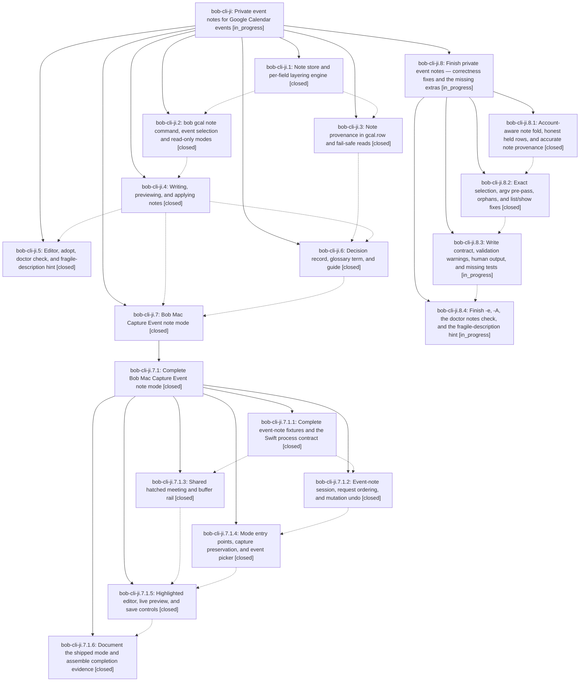

# Bead: bob-cli-ji — Private event notes for Google Calendar events

[Bead Pages](../README.md) / bob-cli-ji

**Status:** ◐ in_progress · **Type:** ▸ plan · **Tier:** epic
**Owner:** `bryanbugyi34@gmail.com` · **Created by:** [bbugyi200.apollo.research.3z.linker.w0](https://github.com/bobs-org/bob-cli--agents/blob/main/sessions/bbugyi200.apollo.research.3z.linker.w0.md) · **Assignee:** `bob-cli-ji.land`
**Created:** 2026-11-10 05:59:46 EST
**Plan:** [202611/private\_gcal\_event\_notes.md](https://github.com/bobs-org/bob-cli--plans/blob/main/202611/private_gcal_event_notes.md)

<!-- sase:links:start -->

## Links

| Relation | Artifact | Why |
| --- | --- | --- |
| implemented-by | [plan:202611/private_gcal_event_notes.md][1] | derived from the plan's `bead_id:` frontmatter field |
| related | [bead:bob-cli-k0][2] | Epic that accepted the single badges-hash cost for private event notes |
| related | [bead:bob-cli-k1][3] | Epic that shipped event and series note scopes |
| related | [bead:bob-cli-k2][4] | Epic that added gcal.row note provenance the tooltip would read |

_Plus 8 automatic references — see [Referenced By](#referenced-by)._

[1]: https://github.com/bobs-org/bob-cli--plans/blob/main/202611/private_gcal_event_notes.md
[2]: https://github.com/bobs-org/bob-cli--beads/blob/main/pages/bob-cli-k0/README.md
[3]: https://github.com/bobs-org/bob-cli--beads/blob/main/pages/bob-cli-k1/README.md
[4]: https://github.com/bobs-org/bob-cli--beads/blob/main/pages/bob-cli-k2/README.md

<!-- sase:links:end -->

## Description

Bryan can give any Google Calendar event (including events other people own and invitations he has not answered yet) Bob-only metadata at RSVP time: `@route`, `#off`/`#on`, `-30 reason`, `+15 reason`, and prose. He can write it from the CLI, over SSH, or from Bob Mac Capture. The metadata lands on the event's Event Task exactly as if those lines were in the Google description, and it beats that description field by field. Bob never writes to Google: it validates notes at write time, previews them faithfully, and never drops one silently.

## Notes

[2026-11-10T20:12:49Z · bob-cli-js.land] DISCOVERED ISSUE: just check / just lint fails at cargo clippy on master 947f24ff with 4 deny-level lints, all in this epic's gcal code: clippy::len_zero at src/native/gcal/note/write.rs:177 (note.errors.len() > 0) and clippy::collapsible_if at src/native/gcal/note/write.rs:1181 and :1421 (both from cf7c0605, bob-cli-ji.4), plus clippy::collapsible_if at src/native/gcal/doctor.rs:357 (c8934b93, bob-cli-ji.5). Because clippy fails at the lib level, cargo test never runs under just check. First proposed by bob-cli-js.3 note #2 (PROPOSED FOLLOW-UP); reproduced by the bob-cli-js land agent with just check on 2026-11-10 (exit 101, 'could not compile bob-obsidian (lib) due to 4 previous errors'). Fix: replace the length check with !note.errors.is_empty() and collapse the three nested ifs (let-chains), then rerun just check.

[2026-11-11T00:14:11Z · bob-cli-jt.land] DISCOVERED ISSUE: Landing bob-cli-jt, triaging jt.1 notes #3 and #4. Two stale test expectations are causally owned by this epic: a2809a1d (ji.2) added gcal-note in src/native/catalog/table.rs, but tests/cli/catalog.rs:42 still expects 88; current land check 31d25bfee9dd8db6b2887c2a6f3d7f41 on 4c1f7dde reproduces protocol_1_parses_with_schema_version_one failure (catalog is 89). Existing task bob-cli-de also tracks this recurring assertion drift. c8934b93 (ji.5) added the doctor notes check, but tests/gcal_auth.rs::doctor_json_healthy_setup exact ID list at line 1094 still omits notes; jt.1 reproduced that on clean base. Update the catalog contract assertion and doctor healthy expectation without removing the new product behavior. The four gcal deny-level clippy findings from jt.1 note #2 are already fixed in 4c1f7dde; this landing check passed clippy. Evidence file:explicit:5d919abc2555b8f911456244

[2026-11-11T00:17:45Z · bob-cli-jt.land] Runtime confirmation of the jt lander DISCOVERED ISSUE: just check 31d25bfee9dd8db6b2887c2a6f3d7f41 completed on 4c1f7dde, exit 101, with exactly the catalog 89-vs-88 and doctor_json_healthy_setup notes-ID expectation failures described above. All other test targets and Clippy passed. Completed evidence: file:explicit:a7ca20870803705cc70efee4.

[2026-11-11T03:27:47Z · bob-cli-ji.land] FOLLOW-UP TRIAGE (bob-cli-ji land agent): (1) docs-check word-budget overages (ji.1 #1, ji.2 #1, ji.3 #1, ji.4 #1, ji.5 #1, ji.6 #7): not caused by this epic; json-outputs.md is back under budget since 891fa3e4, and the mounted Mac pages are already tracked by bob-cli-jz (which cites ji.2 #1) and bob-cli-h9, so no new bead. (2) ji.6 #1 glossary term Private Event Note: declined. The reviewer chose memory_glossary=no, and decisions:private-event-notes-beat-google-per-field already carries the 'private event note' aliases, so a glossary strand would duplicate it. (3) ji.6 #2 badge-hash split -> new feature bob-cli-k0. (4) ji.6 #3 Google Keep phone path: declined. The plan made it conditional on phone RSVPs turning out to be common, there is no such evidence yet, and the guide documents the gcal.colors stopgap. (5) ji.6 #4 this-and-following scope -> new feature bob-cli-k1. (6) ji.6 #5 Ledger Tools pill tooltip -> new feature bob-cli-k2. (7) ji.6 #6 RSVP from Bob: declined as a task. It would reverse the accepted decision bob-gcal-is-read-only-and-proposes-once, so it needs Bryan's own decision rather than a discovered-work bead; the reopen condition is already recorded in decisions:private-event-notes-beat-google-per-field. The bob-cli-ji.7.1 follow-ups were already triaged by its land agent (bob-cli-jx, jy, jz, h9, jc). Epic notes #1-#3 (clippy, catalog 89, doctor notes ID) were fixed by 4c1f7dde/85e618d8; just check on 85e618d8 passed: 10457 tests, 0 failed.

[2026-11-11T03:30:30Z · bob-cli-ji.land] LAND AUDIT (bob-cli-ji land agent): The epic is not complete. Verified OK: all phases closed; DECISIONS honored (auto_sync=yes writer-host sync; cmd_e Mac chord via bob-cli-ji.7.1; memory_record decision strand plus superseded-in-part marks; no glossary strand). Engine/hardening tests are present, and just check on 85e618d8 passed. Integration: the 15 non-epic commits since 4219d70a (capture/notebooks/stats/periods/freshness) neither conflict with nor duplicate this feature; 891fa3e4 only moved note.rs prepass tests. Remaining epic work found by reading the source: (a) lookup_exact clones google_event after apply_notes, so -i/URL previews and -c show the stale note, and cleared.json locks this in; (b) the argv pre-pass swallows options after the first directive (a trailing -d saves instead of previewing); (c) printed orphan clear commands fail; any gog error becomes a not_found orphan; past-hiding runs before the gone/cancelled check for series; (d) load_notes folds without the account, so a foreign note hides this account's; (e) held rows are reported as updated and a duplicate gcal.row is appended every run; (f) the extras phase (c8934b93) shipped no tests: -e lacks the TTY check, vi fallback, git scissors, Edit-again loop, and empty-clears; -A drops bare buffers and lacks the existing-note refusal; the doctor notes check lacks cancelled/declined/series orphans, the 25-lookup cap, malformed records, and per-issue fixes; the fragile hint ignores the task/guests/no-note conditions and lacks fragile_directives JSON; (g) write contract: suggestions are always empty, clock_off/clock_on spans where the Mac expects clock, no invalid spans, one plan warning missing, rail labelled with the colour name. Planned as child epic 'Finish private event notes' (engine -> select -> write -> extras).

## Phases

| Bead | Title | Status | Size | Created | Agents | Commits |
|---|---|---|---|---|---:|---:|
| [bob-cli-ji.1](bob-cli-ji.1.md) | Note store and per-field layering engine | ✓ closed | medium | 2026-11-10 | 1 | 1 |
| [bob-cli-ji.2](bob-cli-ji.2.md) | bob gcal note command, event selection and read-only modes | ✓ closed | medium | 2026-11-10 | 1 | 1 |
| [bob-cli-ji.3](bob-cli-ji.3.md) | Note provenance in gcal.row and fail-safe reads | ✓ closed | small | 2026-11-10 | 1 | 1 |
| [bob-cli-ji.4](bob-cli-ji.4.md) | Writing, previewing, and applying notes | ✓ closed | medium | 2026-11-10 | 1 | 1 |
| [bob-cli-ji.5](bob-cli-ji.5.md) | Editor, adopt, doctor check, and fragile-description hint | ✓ closed | small | 2026-11-10 | 1 | 1 |
| [bob-cli-ji.6](bob-cli-ji.6.md) | Decision record, glossary term, and guide | ✓ closed | small | 2026-11-10 | 1 | 1 |
| [bob-cli-ji.7](bob-cli-ji.7.md) | Bob Mac Capture Event note mode | ✓ closed | large | 2026-11-10 | 1 | 0 |

## Lineage

## Agents

| Agent | Bead | Commits |
|---|---|---:|
| [bbugyi200.apollo.bob-cli-ji.1](https://github.com/bobs-org/bob-cli--agents/blob/main/agents/bbugyi200.apollo.bob-cli-ji.1/README.md) | [bob-cli-ji.1](bob-cli-ji.1.md) | 1 |
| [bbugyi200.apollo.bob-cli-ji.2](https://github.com/bobs-org/bob-cli--agents/blob/main/agents/bbugyi200.apollo.bob-cli-ji.2/README.md) | [bob-cli-ji.2](bob-cli-ji.2.md) | 1 |
| [bbugyi200.apollo.bob-cli-ji.3](https://github.com/bobs-org/bob-cli--agents/blob/main/agents/bbugyi200.apollo.bob-cli-ji.3/README.md) | [bob-cli-ji.3](bob-cli-ji.3.md) | 1 |
| [bbugyi200.apollo.bob-cli-ji.4](https://github.com/bobs-org/bob-cli--agents/blob/main/agents/bbugyi200.apollo.bob-cli-ji.4/README.md) | [bob-cli-ji.4](bob-cli-ji.4.md) | 1 |
| [bbugyi200.apollo.bob-cli-ji.5](https://github.com/bobs-org/bob-cli--agents/blob/main/agents/bbugyi200.apollo.bob-cli-ji.5/README.md) | [bob-cli-ji.5](bob-cli-ji.5.md) | 1 |
| [bbugyi200.apollo.bob-cli-ji.6](https://github.com/bobs-org/bob-cli--agents/blob/main/agents/bbugyi200.apollo.bob-cli-ji.6/README.md) | [bob-cli-ji.6](bob-cli-ji.6.md) | 1 |
| [bbugyi200.apollo.bob-cli-ji.7](https://github.com/bobs-org/bob-cli--agents/blob/main/sessions/bbugyi200.apollo.bob-cli-ji.7.md) | [bob-cli-ji.7](bob-cli-ji.7.md) | 0 |
| [bbugyi200.apollo.bob-cli-ji.7.1.1](https://github.com/bobs-org/bob-cli--agents/blob/main/agents/bbugyi200.apollo.bob-cli-ji.7.1.1/README.md) | [bob-cli-ji.7.1.1](bob-cli-ji.7.1.1.md) | 1 |
| [bbugyi200.apollo.bob-cli-ji.7.1.2](https://github.com/bobs-org/bob-cli--agents/blob/main/sessions/bbugyi200.apollo.bob-cli-ji.7.1.2.md) | [bob-cli-ji.7.1.2](bob-cli-ji.7.1.2.md) | 0 |
| [bbugyi200.apollo.bob-cli-ji.7.1.3](https://github.com/bobs-org/bob-cli--agents/blob/main/sessions/bbugyi200.apollo.bob-cli-ji.7.1.3.md) | [bob-cli-ji.7.1.3](bob-cli-ji.7.1.3.md) | 0 |
| [bbugyi200.apollo.bob-cli-ji.7.1.4](https://github.com/bobs-org/bob-cli--agents/blob/main/sessions/bbugyi200.apollo.bob-cli-ji.7.1.4.md) | [bob-cli-ji.7.1.4](bob-cli-ji.7.1.4.md) | 0 |
| [bbugyi200.apollo.bob-cli-ji.7.1.5](https://github.com/bobs-org/bob-cli--agents/blob/main/sessions/bbugyi200.apollo.bob-cli-ji.7.1.5.md) | [bob-cli-ji.7.1.5](bob-cli-ji.7.1.5.md) | 0 |
| [bbugyi200.apollo.bob-cli-ji.7.1.6](https://github.com/bobs-org/bob-cli--agents/blob/main/agents/bbugyi200.apollo.bob-cli-ji.7.1.6/README.md) | [bob-cli-ji.7.1.6](bob-cli-ji.7.1.6.md) | 1 |
| [bbugyi200.apollo.bob-cli-ji.7.1.land](https://github.com/bobs-org/bob-cli--agents/blob/main/sessions/bbugyi200.apollo.bob-cli-ji.7.1.land.md) | [bob-cli-ji.7.1](bob-cli-ji.7.1.md) | 3 |
| [bbugyi200.apollo.bob-cli-ji.8.1](https://github.com/bobs-org/bob-cli--agents/blob/main/agents/bbugyi200.apollo.bob-cli-ji.8.1/README.md) | [bob-cli-ji.8.1](bob-cli-ji.8.1.md) | 1 |
| [bbugyi200.apollo.bob-cli-ji.8.2](https://github.com/bobs-org/bob-cli--agents/blob/main/agents/bbugyi200.apollo.bob-cli-ji.8.2/README.md) | [bob-cli-ji.8.2](bob-cli-ji.8.2.md) | 1 |
| [bbugyi200.apollo.bob-cli-ji.8.3](https://github.com/bobs-org/bob-cli--agents/blob/main/agents/bbugyi200.apollo.bob-cli-ji.8.3/README.md) | [bob-cli-ji.8.3](bob-cli-ji.8.3.md) | 0 |
| [bbugyi200.apollo.bob-cli-ji.8.4](https://github.com/bobs-org/bob-cli--agents/blob/main/agents/bbugyi200.apollo.bob-cli-ji.8.4/README.md) | [bob-cli-ji.8.4](bob-cli-ji.8.4.md) | 0 |
| [bbugyi200.apollo.bob-cli-ji.8.land](https://github.com/bobs-org/bob-cli--agents/blob/main/agents/bbugyi200.apollo.bob-cli-ji.8.land/README.md) | [bob-cli-ji.8](bob-cli-ji.8.md) | 0 |
| [bbugyi200.apollo.bob-cli-ji.land](https://github.com/bobs-org/bob-cli--agents/blob/main/sessions/bbugyi200.apollo.bob-cli-ji.land.md) | [bob-cli-ji](README.md) | 0 |

## Commits

| Repo | Commit | Subject | Bead | Committed |
|---|---|---|---|---|
| bob-cli | [`4219d70`](https://github.com/bobs-org/bob-cli/commit/4219d70a75d81299cb9321bf194508abcbb96367) | feat(gcal): layer private event notes over Google descriptions | [bob-cli-ji.1](bob-cli-ji.1.md) | 2026-11-10 06:48:22 EST |
| bob-cli | [`7ff24c8`](https://github.com/bobs-org/bob-cli/commit/7ff24c8241b1fefbed57906f5486367e3f86e14d) | feat(gcal): record note provenance in gcal.row and fail-safe reads | [bob-cli-ji.3](bob-cli-ji.3.md) | 2026-11-10 07:15:55 EST |
| bob-cli | [`a2809a1`](https://github.com/bobs-org/bob-cli/commit/a2809a1dc48db0d2ac384f44d3e5fce7c8635715) | feat(gcal): add bob gcal note selection and read-only modes | [bob-cli-ji.2](bob-cli-ji.2.md) | 2026-11-10 08:11:11 EST |
| bob-cli | [`cf7c060`](https://github.com/bobs-org/bob-cli/commit/cf7c06052b26b64d5fb68e10a4b65b5f759fac10) | feat(gcal): add private event note writes and preview | [bob-cli-ji.4](bob-cli-ji.4.md) | 2026-11-10 09:56:07 EST |
| bob-cli | [`8f2b492`](https://github.com/bobs-org/bob-cli/commit/8f2b492552dc4c325322af1fc8cc8b25987028e5) | feat(gcal): record private event notes decision and guide | [bob-cli-ji.6](bob-cli-ji.6.md) | 2026-11-10 10:14:40 EST |
| bob-cli | [`c8934b9`](https://github.com/bobs-org/bob-cli/commit/c8934b93af196e36b08a480aac36df5b336dcda6) | feat(gcal): edit and adopt private event notes | [bob-cli-ji.5](bob-cli-ji.5.md) | 2026-11-10 10:24:00 EST |
| bob-cli | [`8e2b93c`](https://github.com/bobs-org/bob-cli/commit/8e2b93c7d0ed6bee06cb5b19b5ce95bc8f09115e) | feat(gcal): expose effective buffer reasons in note JSON | [bob-cli-ji.7.1.1](bob-cli-ji.7.1.1.md) | 2026-11-10 11:21:54 EST |
| bob-cli | [`23e7f90`](https://github.com/bobs-org/bob-cli/commit/23e7f90df5be9b52b5600c82a6b9104c6324d924) | docs(gcal): mark Mac event-note mode shipped and point at Mac guide | [bob-cli-ji.7.1.6](bob-cli-ji.7.1.6.md) | 2026-11-10 17:10:50 EST |
| bob-cli | [`4c1f7dd`](https://github.com/bobs-org/bob-cli/commit/4c1f7dde9f6e8515f069ccfd3e58c30047d76a0e) | fix(gcal): clean event note lint and add preview fixtures | [bob-cli-ji.7.1](bob-cli-ji.7.1.md) | 2026-11-10 18:28:36 EST |
| bob-cli | [`85e618d`](https://github.com/bobs-org/bob-cli/commit/85e618d889ab2172c29ab5b25cae66d209968936) | test(cli): align catalog and gcal doctor expectations | [bob-cli-ji.7.1](bob-cli-ji.7.1.md) | 2026-11-10 20:14:17 EST |
| bob-cli--plans | [`bob-cli--plans@b03a50d`](https://github.com/bobs-org/bob-cli--plans/commit/b03a50db376878c4df63ec373f72d8624a2f4654) | docs(gcal-note): mark Mac event note plan done | [bob-cli-ji.7.1](bob-cli-ji.7.1.md) | 2026-11-10 22:04:14 EST |
| bob-cli | [`54e650d`](https://github.com/bobs-org/bob-cli/commit/54e650d17699f9ff2362a40f20ae8e80e8b59585) | fix(gcal): fold private notes per account and report held rows honestly | [bob-cli-ji.8.1](bob-cli-ji.8.1.md) | 2026-11-10 23:04:40 EST |
| bob-cli | [`9660397`](https://github.com/bobs-org/bob-cli/commit/9660397de55695647da3a01c2f595e1560651058) | fix(gcal-notes): nine select fixes for note previews, options, clear, list/show | [bob-cli-ji.8.2](bob-cli-ji.8.2.md) | 2026-11-11 00:05:16 EST |

<!-- sase:referenced-by:start -->

## Referenced By

| Relation | Artifact | Why | Uses |
| --- | --- | --- | ---: |
| read-by | [agent:bob-cli-ji.7.1.land--8][1] | Confirm the parent epic remains open after phase closeout | 1 |
| read-by | [agent:bob-cli-ji.8.1][2] | Need parent legend/epic DECISIONS that phases must honor | 1 |
| read-by | [agent:research.40.cdx][3] | Inspect the epic context for an independent private event metadata guide | 1 |
| read-by | [agent:research.40.cld][4] | Context for writing a user guide on adding metadata to private event tasks | 1 |
| read-by | [agent:research.40.final][5] | Ground consolidated private-event-notes guide in the epic's current status and guide requirements | 1 |
| read-by | [agent:research.40.gem][6] | Understand requirements and context for adding metadata to private event tasks | 1 |
| read-by | [agent:research.40.grk][7] | Need full epic bead context including notes and follow-ups for the user-guide research | 1 |
| read-by | [agent:research.40.mus][8] | research guide on adding metadata to private event tasks | 1 |

[1]: https://github.com/bobs-org/bob-cli--agents/blob/main/sessions/bbugyi200.apollo.bob-cli-ji.7.1.land.md
[2]: https://github.com/bobs-org/bob-cli--agents/blob/main/agents/bbugyi200.apollo.bob-cli-ji.8.1/README.md
[3]: https://github.com/bobs-org/bob-cli--agents/blob/main/agents/bbugyi200.apollo.research.40.cdx/README.md
[4]: https://github.com/bobs-org/bob-cli--agents/blob/main/agents/bbugyi200.apollo.research.40.cld/README.md
[5]: https://github.com/bobs-org/bob-cli--agents/blob/main/agents/bbugyi200.apollo.research.40.final/README.md
[6]: https://github.com/bobs-org/bob-cli--agents/blob/main/agents/bbugyi200.apollo.research.40.gem/README.md
[7]: https://github.com/bobs-org/bob-cli--agents/blob/main/agents/bbugyi200.apollo.research.40.grk/README.md
[8]: https://github.com/bobs-org/bob-cli--agents/blob/main/agents/bbugyi200.apollo.research.40.mus/README.md

<!-- sase:referenced-by:end -->
