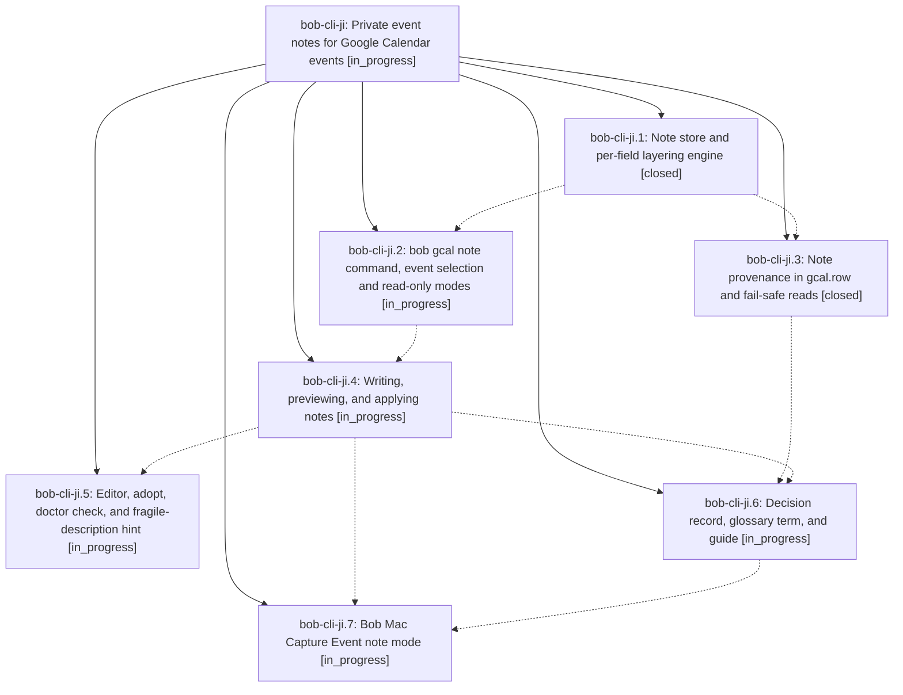

# Bead: bob-cli-ji — Private event notes for Google Calendar events

[Bead Pages](../README.md) / bob-cli-ji

**Status:** ◐ in_progress · **Type:** ▸ plan · **Tier:** epic
**Owner:** `bryanbugyi34@gmail.com` · **Created by:** [bbugyi200.apollo.research.3z.linker.w0](https://github.com/bobs-org/bob-cli--agents/blob/main/sessions/bbugyi200.apollo.research.3z.linker.w0.md) · **Assignee:** `bob-cli-ji.land`
**Created:** 2026-11-10 05:59:46 EST
**Plan:** [202611/private\_gcal\_event\_notes.md](https://github.com/bobs-org/bob-cli--plans/blob/main/202611/private_gcal_event_notes.md)

<!-- sase:links:start -->

## Links

| Relation | Artifact | Why |
| --- | --- | --- |
| implemented-by | [plan:202611/private_gcal_event_notes.md][1] | derived from the plan's `bead_id:` frontmatter field |

[1]: https://github.com/bobs-org/bob-cli--plans/blob/main/202611/private_gcal_event_notes.md

<!-- sase:links:end -->

## Description

Bryan can give any Google Calendar event (including events other people own and invitations he has not answered yet) Bob-only metadata at RSVP time: `@route`, `#off`/`#on`, `-30 reason`, `+15 reason`, and prose. He can write it from the CLI, over SSH, or from Bob Mac Capture. The metadata lands on the event's Event Task exactly as if those lines were in the Google description, and it beats that description field by field. Bob never writes to Google: it validates notes at write time, previews them faithfully, and never drops one silently.

## Phases

| Bead | Title | Status | Size | Created | Agents | Commits |
|---|---|---|---|---|---:|---:|
| [bob-cli-ji.1](bob-cli-ji.1.md) | Note store and per-field layering engine | ✓ closed | medium | 2026-11-10 | 1 | 1 |
| [bob-cli-ji.2](bob-cli-ji.2.md) | bob gcal note command, event selection and read-only modes | ◐ in_progress | medium | 2026-11-10 | 1 | 0 |
| [bob-cli-ji.3](bob-cli-ji.3.md) | Note provenance in gcal.row and fail-safe reads | ✓ closed | small | 2026-11-10 | 1 | 1 |
| [bob-cli-ji.4](bob-cli-ji.4.md) | Writing, previewing, and applying notes | ◐ in_progress | medium | 2026-11-10 | 1 | 0 |
| [bob-cli-ji.5](bob-cli-ji.5.md) | Editor, adopt, doctor check, and fragile-description hint | ◐ in_progress | small | 2026-11-10 | 1 | 0 |
| [bob-cli-ji.6](bob-cli-ji.6.md) | Decision record, glossary term, and guide | ◐ in_progress | small | 2026-11-10 | 1 | 0 |
| [bob-cli-ji.7](bob-cli-ji.7.md) | Bob Mac Capture Event note mode | ◐ in_progress | large | 2026-11-10 | 1 | 0 |

## Lineage

## Agents

| Agent | Bead | Commits |
|---|---|---:|
| [bbugyi200.apollo.bob-cli-ji.1](https://github.com/bobs-org/bob-cli--agents/blob/main/agents/bbugyi200.apollo.bob-cli-ji.1/README.md) | [bob-cli-ji.1](bob-cli-ji.1.md) | 1 |
| [bbugyi200.apollo.bob-cli-ji.2](https://github.com/bobs-org/bob-cli--agents/blob/main/agents/bbugyi200.apollo.bob-cli-ji.2/README.md) | [bob-cli-ji.2](bob-cli-ji.2.md) | 0 |
| [bbugyi200.apollo.bob-cli-ji.3](https://github.com/bobs-org/bob-cli--agents/blob/main/agents/bbugyi200.apollo.bob-cli-ji.3/README.md) | [bob-cli-ji.3](bob-cli-ji.3.md) | 1 |
| [bbugyi200.apollo.bob-cli-ji.4](https://github.com/bobs-org/bob-cli--agents/blob/main/agents/bbugyi200.apollo.bob-cli-ji.4/README.md) | [bob-cli-ji.4](bob-cli-ji.4.md) | 0 |
| [bbugyi200.apollo.bob-cli-ji.5](https://github.com/bobs-org/bob-cli--agents/blob/main/agents/bbugyi200.apollo.bob-cli-ji.5/README.md) | [bob-cli-ji.5](bob-cli-ji.5.md) | 0 |
| [bbugyi200.apollo.bob-cli-ji.6](https://github.com/bobs-org/bob-cli--agents/blob/main/agents/bbugyi200.apollo.bob-cli-ji.6/README.md) | [bob-cli-ji.6](bob-cli-ji.6.md) | 0 |
| [bbugyi200.apollo.bob-cli-ji.7](https://github.com/bobs-org/bob-cli--agents/blob/main/agents/bbugyi200.apollo.bob-cli-ji.7/README.md) | [bob-cli-ji.7](bob-cli-ji.7.md) | 0 |
| [bbugyi200.apollo.bob-cli-ji.land](https://github.com/bobs-org/bob-cli--agents/blob/main/agents/bbugyi200.apollo.bob-cli-ji.land/README.md) | [bob-cli-ji](README.md) | 0 |

## Commits

| Repo | Commit | Subject | Bead | Committed |
|---|---|---|---|---|
| bob-cli | [`4219d70`](https://github.com/bobs-org/bob-cli/commit/4219d70a75d81299cb9321bf194508abcbb96367) | feat(gcal): layer private event notes over Google descriptions | [bob-cli-ji.1](bob-cli-ji.1.md) | 2026-11-10 06:48:22 EST |
| bob-cli | [`7ff24c8`](https://github.com/bobs-org/bob-cli/commit/7ff24c8241b1fefbed57906f5486367e3f86e14d) | feat(gcal): record note provenance in gcal.row and fail-safe reads | [bob-cli-ji.3](bob-cli-ji.3.md) | 2026-11-10 07:15:55 EST |
