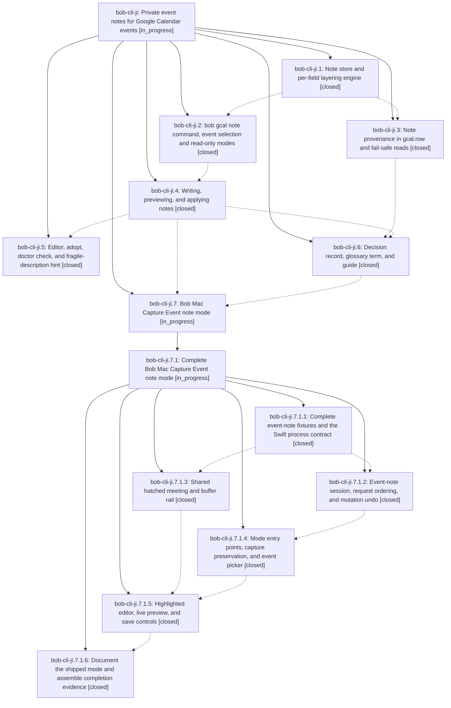

# Bead: bob-cli-ji — Private event notes for Google Calendar events

[Bead Pages](../README.md) / bob-cli-ji

**Status:** ◐ in_progress · **Type:** ▸ plan · **Tier:** epic
**Owner:** `bryanbugyi34@gmail.com` · **Created by:** [bbugyi200.apollo.research.3z.linker.w0](https://github.com/bobs-org/bob-cli--agents/blob/main/sessions/bbugyi200.apollo.research.3z.linker.w0.md) · **Assignee:** `bob-cli-ji.land`
**Created:** 2026-11-10 05:59:46 EST
**Plan:** [202611/private\_gcal\_event\_notes.md](https://github.com/bobs-org/bob-cli--plans/blob/main/202611/private_gcal_event_notes.md)

<!-- sase:links:start -->

## Links

| Relation | Artifact | Why |
| --- | --- | --- |
| implemented-by | [plan:202611/private_gcal_event_notes.md][1] | derived from the plan's `bead_id:` frontmatter field |

_Plus 6 automatic references — see [Referenced By](#referenced-by)._

[1]: https://github.com/bobs-org/bob-cli--plans/blob/main/202611/private_gcal_event_notes.md

<!-- sase:links:end -->

## Description

Bryan can give any Google Calendar event (including events other people own and invitations he has not answered yet) Bob-only metadata at RSVP time: `@route`, `#off`/`#on`, `-30 reason`, `+15 reason`, and prose. He can write it from the CLI, over SSH, or from Bob Mac Capture. The metadata lands on the event's Event Task exactly as if those lines were in the Google description, and it beats that description field by field. Bob never writes to Google: it validates notes at write time, previews them faithfully, and never drops one silently.

## Notes

[2026-11-10T20:12:49Z · bob-cli-js.land] DISCOVERED ISSUE: just check / just lint fails at cargo clippy on master 947f24ff with 4 deny-level lints, all in this epic's gcal code: clippy::len_zero at src/native/gcal/note/write.rs:177 (note.errors.len() > 0) and clippy::collapsible_if at src/native/gcal/note/write.rs:1181 and :1421 (both from cf7c0605, bob-cli-ji.4), plus clippy::collapsible_if at src/native/gcal/doctor.rs:357 (c8934b93, bob-cli-ji.5). Because clippy fails at the lib level, cargo test never runs under just check. First proposed by bob-cli-js.3 note #2 (PROPOSED FOLLOW-UP); reproduced by the bob-cli-js land agent with just check on 2026-11-10 (exit 101, 'could not compile bob-obsidian (lib) due to 4 previous errors'). Fix: replace the length check with !note.errors.is_empty() and collapse the three nested ifs (let-chains), then rerun just check.

## Phases

| Bead | Title | Status | Size | Created | Agents | Commits |
|---|---|---|---|---|---:|---:|
| [bob-cli-ji.1](bob-cli-ji.1.md) | Note store and per-field layering engine | ✓ closed | medium | 2026-11-10 | 1 | 1 |
| [bob-cli-ji.2](bob-cli-ji.2.md) | bob gcal note command, event selection and read-only modes | ✓ closed | medium | 2026-11-10 | 1 | 1 |
| [bob-cli-ji.3](bob-cli-ji.3.md) | Note provenance in gcal.row and fail-safe reads | ✓ closed | small | 2026-11-10 | 1 | 1 |
| [bob-cli-ji.4](bob-cli-ji.4.md) | Writing, previewing, and applying notes | ✓ closed | medium | 2026-11-10 | 1 | 1 |
| [bob-cli-ji.5](bob-cli-ji.5.md) | Editor, adopt, doctor check, and fragile-description hint | ✓ closed | small | 2026-11-10 | 1 | 1 |
| [bob-cli-ji.6](bob-cli-ji.6.md) | Decision record, glossary term, and guide | ✓ closed | small | 2026-11-10 | 1 | 1 |
| [bob-cli-ji.7](bob-cli-ji.7.md) | Bob Mac Capture Event note mode | ◐ in_progress | large | 2026-11-10 | 1 | 0 |

## Lineage

## Agents

| Agent | Bead | Commits |
|---|---|---:|
| [bbugyi200.apollo.bob-cli-ji.1](https://github.com/bobs-org/bob-cli--agents/blob/main/agents/bbugyi200.apollo.bob-cli-ji.1/README.md) | [bob-cli-ji.1](bob-cli-ji.1.md) | 1 |
| [bbugyi200.apollo.bob-cli-ji.2](https://github.com/bobs-org/bob-cli--agents/blob/main/agents/bbugyi200.apollo.bob-cli-ji.2/README.md) | [bob-cli-ji.2](bob-cli-ji.2.md) | 1 |
| [bbugyi200.apollo.bob-cli-ji.3](https://github.com/bobs-org/bob-cli--agents/blob/main/agents/bbugyi200.apollo.bob-cli-ji.3/README.md) | [bob-cli-ji.3](bob-cli-ji.3.md) | 1 |
| [bbugyi200.apollo.bob-cli-ji.4](https://github.com/bobs-org/bob-cli--agents/blob/main/agents/bbugyi200.apollo.bob-cli-ji.4/README.md) | [bob-cli-ji.4](bob-cli-ji.4.md) | 1 |
| [bbugyi200.apollo.bob-cli-ji.5](https://github.com/bobs-org/bob-cli--agents/blob/main/agents/bbugyi200.apollo.bob-cli-ji.5/README.md) | [bob-cli-ji.5](bob-cli-ji.5.md) | 1 |
| [bbugyi200.apollo.bob-cli-ji.6](https://github.com/bobs-org/bob-cli--agents/blob/main/agents/bbugyi200.apollo.bob-cli-ji.6/README.md) | [bob-cli-ji.6](bob-cli-ji.6.md) | 1 |
| [bbugyi200.apollo.bob-cli-ji.7](https://github.com/bobs-org/bob-cli--agents/blob/main/sessions/bbugyi200.apollo.bob-cli-ji.7.md) | [bob-cli-ji.7](bob-cli-ji.7.md) | 0 |
| [bbugyi200.apollo.bob-cli-ji.7.1.1](https://github.com/bobs-org/bob-cli--agents/blob/main/agents/bbugyi200.apollo.bob-cli-ji.7.1.1/README.md) | [bob-cli-ji.7.1.1](bob-cli-ji.7.1.1.md) | 2 |
| [bbugyi200.apollo.bob-cli-ji.7.1.2](https://github.com/bobs-org/bob-cli--agents/blob/main/sessions/bbugyi200.apollo.bob-cli-ji.7.1.2.md) | [bob-cli-ji.7.1.2](bob-cli-ji.7.1.2.md) | 1 |
| [bbugyi200.apollo.bob-cli-ji.7.1.3](https://github.com/bobs-org/bob-cli--agents/blob/main/sessions/bbugyi200.apollo.bob-cli-ji.7.1.3.md) | [bob-cli-ji.7.1.3](bob-cli-ji.7.1.3.md) | 1 |
| [bbugyi200.apollo.bob-cli-ji.7.1.4](https://github.com/bobs-org/bob-cli--agents/blob/main/sessions/bbugyi200.apollo.bob-cli-ji.7.1.4.md) | [bob-cli-ji.7.1.4](bob-cli-ji.7.1.4.md) | 3 |
| [bbugyi200.apollo.bob-cli-ji.7.1.5](https://github.com/bobs-org/bob-cli--agents/blob/main/sessions/bbugyi200.apollo.bob-cli-ji.7.1.5.md) | [bob-cli-ji.7.1.5](bob-cli-ji.7.1.5.md) | 2 |
| [bbugyi200.apollo.bob-cli-ji.7.1.6](https://github.com/bobs-org/bob-cli--agents/blob/main/agents/bbugyi200.apollo.bob-cli-ji.7.1.6/README.md) | [bob-cli-ji.7.1.6](bob-cli-ji.7.1.6.md) | 1 |
| [bbugyi200.apollo.bob-cli-ji.7.1.land](https://github.com/bobs-org/bob-cli--agents/blob/main/agents/bbugyi200.apollo.bob-cli-ji.7.1.land/README.md) | [bob-cli-ji.7.1](bob-cli-ji.7.1.md) | 0 |
| [bbugyi200.apollo.bob-cli-ji.land](https://github.com/bobs-org/bob-cli--agents/blob/main/agents/bbugyi200.apollo.bob-cli-ji.land/README.md) | [bob-cli-ji](README.md) | 0 |

## Commits

| Repo | Commit | Subject | Bead | Committed |
|---|---|---|---|---|
| bob-cli | [`4219d70`](https://github.com/bobs-org/bob-cli/commit/4219d70a75d81299cb9321bf194508abcbb96367) | feat(gcal): layer private event notes over Google descriptions | [bob-cli-ji.1](bob-cli-ji.1.md) | 2026-11-10 06:48:22 EST |
| bob-cli | [`7ff24c8`](https://github.com/bobs-org/bob-cli/commit/7ff24c8241b1fefbed57906f5486367e3f86e14d) | feat(gcal): record note provenance in gcal.row and fail-safe reads | [bob-cli-ji.3](bob-cli-ji.3.md) | 2026-11-10 07:15:55 EST |
| bob-cli | [`a2809a1`](https://github.com/bobs-org/bob-cli/commit/a2809a1dc48db0d2ac384f44d3e5fce7c8635715) | feat(gcal): add bob gcal note selection and read-only modes | [bob-cli-ji.2](bob-cli-ji.2.md) | 2026-11-10 08:11:11 EST |
| bob-cli | [`cf7c060`](https://github.com/bobs-org/bob-cli/commit/cf7c06052b26b64d5fb68e10a4b65b5f759fac10) | feat(gcal): add private event note writes and preview | [bob-cli-ji.4](bob-cli-ji.4.md) | 2026-11-10 09:56:07 EST |
| bob-cli | [`8f2b492`](https://github.com/bobs-org/bob-cli/commit/8f2b492552dc4c325322af1fc8cc8b25987028e5) | feat(gcal): record private event notes decision and guide | [bob-cli-ji.6](bob-cli-ji.6.md) | 2026-11-10 10:14:40 EST |
| bob-cli | [`c8934b9`](https://github.com/bobs-org/bob-cli/commit/c8934b93af196e36b08a480aac36df5b336dcda6) | feat(gcal): edit and adopt private event notes | [bob-cli-ji.5](bob-cli-ji.5.md) | 2026-11-10 10:24:00 EST |
| bob-cli | [`8e2b93c`](https://github.com/bobs-org/bob-cli/commit/8e2b93c7d0ed6bee06cb5b19b5ce95bc8f09115e) | feat(gcal): expose effective buffer reasons in note JSON | [bob-cli-ji.7.1.1](bob-cli-ji.7.1.1.md) | 2026-11-10 11:21:54 EST |
| bob-mac-capture | [`bob-mac-capture@8273c8f`](https://github.com/bobs-org/bob-mac-capture/commit/8273c8fe459b844bf2df58d30ed8d47794801e7a) | feat(capture): add gcal note process contract | [bob-cli-ji.7.1.1](bob-cli-ji.7.1.1.md) | 2026-11-10 11:22:27 EST |
| bob-mac-capture | [`bob-mac-capture@7cb516f`](https://github.com/bobs-org/bob-mac-capture/commit/7cb516fbab387fc79f014bc2750b2e83b92ac5dd) | feat(capture): add shared hatched meeting and buffer rail | [bob-cli-ji.7.1.3](bob-cli-ji.7.1.3.md) | 2026-11-10 11:33:26 EST |
| bob-mac-capture | [`bob-mac-capture@809b66a`](https://github.com/bobs-org/bob-mac-capture/commit/809b66abeaee819e72e1d89e78c2136dc7999db3) | feat(capture): add GcalNoteSession lifecycle | [bob-cli-ji.7.1.2](bob-cli-ji.7.1.2.md) | 2026-11-10 11:50:34 EST |
| bob-mac-capture | [`bob-mac-capture@cdd7384`](https://github.com/bobs-org/bob-mac-capture/commit/cdd73844aec701344b2fa8d1be97eb49d30d5ed0) | feat(capture): add Event Note picker overlay in capture panel | [bob-cli-ji.7.1.4](bob-cli-ji.7.1.4.md) | 2026-11-10 13:54:12 EST |
| bob-mac-capture | [`bob-mac-capture@f32a575`](https://github.com/bobs-org/bob-mac-capture/commit/f32a575071d016a8aa4c7e35dceae157d4cb58ba) | fix(capture): import CaptureCore testably in Event Note picker tests | [bob-cli-ji.7.1.4](bob-cli-ji.7.1.4.md) | 2026-11-10 14:10:47 EST |
| bob-mac-capture | [`bob-mac-capture@90b6f9e`](https://github.com/bobs-org/bob-mac-capture/commit/90b6f9e3cd96b3513687e35e85167a75f69578a8) | fix(capture): expect Command-E to open Event Note in the line-motion test | [bob-cli-ji.7.1.4](bob-cli-ji.7.1.4.md) | 2026-11-10 14:40:18 EST |
| bob-mac-capture | [`bob-mac-capture@5bf8907`](https://github.com/bobs-org/bob-mac-capture/commit/5bf8907e6071f4f364a86b90f28a25cd8957ed09) | feat(capture): add Event Note editor, highlights, and save controls | [bob-cli-ji.7.1.5](bob-cli-ji.7.1.5.md) | 2026-11-10 16:01:17 EST |
| bob-mac-capture | [`bob-mac-capture@62a7b70`](https://github.com/bobs-org/bob-mac-capture/commit/62a7b70fb8d217e6afcdeb7cff0062019ac65524) | fix(capture): publish Event Note preview and show updates atomically | [bob-cli-ji.7.1.5](bob-cli-ji.7.1.5.md) | 2026-11-10 16:35:31 EST |
| bob-cli | [`23e7f90`](https://github.com/bobs-org/bob-cli/commit/23e7f90df5be9b52b5600c82a6b9104c6324d924) | docs(gcal): mark Mac event-note mode shipped and point at Mac guide | [bob-cli-ji.7.1.6](bob-cli-ji.7.1.6.md) | 2026-11-10 17:10:50 EST |

<!-- sase:referenced-by:start -->

## Referenced By

| Relation | Artifact | Why | Uses |
| --- | --- | --- | ---: |
| read-by | [agent:research.40.cdx][1] | Inspect the epic context for an independent private event metadata guide | 1 |
| read-by | [agent:research.40.cld][2] | Context for writing a user guide on adding metadata to private event tasks | 1 |
| read-by | [agent:research.40.final][3] | Ground consolidated private-event-notes guide in the epic's current status and guide requirements | 1 |
| read-by | [agent:research.40.gem][4] | Understand requirements and context for adding metadata to private event tasks | 1 |
| read-by | [agent:research.40.grk][5] | Need full epic bead context including notes and follow-ups for the user-guide research | 1 |
| read-by | [agent:research.40.mus][6] | research guide on adding metadata to private event tasks | 1 |

[1]: https://github.com/bobs-org/bob-cli--agents/blob/main/agents/bbugyi200.apollo.research.40.cdx/README.md
[2]: https://github.com/bobs-org/bob-cli--agents/blob/main/agents/bbugyi200.apollo.research.40.cld/README.md
[3]: https://github.com/bobs-org/bob-cli--agents/blob/main/agents/bbugyi200.apollo.research.40.final/README.md
[4]: https://github.com/bobs-org/bob-cli--agents/blob/main/agents/bbugyi200.apollo.research.40.gem/README.md
[5]: https://github.com/bobs-org/bob-cli--agents/blob/main/agents/bbugyi200.apollo.research.40.grk/README.md
[6]: https://github.com/bobs-org/bob-cli--agents/blob/main/agents/bbugyi200.apollo.research.40.mus/README.md

<!-- sase:referenced-by:end -->
