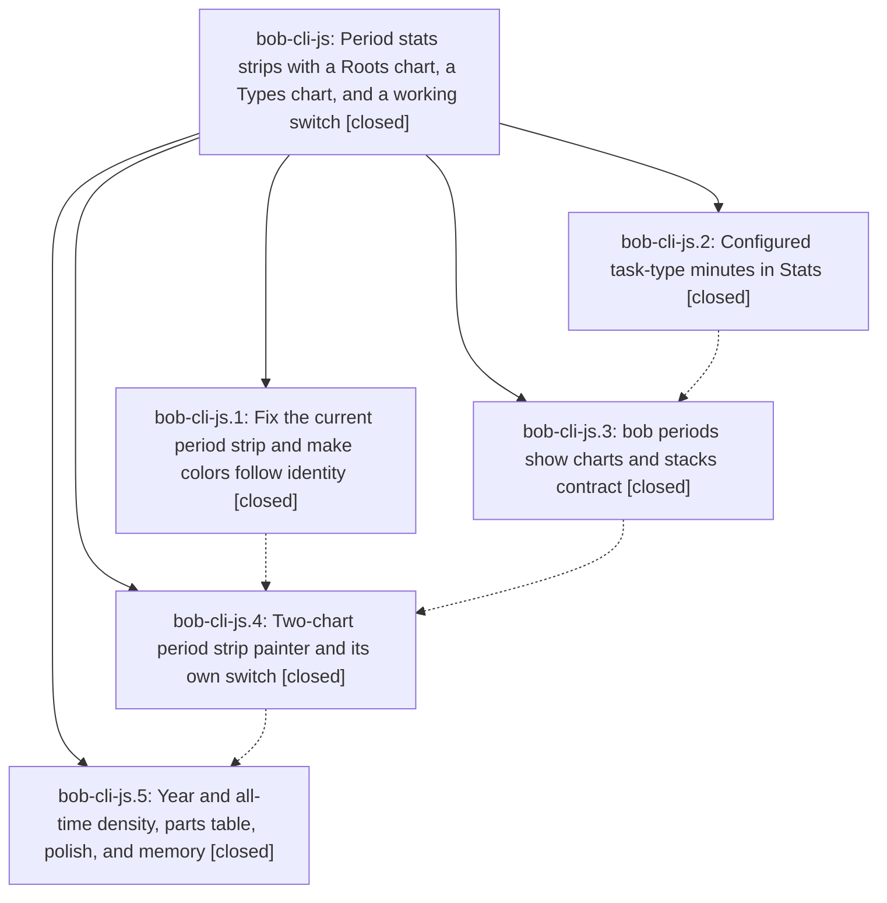

# Bead: bob-cli-js — Period stats strips with a Roots chart, a Types chart, and a working switch

[Bead Pages](../README.md) / bob-cli-js

**Status:** ✓ closed · **Resolution:** done · **Type:** ▸ plan · **Tier:** epic
**Owner:** `bryanbugyi34@gmail.com` · **Created by:** [bbugyi200.apollo.research.41.linker.w0](https://github.com/bobs-org/bob-cli--agents/blob/main/sessions/bbugyi200.apollo.research.41.linker.w0.md) · **Assignee:** `bob-cli-js.land`
**Created:** 2026-11-10 11:49:23 EST · **Closed:** 2026-11-10 15:43:44 EST
**Plan:** [202611/period\_strip\_two\_charts.md](https://github.com/bobs-org/bob-cli--plans/blob/main/202611/period_strip_two_charts.md)

<!-- sase:links:start -->

## Links

| Relation | Artifact | Why |
| --- | --- | --- |
| implemented-by | [plan:202611/period_strip_two_charts.md][1] | derived from the plan's `bead_id:` frontmatter field |

_Plus 1 automatic references — see [Referenced By](#referenced-by)._

[1]: https://github.com/bobs-org/bob-cli--plans/blob/main/202611/period_strip_two_charts.md

<!-- sase:links:end -->

## Description

Every week, quarter, year, and all-time note heads with a calm, honest strip: the facts, then a Roots chart (top N root parents, N from config, 5 in chezmoi) and a Types chart (configured task types only) on one shared child-period axis, a ●/■ switch that cycles Both → Roots → Types with its own memory, identity colors, and density rules per period kind.

## Notes

[2026-11-10T20:17:50Z · bob-cli-js.land] LAND TRIAGE (bob-cli-js.land) of every PROPOSED FOLLOW-UP: (1) js.1 #1, js.4 #2, js.5 #3 docs word budget -> +1 bob-cli-h9 for the four mounted Mac Capture pages (capture-panel 6036, capture-previews 6088, keyboard 6065, protocol 6149; pre-existing, untouched by this epic) and +1 bob-cli-il for plugins/bob-ledger-tools.md, which this epic grew from 6047 to 6196 words (12e6e72 +67, 0fd19de +82); bringing that page back to <=6000 is epic-caused and is assigned to the landing tale. (2) js.2 #1, js.3 #1 bob-plugins mount collision on reference/plugins index.md -> +1 bob-cli-it (did not recur in the land workspace). (3) js.3 #2 clippy deny lints in src/native/gcal/note/write.rs:177/1181/1421 and src/native/gcal/doctor.rs:357 -> caused by in-progress epic bob-cli-ji (ji.4 cf7c0605, ji.5 c8934b93); recorded as a DISCOVERED ISSUE note on bob-cli-ji, no task. They block just check before cargo test, so the land agent ran cargo test for the lib periods/stats/config tests (298 pass) and the cli periods/stats tests (69 pass) directly. (4) js.4 #1 off-clock link chips 200-link 35 ms wall-clock flake -> new task bob-cli-ju (flake, small), related to bob-cli-io (same pattern, different node). (5) js.5 #1 research A10, Day strip type lane and Stats Types panel adopting parts.task_type -> new task bob-cli-jv (feature, large). (6) js.5 #2 optional root_hue_collision warning -> new task bob-cli-jw (feature, medium), with evidence that bob and dev both report blue in 2026-W45. No proposal was declined.

[2026-11-10T20:43:44Z · bob-cli-js.land] Land verification: all five phases reviewed against the plan and DECISIONS (plan_type_color=no kept PLAN auto; sase.md pinned orange; only glossary:stats-strip memory edited; no decision record). bob side: lib periods/stats/config tests 298 pass (land record; no bob code touched here), cli periods/stats tests 69 pass (reran: 36 periods + 33 stats, all green); real-vault bob periods show for W45/Q3/Q4/2026/all has charts.roots.limit 5, policy configured, and Σ stacks.roots = Σ stacks.types = worked.value in every observed column and child; chezmoi and deployed config carry stats.period_strip.top_roots 5. No post-epic drift in bob-cli, bob-plugins, or chezmoi. Landing tale fixed: real-DOM chart frame (week/quarter/all painted no charts), untracked ghosts and future stubs, year fallback captions and Q·short group captions, 24px/slot-2px bars, legend fit ladder, fade only on view change, Alt+Enter day routing, non-vacuous preview, bob-ledger-tools.md back under 6000 words (5997); npm test 5940 pass / 2 fail (known bob-cli-ju 200-link timing flake under full-suite load), preview matrix green with strip-only screenshots, plugin docs:check clean except the 4 known Mac Capture over-budget pages (bob-cli-h9), bob-cli just docs-check same 4 with ledger-tools clear, sync 1.108.0 synced. Follow-ups triaged in the LAND TRIAGE note: +1 h9, il, it; DISCOVERED ISSUE on bob-cli-ji; new tasks ju, jv, jw.

## Phases

| Bead | Title | Status | Size | Created | Agents | Commits |
|---|---|---|---|---|---:|---:|
| [bob-cli-js.1](bob-cli-js.1.md) | Fix the current period strip and make colors follow identity | ✓ closed | medium | 2026-11-10 | 1 | 2 |
| [bob-cli-js.2](bob-cli-js.2.md) | Configured task-type minutes in Stats | ✓ closed | medium | 2026-11-10 | 1 | 1 |
| [bob-cli-js.3](bob-cli-js.3.md) | bob periods show charts and stacks contract | ✓ closed | medium | 2026-11-10 | 1 | 2 |
| [bob-cli-js.4](bob-cli-js.4.md) | Two-chart period strip painter and its own switch | ✓ closed | medium | 2026-11-10 | 1 | 2 |
| [bob-cli-js.5](bob-cli-js.5.md) | Year and all-time density, parts table, polish, and memory | ✓ closed | medium | 2026-11-10 | 1 | 2 |

## Lineage

## Agents

| Agent | Bead | Commits |
|---|---|---:|
| [bbugyi200.apollo.bob-cli-js.1](https://github.com/bobs-org/bob-cli--agents/blob/main/sessions/bbugyi200.apollo.bob-cli-js.1.md) | [bob-cli-js.1](bob-cli-js.1.md) | 2 |
| [bbugyi200.apollo.bob-cli-js.2](https://github.com/bobs-org/bob-cli--agents/blob/main/agents/bbugyi200.apollo.bob-cli-js.2/README.md) | [bob-cli-js.2](bob-cli-js.2.md) | 1 |
| [bbugyi200.apollo.bob-cli-js.3](https://github.com/bobs-org/bob-cli--agents/blob/main/agents/bbugyi200.apollo.bob-cli-js.3/README.md) | [bob-cli-js.3](bob-cli-js.3.md) | 2 |
| [bbugyi200.apollo.bob-cli-js.4](https://github.com/bobs-org/bob-cli--agents/blob/main/sessions/bbugyi200.apollo.bob-cli-js.4.md) | [bob-cli-js.4](bob-cli-js.4.md) | 2 |
| [bbugyi200.apollo.bob-cli-js.5](https://github.com/bobs-org/bob-cli--agents/blob/main/agents/bbugyi200.apollo.bob-cli-js.5/README.md) | [bob-cli-js.5](bob-cli-js.5.md) | 2 |
| [bbugyi200.apollo.bob-cli-js.land](https://github.com/bobs-org/bob-cli--agents/blob/main/sessions/bbugyi200.apollo.bob-cli-js.land.md) | [bob-cli-js](README.md) | 3 |

## Commits

| Repo | Commit | Subject | Bead | Committed |
|---|---|---|---|---|
| bob-cli | [`beef7f2`](https://github.com/bobs-org/bob-cli/commit/beef7f27bf4668693245b80855680bfad886b5d6) | feat(stats): add task\_type parts dimension with configured-type split | [bob-cli-js.2](bob-cli-js.2.md) | 2026-11-10 12:39:27 EST |
| bob-cli | [`ef45fe9`](https://github.com/bobs-org/bob-cli/commit/ef45fe97e8aaf52e136f4babb0d3e177889ea4e1) | docs(stats): refresh generated stats documentation | [bob-cli-js.1](bob-cli-js.1.md) | 2026-11-10 12:44:59 EST |
| bob-plugins | [`bob-plugins@1fcbc82`](https://github.com/bobs-org/bob-plugins/commit/1fcbc825a1d9573c6364b00217ff9791f36c8507) | feat(ledger-tools): add period strip and stats lane views | [bob-cli-js.1](bob-cli-js.1.md) | 2026-11-10 12:45:26 EST |
| bob-cli | [`a985918`](https://github.com/bobs-org/bob-cli/commit/a985918614f5cd959fe6f22bf2302020c8c26613) | feat(periods): emit charts, stacks, and display\_short on show | [bob-cli-js.3](bob-cli-js.3.md) | 2026-11-10 13:19:19 EST |
| chezmoi | [`chezmoi@c6ae11b`](https://github.com/bbugyi200/dotfiles/commit/c6ae11ba186b82ad046eb4852e23cb26c4fcc09d) | feat(bob): set stats.period\_strip.top\_roots to 5 | [bob-cli-js.3](bob-cli-js.3.md) | 2026-11-10 13:19:55 EST |
| bob-cli | [`9cd4ec3`](https://github.com/bobs-org/bob-cli/commit/9cd4ec3e590d187ecdad70e685c198bd45095b6c) | docs(stats): describe aligned period charts | [bob-cli-js.4](bob-cli-js.4.md) | 2026-11-10 14:20:54 EST |
| bob-plugins | [`bob-plugins@12e6e72`](https://github.com/bobs-org/bob-plugins/commit/12e6e728f37367d666e771b2292d99d3c3076f13) | feat(stats): render two-chart period strips | [bob-cli-js.4](bob-cli-js.4.md) | 2026-11-10 14:21:21 EST |
| bob-cli | [`947f24f`](https://github.com/bobs-org/bob-cli/commit/947f24ff8636702d0c323cc7d1a43f362eebd5fd) | docs(memory): document period strip chart density rules in stats-strip glossary | [bob-cli-js.5](bob-cli-js.5.md) | 2026-11-10 14:52:49 EST |
| bob-plugins | [`bob-plugins@0fd19de`](https://github.com/bobs-org/bob-plugins/commit/0fd19deed17990f40a797ba97c491c86836e25a2) | feat(ledger-tools): add period strip chart density rules, year fallback and parts mini-bars | [bob-cli-js.5](bob-cli-js.5.md) | 2026-11-10 14:53:20 EST |
| bob-cli | [`991e270`](https://github.com/bobs-org/bob-cli/commit/991e270e4eae5d6f979c8cae902b90a0174cf9c6) | docs(stats): record period strip geometry, fills, and budgets beside Controls | [bob-cli-js](README.md) | 2026-11-10 15:49:00 EST |
| bob-plugins | [`bob-plugins@af6a346`](https://github.com/bobs-org/bob-plugins/commit/af6a3460790f72111c88583aa8452ad4a59a0260) | feat(ledger-tools): finish two-chart period strip landing (ghosts, fallback labels, legend fit, fade, day routing) | [bob-cli-js](README.md) | 2026-11-10 15:49:39 EST |
| bob-cli--plans | [`bob-cli--plans@148bb76`](https://github.com/bobs-org/bob-cli--plans/commit/148bb76335d9ec248e32607843e75e28480360eb) | docs(plans): mark period strip two-chart epic plan done | [bob-cli-js](README.md) | 2026-11-10 15:50:18 EST |

<!-- sase:referenced-by:start -->

## Referenced By

| Relation | Artifact | Why | Uses |
| --- | --- | --- | ---: |
| read-by | [agent:bob-cli-js.5][1] | Need epic scope for long_periods phase | 1 |

[1]: https://github.com/bobs-org/bob-cli--agents/blob/main/agents/bbugyi200.apollo.bob-cli-js.5/README.md

<!-- sase:referenced-by:end -->
