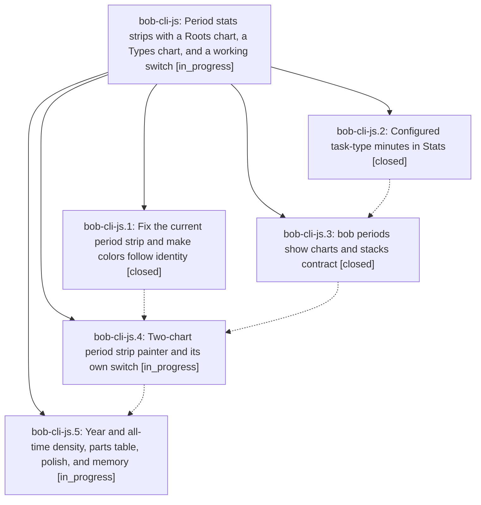

# Bead: bob-cli-js — Period stats strips with a Roots chart, a Types chart, and a working switch

[Bead Pages](../README.md) / bob-cli-js

**Status:** ◐ in_progress · **Type:** ▸ plan · **Tier:** epic
**Owner:** `bryanbugyi34@gmail.com` · **Created by:** [bbugyi200.apollo.research.41.linker.w0](https://github.com/bobs-org/bob-cli--agents/blob/main/sessions/bbugyi200.apollo.research.41.linker.w0.md) · **Assignee:** `bob-cli-js.land`
**Created:** 2026-11-10 11:49:23 EST
**Plan:** [202611/period\_strip\_two\_charts.md](https://github.com/bobs-org/bob-cli--plans/blob/main/202611/period_strip_two_charts.md)

<!-- sase:links:start -->

## Links

| Relation | Artifact | Why |
| --- | --- | --- |
| implemented-by | [plan:202611/period_strip_two_charts.md][1] | derived from the plan's `bead_id:` frontmatter field |

[1]: https://github.com/bobs-org/bob-cli--plans/blob/main/202611/period_strip_two_charts.md

<!-- sase:links:end -->

## Description

Every week, quarter, year, and all-time note heads with a calm, honest strip: the facts, then a Roots chart (top N root parents, N from config, 5 in chezmoi) and a Types chart (configured task types only) on one shared child-period axis, a ●/■ switch that cycles Both → Roots → Types with its own memory, identity colors, and density rules per period kind.

## Phases

| Bead | Title | Status | Size | Created | Agents | Commits |
|---|---|---|---|---|---:|---:|
| [bob-cli-js.1](bob-cli-js.1.md) | Fix the current period strip and make colors follow identity | ✓ closed | medium | 2026-11-10 | 1 | 1 |
| [bob-cli-js.2](bob-cli-js.2.md) | Configured task-type minutes in Stats | ✓ closed | medium | 2026-11-10 | 1 | 1 |
| [bob-cli-js.3](bob-cli-js.3.md) | bob periods show charts and stacks contract | ✓ closed | medium | 2026-11-10 | 1 | 2 |
| [bob-cli-js.4](bob-cli-js.4.md) | Two-chart period strip painter and its own switch | ◐ in_progress | medium | 2026-11-10 | 1 | 0 |
| [bob-cli-js.5](bob-cli-js.5.md) | Year and all-time density, parts table, polish, and memory | ◐ in_progress | medium | 2026-11-10 | 1 | 0 |

## Lineage

## Agents

| Agent | Bead | Commits |
|---|---|---:|
| [bbugyi200.apollo.bob-cli-js.1](https://github.com/bobs-org/bob-cli--agents/blob/main/sessions/bbugyi200.apollo.bob-cli-js.1.md) | [bob-cli-js.1](bob-cli-js.1.md) | 1 |
| [bbugyi200.apollo.bob-cli-js.2](https://github.com/bobs-org/bob-cli--agents/blob/main/agents/bbugyi200.apollo.bob-cli-js.2/README.md) | [bob-cli-js.2](bob-cli-js.2.md) | 1 |
| [bbugyi200.apollo.bob-cli-js.3](https://github.com/bobs-org/bob-cli--agents/blob/main/agents/bbugyi200.apollo.bob-cli-js.3/README.md) | [bob-cli-js.3](bob-cli-js.3.md) | 2 |
| [bbugyi200.apollo.bob-cli-js.4](https://github.com/bobs-org/bob-cli--agents/blob/main/agents/bbugyi200.apollo.bob-cli-js.4/README.md) | [bob-cli-js.4](bob-cli-js.4.md) | 0 |
| [bbugyi200.apollo.bob-cli-js.5](https://github.com/bobs-org/bob-cli--agents/blob/main/agents/bbugyi200.apollo.bob-cli-js.5/README.md) | [bob-cli-js.5](bob-cli-js.5.md) | 0 |
| [bbugyi200.apollo.bob-cli-js.land](https://github.com/bobs-org/bob-cli--agents/blob/main/agents/bbugyi200.apollo.bob-cli-js.land/README.md) | [bob-cli-js](README.md) | 0 |

## Commits

| Repo | Commit | Subject | Bead | Committed |
|---|---|---|---|---|
| bob-cli | [`beef7f2`](https://github.com/bobs-org/bob-cli/commit/beef7f27bf4668693245b80855680bfad886b5d6) | feat(stats): add task\_type parts dimension with configured-type split | [bob-cli-js.2](bob-cli-js.2.md) | 2026-11-10 12:39:27 EST |
| bob-cli | [`ef45fe9`](https://github.com/bobs-org/bob-cli/commit/ef45fe97e8aaf52e136f4babb0d3e177889ea4e1) | docs(stats): refresh generated stats documentation | [bob-cli-js.1](bob-cli-js.1.md) | 2026-11-10 12:44:59 EST |
| bob-cli | [`a985918`](https://github.com/bobs-org/bob-cli/commit/a985918614f5cd959fe6f22bf2302020c8c26613) | feat(periods): emit charts, stacks, and display\_short on show | [bob-cli-js.3](bob-cli-js.3.md) | 2026-11-10 13:19:19 EST |
| chezmoi | [`chezmoi@c6ae11b`](https://github.com/bbugyi200/dotfiles/commit/c6ae11ba186b82ad046eb4852e23cb26c4fcc09d) | feat(bob): set stats.period\_strip.top\_roots to 5 | [bob-cli-js.3](bob-cli-js.3.md) | 2026-11-10 13:19:55 EST |
