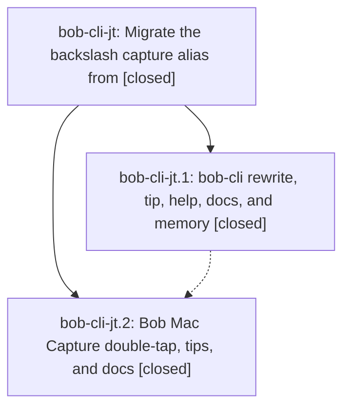

# Bead: bob-cli-jt — Migrate the backslash capture alias from

[Bead Pages](../README.md) / bob-cli-jt

**Status:** ✓ closed · **Resolution:** done · **Type:** ▸ plan · **Tier:** epic
**Owner:** `bryanbugyi34@gmail.com` · **Created by:** [bbugyi200.athena.1b1](https://github.com/bobs-org/bob-cli--agents/blob/main/sessions/bbugyi200.athena.1b1.md) · **Assignee:** `bob-cli-jt.land`
**Created:** 2026-11-10 15:05:10 EST · **Closed:** 2026-11-10 19:30:44 EST
**Plan:** [202611/backslash\_percent\_alias.md](https://github.com/bobs-org/bob-cli--plans/blob/main/202611/backslash_percent_alias.md)

<!-- sase:links:start -->

## Links

| Relation | Artifact | Why |
| --- | --- | --- |
| implemented-by | [plan:202611/backslash_percent_alias.md][1] | derived from the plan's `bead_id:` frontmatter field |
| related | file:explicit:5d919abc2555b8f911456244 | attached via sase artifact create --bead |
| related | file:explicit:a7ca20870803705cc70efee4 | attached via sase artifact create --bead |

[1]: https://github.com/bobs-org/bob-cli--plans/blob/main/202611/backslash_percent_alias.md

<!-- sase:links:end -->

## Description

In Bob Mac Capture, typing `\` where a bare `%` would open the directive menu becomes `%` and opens that menu, `/` remains the only unshifted key for `#`, and both repos' docs, tips, and tests match.

## Notes

[2026-11-11T00:15:17Z · bob-cli-jt.land] LAND FOLLOW-UP TRIAGE: Reviewed every PROPOSED FOLLOW-UP from bob-cli-jt.1 #2-5 and bob-cli-jt.2 #1-5 with /sase_new_task, same-scope searches, last-week task sweep, and active epic/child inspection. Outcomes: (1) jt.1 #2: decline a new lint task; 4c1f7dde fixes all four gcal deny-level lints and the current just check passed clippy. The articles/inbound diagnostic is advisory, not a failing gate. (2) jt.1 #3: corroborated bob-cli-de (+1); a2809a1d from active ji.2 added the 89th catalog row without updating the 88-entry CLI assertion, so also recorded DISCOVERED ISSUE on bob-cli-ji. (3) jt.1 #4: DISCOVERED ISSUE on bob-cli-ji, because ji.5 added the doctor notes check and missed the healthy exact-ID expectation. No standalone task while that causal epic is active. (4) jt.1 #5 and jt.2 #1: +1 on bob-cli-h9 (protocol 6149 words) and bob-cli-jz (capture-panel, previews, keyboard, navigation-hotkeys). The historical ledger-tools failure is gone (5997 words); recorded resolution evidence on bob-cli-il, whose requested headroom remains independent. The +5/+8 words jt itself added to capture-panel/keyboard and its false after-a-word literal wording remain epic work in the small closeout tale, not follow-ups. (5) jt.2 #2: +1 on bob-cli-jx, whose scope already covers all four reported alias-tip tests; no duplicate of adjacent jk. (6) jt.2 #3: +1 on bob-cli-jb for the existing fast-double-equals request-count race. (7) jt.2 #4: DISCOVERED ISSUE on active bob-cli-bj after checking bj.9 and blame of 10016273; rename-merge test fails in run 42921174259 and passes in 42925346886, waiting for errorMessage before refusal/merge state settles. (8) jt.2 #5: +1 on bob-cli-jc; existing evidence already covers the unchanged older-Bob move test fixed-200ms record race. No new task needed. Evidence: file:explicit:5d919abc2555b8f911456244. Preserve all of these outcomes in the final close note.

[2026-11-11T00:17:39Z · bob-cli-jt.land] LAND AUDIT BEFORE REMAINING-WORK TALE: Read approved plan plan:202611/backslash_percent_alias.md, all six notes on each closed phase jt.1/jt.2, and both implementations (Rust 6ed27c1e, Mac df8045f). Confirmed hash_fallback=drop everywhere, removed global backslash collapse, directive_menu stamp/tip, slash-only hash tips, literal guards, UTF-8 cursor handling, no-cursor/template isolation, native Mac slow/fast double taps and old-Bob compatibility. Only authorized glossary:capture-alias memory was changed. Current built-binary probes passed for Buy milk backslash, child-bullet backslash, percent tip, routed/glued/doubled literals, retired hash fallback positions, and slash hash alias. just check ToolRun 31d25bfee9dd8db6b2887c2a6f3d7f41 on 4c1f7dde completed exit 101 in 429s: formatting and Clippy pass; 6376 lib tests pass; only catalog::protocol_1_parses_with_schema_version_one (89 vs 88) and doctor_json_healthy_setup (notes ID absent from expected list) fail. Both routed to ji; catalog also de. No check-full was run. Completed check evidence file:explicit:a7ca20870803705cc70efee4; broader audit file:explicit:5d919abc2555b8f911456244. Reviewed all post-6ed27c1e bob-cli commits (991e270e, 23e7f90d, 4c1f7dde) and Mac changes since epic creation (5bf8907, 62a7b70, 1498f34, f1e5c99). The event-note editor/router is separate; no alias integration conflict. Fetch confirmed both checkouts equal origin/master at audit end. Mac phase snapshot 8028dbfe/run 42925346886 passes percent-tip and double-tap tests but has documented unrelated failures; it is not the same whole tree as integrated df8045f. df8045f run 42928363199 has passed formatting and Build and was still testing at review time. Remaining epic work is bounded: fix misleading after-a-word literal claims in two Mac docs, remove this epic's +5/+8 words from already-over-budget capture-panel/keyboard pages (return to <=6036/6061), and explicitly annotate the retired hash contract with a ! landing commit (phase commit omitted required breaking marker). Authored and validated small tale sase_plan_backslash_alias_closeout.md; its last step closes jt, audits/cleans epic symbols, runs symvision if available, and marks original plan done without waiting for its own commit. epic-symbols jt currently empty; symvision recipe unavailable in audited repositories. Parent link confirmed null. Keep epic open pending that tale; no force close.

[2026-11-11T00:30:44Z · bob-cli-jt.land] Closeout of bob-cli-jt after documentation and breaking-marker landing.

Source and drift: bob-cli remains at 4c1f7dde (alias implementation 6ed27c1e; later 991e270e, 23e7f90d, 4c1f7dde). bob-mac-capture remains at df8045f. Fetch showed no newer origin/master commits. Rechecked intervening trees: event-note input stays on its own editor routing and did not acquire capture aliases. Decisions hash_fallback=drop and glossary_capture_alias=yes remain satisfied; glossary already updated; no memory, Swift, plugin, or new-directive work in this tale.

Docs: Mac capture-panel.md and keyboard.md now say `\` stays literal when glued to a word (not “after a word”), with the positive `Buy milk \` → `Buy milk %` example, keeping line-start, doubled-backslash, slash-literal, older-Bob `\` → `#` arming, and double-tap/Undo facts. typing-tips.md’s true-positive “after a word” lesson is unchanged. bob-cli docs/capture.md now states that `\` no longer types `#` anywhere, including former slash-literal hash spots `=\` and `[[cash\`; `/` remains the hash alias where eligible. The bob-cli landing commit carries the missing `!` breaking marker that 6ed27c1e omitted.

Word counts (bob_docs.markdown.count_words): capture-panel 6036 (was 6041, cap target 6036); keyboard 6060 (was 6069, cap target 6061). just docs-check still fails only the five inherited reference budgets: capture-panel 6036, capture-previews 6088, keyboard 6060, protocol 6149, bob-navigation-hotkeys 6132. No new diagnostic.

Tests: sase tool run check 9a57e61d6ea4edc80dc290f67e8988bd exit 101 in 168s on this tree. Formatting and deny-level Clippy passed; 6376 lib tests passed; only catalog::protocol_1_parses_with_schema_version_one (89 vs 88) and doctor_json_healthy_setup (notes ID) failed — same bob-cli-ji / bob-cli-de owners as lander run 31d25bfee9dd8db6b2887c2a6f3d7f41. Mac CI 42928363199 on df8045f: formatting and Build passed; CaptureHashAliasDoubleTapTests passed; testShiftTypedPercentShowsDirectiveMenuTip passed; remaining failures are recorded owners (bob-cli-jx alias-tip timeouts including testEditingTheSigilAfterItShowsClearsTheTipRow, bob-cli-jc older-Bob move 200ms race, GcalNoteEditorTests event-note highlight timeout from the event-note tree). No Swift edit required.

epic-symbols bob-cli-jt: no entries. just symvision is unavailable in both audited repositories.

Follow-up dispositions from lander triage (file:explicit:5d919abc2555b8f911456244), unchanged and not duplicated: (1) jt.1 #2 declined — 4c1f7dde cleaned gcal deny-level Clippy. (2) jt.1 #3 corroborated bob-cli-de and DISCOVERED ISSUE on bob-cli-ji. (3) jt.1 #4 DISCOVERED ISSUE on bob-cli-ji. (4) jt.1 #5 / jt.2 #1 +1 on bob-cli-h9 and bob-cli-jz; remaining inherited overage stays there; this tale removed only this epic’s +5/+8 words. (5) jt.2 #2 +1 on bob-cli-jx. (6) jt.2 #3 +1 on bob-cli-jb. (7) jt.2 #4 DISCOVERED ISSUE on bob-cli-bj. (8) jt.2 #5 +1 on bob-cli-jc. Parent link is null; no ancestor closeout.

## Phases

| Bead | Title | Status | Size | Created | Agents | Commits |
|---|---|---|---|---|---:|---:|
| [bob-cli-jt.1](bob-cli-jt.1.md) | bob-cli rewrite, tip, help, docs, and memory | ✓ closed | medium | 2026-11-10 | 1 | 1 |
| [bob-cli-jt.2](bob-cli-jt.2.md) | Bob Mac Capture double-tap, tips, and docs | ✓ closed | medium | 2026-11-10 | 1 | 1 |

## Lineage

## Agents

| Agent | Bead | Commits |
|---|---|---:|
| [bbugyi200.athena.bob-cli-jt.1](https://github.com/bobs-org/bob-cli--agents/blob/main/agents/bbugyi200.athena.bob-cli-jt.1/README.md) | [bob-cli-jt.1](bob-cli-jt.1.md) | 1 |
| [bbugyi200.athena.bob-cli-jt.2](https://github.com/bobs-org/bob-cli--agents/blob/main/sessions/bbugyi200.athena.bob-cli-jt.2.md) | [bob-cli-jt.2](bob-cli-jt.2.md) | 1 |
| [bbugyi200.athena.bob-cli-jt.land](https://github.com/bobs-org/bob-cli--agents/blob/main/sessions/bbugyi200.athena.bob-cli-jt.land.md) | [bob-cli-jt](README.md) | 1 |

## Commits

| Repo | Commit | Subject | Bead | Committed |
|---|---|---|---|---|
| bob-cli | [`6ed27c1`](https://github.com/bobs-org/bob-cli/commit/6ed27c1e7b032fbb2e2e883bc2ff2770ed68b4ab) | feat(capture): implement hash\_fallback drop branch with directive\_menu alias | [bob-cli-jt.1](bob-cli-jt.1.md) | 2026-11-10 15:46:51 EST |
| bob-mac-capture | [`bob-mac-capture@df8045f`](https://github.com/bobs-org/bob-mac-capture/commit/df8045f1faa90828d128b1e8a0cade59980109e8) | feat(capture): add percent directive alias support | [bob-cli-jt.2](bob-cli-jt.2.md) | 2026-11-10 19:03:52 EST |
| bob-cli | [`f4c0020`](https://github.com/bobs-org/bob-cli/commit/f4c00204297c9c4dad9fa0f31158108ee7eb94c7) | fix(capture)!: finish the backslash directive alias migration | [bob-cli-jt](README.md) | 2026-11-10 19:32:03 EST |
