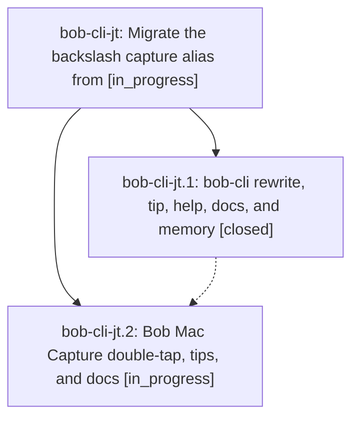

# Bead: bob-cli-jt — Migrate the backslash capture alias from

[Bead Pages](../README.md) / bob-cli-jt

**Status:** ◐ in_progress · **Type:** ▸ plan · **Tier:** epic
**Owner:** `bryanbugyi34@gmail.com` · **Created by:** [bbugyi200.athena.1b1](https://github.com/bobs-org/bob-cli--agents/blob/main/sessions/bbugyi200.athena.1b1.md) · **Assignee:** `bob-cli-jt.land`
**Created:** 2026-11-10 15:05:10 EST
**Plan:** [202611/backslash\_percent\_alias.md](https://github.com/bobs-org/bob-cli--plans/blob/main/202611/backslash_percent_alias.md)

<!-- sase:links:start -->

## Links

| Relation | Artifact | Why |
| --- | --- | --- |
| implemented-by | [plan:202611/backslash_percent_alias.md][1] | derived from the plan's `bead_id:` frontmatter field |

[1]: https://github.com/bobs-org/bob-cli--plans/blob/main/202611/backslash_percent_alias.md

<!-- sase:links:end -->

## Description

In Bob Mac Capture, typing `\` where a bare `%` would open the directive menu becomes `%` and opens that menu, `/` remains the only unshifted key for `#`, and both repos' docs, tips, and tests match.

## Phases

| Bead | Title | Status | Size | Created | Agents | Commits |
|---|---|---|---|---|---:|---:|
| [bob-cli-jt.1](bob-cli-jt.1.md) | bob-cli rewrite, tip, help, docs, and memory | ✓ closed | medium | 2026-11-10 | 1 | 1 |
| [bob-cli-jt.2](bob-cli-jt.2.md) | Bob Mac Capture double-tap, tips, and docs | ◐ in_progress | medium | 2026-11-10 | 1 | 0 |

## Lineage

## Agents

| Agent | Bead | Commits |
|---|---|---:|
| [bbugyi200.athena.bob-cli-jt.1](https://github.com/bobs-org/bob-cli--agents/blob/main/agents/bbugyi200.athena.bob-cli-jt.1/README.md) | [bob-cli-jt.1](bob-cli-jt.1.md) | 1 |
| [bbugyi200.athena.bob-cli-jt.2](https://github.com/bobs-org/bob-cli--agents/blob/main/agents/bbugyi200.athena.bob-cli-jt.2/README.md) | [bob-cli-jt.2](bob-cli-jt.2.md) | 0 |
| [bbugyi200.athena.bob-cli-jt.land](https://github.com/bobs-org/bob-cli--agents/blob/main/agents/bbugyi200.athena.bob-cli-jt.land/README.md) | [bob-cli-jt](README.md) | 0 |

## Commits

| Repo | Commit | Subject | Bead | Committed |
|---|---|---|---|---|
| bob-cli | [`6ed27c1`](https://github.com/bobs-org/bob-cli/commit/6ed27c1e7b032fbb2e2e883bc2ff2770ed68b4ab) | feat(capture): implement hash\_fallback drop branch with directive\_menu alias | [bob-cli-jt.1](bob-cli-jt.1.md) | 2026-11-10 15:46:51 EST |
