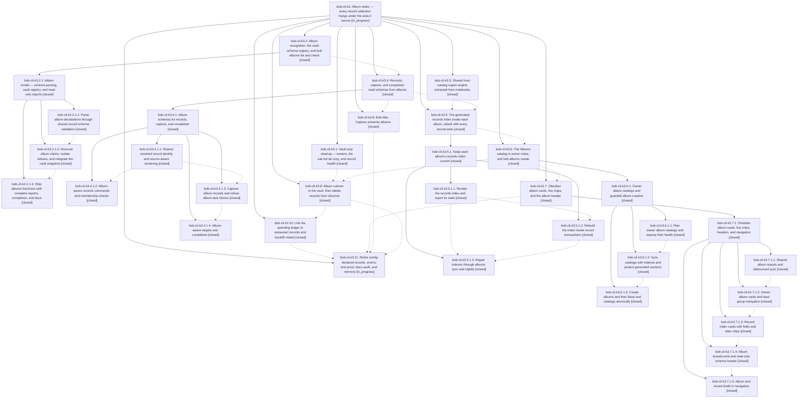

# Bead: bob-cli-k3 — Album notes — every record collection hangs under the area it serves

[Bead Pages](../README.md) / bob-cli-k3

**Status:** ◐ in_progress · **Type:** ▸ plan · **Tier:** epic
**Owner:** `bryanbugyi34@gmail.com` · **Created by:** `bbugyi200.apollo.research.43.linker.w0` · **Assignee:** `bob-cli-k3.land`
**Created:** 2026-11-11 04:56:43 EST
**Plan:** [202611/album\_and\_record\_notes.md](https://github.com/bobs-org/bob-cli--plans/blob/main/202611/album_and_record_notes.md)

<!-- sase:links:start -->

## Links

| Relation | Artifact | Why |
| --- | --- | --- |
| implemented-by | [plan:202611/album_and_record_notes.md][1] | derived from the plan's `bead_id:` frontmatter field |

_Plus 14 automatic references — see [Referenced By](#referenced-by)._

[1]: https://github.com/bobs-org/bob-cli--plans/blob/main/202611/album_and_record_notes.md

<!-- sase:links:end -->

## Description

Every record note reaches an area of responsibility. Each record collection (eat, podcasts, tv, movies) becomes an album note: `type: "[[album]]"` under its owner area, holding its record schema in frontmatter instead of `config.yml`, de-zorged, and showing a generated, grouped `[!records]` index. Every owner area or project shows a beautiful generated `## Albums` catalog. Records become `type: "[[record]]"` children of their album. Schema and data version together in the vault, a broken album fails alone, and glossary terms for album note and record note are published.

## Notes

[2026-11-12T14:53:58Z · bryanbugyi34@gmail.com] There is an error about ancestry in the ~/bob/podcasts.md file. See the 🔒 20261112\_095308.png screenshot for context. The epic lander agent should resolve this before landing.

[2026-11-12T14:55:12Z · bryanbugyi34@gmail.com] Actually that's likely caused by the bob-cli-kr epic, so you can disregard the previous note.

## Attachments

- 🔒 20261112\_095308.png · image/png · 2858×1728 · 358.144 KiB (private attachment)

## Phases

| Bead | Title | Status | Size | Created | Agents | Commits |
|---|---|---|---|---|---:|---:|
| [bob-cli-k3.1](bob-cli-k3.1.md) | Vault-only cleanup — owners, the eat.md de-zorg, and record health | ✓ closed | medium | 2026-11-11 | 0 | 0 |
| [bob-cli-k3.10](bob-cli-k3.10.md) | Link the spending ledger to restaurant records and backfill visited | ✓ closed | medium | 2026-11-11 | 0 | 0 |
| [bob-cli-k3.11](bob-cli-k3.11.md) | Retire config-declared records, end-to-end proof, docs audit, and memory | ◐ in_progress | medium | 2026-11-11 | 1 | 0 |
| [bob-cli-k3.2](bob-cli-k3.2.md) | Album recognition, the vault schema registry, and bob albums list and check | ✓ closed | large | 2026-11-11 | 0 | 0 |
| [bob-cli-k3.3](bob-cli-k3.3.md) | Shared host-catalog region engine extracted from notebooks | ✓ closed | medium | 2026-11-11 | 1 | 1 |
| [bob-cli-k3.4](bob-cli-k3.4.md) | Records, capture, and completion read schemas from albums | ✓ closed | large | 2026-11-11 | 1 | 0 |
| [bob-cli-k3.5](bob-cli-k3.5.md) | The generated records index inside each album, rebuilt with every record write | ✓ closed | large | 2026-11-11 | 1 | 0 |
| [bob-cli-k3.6](bob-cli-k3.6.md) | The Albums catalog in owner notes, and bob albums create | ✓ closed | large | 2026-11-11 | 1 | 0 |
| [bob-cli-k3.7](bob-cli-k3.7.md) | Obsidian album cards, live chips, and the album header | ✓ closed | large | 2026-11-11 | 1 | 0 |
| [bob-cli-k3.8](bob-cli-k3.8.md) | Bob Mac Capture presents albums | ✓ closed | medium | 2026-11-11 | 1 | 0 |
| [bob-cli-k3.9](bob-cli-k3.9.md) | Album cutover in the vault, then delete records from chezmoi | ✓ closed | medium | 2026-11-11 | 1 | 0 |

## Lineage

## Dependencies

- **Blocks:** [bob-cli-kt](../bob-cli-kt/README.md) ◇ · ⧖ 2026-11-12

## Agents

| Agent | Bead | Commits |
|---|---|---:|
| [bbugyi200.apollo.bob-cli-k3.2.1.1](https://github.com/bobs-org/bob-cli--agents/blob/main/sessions/bbugyi200.apollo.bob-cli-k3.2.1.1.md) | [bob-cli-k3.2.1.1](bob-cli-k3.2.1.1.md) | 1 |
| [bbugyi200.apollo.bob-cli-k3.3](https://github.com/bobs-org/bob-cli--agents/blob/main/sessions/bbugyi200.apollo.bob-cli-k3.3.md) | [bob-cli-k3.3](bob-cli-k3.3.md) | 1 |
| [bbugyi200.athena.bob-cli-k3.11](https://github.com/bobs-org/bob-cli--agents/blob/main/agents/bbugyi200.athena.bob-cli-k3.11/README.md) | [bob-cli-k3.11](bob-cli-k3.11.md) | 0 |
| [bbugyi200.athena.bob-cli-k3.2.1.2](https://github.com/bobs-org/bob-cli--agents/blob/main/agents/bbugyi200.athena.bob-cli-k3.2.1.2/README.md) | [bob-cli-k3.2.1.2](bob-cli-k3.2.1.2.md) | 1 |
| [bbugyi200.athena.bob-cli-k3.2.1.3](https://github.com/bobs-org/bob-cli--agents/blob/main/sessions/bbugyi200.athena.bob-cli-k3.2.1.3.md) | [bob-cli-k3.2.1.3](bob-cli-k3.2.1.3.md) | 1 |
| [bbugyi200.athena.bob-cli-k3.2.1.land](https://github.com/bobs-org/bob-cli--agents/blob/main/sessions/bbugyi200.athena.bob-cli-k3.2.1.land.md) | [bob-cli-k3.2.1](bob-cli-k3.2.1.md) | 2 |
| [bbugyi200.athena.bob-cli-k3.4](https://github.com/bobs-org/bob-cli--agents/blob/main/sessions/bbugyi200.athena.bob-cli-k3.4.md) | [bob-cli-k3.4](bob-cli-k3.4.md) | 0 |
| [bbugyi200.athena.bob-cli-k3.4.1.1](https://github.com/bobs-org/bob-cli--agents/blob/main/agents/bbugyi200.athena.bob-cli-k3.4.1.1/README.md) | [bob-cli-k3.4.1.1](bob-cli-k3.4.1.1.md) | 1 |
| [bbugyi200.athena.bob-cli-k3.4.1.2](https://github.com/bobs-org/bob-cli--agents/blob/main/sessions/bbugyi200.athena.bob-cli-k3.4.1.2.md) | [bob-cli-k3.4.1.2](bob-cli-k3.4.1.2.md) | 1 |
| [bbugyi200.athena.bob-cli-k3.4.1.3](https://github.com/bobs-org/bob-cli--agents/blob/main/agents/bbugyi200.athena.bob-cli-k3.4.1.3/README.md) | [bob-cli-k3.4.1.3](bob-cli-k3.4.1.3.md) | 1 |
| [bbugyi200.athena.bob-cli-k3.4.1.4](https://github.com/bobs-org/bob-cli--agents/blob/main/agents/bbugyi200.athena.bob-cli-k3.4.1.4/README.md) | [bob-cli-k3.4.1.4](bob-cli-k3.4.1.4.md) | 1 |
| [bbugyi200.athena.bob-cli-k3.4.1.land](https://github.com/bobs-org/bob-cli--agents/blob/main/sessions/bbugyi200.athena.bob-cli-k3.4.1.land.md) | [bob-cli-k3.4.1](bob-cli-k3.4.1.md) | 2 |
| [bbugyi200.athena.bob-cli-k3.5](https://github.com/bobs-org/bob-cli--agents/blob/main/sessions/bbugyi200.athena.bob-cli-k3.5.md) | [bob-cli-k3.5](bob-cli-k3.5.md) | 0 |
| [bbugyi200.athena.bob-cli-k3.5.1.1](https://github.com/bobs-org/bob-cli--agents/blob/main/agents/bbugyi200.athena.bob-cli-k3.5.1.1/README.md) | [bob-cli-k3.5.1.1](bob-cli-k3.5.1.1.md) | 1 |
| [bbugyi200.athena.bob-cli-k3.5.1.2](https://github.com/bobs-org/bob-cli--agents/blob/main/agents/bbugyi200.athena.bob-cli-k3.5.1.2/README.md) | [bob-cli-k3.5.1.2](bob-cli-k3.5.1.2.md) | 1 |
| [bbugyi200.athena.bob-cli-k3.5.1.3](https://github.com/bobs-org/bob-cli--agents/blob/main/agents/bbugyi200.athena.bob-cli-k3.5.1.3/README.md) | [bob-cli-k3.5.1.3](bob-cli-k3.5.1.3.md) | 1 |
| [bbugyi200.athena.bob-cli-k3.5.1.land](https://github.com/bobs-org/bob-cli--agents/blob/main/sessions/bbugyi200.athena.bob-cli-k3.5.1.land.md) | [bob-cli-k3.5.1](bob-cli-k3.5.1.md) | 2 |
| [bbugyi200.athena.bob-cli-k3.6](https://github.com/bobs-org/bob-cli--agents/blob/main/sessions/bbugyi200.athena.bob-cli-k3.6.md) | [bob-cli-k3.6](bob-cli-k3.6.md) | 0 |
| [bbugyi200.athena.bob-cli-k3.6.1.1](https://github.com/bobs-org/bob-cli--agents/blob/main/agents/bbugyi200.athena.bob-cli-k3.6.1.1/README.md) | [bob-cli-k3.6.1.1](bob-cli-k3.6.1.1.md) | 1 |
| [bbugyi200.athena.bob-cli-k3.6.1.2](https://github.com/bobs-org/bob-cli--agents/blob/main/agents/bbugyi200.athena.bob-cli-k3.6.1.2/README.md) | [bob-cli-k3.6.1.2](bob-cli-k3.6.1.2.md) | 1 |
| [bbugyi200.athena.bob-cli-k3.6.1.3](https://github.com/bobs-org/bob-cli--agents/blob/main/agents/bbugyi200.athena.bob-cli-k3.6.1.3/README.md) | [bob-cli-k3.6.1.3](bob-cli-k3.6.1.3.md) | 1 |
| [bbugyi200.athena.bob-cli-k3.6.1.land](https://github.com/bobs-org/bob-cli--agents/blob/main/sessions/bbugyi200.athena.bob-cli-k3.6.1.land.md) | [bob-cli-k3.6.1](bob-cli-k3.6.1.md) | 2 |
| [bbugyi200.athena.bob-cli-k3.7](https://github.com/bobs-org/bob-cli--agents/blob/main/sessions/bbugyi200.athena.bob-cli-k3.7.md) | [bob-cli-k3.7](bob-cli-k3.7.md) | 0 |
| [bbugyi200.athena.bob-cli-k3.7.1.1](https://github.com/bobs-org/bob-cli--agents/blob/main/agents/bbugyi200.athena.bob-cli-k3.7.1.1/README.md) | [bob-cli-k3.7.1.1](bob-cli-k3.7.1.1.md) | 1 |
| [bbugyi200.athena.bob-cli-k3.7.1.2](https://github.com/bobs-org/bob-cli--agents/blob/main/sessions/bbugyi200.athena.bob-cli-k3.7.1.2.md) | [bob-cli-k3.7.1.2](bob-cli-k3.7.1.2.md) | 1 |
| [bbugyi200.athena.bob-cli-k3.7.1.3](https://github.com/bobs-org/bob-cli--agents/blob/main/agents/bbugyi200.athena.bob-cli-k3.7.1.3/README.md) | [bob-cli-k3.7.1.3](bob-cli-k3.7.1.3.md) | 1 |
| [bbugyi200.athena.bob-cli-k3.7.1.4](https://github.com/bobs-org/bob-cli--agents/blob/main/sessions/bbugyi200.athena.bob-cli-k3.7.1.4.md) | [bob-cli-k3.7.1.4](bob-cli-k3.7.1.4.md) | 1 |
| [bbugyi200.athena.bob-cli-k3.7.1.5](https://github.com/bobs-org/bob-cli--agents/blob/main/agents/bbugyi200.athena.bob-cli-k3.7.1.5/README.md) | [bob-cli-k3.7.1.5](bob-cli-k3.7.1.5.md) | 1 |
| [bbugyi200.athena.bob-cli-k3.7.1.land](https://github.com/bobs-org/bob-cli--agents/blob/main/sessions/bbugyi200.athena.bob-cli-k3.7.1.land.md) | [bob-cli-k3.7.1](bob-cli-k3.7.1.md) | 1 |
| [bbugyi200.athena.bob-cli-k3.8](https://github.com/bobs-org/bob-cli--agents/blob/main/sessions/bbugyi200.athena.bob-cli-k3.8.md) | [bob-cli-k3.8](bob-cli-k3.8.md) | 0 |
| [bbugyi200.athena.bob-cli-k3.9](https://github.com/bobs-org/bob-cli--agents/blob/main/sessions/bbugyi200.athena.bob-cli-k3.9.md) | [bob-cli-k3.9](bob-cli-k3.9.md) | 0 |
| [bbugyi200.athena.bob-cli-k3.land](https://github.com/bobs-org/bob-cli--agents/blob/main/agents/bbugyi200.athena.bob-cli-k3.land/README.md) | [bob-cli-k3](README.md) | 0 |

## Commits

| Repo | Commit | Subject | Bead | Committed |
|---|---|---|---|---|
| bob-cli | [`f977009`](https://github.com/bobs-org/bob-cli/commit/f977009a26f64775b377c27ed885fdf61ef6f1da) | feat(albums): parse declarations through shared schema validation | [bob-cli-k3.2.1.1](bob-cli-k3.2.1.1.md) | 2026-11-11 06:00:18 EST |
| bob-cli | [`d0ada55`](https://github.com/bobs-org/bob-cli/commit/d0ada555a8b60c74933f9ce4eb3aa8c0469b0d64) | refactor(notebooks): extract shared host-catalog region engine | [bob-cli-k3.3](bob-cli-k3.3.md) | 2026-11-11 06:03:48 EST |
| bob-cli | [`b6f3b92`](https://github.com/bobs-org/bob-cli/commit/b6f3b92c010044e720ebcd75ed47c2f014c6ab0d) | feat(albums): add vault-scoped album registry | [bob-cli-k3.2.1.2](bob-cli-k3.2.1.2.md) | 2026-11-11 06:59:18 EST |
| bob-cli | [`ba9867a`](https://github.com/bobs-org/bob-cli/commit/ba9867a56d0d28b163a480aa9a837e636a2242a2) | feat(albums): add list/check reports, completion, and docs | [bob-cli-k3.2.1.3](bob-cli-k3.2.1.3.md) | 2026-11-11 08:17:41 EST |
| bob-cli | [`ba3f51b`](https://github.com/bobs-org/bob-cli/commit/ba3f51bad3bd491d66e739a895ce4de99149329f) | fix(albums): confine routes, recover nouns, and restore report diagnostics | [bob-cli-k3.2.1](bob-cli-k3.2.1.md) | 2026-11-11 09:11:57 EST |
| bob-cli--plans | [`bob-cli--plans@5335af5`](https://github.com/bobs-org/bob-cli--plans/commit/5335af5dd1df88005093f7e933575f39fdf026ae) | chore(plans): mark album\_model epic plan done | [bob-cli-k3.2.1](bob-cli-k3.2.1.md) | 2026-11-11 09:12:30 EST |
| bob-cli | [`f7332f5`](https://github.com/bobs-org/bob-cli/commit/f7332f5813c2929c2cd2979a755955cc5cf86074) | feat(records): add shared album record context | [bob-cli-k3.4.1.1](bob-cli-k3.4.1.1.md) | 2026-11-11 09:54:13 EST |
| bob-cli | [`8edd5a5`](https://github.com/bobs-org/bob-cli/commit/8edd5a5ffacc4f606b2765a7c81557a321cc078b) | feat(capture)!: per-route album resolution with task-home refusals | [bob-cli-k3.4.1.3](bob-cli-k3.4.1.3.md) | 2026-11-11 11:00:01 EST |
| bob-cli | [`c36e6e7`](https://github.com/bobs-org/bob-cli/commit/c36e6e752d36828f6bd73e09cb095d7c70d25498) | feat(records): add album-aware records commands and membership checks | [bob-cli-k3.4.1.2](bob-cli-k3.4.1.2.md) | 2026-11-11 11:19:55 EST |
| bob-cli | [`3d1c076`](https://github.com/bobs-org/bob-cli/commit/3d1c0763871e992e6aa8ca652eebda69cddf0b26) | feat(capture): use album registry across targets and completion | [bob-cli-k3.4.1.4](bob-cli-k3.4.1.4.md) | 2026-11-11 11:43:11 EST |
| bob-cli | [`6e42159`](https://github.com/bobs-org/bob-cli/commit/6e4215971c02e0f88e12616fee37159fe455f0e1) | feat(capture)!: finish the album consumer landing repairs | [bob-cli-k3.4.1](bob-cli-k3.4.1.md) | 2026-11-11 13:36:26 EST |
| bob-cli--plans | [`bob-cli--plans@2814cf2`](https://github.com/bobs-org/bob-cli--plans/commit/2814cf2080d90274459893f3498694682be87ea1) | docs(plans): mark album\_record\_consumers done after consumer landing | [bob-cli-k3.4.1](bob-cli-k3.4.1.md) | 2026-11-11 13:37:21 EST |
| bob-cli | [`1f4c945`](https://github.com/bobs-org/bob-cli/commit/1f4c94571454ed9307094a677f69b31cddc30600) | feat(albums): render the records index and report its state | [bob-cli-k3.5.1.1](bob-cli-k3.5.1.1.md) | 2026-11-11 14:38:15 EST |
| bob-cli | [`b79ea37`](https://github.com/bobs-org/bob-cli/commit/b79ea376ff57017d460c83b5f08e7f8153860be7) | feat(albums): rebuild the records index inside record transactions | [bob-cli-k3.5.1.2](bob-cli-k3.5.1.2.md) | 2026-11-11 16:13:47 EST |
| bob-cli | [`6352824`](https://github.com/bobs-org/bob-cli/commit/6352824bffd7db5d2d22950ed83f101c7b8ae4de) | feat(albums): sync generated record indexes | [bob-cli-k3.5.1.3](bob-cli-k3.5.1.3.md) | 2026-11-11 17:22:22 EST |
| bob-cli | [`300a6e8`](https://github.com/bobs-org/bob-cli/commit/300a6e81005263311408fac024038a12a50fd62d) | feat(albums): finish index write safety and preview parity | [bob-cli-k3.5.1](bob-cli-k3.5.1.md) | 2026-11-11 18:19:33 EST |
| bob-cli--plans | [`bob-cli--plans@3fb7c92`](https://github.com/bobs-org/bob-cli--plans/commit/3fb7c92ac664441a58dc057714133101ec4cff40) | docs(plans): mark album index plan done | [bob-cli-k3.5.1](bob-cli-k3.5.1.md) | 2026-11-11 18:20:19 EST |
| bob-cli | [`3dce8a9`](https://github.com/bobs-org/bob-cli/commit/3dce8a9e920fb928211f8b64000f85dce8df94a6) | feat(albums): report owner catalog health | [bob-cli-k3.6.1.1](bob-cli-k3.6.1.1.md) | 2026-11-11 19:23:43 EST |
| bob-cli | [`0d2f433`](https://github.com/bobs-org/bob-cli/commit/0d2f433dcaa2f48dc33970635db913a4ccc503db) | feat(albums): sync owner catalogs with records indexes | [bob-cli-k3.6.1.2](bob-cli-k3.6.1.2.md) | 2026-11-11 20:19:20 EST |
| bob-cli | [`aef2354`](https://github.com/bobs-org/bob-cli/commit/aef235427787cacff6296b44f556a28aff120c21) | feat(albums): create albums and their Base and catalogs atomically | [bob-cli-k3.6.1.3](bob-cli-k3.6.1.3.md) | 2026-11-11 22:01:04 EST |
| bob-cli | [`0c8df96`](https://github.com/bobs-org/bob-cli/commit/0c8df969406611b9db4170ce5cb24df1eca15385) | fix(albums): guard create collisions, catalog deps, and records-init claims | [bob-cli-k3.6.1](bob-cli-k3.6.1.md) | 2026-11-11 22:57:55 EST |
| bob-cli--plans | [`bob-cli--plans@7454ff5`](https://github.com/bobs-org/bob-cli--plans/commit/7454ff50e20e9faa1a30077fe9fa255cd22f12ef) | chore(plans): mark album\_catalog\_and\_create done | [bob-cli-k3.6.1](bob-cli-k3.6.1.md) | 2026-11-11 22:58:45 EST |
| bob-plugins | [`bob-plugins@9c79123`](https://github.com/bobs-org/bob-plugins/commit/9c79123181c1306ae58595e3982181083a1b1613) | feat(albums): shared album report/sync service with debounced sync and tests | [bob-cli-k3.7.1.1](bob-cli-k3.7.1.1.md) | 2026-11-11 23:40:42 EST |
| bob-plugins | [`bob-plugins@bd6fc41`](https://github.com/bobs-org/bob-plugins/commit/bd6fc416960c49808d4a542c61d80ab3501a64a9) | feat(ledger-tools): add owner album cards and group navigation | [bob-cli-k3.7.1.2](bob-cli-k3.7.1.2.md) | 2026-11-12 07:31:10 EST |
| bob-plugins | [`bob-plugins@ed5e648`](https://github.com/bobs-org/bob-plugins/commit/ed5e64814b1e80f0cbe9ecb8794057b1d884c6de) | feat(ledger-tools): paint record index cards with folds and date chips | [bob-cli-k3.7.1.3](bob-cli-k3.7.1.3.md) | 2026-11-12 08:48:00 EST |
| bob-plugins | [`bob-plugins@c2f6834`](https://github.com/bobs-org/bob-plugins/commit/c2f683490cdbcb5e1eabaa596cb164847f46d9ba) | feat(album-header): add breadcrumb and schema header | [bob-cli-k3.7.1.4](bob-cli-k3.7.1.4.md) | 2026-11-12 09:46:11 EST |
| bob-plugins | [`bob-plugins@2d10fca`](https://github.com/bobs-org/bob-plugins/commit/2d10fca3ce8b6333af0fa41c82847d65083282cc) | feat(navigation-hotkeys): album and record kinds in parent pickers | [bob-cli-k3.7.1.5](bob-cli-k3.7.1.5.md) | 2026-11-12 10:09:25 EST |
| bob-cli | [`8cef0d5`](https://github.com/bobs-org/bob-cli/commit/8cef0d56c8c987de0d0acbc31d260b72c6c37953) | docs(records): link albums section to Obsidian Album cards page | [bob-cli-k3.7.1](bob-cli-k3.7.1.md) | 2026-11-12 11:22:46 EST |

<!-- sase:referenced-by:start -->

## Referenced By

| Relation | Artifact | Why | Uses |
| --- | --- | --- | ---: |
| read-by | [agent:bob-cli-kd.7][1] | Need k3 status for the subscriptions-album follow-up dependency | 1 |
| read-by | [agent:bob-cli-kd.land][2] | Triage bob-cli-kd follow-ups against existing beads | 2 |
| read-by | [agent:research.47.cdx][3] | Read album foundation epic and its current implementation constraints for bank album design | 1 |
| read-by | [agent:research.47.cld][4] | Understand the albums epic to design a bank album | 1 |
| read-by | [agent:research.47.final][5] | Check album epic status for bank album consolidation | 1 |
| read-by | [agent:research.47.gem][6] | research bank album design context | 1 |
| read-by | [agent:research.47.grk][7] | Need the albums epic context before designing a bank album | 1 |
| read-by | [agent:research.47.mus][8] | Research bank album needs album epic context | 1 |
| read-by | [agent:research.4b.cdx][9] | Understand the accepted record model and implementation scope before designing Obsidian editing | 1 |
| read-by | [agent:research.4b.cld][10] | Context on the record frontmatter field for research on rendering it in Obsidian | 1 |
| read-by | [agent:research.4b.final][11] | Context on the record frontmatter field for consolidating research on its Obsidian rendering UX | 1 |
| read-by | [agent:research.4b.gem][12] | Research context on the record frontmatter field for Obsidian rendering and editing UX | 1 |
| read-by | [agent:research.4b.grk][13] | Need epic context for the record frontmatter field that currently renders as truncated JSON in Obsidian Properties | 1 |
| read-by | [agent:research.4b.mus][14] | research record frontmatter render in Obsidian | 1 |

[1]: https://github.com/bobs-org/bob-cli--agents/blob/main/agents/bbugyi200.athena.bob-cli-kd.7/README.md
[2]: https://github.com/bobs-org/bob-cli--agents/blob/main/agents/bbugyi200.athena.bob-cli-kd.land/README.md
[3]: https://github.com/bobs-org/bob-cli--agents/blob/main/agents/bbugyi200.athena.research.47.cdx/README.md
[4]: https://github.com/bobs-org/bob-cli--agents/blob/main/agents/bbugyi200.athena.research.47.cld/README.md
[5]: https://github.com/bobs-org/bob-cli--agents/blob/main/agents/bbugyi200.athena.research.47.final/README.md
[6]: https://github.com/bobs-org/bob-cli--agents/blob/main/agents/bbugyi200.athena.research.47.gem/README.md
[7]: https://github.com/bobs-org/bob-cli--agents/blob/main/agents/bbugyi200.athena.research.47.grk/README.md
[8]: https://github.com/bobs-org/bob-cli--agents/blob/main/agents/bbugyi200.athena.research.47.mus/README.md
[9]: https://github.com/bobs-org/bob-cli--agents/blob/main/agents/bbugyi200.athena.research.4b.cdx/README.md
[10]: https://github.com/bobs-org/bob-cli--agents/blob/main/agents/bbugyi200.athena.research.4b.cld/README.md
[11]: https://github.com/bobs-org/bob-cli--agents/blob/main/agents/bbugyi200.athena.research.4b.final/README.md
[12]: https://github.com/bobs-org/bob-cli--agents/blob/main/agents/bbugyi200.athena.research.4b.gem/README.md
[13]: https://github.com/bobs-org/bob-cli--agents/blob/main/agents/bbugyi200.athena.research.4b.grk/README.md
[14]: https://github.com/bobs-org/bob-cli--agents/blob/main/agents/bbugyi200.athena.research.4b.mus/README.md

<!-- sase:referenced-by:end -->
