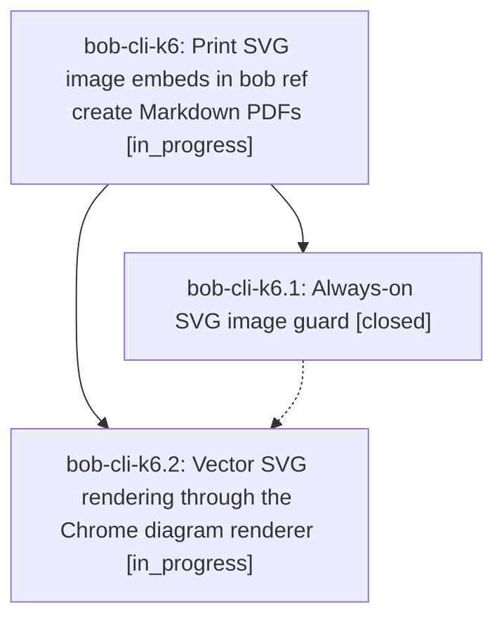

# Bead: bob-cli-k6 — Print SVG image embeds in bob ref create Markdown PDFs

[Bead Pages](../README.md) / bob-cli-k6

**Status:** ◐ in_progress · **Type:** ▸ plan · **Tier:** epic
**Owner:** `bryanbugyi34@gmail.com` · **Created by:** [bbugyi200.apollo.d9](https://github.com/bobs-org/bob-cli--agents/blob/main/sessions/bbugyi200.apollo.d9.md) · **Assignee:** `bob-cli-k6.land`
**Created:** 2026-11-11 07:53:18 EST
**Plan:** [202611/ref\_create\_svg\_images.md](https://github.com/bobs-org/bob-cli--plans/blob/main/202611/ref_create_svg_images.md)

<!-- sase:links:start -->

## Links

| Relation | Artifact | Why |
| --- | --- | --- |
| implemented-by | [plan:202611/ref_create_svg_images.md][1] | derived from the plan's `bead_id:` frontmatter field |

[1]: https://github.com/bobs-org/bob-cli--plans/blob/main/202611/ref_create_svg_images.md

<!-- sase:links:end -->

## Description

A Markdown bob ref create never fails on an SVG image embed; each SVG prints as a vector PDF, else a same-stem sibling raster, else a visible placeholder with a warning.

## Phases

| Bead | Title | Status | Size | Created | Agents | Commits |
|---|---|---|---|---|---:|---:|
| [bob-cli-k6.1](bob-cli-k6.1.md) | Always-on SVG image guard | ✓ closed | medium | 2026-11-11 | 1 | 1 |
| [bob-cli-k6.2](bob-cli-k6.2.md) | Vector SVG rendering through the Chrome diagram renderer | ◐ in_progress | medium | 2026-11-11 | 1 | 0 |

## Lineage

## Agents

| Agent | Bead | Commits |
|---|---|---:|
| [bbugyi200.apollo.bob-cli-k6.1](https://github.com/bobs-org/bob-cli--agents/blob/main/agents/bbugyi200.apollo.bob-cli-k6.1/README.md) | [bob-cli-k6.1](bob-cli-k6.1.md) | 1 |
| [bbugyi200.apollo.bob-cli-k6.2](https://github.com/bobs-org/bob-cli--agents/blob/main/agents/bbugyi200.apollo.bob-cli-k6.2/README.md) | [bob-cli-k6.2](bob-cli-k6.2.md) | 0 |
| [bbugyi200.apollo.bob-cli-k6.land](https://github.com/bobs-org/bob-cli--agents/blob/main/agents/bbugyi200.apollo.bob-cli-k6.land/README.md) | [bob-cli-k6](README.md) | 0 |

## Commits

| Repo | Commit | Subject | Bead | Committed |
|---|---|---|---|---|
| bob-cli | [`52f0d61`](https://github.com/bobs-org/bob-cli/commit/52f0d615b779fd66018888923ed8f8108761ef72) | feat(highlights): guard SVG images in PDF renders | [bob-cli-k6.1](bob-cli-k6.1.md) | 2026-11-11 08:39:05 EST |
