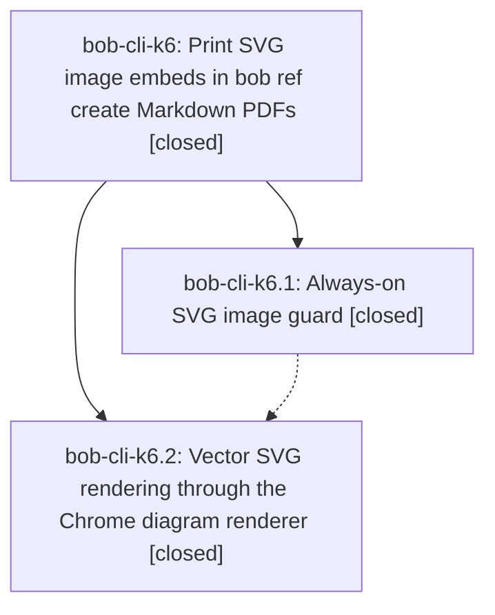

# Bead: bob-cli-k6 — Print SVG image embeds in bob ref create Markdown PDFs

[Bead Pages](../README.md) / bob-cli-k6

**Status:** ✓ closed · **Resolution:** done · **Type:** ▸ plan · **Tier:** epic
**Owner:** `bryanbugyi34@gmail.com` · **Created by:** [bbugyi200.apollo.d9](https://github.com/bobs-org/bob-cli--agents/blob/main/sessions/bbugyi200.apollo.d9.md) · **Assignee:** `bob-cli-k6.land`
**Created:** 2026-11-11 07:53:18 EST · **Closed:** 2026-11-11 10:49:31 EST
**Plan:** [202611/ref\_create\_svg\_images.md](https://github.com/bobs-org/bob-cli--plans/blob/main/202611/ref_create_svg_images.md)

<!-- sase:links:start -->

## Links

| Relation | Artifact | Why |
| --- | --- | --- |
| implemented-by | [plan:202611/ref_create_svg_images.md][1] | derived from the plan's `bead_id:` frontmatter field |

_Plus 1 automatic references — see [Referenced By](#referenced-by)._

[1]: https://github.com/bobs-org/bob-cli--plans/blob/main/202611/ref_create_svg_images.md

<!-- sase:links:end -->

## Description

A Markdown bob ref create never fails on an SVG image embed; each SVG prints as a vector PDF, else a same-stem sibling raster, else a visible placeholder with a warning.

## Notes

[2026-11-11T14:55:48Z · bob-cli-k6.land] LAND AUDIT / FOLLOW-UP TRIAGE before remaining-work tale: reviewed every note on k6.1 and k6.2 (both closed done), the approved plan, DECISIONS recapture=yes, epic commits 52f0d615 and 7eb82440, and source/Lua/adapter/tests/docs. k6.2 records just install and successful keep_moving_link_marks capture (2/2 Mermaid, 1/1 SVG, exit 0); retain that completed acceptance. Fetched origin/master remains 7eb82440. Reviewed intervening non-epic b2c3697e, dcc1986e, ba3f51ba and post-creation ba9867a5; none touches or duplicates the SVG pipeline, so no integration edits are needed. Four remaining epic defects: (1) production prescan returns 0 for angle-bracket paths with spaces and multiline inline/reference image destinations, though actual Pandoc collection returns one SVG; (2) Pandoc default typewise collection emits a later SVG before an earlier Mermaid fence, violating document order/shared-budget precedence; (3) inline SVG sanitizer excludes root on* attributes, confirmed with a harmless root onmouseover handler still present at print and executing when dispatched in offline Chrome; (4) Markdown and plain-note overwrite paths discard image guard/diagram summaries and warnings. These belong to this epic and are in a bounded medium landing tale, not new tasks. Root onload was not observed to fire automatically; the confirmed event test explicitly dispatched mouseover. Browser probe needed TMPDIR=/tmp to avoid Chromium socket-path length failure. FOLLOW-UP OUTCOMES: k6.1 note #1 and k6.2 note #1 mounted pages independently reproduce with just docs-check on 7eb82440: panel 6036, previews 6177, keyboard 6060, navigation-hotkeys 6186, protocol 6149 against cap 6000. Used sase_new_task same-type search, recent sweep, and active-epic review; recorded +1 on existing bob-cli-jz and bob-cli-h9, no new causal owner and no duplicate tasks. Declined k6.2 json-outputs proposal because ba3f51ba fixes that overage and current docs-check has no such failure. No epic-symbol entries; no symvision recipe. Parent link is absent. No source edits or check-full run this turn. Epic intentionally remains open for the tale to repair, verify with just check and adapter checks, and close in the same coding turn.

[2026-11-11T15:49:31Z · bob-cli-k6.land] Reviewed both phase scopes and every note, epic decisions and commits, intervening changes, and landing repairs; verified SVG collection, root sanitization, overwrite reporting and the relevant checks. Follow-up outcomes: k6.1 #1 and k6.2 #1 mounted budgets corroborated on jz/h9 (capture-panel 6036, capture-previews 6177, keyboard 6060, navigation-hotkeys 6186, protocol 6149); k6.2 json-outputs proposal declined as fixed by ba3f51ba. Recapture=yes acceptance recorded by k6.2. Repairs: prescan now permissive .svg marker (covers angle-space, plain, reference); collect uses traverse topdown for document order with alternating/budget tests; _render_svg_one strips root on* plus script check with browser-backed sanitization regression (root/descendant/script, foreignObject, no requests); overwrite_markdown and -M plain emit images:/svg:/warnings exactly once after commit with vector/sibling/placeholder CLI tests including source-dir resolution. Checks: 22 lib diagrams tests pass; 3 overwrite SVG CLI tests pass; existing SVG CLI (3) and overwrite (4+1) pass; just check-web-clip-adapter ok; just docs-check fails only on the 5 known budgets; just check blocked by pre-existing records clippy needless_borrow in f7332f58 (unrelated, no SVG integration). No remaining epic-symbol entries. No symvision recipe.

## Phases

| Bead | Title | Status | Size | Created | Agents | Commits |
|---|---|---|---|---|---:|---:|
| [bob-cli-k6.1](bob-cli-k6.1.md) | Always-on SVG image guard | ✓ closed | medium | 2026-11-11 | 1 | 1 |
| [bob-cli-k6.2](bob-cli-k6.2.md) | Vector SVG rendering through the Chrome diagram renderer | ✓ closed | medium | 2026-11-11 | 1 | 1 |

## Lineage

## Agents

| Agent | Bead | Commits |
|---|---|---:|
| [bbugyi200.apollo.bob-cli-k6.1](https://github.com/bobs-org/bob-cli--agents/blob/main/agents/bbugyi200.apollo.bob-cli-k6.1/README.md) | [bob-cli-k6.1](bob-cli-k6.1.md) | 1 |
| [bbugyi200.apollo.bob-cli-k6.2](https://github.com/bobs-org/bob-cli--agents/blob/main/agents/bbugyi200.apollo.bob-cli-k6.2/README.md) | [bob-cli-k6.2](bob-cli-k6.2.md) | 1 |
| [bbugyi200.apollo.bob-cli-k6.land](https://github.com/bobs-org/bob-cli--agents/blob/main/sessions/bbugyi200.apollo.bob-cli-k6.land.md) | [bob-cli-k6](README.md) | 1 |

## Commits

| Repo | Commit | Subject | Bead | Committed |
|---|---|---|---|---|
| bob-cli | [`52f0d61`](https://github.com/bobs-org/bob-cli/commit/52f0d615b779fd66018888923ed8f8108761ef72) | feat(highlights): guard SVG images in PDF renders | [bob-cli-k6.1](bob-cli-k6.1.md) | 2026-11-11 08:39:05 EST |
| bob-cli | [`7eb8244`](https://github.com/bobs-org/bob-cli/commit/7eb82440731f94ffc65177b1ab94a2fa708bd447) | feat(highlights): render local SVG embeds as vector PDFs | [bob-cli-k6.2](bob-cli-k6.2.md) | 2026-11-11 09:45:46 EST |
| bob-cli | [`921e51d`](https://github.com/bobs-org/bob-cli/commit/921e51d994e9bbc9ca0eefc0da70da34c69f8859) | feat(highlights): finish SVG landing repairs for bob-cli-k6 | [bob-cli-k6](README.md) | 2026-11-11 10:51:12 EST |

<!-- sase:referenced-by:start -->

## Referenced By

| Relation | Artifact | Why | Uses |
| --- | --- | --- | ---: |
| read-by | [agent:bob-cli-ka.1--1][1] | See if SVG image-guard epic is related to the CLI mermaid failure | 1 |

[1]: https://github.com/bobs-org/bob-cli--agents/blob/main/sessions/bbugyi200.apollo.bob-cli-ka.1.md

<!-- sase:referenced-by:end -->
