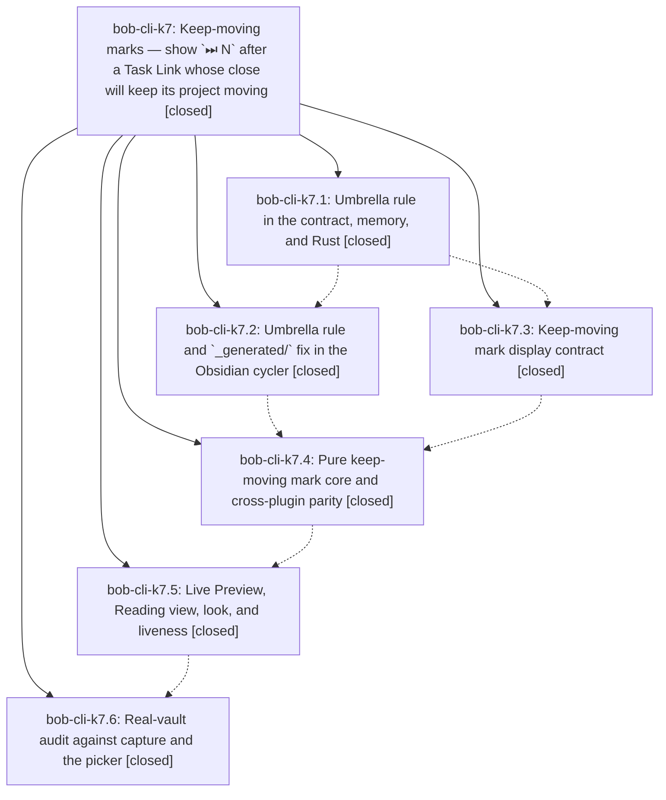

# Bead: bob-cli-k7 — Keep-moving marks — show \`⏭ N\` after a Task Link whose close will keep its project moving

[Bead Pages](../README.md) / bob-cli-k7

**Status:** ✓ closed · **Resolution:** done · **Type:** ▸ plan · **Tier:** epic
**Owner:** `bryanbugyi34@gmail.com` · **Created by:** [bbugyi200.athena.1b8](https://github.com/bobs-org/bob-cli--agents/blob/main/sessions/bbugyi200.athena.1b8.md) · **Assignee:** `bob-cli-k7.land`
**Created:** 2026-11-11 07:57:57 EST · **Closed:** 2026-11-11 12:24:59 EST
**Plan:** [202611/keep\_moving\_link\_marks.md](https://github.com/bobs-org/bob-cli--plans/blob/main/202611/keep_moving_link_marks.md)

<!-- sase:links:start -->

## Links

| Relation | Artifact | Why |
| --- | --- | --- |
| implemented-by | [plan:202611/keep_moving_link_marks.md][1] | derived from the plan's `bead_id:` frontmatter field |
| related | [bead:bob-cli-ke][2] | Keep-moving marks epic whose real-vault audit (k7.6) observed the stalled close; its ⏭ mark promises the picker this bead must make open |

_Plus 1 automatic references — see [Referenced By](#referenced-by)._

[1]: https://github.com/bobs-org/bob-cli--plans/blob/main/202611/keep_moving_link_marks.md
[2]: https://github.com/bobs-org/bob-cli--beads/blob/main/pages/bob-cli-ke/README.md

<!-- sase:links:end -->

## Description

In today's ledger, a quiet `⏭ N` mark after a Task Link forecasts the `Keep ‹N› moving` successor picker that closing that task will really open: N is exactly the number of rows that group will offer, it appears only on the link whose close triggers the group, and it is silent whenever that cannot be proven. Keep-moving first stops skipping standalone top-level projects (only umbrella projects are skipped), so the screenshot's `job_email_recruiters` link shows `⏭ 4` and Ctrl+Enter then offers those same four tasks.

## Notes

[2026-11-11T17:24:44Z · bob-cli-k7.land] Land triage of PROPOSED FOLLOW-UPs: (1) docs word budgets (k7.1/.2/.3/.4/.6): Mac capture-panel/capture-previews/keyboard and nav-hotkeys are tracked by bob-cli-jz (+1 recorded; nav-hotkeys now 6200 after d1d294b), protocol by bob-cli-h9; not epic-caused. (2) k7.5 bob-ledger-tools.md 6101 words: epic-caused, fixed in the landing by condensing to 5995; the remaining headroom need corroborated on bob-cli-il (+1). (3) k7.4 block-id-prompt timing nodes: duplicate of bob-cli-f8 (+1); they passed in the lander's full run. (4) k7.6 scratch-Obsidian close pending >30s without successors.pick: no duplicate; filed bob-cli-ke (bug, large) after a new KM33 real-wiring node test showed the cycler opens the 4-row group. Also: closed bob-cli-k5 (_generated ambiguity) as fixed by k7.2 87b28e1; noted DISCOVERED ISSUE on active epic bob-cli-k3.4.1 for the capture_link_tasks duplicate-warning test failure from 3d1c0763.

[2026-11-11T17:24:59Z · bob-cli-k7.land] Verified all six phases against plan 202611/keep_moving_link_marks.md and their commits (bob-cli b2c3697e, dcc1986e, db91ab20; bob-plugins 87b28e1, e2a5701, 27b99dd).
- Umbrella rule: Rust is_leaf_project uses ProjectSurface.subprojects_listed with no walk when there is no marker; §12.15–§12.17 LP1–LP17, KM6, and KM33 are in place. The cycler's successorLeafProject uses held text and a _generated-safe parent scan.
- Ledger-tools: the 141d/141e/271g/271h ⏭ mark ships with parity and surface tests.
- Contract: docs/keep-moving-marks.md is registered, with Live verification filled in.
- Decisions honored: only glossary:leaf-project was edited, and no decisions record was created.

Landing fixes in bob-plugins:
- The keep-moving CSS had been appended at the end of styles.css, so the reading-board and stats stylesheet contract tests failed. It now sits after .bob-frees-mark, as the plan specified (bob-ledger-tools 1.110.1, synced).
- bob-ledger-tools.md was 6101 words (epic-caused) and is now 5995.
- Added a KM33 real-wiring test: handleActiveTaskBlockLinkOpenDone on the screenshot fixture opens exactly one 4-row "Keep ‹job_email_recruiters› moving" group, nothing preselected, and Esc writes only the close and the strike. The contract's Live verification records this.

Results:
- bob-plugins npm test: 6109/6109 passed.
- bob-cli just check: 1 failure, capture_link_tasks warns_for_unreadable_notes, caused by 3d1c0763 and noted on bob-cli-k3.4.1. Everything else passes.
- just docs-check: only the 5 tracked budget errors (bob-cli-jz, bob-cli-h9).
- Integration: no post-start bob-cli or bob-plugins commit touches keep-moving, the leaf rule, or the mark surfaces.
- No epic-symbol entries.

Follow-ups:
- +1 on bob-cli-jz, bob-cli-il, and bob-cli-f8.
- Filed bob-cli-ke for the scratch-Obsidian picker stall.
- Closed bob-cli-k5 as fixed by k7.2.

## Phases

| Bead | Title | Status | Size | Created | Agents | Commits |
|---|---|---|---|---|---:|---:|
| [bob-cli-k7.1](bob-cli-k7.1.md) | Umbrella rule in the contract, memory, and Rust | ✓ closed | medium | 2026-11-11 | 1 | 1 |
| [bob-cli-k7.2](bob-cli-k7.2.md) | Umbrella rule and \`\_generated/\` fix in the Obsidian cycler | ✓ closed | small | 2026-11-11 | 1 | 1 |
| [bob-cli-k7.3](bob-cli-k7.3.md) | Keep-moving mark display contract | ✓ closed | small | 2026-11-11 | 1 | 1 |
| [bob-cli-k7.4](bob-cli-k7.4.md) | Pure keep-moving mark core and cross-plugin parity | ✓ closed | medium | 2026-11-11 | 1 | 1 |
| [bob-cli-k7.5](bob-cli-k7.5.md) | Live Preview, Reading view, look, and liveness | ✓ closed | medium | 2026-11-11 | 1 | 1 |
| [bob-cli-k7.6](bob-cli-k7.6.md) | Real-vault audit against capture and the picker | ✓ closed | small | 2026-11-11 | 1 | 1 |

## Lineage

## Agents

| Agent | Bead | Commits |
|---|---|---:|
| [bbugyi200.athena.bob-cli-k7.1](https://github.com/bobs-org/bob-cli--agents/blob/main/sessions/bbugyi200.athena.bob-cli-k7.1.md) | [bob-cli-k7.1](bob-cli-k7.1.md) | 1 |
| [bbugyi200.athena.bob-cli-k7.2](https://github.com/bobs-org/bob-cli--agents/blob/main/agents/bbugyi200.athena.bob-cli-k7.2/README.md) | [bob-cli-k7.2](bob-cli-k7.2.md) | 1 |
| [bbugyi200.athena.bob-cli-k7.3](https://github.com/bobs-org/bob-cli--agents/blob/main/agents/bbugyi200.athena.bob-cli-k7.3/README.md) | [bob-cli-k7.3](bob-cli-k7.3.md) | 1 |
| [bbugyi200.athena.bob-cli-k7.4](https://github.com/bobs-org/bob-cli--agents/blob/main/sessions/bbugyi200.athena.bob-cli-k7.4.md) | [bob-cli-k7.4](bob-cli-k7.4.md) | 1 |
| [bbugyi200.athena.bob-cli-k7.5](https://github.com/bobs-org/bob-cli--agents/blob/main/agents/bbugyi200.athena.bob-cli-k7.5/README.md) | [bob-cli-k7.5](bob-cli-k7.5.md) | 1 |
| [bbugyi200.athena.bob-cli-k7.6](https://github.com/bobs-org/bob-cli--agents/blob/main/agents/bbugyi200.athena.bob-cli-k7.6/README.md) | [bob-cli-k7.6](bob-cli-k7.6.md) | 1 |
| [bbugyi200.athena.bob-cli-k7.land](https://github.com/bobs-org/bob-cli--agents/blob/main/agents/bbugyi200.athena.bob-cli-k7.land/README.md) | [bob-cli-k7](README.md) | 2 |

## Commits

| Repo | Commit | Subject | Bead | Committed |
|---|---|---|---|---|
| bob-cli | [`b2c3697`](https://github.com/bobs-org/bob-cli/commit/b2c3697e8c57c5c2091b1df207d9bed3b38382f3) | feat(keep-moving): skip only umbrella projects, not every root | [bob-cli-k7.1](bob-cli-k7.1.md) | 2026-11-11 08:44:49 EST |
| bob-cli | [`dcc1986`](https://github.com/bobs-org/bob-cli/commit/dcc1986ed8d3725705510f3636e0cee9f05695d8) | docs(keep-moving-marks): add ledger display contract | [bob-cli-k7.3](bob-cli-k7.3.md) | 2026-11-11 08:56:56 EST |
| bob-plugins | [`bob-plugins@87b28e1`](https://github.com/bobs-org/bob-plugins/commit/87b28e1a60ee4aceca1f9f7094ffe06129b81485) | feat(task-status-cycler): skip only umbrella projects, stop \_generated ambiguity | [bob-cli-k7.2](bob-cli-k7.2.md) | 2026-11-11 08:58:31 EST |
| bob-plugins | [`bob-plugins@e2a5701`](https://github.com/bobs-org/bob-plugins/commit/e2a57015245d74018c6e6214688444ce3fbcf608) | feat(ledger-tools): add keep-moving project marks | [bob-cli-k7.4](bob-cli-k7.4.md) | 2026-11-11 10:23:19 EST |
| bob-plugins | [`bob-plugins@27b99dd`](https://github.com/bobs-org/bob-plugins/commit/27b99ddd0f927e659d2241913c8fa2116d439eee) | feat(ledger-tools): render keep-moving marks in Live Preview and Reading view Shows a quiet mark after the last planned Task Link of a leaf project: shared source-text cache, refresh fan-out, baton-pass tick, session toggle, off-clock chip at side 4, contract docs, surface unit tests, real-Obsidian e2e. Tooltip titles stripped to clean prose (KT1). | [bob-cli-k7.5](bob-cli-k7.5.md) | 2026-11-11 11:19:38 EST |
| bob-cli | [`db91ab2`](https://github.com/bobs-org/bob-cli/commit/db91ab2045021affb532bb813707acb597aef266) | docs(keep-moving-marks): record real-vault live verification | [bob-cli-k7.6](bob-cli-k7.6.md) | 2026-11-11 11:51:31 EST |
| bob-cli | [`ba700bc`](https://github.com/bobs-org/bob-cli/commit/ba700bcb08722e9472dea64ed9ce2807578181d5) | docs(keep-moving-marks): record cycler KM33 picker wiring evidence | [bob-cli-k7](README.md) | 2026-11-11 12:26:06 EST |
| bob-plugins | [`bob-plugins@4e1f377`](https://github.com/bobs-org/bob-plugins/commit/4e1f3775e5f654f84e9ef5a67e9f1b33929b1d1c) | fix(ledger-tools): land keep-moving marks CSS placement and docs budget | [bob-cli-k7](README.md) | 2026-11-11 12:26:28 EST |

<!-- sase:referenced-by:start -->

## Referenced By

| Relation | Artifact | Why | Uses |
| --- | --- | --- | ---: |
| read-by | [agent:bob-cli-k7.6][1] | Need epic DECISIONS, design, and sibling phase status | 1 |

[1]: https://github.com/bobs-org/bob-cli--agents/blob/main/agents/bbugyi200.athena.bob-cli-k7.6/README.md

<!-- sase:referenced-by:end -->
