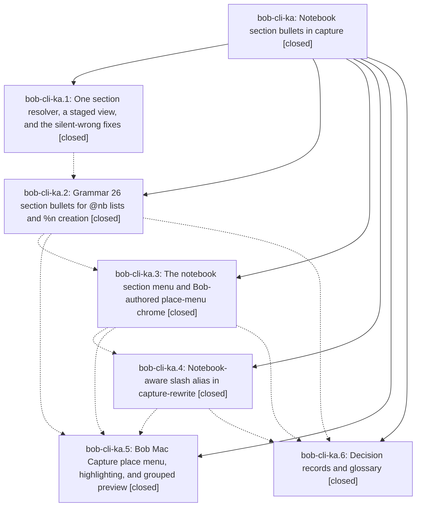

# Bead: bob-cli-ka — Notebook section bullets in capture

[Bead Pages](../README.md) / bob-cli-ka

**Status:** ✓ closed · **Resolution:** done · **Type:** ▸ plan · **Tier:** epic
**Owner:** `bryanbugyi34@gmail.com` · **Created by:** [bbugyi200.athena.1b9](https://github.com/bobs-org/bob-cli--agents/blob/main/sessions/bbugyi200.athena.1b9.md) · **Assignee:** `bob-cli-ka.land`
**Created:** 2026-11-11 09:22:46 EST · **Closed:** 2026-11-11 19:14:18 EST
**Plan:** [202611/notebook\_section\_bullets.md](https://github.com/bobs-org/bob-cli--plans/blob/main/202611/notebook_section_bullets.md)

<!-- sase:links:start -->

## Links

| Relation | Artifact | Why |
| --- | --- | --- |
| implemented-by | [plan:202611/notebook_section_bullets.md][1] | derived from the plan's `bead_id:` frontmatter field |

[1]: https://github.com/bobs-org/bob-cli--plans/blob/main/202611/notebook_section_bullets.md

<!-- sase:links:end -->

## Description

In any capture draft whose bullets land directly in a notebook body (a route-only `@nb` list or a `@parent^id@ %n` creation item), typing `- #` or `- /` opens a Bob-authored section menu listing the notebook's `##` sections (plus sections created earlier in the draft), accepting a row writes `- #Git` and drops the caret on the first nested note, and parse, menu, dry-run, and commit always agree on which section each note lands in.

## Notes

[2026-11-11T21:29:27Z · dd] DISCOVERED ISSUE: Phase bob-cli-ka.5 commit 4a69ed2 broke the bob-mac-capture build on master: it added .accessibilityHelp(model.notebookSectionEditorHelp ?? "") at Sources/BobMacCapture/CapturePanelView.swift:1598, but accessibilityHelp is not a SwiftUI View modifier (it is an AppKit NSAccessibilityProtocol method name). Exact-SHA macOS CI run 43100764208 (job 'macOS 26 SwiftPM') failed with this single compile error, and the push was not watched to green per bob-mac-capture AGENTS.md. Bryan's 'just install' on the Mac then failed on the same error (log 20261111-161414-56731-bob-mac-capture.log). A hotfix tale plan (sase_plan_fix_mac_capture_accessibility_help.md) has been proposed to delete the invalid line; .help() on the next line already supplies the tooltip and accessibility hint.

[2026-11-11T22:07:31Z · dd--1] DISCOVERED ISSUE: After deleting the invalid SwiftUI `.accessibilityHelp` modifier, macos-ci-check (GitHub Actions run 43105632578, snapshot SHA 8c032b5421592dac41bf748ed9d22c63b771bb2c) compiled and built, then failed Test with 3 deterministic XCTest failures introduced by 4a69ed2 (feat(capture): paint notebook section place menus from Bob chrome). They never ran on master because that SHA's exact-SHA run 43100764208 died at Build on accessibilityHelp. Failures (not caused by the one-line delete; a sibling accessibilityHint snapshot 43104852429 hit the same three): (1) CaptureEditorHighlightTests.testNotebookCreateSectionUsesDottedUnderlineAndExistingClearsIt — CaptureEditorHighlightTests.swift:1170 XCTAssertTrue failed: dotted underline remains after painting sectionAction=existing. (2) CapturePanelModelTests.testNotebookNewSectionUsesDottedPurpleUnderlineAndRepaintClearsIt — CapturePanelModelTests.swift:7538 and 7556 XCTAssertTrue failed: same leftover dotted underline after existing/generic repaint (paintHighlighting does call clearEditorHighlightAttributes). (3) CapturePanelModelTests.testAcceptingDrawerCandidateInsertsSlugAndLandsCaret — CapturePanelModelTests.swift:6669–6672: Tab on an unselected drawer place menu does not insert #requirements; acceptSelectedCompletion returns false when placeMenu != nil and selectedCompletionIndex == nil (CapturePanelModel.swift:11486), leaving the draft as 'Postgres 17 minimum @foo+bar#' with initialSelection none. The accessibilityHelp hotfix (plan:202611/fix_mac_capture_accessibility_help.md, fix_shape=delete) is compiled but not landed so master stays off a test-red tree. Do not treat this as the empty glued @nb# place_menu PROPOSED FOLLOW-UP.

[2026-11-11T23:42:56Z · bob-cli-ka.land] LAND TRIAGE (bob-cli-ka.land): outcomes for every child PROPOSED FOLLOW-UP and epic note. (1) ka.1--1, highlights_create_recognizes_definition_list_mermaid_fences: declined, already fixed by bob-cli-k6.2 7eb82440; passes on master 300a6e81. (2) ka.3 #1 / ka.4 #1 / ka.6 #1, docs word-budget lint: declined, already tracked by bob-cli-jz/bob-cli-h9 and now 'bob-docs lint: ok' on 300a6e81 (Mac 2007294 trimmed the mounted pages). (3) ka.3 #2, capture_link_tasks warns_for_unreadable_notes: declined, both warns_for_unreadable_notes_and_keeps_other_candidates tests pass on 300a6e81; the original agent judged it environmental and it does not reproduce. (4) ka.5 #1, empty glued @nb# omits place_menu: epic-caused, confirmed in a scratch vault ('Note @empty_nb#' returns place_menu null, query null, initial_selection null). Kept as epic work in the closeout tale. (5) ka.5--3, Mac typecheck-tests MainActor: duplicate, +1 on bob-cli-jy; bob-mac-capture 1e83c03 (bob-cli-kj.1) appears to fix it. (6) Epic notes #1/#2, Mac accessibilityHelp build break and three XCTest failures: resolved by bob-mac-capture 26e9f0a + 7fceb52; exact-SHA macOS CI run 43117124821 on 7fceb52 is green. Discovered: the docs-check strict Zensical build fails on three broken links, none caused by this epic. Filed bob-cli-kk for keep-moving-marks and vault-git-sync; noted the yank-flash link on active epic bob-cli-kb.

[2026-11-11T23:44:48Z · bob-cli-ka.land] LAND AUDIT (bob-cli-ka.land): Phases 1-6 verified against source and a scratch vault on master 300a6e81. Resolver ambiguity and typed capitals, the staged view (bug 5), grammar-26 section bullets (placement, merging, %n order, every refusal, \#, needs, fanout marker), the menu, place_menu on populated menus, the '- /' alias including negatives, and the glossary all behave as specified. CLI capture:: (1883) and lib capture (2089) tests pass. bob-mac-capture 7fceb52 passed exact-SHA macOS CI run 43117124821. Integration: the post-start commits 04cba0fa (configured-timezone stamps, threaded into the %n seed path) and the album commits 8edd5a5f/3d1c0763/6e421597/b79ea376/300a6e81 do not conflict; GRAMMAR_REVISION stays 26. Remaining epic-caused defects, planned as a closeout tale: (a) empty notebook section menus omit place_menu, query, and initial_selection (ka.5 follow-up); (b) bullet rows spell multi-word titles as slugs ('api-design') instead of quoted titles; (c) create rows drop typed capitals: '#API-keys' advertises 'API Keys' but splices 'api-keys', which parses to 'Api Keys', breaking the round-trip invariant; (d) the glued 'Note @nb#Zeta' menu lists its own selector as a 'draft' row instead of the create row.

[2026-11-12T00:14:18Z · bob-cli-ka.land] All six phases were verified against source and a scratch vault on 300a6e81: resolver ambiguity and typed capitals; staged view; grammar-26 section bullets with placement, merge, refusals, and \#; menu and place_menu; the - / alias; glossary. The Mac place menu was green on exact-SHA macOS CI run 43117124821 for bob-mac-capture 7fceb52. This closeout fixes four defects in commit cd251a3: empty notebook menus omitted chrome, query, and initial selection; bullet rows used slugs for multi-word titles; create replacements lost typed capitals; and the glued selector under the caret appeared as a draft row. LAND TRIAGE already recorded: ka.1--1 declined as fixed by bob-cli-k6.2 7eb82440; ka.3 #1, ka.4 #1, and ka.6 #1 docs word-budget reports declined as tracked by bob-cli-jz and bob-cli-h9, with lint passing; ka.3 #2 unreadable-note warning declined after both warning tests passed; ka.5 #1 empty menu fixed here; ka.5--3 duplicate +1 recorded on bob-cli-jy and appears fixed by bob-mac-capture 1e83c03 in bob-cli-kj.1; epic notes #1/#2 resolved by bob-mac-capture 26e9f0a and 7fceb52, with the exact-SHA CI run green. The three strict docs-check links remain tracked on bob-cli-kk and noted on bob-cli-kb.

## Phases

| Bead | Title | Status | Size | Created | Agents | Commits |
|---|---|---|---|---|---:|---:|
| [bob-cli-ka.1](bob-cli-ka.1.md) | One section resolver, a staged view, and the silent-wrong fixes | ✓ closed | medium | 2026-11-11 | 1 | 1 |
| [bob-cli-ka.2](bob-cli-ka.2.md) | Grammar 26 section bullets for @nb lists and %n creation | ✓ closed | large | 2026-11-11 | 1 | 1 |
| [bob-cli-ka.3](bob-cli-ka.3.md) | The notebook section menu and Bob-authored place-menu chrome | ✓ closed | medium | 2026-11-11 | 1 | 1 |
| [bob-cli-ka.4](bob-cli-ka.4.md) | Notebook-aware slash alias in capture-rewrite | ✓ closed | small | 2026-11-11 | 1 | 1 |
| [bob-cli-ka.5](bob-cli-ka.5.md) | Bob Mac Capture place menu, highlighting, and grouped preview | ✓ closed | large | 2026-11-11 | 1 | 3 |
| [bob-cli-ka.6](bob-cli-ka.6.md) | Decision records and glossary | ✓ closed | small | 2026-11-11 | 1 | 1 |

## Lineage

## Agents

| Agent | Bead | Commits |
|---|---|---:|
| [bbugyi200.athena.bob-cli-ka.1](https://github.com/bobs-org/bob-cli--agents/blob/main/sessions/bbugyi200.athena.bob-cli-ka.1.md) | [bob-cli-ka.1](bob-cli-ka.1.md) | 1 |
| [bbugyi200.athena.bob-cli-ka.2](https://github.com/bobs-org/bob-cli--agents/blob/main/sessions/bbugyi200.athena.bob-cli-ka.2.md) | [bob-cli-ka.2](bob-cli-ka.2.md) | 1 |
| [bbugyi200.athena.bob-cli-ka.3](https://github.com/bobs-org/bob-cli--agents/blob/main/agents/bbugyi200.athena.bob-cli-ka.3/README.md) | [bob-cli-ka.3](bob-cli-ka.3.md) | 1 |
| [bbugyi200.athena.bob-cli-ka.4](https://github.com/bobs-org/bob-cli--agents/blob/main/agents/bbugyi200.athena.bob-cli-ka.4/README.md) | [bob-cli-ka.4](bob-cli-ka.4.md) | 1 |
| [bbugyi200.athena.bob-cli-ka.5](https://github.com/bobs-org/bob-cli--agents/blob/main/sessions/bbugyi200.athena.bob-cli-ka.5.md) | [bob-cli-ka.5](bob-cli-ka.5.md) | 3 |
| [bbugyi200.athena.bob-cli-ka.6](https://github.com/bobs-org/bob-cli--agents/blob/main/agents/bbugyi200.athena.bob-cli-ka.6/README.md) | [bob-cli-ka.6](bob-cli-ka.6.md) | 1 |
| [bbugyi200.athena.bob-cli-ka.land](https://github.com/bobs-org/bob-cli--agents/blob/main/sessions/bbugyi200.athena.bob-cli-ka.land.md) | [bob-cli-ka](README.md) | 2 |

## Commits

| Repo | Commit | Subject | Bead | Committed |
|---|---|---|---|---|
| bob-cli | [`f9d998c`](https://github.com/bobs-org/bob-cli/commit/f9d998c179a37bb1f1f3df8b590c472a3f5eff00) | feat(capture): resolve notebook sections with staged draft view | [bob-cli-ka.1](bob-cli-ka.1.md) | 2026-11-11 10:26:20 EST |
| bob-cli | [`0f37849`](https://github.com/bobs-org/bob-cli/commit/0f37849b5eaab07220e4a55d72a5e6107d840e1d) | feat(capture)!: add grammar 26 notebook section bullets | [bob-cli-ka.2](bob-cli-ka.2.md) | 2026-11-11 12:22:43 EST |
| bob-cli | [`53218b1`](https://github.com/bobs-org/bob-cli/commit/53218b17809cbbd15d6fea727cc1f998a8c29bf9) | feat(capture): add notebook section menu and Bob-authored place-menu chrome | [bob-cli-ka.3](bob-cli-ka.3.md) | 2026-11-11 13:21:29 EST |
| bob-cli | [`f709200`](https://github.com/bobs-org/bob-cli/commit/f7092004f02f210eaaef0599f46f4fc4568c8a65) | feat(capture): add notebook-aware slash alias in capture-rewrite | [bob-cli-ka.4](bob-cli-ka.4.md) | 2026-11-11 14:18:28 EST |
| bob-cli | [`467b62b`](https://github.com/bobs-org/bob-cli/commit/467b62b99ece3dd159d7c678cdf3da4f6aa6c223) | docs(glossary): document notebook section bullets | [bob-cli-ka.6](bob-cli-ka.6.md) | 2026-11-11 14:34:49 EST |
| bob-mac-capture | [`bob-mac-capture@4a69ed2`](https://github.com/bobs-org/bob-mac-capture/commit/4a69ed25bec6a6398d64e1873eccb928d21af96a) | feat(capture): paint notebook section place menus from Bob chrome | [bob-cli-ka.5](bob-cli-ka.5.md) | 2026-11-11 16:10:15 EST |
| bob-mac-capture | [`bob-mac-capture@26e9f0a`](https://github.com/bobs-org/bob-mac-capture/commit/26e9f0a8661e0013e6baf73381c95dde29243548) | fix(capture): use accessibilityHint for notebook section editor help | [bob-cli-ka.5](bob-cli-ka.5.md) | 2026-11-11 16:38:09 EST |
| bob-mac-capture | [`bob-mac-capture@7fceb52`](https://github.com/bobs-org/bob-mac-capture/commit/7fceb525141f5facb2a7d7de94efbdf9362d6839) | fix(capture): keep drawer Tab accept and clear create-section underlines | [bob-cli-ka.5](bob-cli-ka.5.md) | 2026-11-11 18:05:43 EST |
| bob-cli | [`cd251a3`](https://github.com/bobs-org/bob-cli/commit/cd251a3e6117b3b3b0e1f3a4cda6529304e93d61) | fix(capture): complete notebook section menu round-trips | [bob-cli-ka](README.md) | 2026-11-11 19:13:27 EST |
| bob-cli--plans | [`bob-cli--plans@f04f277`](https://github.com/bobs-org/bob-cli--plans/commit/f04f277ede3a093b25217d3e621cf1786d0d4293) | docs(plans): mark notebook section bullets complete | [bob-cli-ka](README.md) | 2026-11-11 19:15:50 EST |
