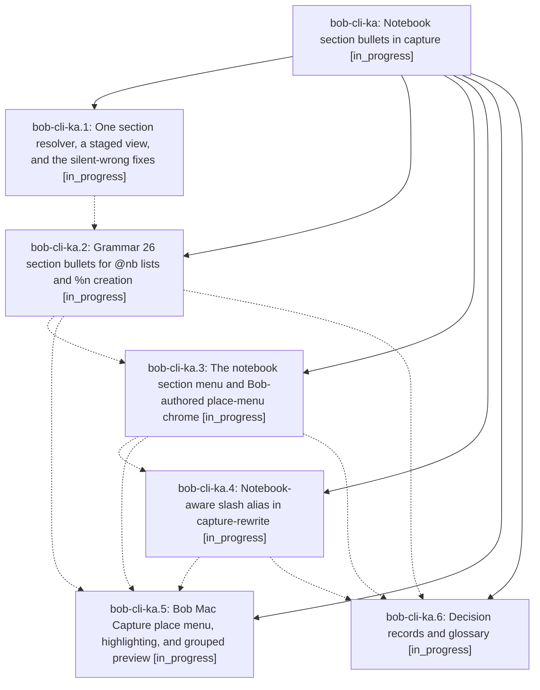

# Bead: bob-cli-ka — Notebook section bullets in capture

[Bead Pages](../README.md) / bob-cli-ka

**Status:** ◐ in_progress · **Type:** ▸ plan · **Tier:** epic
**Owner:** `bryanbugyi34@gmail.com` · **Created by:** [bbugyi200.athena.1b9](https://github.com/bobs-org/bob-cli--agents/blob/main/sessions/bbugyi200.athena.1b9.md) · **Assignee:** `bob-cli-ka.land`
**Created:** 2026-11-11 09:22:46 EST
**Plan:** [202611/notebook\_section\_bullets.md](https://github.com/bobs-org/bob-cli--plans/blob/main/202611/notebook_section_bullets.md)

<!-- sase:links:start -->

## Links

| Relation | Artifact | Why |
| --- | --- | --- |
| implemented-by | [plan:202611/notebook_section_bullets.md][1] | derived from the plan's `bead_id:` frontmatter field |

[1]: https://github.com/bobs-org/bob-cli--plans/blob/main/202611/notebook_section_bullets.md

<!-- sase:links:end -->

## Description

In any capture draft whose bullets land directly in a notebook body (a route-only `@nb` list or a `@parent^id@ %n` creation item), typing `- #` or `- /` opens a Bob-authored section menu listing the notebook's `##` sections (plus sections created earlier in the draft), accepting a row writes `- #Git` and drops the caret on the first nested note, and parse, menu, dry-run, and commit always agree on which section each note lands in.

## Phases

| Bead | Title | Status | Size | Created | Agents | Commits |
|---|---|---|---|---|---:|---:|
| [bob-cli-ka.1](bob-cli-ka.1.md) | One section resolver, a staged view, and the silent-wrong fixes | ◐ in_progress | medium | 2026-11-11 | 1 | 1 |
| [bob-cli-ka.2](bob-cli-ka.2.md) | Grammar 26 section bullets for @nb lists and %n creation | ◐ in_progress | large | 2026-11-11 | 1 | 0 |
| [bob-cli-ka.3](bob-cli-ka.3.md) | The notebook section menu and Bob-authored place-menu chrome | ◐ in_progress | medium | 2026-11-11 | 1 | 0 |
| [bob-cli-ka.4](bob-cli-ka.4.md) | Notebook-aware slash alias in capture-rewrite | ◐ in_progress | small | 2026-11-11 | 1 | 0 |
| [bob-cli-ka.5](bob-cli-ka.5.md) | Bob Mac Capture place menu, highlighting, and grouped preview | ◐ in_progress | large | 2026-11-11 | 1 | 0 |
| [bob-cli-ka.6](bob-cli-ka.6.md) | Decision records and glossary | ◐ in_progress | small | 2026-11-11 | 1 | 0 |

## Lineage

## Agents

| Agent | Bead | Commits |
|---|---|---:|
| [bbugyi200.athena.bob-cli-ka.1](https://github.com/bobs-org/bob-cli--agents/blob/main/sessions/bbugyi200.athena.bob-cli-ka.1.md) | [bob-cli-ka.1](bob-cli-ka.1.md) | 1 |
| [bbugyi200.athena.bob-cli-ka.2](https://github.com/bobs-org/bob-cli--agents/blob/main/agents/bbugyi200.athena.bob-cli-ka.2/README.md) | [bob-cli-ka.2](bob-cli-ka.2.md) | 0 |
| [bbugyi200.athena.bob-cli-ka.3](https://github.com/bobs-org/bob-cli--agents/blob/main/agents/bbugyi200.athena.bob-cli-ka.3/README.md) | [bob-cli-ka.3](bob-cli-ka.3.md) | 0 |
| [bbugyi200.athena.bob-cli-ka.4](https://github.com/bobs-org/bob-cli--agents/blob/main/agents/bbugyi200.athena.bob-cli-ka.4/README.md) | [bob-cli-ka.4](bob-cli-ka.4.md) | 0 |
| [bbugyi200.athena.bob-cli-ka.5](https://github.com/bobs-org/bob-cli--agents/blob/main/agents/bbugyi200.athena.bob-cli-ka.5/README.md) | [bob-cli-ka.5](bob-cli-ka.5.md) | 0 |
| [bbugyi200.athena.bob-cli-ka.6](https://github.com/bobs-org/bob-cli--agents/blob/main/agents/bbugyi200.athena.bob-cli-ka.6/README.md) | [bob-cli-ka.6](bob-cli-ka.6.md) | 0 |
| [bbugyi200.athena.bob-cli-ka.land](https://github.com/bobs-org/bob-cli--agents/blob/main/agents/bbugyi200.athena.bob-cli-ka.land/README.md) | [bob-cli-ka](README.md) | 0 |

## Commits

| Repo | Commit | Subject | Bead | Committed |
|---|---|---|---|---|
| bob-cli | [`f9d998c`](https://github.com/bobs-org/bob-cli/commit/f9d998c179a37bb1f1f3df8b590c472a3f5eff00) | feat(capture): resolve notebook sections with staged draft view | [bob-cli-ka.1](bob-cli-ka.1.md) | 2026-11-11 10:26:20 EST |
