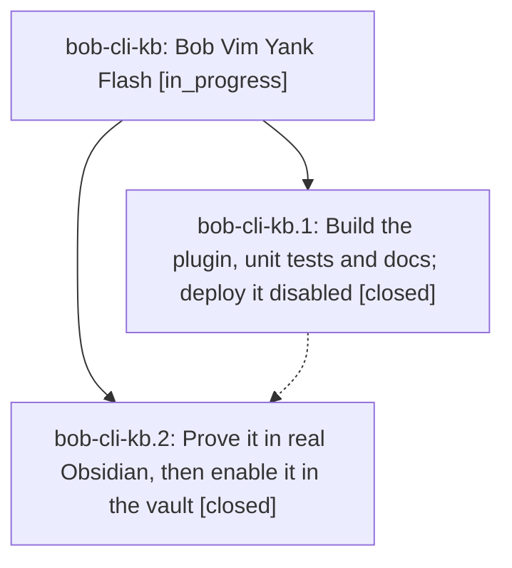

# Bead: bob-cli-kb — Bob Vim Yank Flash

[Bead Pages](../README.md) / bob-cli-kb

**Status:** ◐ in_progress · **Type:** ▸ plan · **Tier:** epic
**Owner:** `bryanbugyi34@gmail.com` · **Created by:** [bbugyi200.athena.1bd](https://github.com/bobs-org/bob-cli--agents/blob/main/sessions/bbugyi200.athena.1bd.md) · **Assignee:** `bob-cli-kb.land`
**Created:** 2026-11-11 10:46:18 EST
**Plan:** [202611/vim\_yank\_flash.md](https://github.com/bobs-org/bob-cli--plans/blob/main/202611/vim_yank_flash.md)

<!-- sase:links:start -->

## Links

| Relation | Artifact | Why |
| --- | --- | --- |
| implemented-by | [plan:202611/vim_yank_flash.md][1] | derived from the plan's `bead_id:` frontmatter field |

_Plus 1 automatic references — see [Referenced By](#referenced-by)._

[1]: https://github.com/bobs-org/bob-cli--plans/blob/main/202611/vim_yank_flash.md

<!-- sase:links:end -->

## Description

Every Vim yank in Obsidian briefly highlights exactly the text it copied, like the SASE prompt input, with no change to editing behavior and nothing drawn when unsure.

## Phases

| Bead | Title | Status | Size | Created | Agents | Commits |
|---|---|---|---|---|---:|---:|
| [bob-cli-kb.1](bob-cli-kb.1.md) | Build the plugin, unit tests and docs; deploy it disabled | ✓ closed | medium | 2026-11-11 | 1 | 1 |
| [bob-cli-kb.2](bob-cli-kb.2.md) | Prove it in real Obsidian, then enable it in the vault | ✓ closed | medium | 2026-11-11 | 1 | 1 |

## Lineage

## Agents

| Agent | Bead | Commits |
|---|---|---:|
| [bbugyi200.athena.bob-cli-kb.1](https://github.com/bobs-org/bob-cli--agents/blob/main/agents/bbugyi200.athena.bob-cli-kb.1/README.md) | [bob-cli-kb.1](bob-cli-kb.1.md) | 1 |
| [bbugyi200.athena.bob-cli-kb.2](https://github.com/bobs-org/bob-cli--agents/blob/main/agents/bbugyi200.athena.bob-cli-kb.2/README.md) | [bob-cli-kb.2](bob-cli-kb.2.md) | 1 |
| [bbugyi200.athena.bob-cli-kb.land](https://github.com/bobs-org/bob-cli--agents/blob/main/agents/bbugyi200.athena.bob-cli-kb.land/README.md) | [bob-cli-kb](README.md) | 0 |

## Commits

| Repo | Commit | Subject | Bead | Committed |
|---|---|---|---|---|
| bob-plugins | [`bob-plugins@95e2e51`](https://github.com/bobs-org/bob-plugins/commit/95e2e510bb8e684b027341c4c2cd591229ef8525) | feat(yank-flash): add bob-vim-yank-flash plugin with tests and docs | [bob-cli-kb.1](bob-cli-kb.1.md) | 2026-11-11 11:02:52 EST |
| bob-plugins | [`bob-plugins@7197394`](https://github.com/bobs-org/bob-plugins/commit/719739411431d2007d308042e5db4ea0236f57f9) | test(bob-vim-yank-flash): verify yank flash in Obsidian | [bob-cli-kb.2](bob-cli-kb.2.md) | 2026-11-11 12:13:33 EST |

<!-- sase:referenced-by:start -->

## Referenced By

| Relation | Artifact | Why | Uses |
| --- | --- | --- | ---: |
| read-by | [agent:bob-cli-kb.1][1] | Need epic DECISIONS and scope | 1 |

[1]: https://github.com/bobs-org/bob-cli--agents/blob/main/agents/bbugyi200.athena.bob-cli-kb.1/README.md

<!-- sase:referenced-by:end -->
