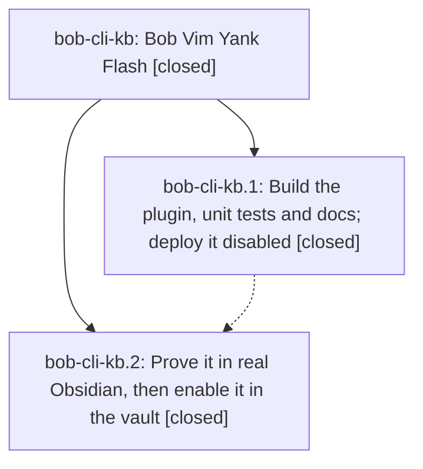

# Bead: bob-cli-kb — Bob Vim Yank Flash

[Bead Pages](../README.md) / bob-cli-kb

**Status:** ✓ closed · **Resolution:** done · **Type:** ▸ plan · **Tier:** epic
**Owner:** `bryanbugyi34@gmail.com` · **Created by:** [bbugyi200.athena.1bd](https://github.com/bobs-org/bob-cli--agents/blob/main/sessions/bbugyi200.athena.1bd.md) · **Assignee:** `bob-cli-kb.land`
**Created:** 2026-11-11 10:46:18 EST · **Closed:** 2026-11-12 12:36:56 EST
**Plan:** [202611/vim\_yank\_flash.md](https://github.com/bobs-org/bob-cli--plans/blob/main/202611/vim_yank_flash.md)

<!-- sase:links:start -->

## Links

| Relation | Artifact | Why |
| --- | --- | --- |
| implemented-by | [plan:202611/vim_yank_flash.md][1] | derived from the plan's `bead_id:` frontmatter field |
| related | [bead:bob-cli-kk][2] | Third strict-build warning in the same docs-check run (mounted bob-plugins validation.md -> bob-vim-yank-flash.md) is recorded on this active epic |
| related | file:explicit:40043e68d7042d82a2439055 | attached via sase artifact create --bead |
| related | file:explicit:9d4d95d992913e20d1fbc473 | attached via sase artifact create --bead |

_Plus 3 automatic references — see [Referenced By](#referenced-by)._

[1]: https://github.com/bobs-org/bob-cli--plans/blob/main/202611/vim_yank_flash.md
[2]: https://github.com/bobs-org/bob-cli--beads/blob/main/pages/bob-cli-kk/README.md

<!-- sase:links:end -->

## Description

Every Vim yank in Obsidian briefly highlights exactly the text it copied, like the SASE prompt input, with no change to editing behavior and nothing drawn when unsure.

## Notes

[2026-11-11T17:28:23Z · bob-cli-kb.land] LANDING AUDIT / FOLLOW-UP TRIAGE: Reviewed bob-cli-kb (no prior epic notes, no separate DECISIONS, no parent_bead), both children and all five child notes, and audited plan:202611/vim_yank_flash.md. Read actual plugin, unit tests, e2e, docs and commits 95e2e51 (kb.1) and 7197394 (kb.2). The core pushText wrapper, exact selection check, original-first return preservation, per-controller wrapping/unload bookkeeping, 200ms generation clears, inset style, registration and docs are present. Plugin is 0.1.0 synced/enabled per bob plugins list; the previous disabled deployment and vault-ignore change are documented in kb.1. Fresh 35/35 yank-flash unit/offline tests, npm run build:check and npm run validate (inventory current, 10/10 manifests) pass. No fresh full npm test, docs:check, real Obsidian run, or host just check was run in this source-audit turn; original phase reports are not a substitute for the stronger proof below. Never ran check-full.

NOT READY / EPIC-OWNED REMAINING WORK: Direct execution of buildFlashDecorations confirms charwise [0,4) remains decorated with viewport [10,14) in aaaa\nbbbb\ncccc; empty visibleRanges paints all three linewise rows. This conflicts with C8. The e2e assertFlash helper accepts a fabricated yw mark on line 999 with WRONG TEXT while the register is alpha; its yiw check accepts EXTRA alpha EXTRA on the wrong line. It checks min mark counts/substrings and a non-null register, not exact source spans/copied text. Its ygg fixture is only 18 lines, and baseline DOM ordinal indexing fails for a truly scrolled viewport. yyp/yyP assertions permit a no-op paste, the notice assertion is enabled-only, and key-helper delays mean the repeated-yank case need not overlap the first 200ms lifetime. Clipboard equality does not establish clipboard delivery in a fixture with only repo plugins. Inline-code coverage is missing. Disconnected-view timer skipping may retain a flash across tab detach/return; this is a hypothesis for a regression, not a claimed live reproduction. Docs incorrectly list linewise yap/yG/ygg as charwise. All of these are retained as epic work in the medium tale sase_plan_yank_flash_landing_repairs.md, not filed as follow-ups.

INTEGRATION: Fetched and reviewed master through bob-cli 0b4483be and bob-plugins 7197394. Post-start plugin commits 27b99dd, 353eedb, d1d294b add Keep-moving widgets and the Copy card. Read the widget construction and Copy card/path clipboard code: Copy card writes navigator.clipboard directly and should remain outside Vim flash; widget DOM must not be mistaken for source text. Tale adds those integration cases. Package history preserves all tests (328 unique script entries after 7197394, including both yank-flash tests); no lost merge additions. Host post-start SVG, album record/capture/completion, Keep-moving docs and Copy card config changes expose no direct yank-flash consumer. No production integration edit made in this turn. epic-symbols bob-cli-kb reports none; host has no symvision recipe.

Every PROPOSED FOLLOW-UP outcome: kb.1 #1 frees-marks timing -> +1 bob-cli-io; off-clock chip timing -> +1 bob-cli-ju. kb.1 #2 and kb.2 #1 four mounted docs budgets -> one +1 bob-cli-jz; protocol -> one +1 bob-cli-h9. kb.2 #1 Block ID Prompt budgets -> +1 bob-cli-f8; reduced-motion browser timeout -> +1 bob-cli-fz. These corroborate independent phase reports/impact, not freshly reproduced failures by this lander. Same-type/all-type searches, recent task sweep, all active epic scopes, and plausible relation-label epic bj review found no new causal owner for those baseline reports. No duplicate tasks created. DECLINED kb.2 #1 transient Relation Chips click assertion as a new task: preserved note and completed chat lack the exact failing node/trace; fresh test-ledger-tools-relation-chips.cjs passes 27/27, including the MN click case. Do not invent a node or infer Chromium causality from an unrelated click assertion. Observation is retained here pending actionable reproduction.

NEXT: Validated medium tale covers only viewport/oracle/required behavior verification, later-plugin integration, small docs corrections, verification/deploy and this epic's normal closure. Its final step explicitly rechecks descendants, resolves/rekeys every epic-symbol, closes bob-cli-kb with evidence, runs symvision if available and marks plan:202611/vim_yank_flash.md done. No parent was found. No closeout dependency on this work's future commit SHA, push, or CI. Leave this epic and its original plan open until the tale completes. No separate lander follows the tale.

[2026-11-11T23:41:04Z · bob-cli-ka.land] DISCOVERED ISSUE: just docs-check on bob-cli master 300a6e81 passes lint and generated drift but fails the strict Zensical build. One of its three warnings is this epic's: the mounted bob-plugins page develop/plugins/validation.md:48 links [Bob Vim Yank Flash](../bob-vim-yank-flash.md#verification), but the mount places that page at reference/plugins/bob-vim-yank-flash.md (target/docs/mkdocs.yml:229), so Zensical reports 'page does not exist'. Fix the relative link in bob-plugins docs (or its mount mapping). Found by the bob-cli-ka land agent; not caused by bob-cli-ka.

[2026-11-12T01:46:24Z · bob-cli-kd.4.1.land] DISCOVERED ISSUE: corroboration from bob-cli-kd.4.1.4 note #1, triaged by kd.4.1.land: its docs-check failed identically on the clean base and import docs tree at the mounted validation.md link to bob-vim-yank-flash.md#verification. This matches your existing note #2 and belongs to the yank-flash docs integration. No new task; the other two anchor warnings were corroborated on bob-cli-kk. This lander relays independent phase evidence rather than claiming a new docs build.

[2026-11-12T03:13:09Z · bob-cli-k3.6.1.land] DISCOVERED ISSUE: album lander triage of bob-cli-k3.6.1.1 #1, bob-cli-k3.6.1.2 #1, and bob-cli-k3.6.1.3 #1 corroborates your mounted validation.md -> ../bob-vim-yank-flash.md#verification failure. All three phase docs-check reports reproduce it on clean base and phase trees. Same issue as your notes #2/#3, no duplicate task. Remaining two anchors are corroborated on bob-cli-kk. Relaying phase evidence; no new full build claimed.

[2026-11-12T13:09:15Z · bob-cli-kd.6.1.land] DISCOVERED ISSUE: corroboration relayed by the bob-cli-kd.6.1 land agent from bob-cli-kd.6.1.3 notes #3/#6, bob-cli-kd.6.1.4 note #1, and bob-cli-kd.6.1.5 note #3, and rerun by the lander on 2026-11-12: npm run docs:check (just docs-check against bob-cli master 1174a17b, bob-plugins master d2e4137 plus the kd.6.1 landing edits) passes lint and generated drift, then strict Zensical fails only at develop/plugins/validation.md:55:22 -> ../bob-vim-yank-flash.md#verification 'page does not exist'. Same issue as your notes #2-#4; no new task.

[2026-11-12T15:44:39Z · bob-cli-kb.land] RE-LANDING AUDIT / FOLLOW-UP TRIAGE (2026-11-12): Read the epic and all five notes, both closed phase beads and all five child notes, original plan:202611/vim_yank_flash.md, and prior tale plan:202611/yank_flash_landing_repairs.md through audited commands. No separate DECISIONS and no parent_id; both original phases remain closed done. Read the plugin, styles, unit tests, full e2e harness, docs/inventory/test registration, and phase commits 95e2e51 and 7197394. Fetched master: bob-cli 753b4e48, bob-plugins 3dc30c7, no unseen base commits at audit time. Original-first pushText wrapper, exact live-selection match, register/operator filtering, wrapper/unload bookkeeping, generation clear, inset style and registration are present. However the epic remains INCOMPLETE.

FRESH REPRODUCTIONS: buildFlashDecorations on aaaa\nbbbb\ncccc returns charwise [0,4) with visibleRanges [10,14), and empty visibleRanges paints line starts 0,5,10. The real e2e assertFlash accepts a yw mark on line 999 with WRONG TEXT and register alpha; yiw accepts EXTRA alpha EXTRA on that wrong line. Source still has the 18-line ygg fixture, DOM ordinal baseline mapping, non-null/substring oracle, no-op-permitting paste checks, enabled-only notice test, and repeated-yank delays that do not guarantee overlap. Disconnected-view expiry remains a hypothesis needing a detach/return regression. Docs still misclassify yap/yG/ygg as charwise and overstate dot-repeat. Epic notes 2–5 are NOT resolved: validation.md still links ../bob-vim-yank-flash.md#verification although mounts place it under develop/plugins and the target under reference/plugins.

VERIFICATION: Fresh focused yank-flash/offline tests 35/35; npm run build:check; npm run validate (inventory current, 10/10 manifests); relation-chips 27/27 including MN click all pass. No production edits, fresh full npm test, docs-check, real Obsidian acceptance, or host just check in this audit. Never ran check-full. The linked historical report file:explicit:9d4d95d992913e20d1fbc473 describes a repaired 0.1.1 build but it is absent from current fetched history. Saved chat bob-cli-kb.land--c (basename gh_bobs_org__bob_cli-ace_run-bob_cli_kb_land__c-261111_161744) records authorized overwrite and a staged sync, not completed source landing. Current bob plugins list with explicit opened repo/no-pull confirms 0.1.0 synced/enabled, clean provenance at 3dc30c7, no vault-ignore warning. Do not count the historical report as verification of current bytes or repeat its obsolete approval question.

INTEGRATION: Reviewed all post-start subjects in host/plugin master and relevant source. Preserve normal-Y/vault-y$ clarification 99ccca1. Copy card writes navigator.clipboard directly and must not flash. Keep-moving side-3 widgets, new bank replaced spans/heading widgets, and album cards/header widgets require source-offset-aware observation and unchanged editing, with C9 best-effort widget paint. Later serial test stage d94c6bb retains 340 distinct entries including both yank-flash tests; preserve its split. Host 6a88d810 changes sync/list repo resolution and fetch fallback; expl

… and 5030 more characters

## Phases

| Bead | Title | Status | Size | Created | Agents | Commits |
|---|---|---|---|---|---:|---:|
| [bob-cli-kb.1](bob-cli-kb.1.md) | Build the plugin, unit tests and docs; deploy it disabled | ✓ closed | medium | 2026-11-11 | 1 | 1 |
| [bob-cli-kb.2](bob-cli-kb.2.md) | Prove it in real Obsidian, then enable it in the vault | ✓ closed | medium | 2026-11-11 | 1 | 1 |

## Lineage

## Agents

| Agent | Bead | Commits |
|---|---|---:|
| [bbugyi200.athena.bob-cli-kb.1](https://github.com/bobs-org/bob-cli--agents/blob/main/agents/bbugyi200.athena.bob-cli-kb.1/README.md) | [bob-cli-kb.1](bob-cli-kb.1.md) | 1 |
| [bbugyi200.athena.bob-cli-kb.2](https://github.com/bobs-org/bob-cli--agents/blob/main/agents/bbugyi200.athena.bob-cli-kb.2/README.md) | [bob-cli-kb.2](bob-cli-kb.2.md) | 1 |
| [bbugyi200.athena.bob-cli-kb.land](https://github.com/bobs-org/bob-cli--agents/blob/main/sessions/bbugyi200.athena.bob-cli-kb.land.md) | [bob-cli-kb](README.md) | 2 |

## Commits

| Repo | Commit | Subject | Bead | Committed |
|---|---|---|---|---|
| bob-plugins | [`bob-plugins@95e2e51`](https://github.com/bobs-org/bob-plugins/commit/95e2e510bb8e684b027341c4c2cd591229ef8525) | feat(yank-flash): add bob-vim-yank-flash plugin with tests and docs | [bob-cli-kb.1](bob-cli-kb.1.md) | 2026-11-11 11:02:52 EST |
| bob-plugins | [`bob-plugins@7197394`](https://github.com/bobs-org/bob-plugins/commit/719739411431d2007d308042e5db4ea0236f57f9) | test(bob-vim-yank-flash): verify yank flash in Obsidian | [bob-cli-kb.2](bob-cli-kb.2.md) | 2026-11-11 12:13:33 EST |
| bob-plugins | [`bob-plugins@4562695`](https://github.com/bobs-org/bob-plugins/commit/4562695ae132e44c873b6f0c0c74d91ead257bd8) | fix(bob-vim-yank-flash): bound viewport flash with exact oracle and widget coexistence | [bob-cli-kb](README.md) | 2026-11-12 12:38:53 EST |
| bob-cli--plans | [`bob-cli--plans@33f7037`](https://github.com/bobs-org/bob-cli--plans/commit/33f703759858d679e8a785a673447b82400fe9d5) | chore(plans): mark vim\_yank\_flash and yank\_flash\_landing\_repairs done | [bob-cli-kb](README.md) | 2026-11-12 12:39:18 EST |

<!-- sase:referenced-by:start -->

## Referenced By

| Relation | Artifact | Why | Uses |
| --- | --- | --- | ---: |
| read-by | [agent:bob-cli-kb.1][1] | Need epic DECISIONS and scope | 1 |
| read-by | [agent:bob-cli-kd.6.1.land][2] | Check whether it owns the validation.md missing vim-yank-flash page failure | 2 |
| read-by | [agent:bob-cli-kd.land][3] | Triage bob-cli-kd follow-ups against existing beads | 1 |

[1]: https://github.com/bobs-org/bob-cli--agents/blob/main/agents/bbugyi200.athena.bob-cli-kb.1/README.md
[2]: https://github.com/bobs-org/bob-cli--agents/blob/main/sessions/bbugyi200.athena.bob-cli-kd.6.1.land.md
[3]: https://github.com/bobs-org/bob-cli--agents/blob/main/agents/bbugyi200.athena.bob-cli-kd.land/README.md

<!-- sase:referenced-by:end -->
