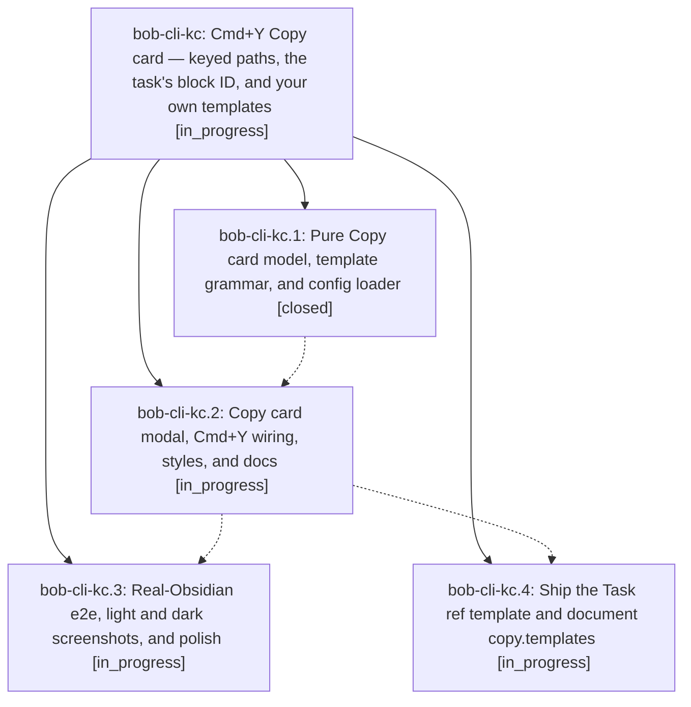

# Bead: bob-cli-kc — Cmd+Y Copy card — keyed paths, the task's block ID, and your own templates

[Bead Pages](../README.md) / bob-cli-kc

**Status:** ◐ in_progress · **Type:** ▸ plan · **Tier:** epic
**Owner:** `bryanbugyi34@gmail.com` · **Created by:** [bbugyi200.athena.1bg](https://github.com/bobs-org/bob-cli--agents/blob/main/sessions/bbugyi200.athena.1bg.md) · **Assignee:** `bob-cli-kc.land`
**Created:** 2026-11-11 11:19:06 EST
**Plan:** [202611/cmd\_y\_copy\_card.md](https://github.com/bobs-org/bob-cli--plans/blob/main/202611/cmd_y_copy_card.md)

## Description

Cmd+Y in Obsidian opens a compact, filter-less Copy card where every row copies with one key (P Path stays the ↵ default), the cursor's task contributes an I Block ID row, and copy.templates in ~/.config/bob/config.yml adds rows such as "the ^{block_id} task in the {path}". Preview and clipboard never disagree, and copying never writes the vault.

## Phases

| Bead | Title | Status | Size | Created | Agents | Commits |
|---|---|---|---|---|---:|---:|
| [bob-cli-kc.1](bob-cli-kc.1.md) | Pure Copy card model, template grammar, and config loader | ✓ closed | medium | 2026-11-11 | 1 | 1 |
| [bob-cli-kc.2](bob-cli-kc.2.md) | Copy card modal, Cmd+Y wiring, styles, and docs | ◐ in_progress | medium | 2026-11-11 | 1 | 0 |
| [bob-cli-kc.3](bob-cli-kc.3.md) | Real-Obsidian e2e, light and dark screenshots, and polish | ◐ in_progress | medium | 2026-11-11 | 1 | 0 |
| [bob-cli-kc.4](bob-cli-kc.4.md) | Ship the Task ref template and document copy.templates | ◐ in_progress | small | 2026-11-11 | 1 | 0 |

## Lineage

## Agents

| Agent | Bead | Commits |
|---|---|---:|
| [bbugyi200.athena.bob-cli-kc.1](https://github.com/bobs-org/bob-cli--agents/blob/main/agents/bbugyi200.athena.bob-cli-kc.1/README.md) | [bob-cli-kc.1](bob-cli-kc.1.md) | 1 |
| [bbugyi200.athena.bob-cli-kc.2](https://github.com/bobs-org/bob-cli--agents/blob/main/agents/bbugyi200.athena.bob-cli-kc.2/README.md) | [bob-cli-kc.2](bob-cli-kc.2.md) | 0 |
| [bbugyi200.athena.bob-cli-kc.3](https://github.com/bobs-org/bob-cli--agents/blob/main/agents/bbugyi200.athena.bob-cli-kc.3/README.md) | [bob-cli-kc.3](bob-cli-kc.3.md) | 0 |
| [bbugyi200.athena.bob-cli-kc.4](https://github.com/bobs-org/bob-cli--agents/blob/main/agents/bbugyi200.athena.bob-cli-kc.4/README.md) | [bob-cli-kc.4](bob-cli-kc.4.md) | 0 |
| [bbugyi200.athena.bob-cli-kc.land](https://github.com/bobs-org/bob-cli--agents/blob/main/agents/bbugyi200.athena.bob-cli-kc.land/README.md) | [bob-cli-kc](README.md) | 0 |

## Commits

| Repo | Commit | Subject | Bead | Committed |
|---|---|---|---|---|
| bob-plugins | [`bob-plugins@353eedb`](https://github.com/bobs-org/bob-plugins/commit/353eedbc8799f9c16d8c5e26325a203e99980b0e) | feat(navigation-hotkeys): add pure Copy card model, grammar, and config loader | [bob-cli-kc.1](bob-cli-kc.1.md) | 2026-11-11 11:39:51 EST |
