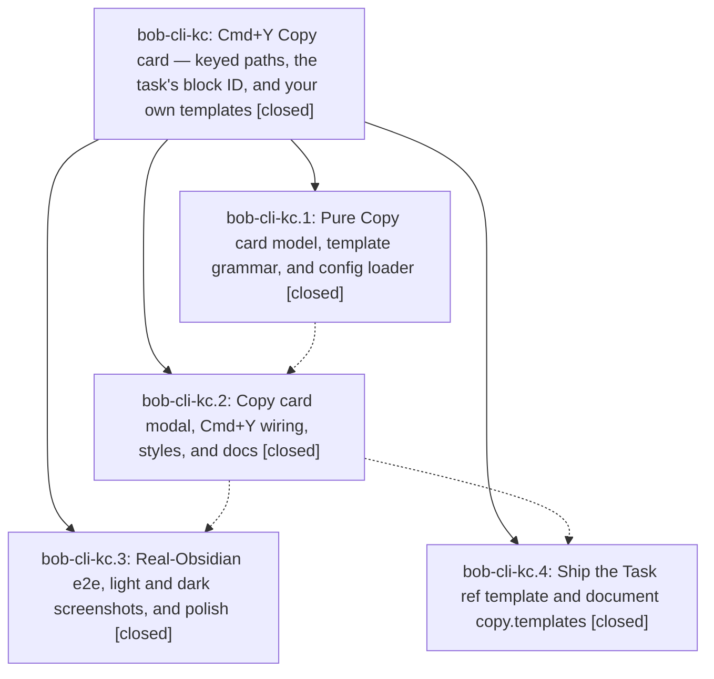

# Bead: bob-cli-kc — Cmd+Y Copy card — keyed paths, the task's block ID, and your own templates

[Bead Pages](../README.md) / bob-cli-kc

**Status:** ✓ closed · **Resolution:** done · **Type:** ▸ plan · **Tier:** epic
**Owner:** `bryanbugyi34@gmail.com` · **Created by:** [bbugyi200.athena.1bg](https://github.com/bobs-org/bob-cli--agents/blob/main/sessions/bbugyi200.athena.1bg.md) · **Assignee:** `bob-cli-kc.land`
**Created:** 2026-11-11 11:19:06 EST · **Closed:** 2026-11-11 18:03:42 EST
**Plan:** [202611/cmd\_y\_copy\_card.md](https://github.com/bobs-org/bob-cli--plans/blob/main/202611/cmd_y_copy_card.md)

<!-- sase:links:start -->

## Links

| Relation | Artifact | Why |
| --- | --- | --- |
| implemented-by | [plan:202611/cmd_y_copy_card.md][1] | derived from the plan's `bead_id:` frontmatter field |
| related | file:explicit:62d26843ee7fe02042cd45fc | attached via sase artifact create --bead |
| related | file:explicit:80d719192c713e8d4e9929ea | attached via sase artifact create --bead |
| related | file:explicit:c5fe138f6bdc28c20de1a40f | attached via sase artifact create --bead |
| related | file:explicit:df5f52dc2e75c4caa6d1c879 | attached via sase artifact create --bead |
| related | file:explicit:f83da980d7f71f1ddc4d33d1 | attached via sase artifact create --bead |

_Plus 2 automatic references — see [Referenced By](#referenced-by)._

[1]: https://github.com/bobs-org/bob-cli--plans/blob/main/202611/cmd_y_copy_card.md

<!-- sase:links:end -->

## Description

Cmd+Y in Obsidian opens a compact, filter-less Copy card where every row copies with one key (P Path stays the ↵ default), the cursor's task contributes an I Block ID row, and copy.templates in ~/.config/bob/config.yml adds rows such as "the ^{block_id} task in the {path}". Preview and clipboard never disagree, and copying never writes the vault.

## Notes

[2026-11-11T22:18:51Z · bob-cli-kc.land] LANDING AUDIT: Read this epic (no existing notes at start), all four closed children and all 11 child notes, and audited plan:202611/cmd_y_copy_card.md. Reviewed actual model/keys/config/modal/mixin, command wiring, shared owner/path helpers, styles, tests, e2e driver/assertions, docs/config, and epic commits: bob-plugins 353eedb (kc.1), d1d294b (kc.2), 934bbbb (kc.3); bob-cli 0b4483be and chezmoi 68f2fbba (kc.4). cmd_y_twice=yes is implemented; copy_card_record=no was honored and no epic commit touches memory. Existing frozen snapshot, single-pass grammar, reserved/colliding keys, no-ID state, read-only clipboard callback and palette compatibility are present. The phase completion reports are qualified by the concrete gaps below, so the epic is not yet ready to close.

FRESH VERIFICATION: 55/55 Copy card model/view/offline-e2e tests pass; npm run build:check and npm run docs:inventory:check pass; 46/46 Reading Board and Stats stylesheet controls pass. bob plugins list --repo <opened checkout> --no-pull -f json reports bob-navigation-hotkeys 2.80.0 synced and enabled on athena; its stamp reflects the pre-finalization kc.3 deployment. No new full npm test, real Obsidian walkthrough, Mac UI verification, docs-check, or just check run in this source-audit turn. No check-full ran. All six new fragments are below 1000 lines (101 is 893). epic-symbols reports none; host justfile has no symvision recipe.

EPIC-OWNED REMAINING WORK: (1) Built helper repro on a Parent task with a two-space nested fenced Example task returns parent ID from inside the fence; four-space fences return the literal example ID. Required fenced-cursor result is none. (2) Ready template 10 has model reason add key: to bind but the actual modal DOM omits the reason. Highlight/refusal renders have no scrolling, requiring long-list geometry proof and repair. (3) Explicit blank/whitespace key strings silently become positional bindings, whitespace-padded strings silently normalize, and parsed copy:null suppresses the required non-mapping diagnostic. (4) Meta+Ctrl+Y copies, and Alt+Escape closes despite the modified-chord exclusions. (5) The view test named for switching the active file never switches it. Add a real plugin-entry snapshot test and stronger per-copy sentinels/long-list/fence real-app coverage. (6) kc.2 grew the already-over-cap navigation reference from 6186 to 6200 canonical words; own that added content and trim the touched page, rather than treating all its growth as a baseline issue. These are retained as epic work in the medium tale sase_plan_copy_card_landing_repairs.md, not filed as follow-ups.

[2026-11-11T22:18:56Z · bob-cli-kc.land] INTEGRATION REVIEW: Fetched origin and reviewed all post-start commit subjects/paths from the creation/first plugin commit boundary through bob-cli ee2d2cbf, bob-plugins 934bbbb and chezmoi 09725bd3, with no upstream commits missing. Later Vim yank flash wraps Vim pushText while Copy card directly writes navigator.clipboard; preserve that separation. Later bank data/actions and prj/hide marks do not replace the card, and bank rows without #task remain file-only contexts. Picker-title prj/hide cleanup is expressly deferred by ACE and tracked on bob-cli-kg, so do not fold it into this landing. Preserve package test registrations. Root album/notebook/bank/gcal/security changes introduce no additional Copy card consumer; deployment change 6a88d810 selects the enclosing checkout, while an explicit --repo and --no-pull remains suitable for the repaired working tree. Bryan deliberately added the word file to the Task ref template in chezmoi 09725bd3; preserve and regression-test that later customization instead of restoring the original plan example. No production integration files were edited in this planning turn.

EVERY PROPOSED FOLLOW-UP DISPOSITION (using sase_new_task, same-type/all-type searches, recent task sweeps and active-epic scope review): kc.1 #1, kc.2 #2 Reading Board/Stats hex failures, and kc.3 #1 are RESOLVED by 4e1f377 moving the Keep-moving CSS; fresh controls pass 46/46, so decline duplicate tasks. kc.1 #2 and kc.3 #2 Keep-moving timing -> one +1 bob-cli-ki, not the different bob-cli-ej large-child node; kc.1 threshold spelling is not trusted over the current test. kc.2 #2 wikilink timing and kc.3 #2 three index budgets -> one +1 bob-cli-f8. kc.2 #1 and kc.4 #1 mounted docs -> +1 bob-cli-jz for Mac panel/previews/keyboard and inherited navigation overage, +1 bob-cli-h9 for protocol, +1 bob-cli-il for ledger editing headroom. The original ledger 6101 overage was fixed to 5995 by 4e1f377, then unrelated prj/hide commit 3423ba6 grew it to 6020; c35662b has no net word-count growth. The active bank epic therefore is not the causal owner of this recurrence. kc navigation growth stays epic work. All +1 entries identify proposing phases and distinguish reported phase impact from fresh lander measurements.

DECLINED kc.2 #2 reduced-motion as a distinct new task: it contains no exact node, assertion, timeout or trace; the completed kc.2 response/raw chat offers no additional diagnostic. Added a supplementary note to related bob-cli-fz without claiming a +1 or proving its Chromium-timeout root cause. Retain this observation here and obtain an exact trace if it recurs. No new duplicate task was created.

NEXT: Validated medium tale sase_plan_copy_card_landing_repairs.md contains only remaining repairs, stronger proof, integration checks and this epic closeout. Its last step rechecks descendants/notes/drift, resolves or rekeys every epic-symbol, closes bob-cli-kc normally, runs just symvision if available, and sets status: done in original PLAN sase/repos/plans/202611/cmd_y_copy_card.md. Re-read found no parent_bead. No final step depends on the tale own future commit, SHA, push or CI; no separate lander follows it. Leave this epic and original plan open until those repairs complete.

[2026-11-11T23:03:42Z · bob-cli-kc.land] Closed after Copy-card landing repairs. Source review: four original phases remain closed; cmd_y_twice=yes and copy_card_record=no still hold; no SASE memory or decision edits; copying stays read-only. Post-start integration on bob-plugins e8a776e plus later Vim yank-flash, bank, and prj/hide work: Copy card still writes navigator.clipboard directly, bank checkboxes without #task stay file-only, picker-title prj/hide stays on bob-cli-kg, and Bryan's Task ref suffix ("the ^{block_id} task in the {path} file") is preserved with a model regression.

Fixes in bob-plugins bob-navigation-hotkeys: nested fence walker rejects list-nested backtick/tilde fences and a four-space fence under a child bullet with no parent fallback (openCopyCard and yank-block-id); explicit key: "" / "  " / " t " / null are invalid while only an omitted key gets the positional default; {copy: null} diagnoses "copy must be a mapping"; ready rows render "add key: to bind"; selected/refused rows scroll inside .bob-copy-card-rows with header/status/footer pinned; snapshot test opens through plugin.openCopyCard() on A then switches to B.

Verification now (distinct from older phase evidence): 68/68 focused Copy-card tests; npm run build + build:check; npm test 6186/6186; real Obsidian e2e under xvfb-run -a, 50/50 including nested fences, Live Preview (mode source / source:false), unique clipboard sentinels, file-switch snapshot, Overflow 12 wrap, and Linux Ctrl+Y twice (fresh-mod-y-copies-highlight copied ~/bob/Copy card e2e.md). 14 light/dark screenshots inspected; artifacts file:explicit:df5f52dc2e75c4caa6d1c879 (report), file:explicit:c5fe138f6bdc28c20de1a40f (png tarball). Fragments 101=955 and 103=498 lines. docs/bob-navigation-hotkeys.md is 5818 canonical words (cap 6000). Deployed with bob plugins sync --repo "$PWD" --no-pull -p bob-navigation-hotkeys (athena, uncommitted working tree, backup 20261111-180236).

just check: fmt and clippy passed; 2 unrelated capture::complete_themes shell-description failures corroborated on bob-cli-g8. just docs-check / npm run docs:check: Mac capture panel/previews/keyboard/protocol and bob-cli capture-syntax/json-outputs overages remain on bob-cli-jz and bob-cli-h9; Copy-card pages are under cap. epic-symbols: none. No just check-full. No Mac UI run.

Lander follow-up dispositions retained: Keep-moving CSS resolved by 4e1f377; timing +1s on bob-cli-ki and bob-cli-f8; Mac/docs budgets +1s on bob-cli-jz, bob-cli-h9, bob-cli-il; reduced-motion declined. No new epic-caused issue. Original plan status set to done. No parent_bead.

## Phases

| Bead | Title | Status | Size | Created | Agents | Commits |
|---|---|---|---|---|---:|---:|
| [bob-cli-kc.1](bob-cli-kc.1.md) | Pure Copy card model, template grammar, and config loader | ✓ closed | medium | 2026-11-11 | 1 | 1 |
| [bob-cli-kc.2](bob-cli-kc.2.md) | Copy card modal, Cmd+Y wiring, styles, and docs | ✓ closed | medium | 2026-11-11 | 1 | 1 |
| [bob-cli-kc.3](bob-cli-kc.3.md) | Real-Obsidian e2e, light and dark screenshots, and polish | ✓ closed | medium | 2026-11-11 | 1 | 1 |
| [bob-cli-kc.4](bob-cli-kc.4.md) | Ship the Task ref template and document copy.templates | ✓ closed | small | 2026-11-11 | 1 | 2 |

## Lineage

## Agents

| Agent | Bead | Commits |
|---|---|---:|
| [bbugyi200.athena.bob-cli-kc.1](https://github.com/bobs-org/bob-cli--agents/blob/main/agents/bbugyi200.athena.bob-cli-kc.1/README.md) | [bob-cli-kc.1](bob-cli-kc.1.md) | 1 |
| [bbugyi200.athena.bob-cli-kc.2](https://github.com/bobs-org/bob-cli--agents/blob/main/agents/bbugyi200.athena.bob-cli-kc.2/README.md) | [bob-cli-kc.2](bob-cli-kc.2.md) | 1 |
| [bbugyi200.athena.bob-cli-kc.3](https://github.com/bobs-org/bob-cli--agents/blob/main/sessions/bbugyi200.athena.bob-cli-kc.3.md) | [bob-cli-kc.3](bob-cli-kc.3.md) | 1 |
| [bbugyi200.athena.bob-cli-kc.4](https://github.com/bobs-org/bob-cli--agents/blob/main/agents/bbugyi200.athena.bob-cli-kc.4/README.md) | [bob-cli-kc.4](bob-cli-kc.4.md) | 2 |
| [bbugyi200.athena.bob-cli-kc.land](https://github.com/bobs-org/bob-cli--agents/blob/main/sessions/bbugyi200.athena.bob-cli-kc.land.md) | [bob-cli-kc](README.md) | 1 |

## Commits

| Repo | Commit | Subject | Bead | Committed |
|---|---|---|---|---|
| bob-plugins | [`bob-plugins@353eedb`](https://github.com/bobs-org/bob-plugins/commit/353eedbc8799f9c16d8c5e26325a203e99980b0e) | feat(navigation-hotkeys): add pure Copy card model, grammar, and config loader | [bob-cli-kc.1](bob-cli-kc.1.md) | 2026-11-11 11:39:51 EST |
| bob-plugins | [`bob-plugins@d1d294b`](https://github.com/bobs-org/bob-plugins/commit/d1d294bb93765e3a27f299049d09ed8beaca3e8f) | feat(navigation-hotkeys): add Cmd+Y Copy card modal, wiring, styles, and docs | [bob-cli-kc.2](bob-cli-kc.2.md) | 2026-11-11 12:00:15 EST |
| bob-cli | [`0b4483b`](https://github.com/bobs-org/bob-cli/commit/0b4483be37977abc2ed8896712e50e4c3fe86ddc) | docs(config): document copy.templates for the Cmd+Y Copy card | [bob-cli-kc.4](bob-cli-kc.4.md) | 2026-11-11 12:10:28 EST |
| chezmoi | [`chezmoi@68f2fbb`](https://github.com/bbugyi200/dotfiles/commit/68f2fbba64bdb422f49a5bb7daab853e84972bc3) | feat(bob): add Cmd+Y Copy card Task ref template | [bob-cli-kc.4](bob-cli-kc.4.md) | 2026-11-11 12:11:01 EST |
| bob-plugins | [`bob-plugins@934bbbb`](https://github.com/bobs-org/bob-plugins/commit/934bbbbfe95d4d9e797c6a82e5bb84b3968f5f29) | feat(copy-card): complete Obsidian e2e and polish | [bob-cli-kc.3](bob-cli-kc.3.md) | 2026-11-11 16:47:52 EST |
| bob-plugins | [`bob-plugins@d532aad`](https://github.com/bobs-org/bob-plugins/commit/d532aad74573f4a8e66a0fb8fb0a4a33c7415b9d) | fix(copy-card): reject fenced tasks and honor copy config | [bob-cli-kc](README.md) | 2026-11-11 18:11:43 EST |

<!-- sase:referenced-by:start -->

## Referenced By

| Relation | Artifact | Why | Uses |
| --- | --- | --- | ---: |
| read-by | [agent:bob-cli-kc.2][1] | Need epic context | 1 |
| read-by | [agent:bob-cli-kc.4][2] | Need parent epic DECISIONS, phase list, and remaining work context | 1 |

[1]: https://github.com/bobs-org/bob-cli--agents/blob/main/agents/bbugyi200.athena.bob-cli-kc.2/README.md
[2]: https://github.com/bobs-org/bob-cli--agents/blob/main/agents/bbugyi200.athena.bob-cli-kc.4/README.md

<!-- sase:referenced-by:end -->
