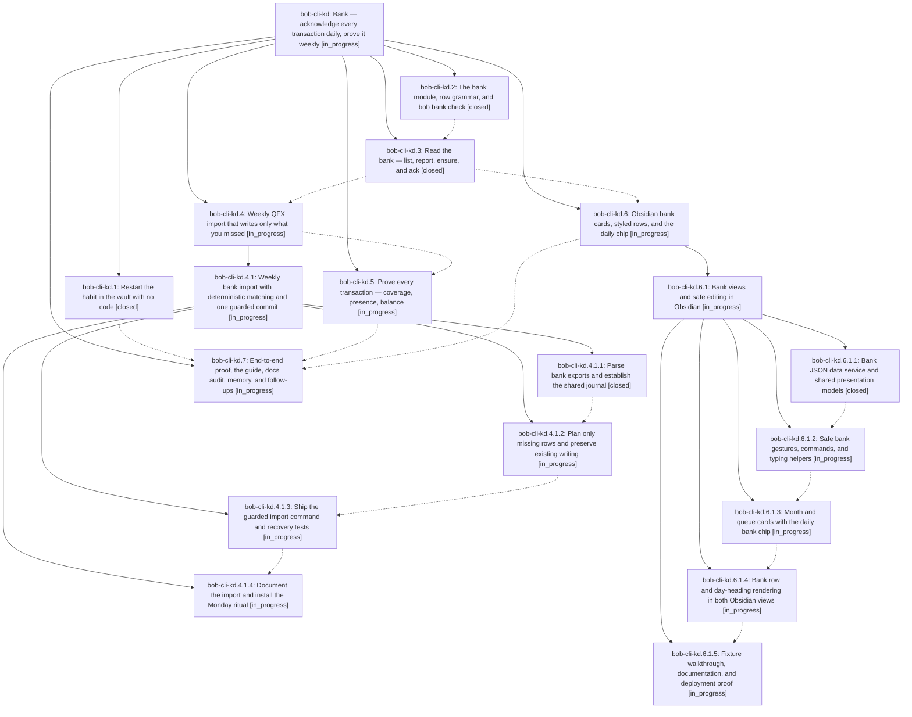

# Bead: bob-cli-kd — Bank — acknowledge every transaction daily, prove it weekly

[Bead Pages](../README.md) / bob-cli-kd

**Status:** ◐ in_progress · **Type:** ▸ plan · **Tier:** epic
**Owner:** `bryanbugyi34@gmail.com` · **Created by:** [bbugyi200.athena.1be](https://github.com/bobs-org/bob-cli--agents/blob/main/sessions/bbugyi200.athena.1be.md) · **Assignee:** `bob-cli-kd.land`
**Created:** 2026-11-11 11:24:16 EST
**Plan:** [202611/bank\_daily\_acknowledgment.md](https://github.com/bobs-org/bob-cli--plans/blob/main/202611/bank_daily_acknowledgment.md)

<!-- sase:links:start -->

## Links

| Relation | Artifact | Why |
| --- | --- | --- |
| implemented-by | [plan:202611/bank_daily_acknowledgment.md][1] | derived from the plan's `bead_id:` frontmatter field |

_Plus 1 automatic references — see [Referenced By](#referenced-by)._

[1]: https://github.com/bobs-org/bob-cli--plans/blob/main/202611/bank_daily_acknowledgment.md

<!-- sase:links:end -->

## Description

Bryan restarts his daily bank habit right away. Every posted transaction and deposit becomes one checkbox row in a monthly bank note under a new `bank` sub-area of `cash`. Typing a row acknowledges it. A weekly `bob bank import` of a Wells Fargo QFX file writes, unchecked, only the rows he missed, and a balance proof shows that nothing was skipped. Every total is computed when it is drawn (terminal, month card, queue card, daily chip) and never written into notes. A missed week costs one sitting to catch up, not a retyping spiral.

## Phases

| Bead | Title | Status | Size | Created | Agents | Commits |
|---|---|---|---|---|---:|---:|
| [bob-cli-kd.1](bob-cli-kd.1.md) | Restart the habit in the vault with no code | ✓ closed | small | 2026-11-11 | 1 | 0 |
| [bob-cli-kd.2](bob-cli-kd.2.md) | The bank module, row grammar, and bob bank check | ✓ closed | medium | 2026-11-11 | 1 | 1 |
| [bob-cli-kd.3](bob-cli-kd.3.md) | Read the bank — list, report, ensure, and ack | ✓ closed | medium | 2026-11-11 | 1 | 1 |
| [bob-cli-kd.4](bob-cli-kd.4.md) | Weekly QFX import that writes only what you missed | ◐ in_progress | large | 2026-11-11 | 1 | 0 |
| [bob-cli-kd.5](bob-cli-kd.5.md) | Prove every transaction — coverage, presence, balance | ◐ in_progress | medium | 2026-11-11 | 1 | 0 |
| [bob-cli-kd.6](bob-cli-kd.6.md) | Obsidian bank cards, styled rows, and the daily chip | ◐ in_progress | large | 2026-11-11 | 1 | 0 |
| [bob-cli-kd.7](bob-cli-kd.7.md) | End-to-end proof, the guide, docs audit, memory, and follow-ups | ◐ in_progress | medium | 2026-11-11 | 1 | 0 |

## Lineage

## Agents

| Agent | Bead | Commits |
|---|---|---:|
| [bbugyi200.athena.bob-cli-kd.1](https://github.com/bobs-org/bob-cli--agents/blob/main/agents/bbugyi200.athena.bob-cli-kd.1/README.md) | [bob-cli-kd.1](bob-cli-kd.1.md) | 0 |
| [bbugyi200.athena.bob-cli-kd.2](https://github.com/bobs-org/bob-cli--agents/blob/main/sessions/bbugyi200.athena.bob-cli-kd.2.md) | [bob-cli-kd.2](bob-cli-kd.2.md) | 1 |
| [bbugyi200.athena.bob-cli-kd.3](https://github.com/bobs-org/bob-cli--agents/blob/main/agents/bbugyi200.athena.bob-cli-kd.3/README.md) | [bob-cli-kd.3](bob-cli-kd.3.md) | 1 |
| [bbugyi200.athena.bob-cli-kd.4](https://github.com/bobs-org/bob-cli--agents/blob/main/sessions/bbugyi200.athena.bob-cli-kd.4.md) | [bob-cli-kd.4](bob-cli-kd.4.md) | 0 |
| [bbugyi200.athena.bob-cli-kd.4.1.1](https://github.com/bobs-org/bob-cli--agents/blob/main/agents/bbugyi200.athena.bob-cli-kd.4.1.1/README.md) | [bob-cli-kd.4.1.1](bob-cli-kd.4.1.1.md) | 1 |
| [bbugyi200.athena.bob-cli-kd.4.1.2](https://github.com/bobs-org/bob-cli--agents/blob/main/agents/bbugyi200.athena.bob-cli-kd.4.1.2/README.md) | [bob-cli-kd.4.1.2](bob-cli-kd.4.1.2.md) | 0 |
| [bbugyi200.athena.bob-cli-kd.4.1.3](https://github.com/bobs-org/bob-cli--agents/blob/main/agents/bbugyi200.athena.bob-cli-kd.4.1.3/README.md) | [bob-cli-kd.4.1.3](bob-cli-kd.4.1.3.md) | 0 |
| [bbugyi200.athena.bob-cli-kd.4.1.4](https://github.com/bobs-org/bob-cli--agents/blob/main/agents/bbugyi200.athena.bob-cli-kd.4.1.4/README.md) | [bob-cli-kd.4.1.4](bob-cli-kd.4.1.4.md) | 0 |
| [bbugyi200.athena.bob-cli-kd.4.1.land](https://github.com/bobs-org/bob-cli--agents/blob/main/agents/bbugyi200.athena.bob-cli-kd.4.1.land/README.md) | [bob-cli-kd.4.1](bob-cli-kd.4.1.md) | 0 |
| [bbugyi200.athena.bob-cli-kd.5](https://github.com/bobs-org/bob-cli--agents/blob/main/agents/bbugyi200.athena.bob-cli-kd.5/README.md) | [bob-cli-kd.5](bob-cli-kd.5.md) | 0 |
| [bbugyi200.athena.bob-cli-kd.6](https://github.com/bobs-org/bob-cli--agents/blob/main/sessions/bbugyi200.athena.bob-cli-kd.6.md) | [bob-cli-kd.6](bob-cli-kd.6.md) | 0 |
| [bbugyi200.athena.bob-cli-kd.6.1.1](https://github.com/bobs-org/bob-cli--agents/blob/main/agents/bbugyi200.athena.bob-cli-kd.6.1.1/README.md) | [bob-cli-kd.6.1.1](bob-cli-kd.6.1.1.md) | 0 |
| [bbugyi200.athena.bob-cli-kd.6.1.2](https://github.com/bobs-org/bob-cli--agents/blob/main/agents/bbugyi200.athena.bob-cli-kd.6.1.2/README.md) | [bob-cli-kd.6.1.2](bob-cli-kd.6.1.2.md) | 0 |
| [bbugyi200.athena.bob-cli-kd.6.1.3](https://github.com/bobs-org/bob-cli--agents/blob/main/agents/bbugyi200.athena.bob-cli-kd.6.1.3/README.md) | [bob-cli-kd.6.1.3](bob-cli-kd.6.1.3.md) | 0 |
| [bbugyi200.athena.bob-cli-kd.6.1.4](https://github.com/bobs-org/bob-cli--agents/blob/main/agents/bbugyi200.athena.bob-cli-kd.6.1.4/README.md) | [bob-cli-kd.6.1.4](bob-cli-kd.6.1.4.md) | 0 |
| [bbugyi200.athena.bob-cli-kd.6.1.5](https://github.com/bobs-org/bob-cli--agents/blob/main/agents/bbugyi200.athena.bob-cli-kd.6.1.5/README.md) | [bob-cli-kd.6.1.5](bob-cli-kd.6.1.5.md) | 0 |
| [bbugyi200.athena.bob-cli-kd.6.1.land](https://github.com/bobs-org/bob-cli--agents/blob/main/agents/bbugyi200.athena.bob-cli-kd.6.1.land/README.md) | [bob-cli-kd.6.1](bob-cli-kd.6.1.md) | 0 |
| [bbugyi200.athena.bob-cli-kd.7](https://github.com/bobs-org/bob-cli--agents/blob/main/agents/bbugyi200.athena.bob-cli-kd.7/README.md) | [bob-cli-kd.7](bob-cli-kd.7.md) | 0 |
| [bbugyi200.athena.bob-cli-kd.land](https://github.com/bobs-org/bob-cli--agents/blob/main/agents/bbugyi200.athena.bob-cli-kd.land/README.md) | [bob-cli-kd](README.md) | 0 |

## Commits

| Repo | Commit | Subject | Bead | Committed |
|---|---|---|---|---|
| bob-cli | [`07f1c74`](https://github.com/bobs-org/bob-cli/commit/07f1c7442bb24d50658167856fb5816312199423) | feat(bank): add bank grammar, month notes, and read-only bob bank check | [bob-cli-kd.2](bob-cli-kd.2.md) | 2026-11-11 12:58:45 EST |
| bob-cli | [`49218b3`](https://github.com/bobs-org/bob-cli/commit/49218b38ebf3372b44274fa94869ad7ccc58311c) | feat(bank): add list, report, ensure, and ack to bob bank | [bob-cli-kd.3](bob-cli-kd.3.md) | 2026-11-11 13:58:05 EST |
| bob-cli | [`bffbf36`](https://github.com/bobs-org/bob-cli/commit/bffbf36bd58d79868e4bf2b2db042bcab50f4635) | feat(bank): parse OFX/CSV exports and fold the bank journal | [bob-cli-kd.4.1.1](bob-cli-kd.4.1.1.md) | 2026-11-11 15:06:39 EST |

<!-- sase:referenced-by:start -->

## Referenced By

| Relation | Artifact | Why | Uses |
| --- | --- | --- | ---: |
| read-by | [agent:bob-cli-kd.3][1] | Need epic scope and decisions | 1 |

[1]: https://github.com/bobs-org/bob-cli--agents/blob/main/agents/bbugyi200.athena.bob-cli-kd.3/README.md

<!-- sase:referenced-by:end -->
