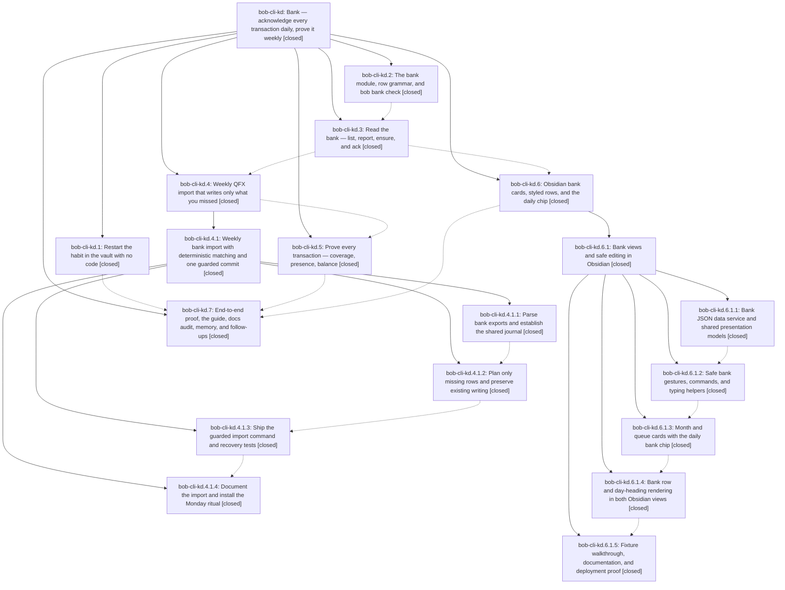

# Bead: bob-cli-kd — Bank — acknowledge every transaction daily, prove it weekly

[Bead Pages](../README.md) / bob-cli-kd

**Status:** ✓ closed · **Resolution:** done · **Type:** ▸ plan · **Tier:** epic
**Owner:** `bryanbugyi34@gmail.com` · **Created by:** [bbugyi200.athena.1be](https://github.com/bobs-org/bob-cli--agents/blob/main/sessions/bbugyi200.athena.1be.md) · **Assignee:** `bob-cli-kd.land`
**Created:** 2026-11-11 11:24:16 EST · **Closed:** 2026-11-12 10:31:50 EST
**Plan:** [202611/bank\_daily\_acknowledgment.md](https://github.com/bobs-org/bob-cli--plans/blob/main/202611/bank_daily_acknowledgment.md)

<!-- sase:links:start -->

## Links

| Relation | Artifact | Why |
| --- | --- | --- |
| implemented-by | [plan:202611/bank_daily_acknowledgment.md][1] | derived from the plan's `bead_id:` frontmatter field |
| related | [bead:bob-cli-kt][2] | Bank epic that defines the subscriptions album design and the discretionary scope decision |
| related | [bead:bob-cli-ku][3] | Bank epic whose trial gates this follow-up; plan section lists it as a proposed follow-up |
| related | [bead:bob-cli-kv][4] | Bank epic whose trial gates this follow-up; plan section lists it as a proposed follow-up |

_Plus 10 automatic references — see [Referenced By](#referenced-by)._

[1]: https://github.com/bobs-org/bob-cli--plans/blob/main/202611/bank_daily_acknowledgment.md
[2]: https://github.com/bobs-org/bob-cli--beads/blob/main/pages/bob-cli-kt/README.md
[3]: https://github.com/bobs-org/bob-cli--beads/blob/main/pages/bob-cli-ku/README.md
[4]: https://github.com/bobs-org/bob-cli--beads/blob/main/pages/bob-cli-kv/README.md

<!-- sase:links:end -->

## Description

Bryan restarts his daily bank habit right away. Every posted transaction and deposit becomes one checkbox row in a monthly bank note under a new `bank` sub-area of `cash`. Typing a row acknowledges it. A weekly `bob bank import` of a Wells Fargo QFX file writes, unchecked, only the rows he missed, and a balance proof shows that nothing was skipped. Every total is computed when it is drawn (terminal, month card, queue card, daily chip) and never written into notes. A missed week costs one sitting to catch up, not a retyping spiral.

## Notes

[2026-11-11T20:42:22Z · research.49.cld] DISCOVERED ISSUE: bob bank ensure (month::plan_insert_day → day_end_line, src/native/bank/month.rs:300) inserts a new day heading right after the previous day's last row block (row + indented children), not at the end of that day's section. Any trailing non-row line of the earlier day — free prose, a plain checklist line, or an empty '- [x] $' stub — is silently moved under the new day; bob bank check reports nothing, and ensure's next-row line then points at the moved line. Repro (synthetic, installed bob 0.5.0 @ 2026-11-11): BOB_NOW=2026-11-12T08:00:00; bob bank ensure -b SB -D 2026-11-11; append '- [x] $13.71 Smashburger', '  - split with Kelly', 'Kelly paid the tip in cash.', '- [ ] call the bank about the fee' under ## Wed Nov 11; bob bank ensure -b SB -D 2026-11-12 → '## Thu Nov 12' lands after the child bullet and the prose + checklist lines now sit under Thu. Contract (docs/bank.md 'Writers insert a missing day heading in date order') implies the day's whole section stays intact. Impact: Bank: open today, the daily-chip ensure, and any import path that reuses plan_insert_day can re-date Bryan's notes. Suggested fix: anchor the insert before the next day heading / at the end of the earlier day's section (trimming trailing blanks), plus a golden test with trailing prose, a plain checklist line, and a stub.

[2026-11-12T01:50:17Z · bob-cli-kd.4.1.land] LANDING INTEGRATION: kd.4.1 review reproduced your note #1 through bank import: plan_insert_day puts the Nov 12 heading before Nov 11 trailing prose/plain checklist lines. Commit 03a0aba2 only repaired next_row_line after indented children and does not fix whole-day section ownership. The kd.4.1 repair tale retains this shared month helper fix and a section-ownership regression; no duplicate task. kd.4.1 and parent phase kd.4 remain open until that tale finishes their normal closeout.

[2026-11-12T15:31:50Z · bob-cli-kd.land] LANDING VERIFIED (bob-cli-kd.land). Read the epic (notes #1-#2), all 7 phases, child epics kd.4.1 / kd.6.1 and their 9 phases, every note, and plan:202611/bank_daily_acknowledgment.md. DECISIONS honored: checking-only bank.md (no card); subscriptions_scope=discretionary carried into bob-cli-kt; glossary:bank-month-note + glossary:bank-row exist; no decisions:bank-rows-not-records record.

SOURCE/COMMITS: 07f1c744, 49218b38, bffbf36b, ee2d2cbf, d9f0539f, b8c71181, ae6a28d0, c1e28399, 65c9e95c (+ kf/kq/docs touch-ups 757e36bb, 03a0aba2, 15077720, 736aa820, 9662ce54, d1d0db6f). Epic note #1 (plan_insert_day re-dated trailing prose) is fixed: month.rs day_section_end_line anchors inserts at the next level-1/2 heading (ae6a28d0). Fresh: cargo test --lib native::bank:: 118/118; cargo test --test cli bank 6/6.
Vault (brokered gh:bobs-org/bob @ origin/master): .gitignore '!/.bob/bank/*.jsonl' + .gitattributes 'merge=union' reached the remote (247e2194c); bank.md, bank/2026-11.md, daily Acknowledge bank and Monday Bank import PRE chores present; ^daily-bank-records-again cancelled/superseded; bob.md ^bank-records still [/] for Bryan. bob bank check on that checkout: 2 notes, 0 errors, 0 warnings; report -D works for 2026-10-15 and Nov 1/10/11/12, so the daily chip has data for every past daily note. Bryan's own vault task ^day-strip-in-out-bank (FIX, depends on ^bank-records) did not reproduce as a defect; left to him.

INTEGRATION (lander edits): 04cba0fa (kj.4) moved every created: writer to the configured timezone mid-epic, but bank still wrote UTC (ensure via Utc::now(), which also ignored BOB_NOW; import via a UTC now_stamp), contradicting the contract template's -05:00 shape. Now month::created_stamp uses the shared format_timestamp_with_format (%:z), ensure and import share it, journal ts stays byte-identical UTC, and status last_import dates use the configured zone. Added 3 regression tests and one docs/bank.md sentence. Also cargo fmt reordered kd.7's out-of-order `mod bank;` in tests/cli/main.rs (fmt --check had been red). Albums registry restaurant lookup and host_catalog commits already match k3/kq.
GATES: just check exit 101 with only capture::complete_themes::theme_recent_shell_description_and_quoted_replacement failing (known load flake bob-cli-g8; passes 7/7 alone); fmt + clippy clean. just docs-gen clean. just docs-check: lint ok, drift ok, strict fails only on mounted develop/plugins/validation.md:55 ../bob-vim-yank-flash.md#verification (owned by active bob-cli-kb). epic-symbols: none; there is no symvision recipe.

FOLLOW-UP TRIAGE: kd.7 #1 subscriptions album -> new bob-cli-kt (large, depends on bob-cli-k3). kd.7 #2 later views -> new bob-cli-ku and kd.7 #3 feed spike -> new bob-cli-kv (both large, snoozed to 2026-12-14 for the trial). Declined: kd.2 #1 / kd.3 #2 word-budget overruns are resolved (docs lint ok; jz closed). kd.5 #2 ledger-tools cap was resolved by the kd.6.1 lander's trim, and headroom is on bob-cli-il. kd.3 #1 capture_link_tasks test no longer reproduces (passes alone and in the full suite). kd.5 #1 and kd.7 #4 validation.md link are already routed to active bob-cli-kb, so no duplicate. Child-epic follow-ups were triaged by the kd.4.1 lander (notes #1/#5: g8, 3j, kk, kb, kl) and the kd.6.1 lander (note #1: ks, fz, ki, kb, il).

## Phases

| Bead | Title | Status | Size | Created | Agents | Commits |
|---|---|---|---|---|---:|---:|
| [bob-cli-kd.1](bob-cli-kd.1.md) | Restart the habit in the vault with no code | ✓ closed | small | 2026-11-11 | 1 | 0 |
| [bob-cli-kd.2](bob-cli-kd.2.md) | The bank module, row grammar, and bob bank check | ✓ closed | medium | 2026-11-11 | 1 | 1 |
| [bob-cli-kd.3](bob-cli-kd.3.md) | Read the bank — list, report, ensure, and ack | ✓ closed | medium | 2026-11-11 | 1 | 1 |
| [bob-cli-kd.4](bob-cli-kd.4.md) | Weekly QFX import that writes only what you missed | ✓ closed | large | 2026-11-11 | 1 | 0 |
| [bob-cli-kd.5](bob-cli-kd.5.md) | Prove every transaction — coverage, presence, balance | ✓ closed | medium | 2026-11-11 | 1 | 1 |
| [bob-cli-kd.6](bob-cli-kd.6.md) | Obsidian bank cards, styled rows, and the daily chip | ✓ closed | large | 2026-11-11 | 1 | 0 |
| [bob-cli-kd.7](bob-cli-kd.7.md) | End-to-end proof, the guide, docs audit, memory, and follow-ups | ✓ closed | medium | 2026-11-11 | 1 | 1 |

## Lineage

## Agents

| Agent | Bead | Commits |
|---|---|---:|
| [bbugyi200.athena.bob-cli-kd.1](https://github.com/bobs-org/bob-cli--agents/blob/main/agents/bbugyi200.athena.bob-cli-kd.1/README.md) | [bob-cli-kd.1](bob-cli-kd.1.md) | 0 |
| [bbugyi200.athena.bob-cli-kd.2](https://github.com/bobs-org/bob-cli--agents/blob/main/sessions/bbugyi200.athena.bob-cli-kd.2.md) | [bob-cli-kd.2](bob-cli-kd.2.md) | 1 |
| [bbugyi200.athena.bob-cli-kd.3](https://github.com/bobs-org/bob-cli--agents/blob/main/agents/bbugyi200.athena.bob-cli-kd.3/README.md) | [bob-cli-kd.3](bob-cli-kd.3.md) | 1 |
| [bbugyi200.athena.bob-cli-kd.4](https://github.com/bobs-org/bob-cli--agents/blob/main/sessions/bbugyi200.athena.bob-cli-kd.4.md) | [bob-cli-kd.4](bob-cli-kd.4.md) | 0 |
| [bbugyi200.athena.bob-cli-kd.4.1.1](https://github.com/bobs-org/bob-cli--agents/blob/main/agents/bbugyi200.athena.bob-cli-kd.4.1.1/README.md) | [bob-cli-kd.4.1.1](bob-cli-kd.4.1.1.md) | 1 |
| [bbugyi200.athena.bob-cli-kd.4.1.2](https://github.com/bobs-org/bob-cli--agents/blob/main/agents/bbugyi200.athena.bob-cli-kd.4.1.2/README.md) | [bob-cli-kd.4.1.2](bob-cli-kd.4.1.2.md) | 1 |
| [bbugyi200.athena.bob-cli-kd.4.1.3](https://github.com/bobs-org/bob-cli--agents/blob/main/sessions/bbugyi200.athena.bob-cli-kd.4.1.3.md) | [bob-cli-kd.4.1.3](bob-cli-kd.4.1.3.md) | 1 |
| [bbugyi200.athena.bob-cli-kd.4.1.4](https://github.com/bobs-org/bob-cli--agents/blob/main/agents/bbugyi200.athena.bob-cli-kd.4.1.4/README.md) | [bob-cli-kd.4.1.4](bob-cli-kd.4.1.4.md) | 1 |
| [bbugyi200.athena.bob-cli-kd.4.1.land](https://github.com/bobs-org/bob-cli--agents/blob/main/sessions/bbugyi200.athena.bob-cli-kd.4.1.land.md) | [bob-cli-kd.4.1](bob-cli-kd.4.1.md) | 1 |
| [bbugyi200.athena.bob-cli-kd.5](https://github.com/bobs-org/bob-cli--agents/blob/main/agents/bbugyi200.athena.bob-cli-kd.5/README.md) | [bob-cli-kd.5](bob-cli-kd.5.md) | 1 |
| [bbugyi200.athena.bob-cli-kd.6](https://github.com/bobs-org/bob-cli--agents/blob/main/sessions/bbugyi200.athena.bob-cli-kd.6.md) | [bob-cli-kd.6](bob-cli-kd.6.md) | 0 |
| [bbugyi200.athena.bob-cli-kd.6.1.1](https://github.com/bobs-org/bob-cli--agents/blob/main/agents/bbugyi200.athena.bob-cli-kd.6.1.1/README.md) | [bob-cli-kd.6.1.1](bob-cli-kd.6.1.1.md) | 1 |
| [bbugyi200.athena.bob-cli-kd.6.1.2](https://github.com/bobs-org/bob-cli--agents/blob/main/agents/bbugyi200.athena.bob-cli-kd.6.1.2/README.md) | [bob-cli-kd.6.1.2](bob-cli-kd.6.1.2.md) | 1 |
| [bbugyi200.athena.bob-cli-kd.6.1.3](https://github.com/bobs-org/bob-cli--agents/blob/main/sessions/bbugyi200.athena.bob-cli-kd.6.1.3.md) | [bob-cli-kd.6.1.3](bob-cli-kd.6.1.3.md) | 1 |
| [bbugyi200.athena.bob-cli-kd.6.1.4](https://github.com/bobs-org/bob-cli--agents/blob/main/agents/bbugyi200.athena.bob-cli-kd.6.1.4/README.md) | [bob-cli-kd.6.1.4](bob-cli-kd.6.1.4.md) | 1 |
| [bbugyi200.athena.bob-cli-kd.6.1.5](https://github.com/bobs-org/bob-cli--agents/blob/main/agents/bbugyi200.athena.bob-cli-kd.6.1.5/README.md) | [bob-cli-kd.6.1.5](bob-cli-kd.6.1.5.md) | 1 |
| [bbugyi200.athena.bob-cli-kd.6.1.land](https://github.com/bobs-org/bob-cli--agents/blob/main/sessions/bbugyi200.athena.bob-cli-kd.6.1.land.md) | [bob-cli-kd.6.1](bob-cli-kd.6.1.md) | 3 |
| [bbugyi200.athena.bob-cli-kd.7](https://github.com/bobs-org/bob-cli--agents/blob/main/agents/bbugyi200.athena.bob-cli-kd.7/README.md) | [bob-cli-kd.7](bob-cli-kd.7.md) | 1 |
| [bbugyi200.athena.bob-cli-kd.land](https://github.com/bobs-org/bob-cli--agents/blob/main/agents/bbugyi200.athena.bob-cli-kd.land/README.md) | [bob-cli-kd](README.md) | 2 |

## Commits

| Repo | Commit | Subject | Bead | Committed |
|---|---|---|---|---|
| bob-cli | [`07f1c74`](https://github.com/bobs-org/bob-cli/commit/07f1c7442bb24d50658167856fb5816312199423) | feat(bank): add bank grammar, month notes, and read-only bob bank check | [bob-cli-kd.2](bob-cli-kd.2.md) | 2026-11-11 12:58:45 EST |
| bob-cli | [`49218b3`](https://github.com/bobs-org/bob-cli/commit/49218b38ebf3372b44274fa94869ad7ccc58311c) | feat(bank): add list, report, ensure, and ack to bob bank | [bob-cli-kd.3](bob-cli-kd.3.md) | 2026-11-11 13:58:05 EST |
| bob-plugins | [`bob-plugins@8a1daca`](https://github.com/bobs-org/bob-plugins/commit/8a1daca7b0757c48fcf9f068f7bcccac3561a87f) | feat(ledger-tools): add bank JSON data service and presentation models | [bob-cli-kd.6.1.1](bob-cli-kd.6.1.1.md) | 2026-11-11 14:57:25 EST |
| bob-cli | [`bffbf36`](https://github.com/bobs-org/bob-cli/commit/bffbf36bd58d79868e4bf2b2db042bcab50f4635) | feat(bank): parse OFX/CSV exports and fold the bank journal | [bob-cli-kd.4.1.1](bob-cli-kd.4.1.1.md) | 2026-11-11 15:06:39 EST |
| bob-plugins | [`bob-plugins@c35662b`](https://github.com/bobs-org/bob-plugins/commit/c35662bf5bf262c9673dd5accc67d7632e561b80) | feat(ledger-tools): add bank action service and cycler bank-row guards | [bob-cli-kd.6.1.2](bob-cli-kd.6.1.2.md) | 2026-11-11 15:51:18 EST |
| bob-cli | [`ee2d2cb`](https://github.com/bobs-org/bob-cli/commit/ee2d2cbf0a837c5b735d26d462fbce60e34d269c) | feat(bank): add import planner and payee naming for match-name plan | [bob-cli-kd.4.1.2](bob-cli-kd.4.1.2.md) | 2026-11-11 16:39:22 EST |
| bob-cli | [`d9f0539`](https://github.com/bobs-org/bob-cli/commit/d9f0539f61830be7296f311f086496c1fd491cbb) | feat(bank): add guarded import command and recovery | [bob-cli-kd.4.1.3](bob-cli-kd.4.1.3.md) | 2026-11-11 19:20:43 EST |
| bob-cli | [`b8c7118`](https://github.com/bobs-org/bob-cli/commit/b8c71181f28dee1ee9b9847d429c305ee3f83f17) | docs(bank): document bank import contract, journal, and JSON output | [bob-cli-kd.4.1.4](bob-cli-kd.4.1.4.md) | 2026-11-11 19:54:58 EST |
| bob-cli | [`ae6a28d`](https://github.com/bobs-org/bob-cli/commit/ae6a28d07c023ab7ee8bd518d0fcff26739e4178) | fix(bank): harden import planning and recovery | [bob-cli-kd.4.1](bob-cli-kd.4.1.md) | 2026-11-11 22:08:28 EST |
| bob-plugins | [`bob-plugins@564f3c1`](https://github.com/bobs-org/bob-plugins/commit/564f3c1087e3bf1f4a03854a15e905e08c253301) | feat(bob-ledger-tools): render bank cards and daily chip | [bob-cli-kd.6.1.3](bob-cli-kd.6.1.3.md) | 2026-11-12 01:47:49 EST |
| bob-plugins | [`bob-plugins@4e4a580`](https://github.com/bobs-org/bob-plugins/commit/4e4a58019dc7e6fea2608ff37d6fa7a9dc9e2db9) | feat(ledger-tools): decorate bank month rows in Live Preview and Reading view | [bob-cli-kd.6.1.4](bob-cli-kd.6.1.4.md) | 2026-11-12 06:53:25 EST |
| bob-plugins | [`bob-plugins@d2e4137`](https://github.com/bobs-org/bob-plugins/commit/d2e4137e0f96a95591ee7b1e4f93c1f7b2780b89) | docs(bank): finish bank-ui-proof documentation for fixture walkthrough and deployment evidence | [bob-cli-kd.6.1.5](bob-cli-kd.6.1.5.md) | 2026-11-12 07:40:02 EST |
| bob-cli | [`c1e2839`](https://github.com/bobs-org/bob-cli/commit/c1e28399c517a1a9b32c953b1b5bd2328699d318) | feat(bank): verify balances and restore missing rows | [bob-cli-kd.5](bob-cli-kd.5.md) | 2026-11-12 08:06:20 EST |
| bob-plugins | [`bob-plugins@a6f4b03`](https://github.com/bobs-org/bob-plugins/commit/a6f4b035a653489331134bf326788de8e654da10) | fix(ledger-tools): guard bank marks config timer and trim bank docs under cap | [bob-cli-kd.6.1](bob-cli-kd.6.1.md) | 2026-11-12 08:12:49 EST |
| bob-plugins | [`bob-plugins@2f02824`](https://github.com/bobs-org/bob-plugins/commit/2f02824e2858c01109ddb50501a66a9eda860ada) | fix(ledger-tools): wire bank cards and chip through bankApi() | [bob-cli-kd.6.1](bob-cli-kd.6.1.md) | 2026-11-12 09:06:29 EST |
| bob-cli--plans | [`bob-cli--plans@442089c`](https://github.com/bobs-org/bob-cli--plans/commit/442089c7ccd576b665729e545f9226fbd444f5e7) | chore(plans): mark bank\_obsidian epic and landing tale done | [bob-cli-kd.6.1](bob-cli-kd.6.1.md) | 2026-11-12 09:07:24 EST |
| bob-cli | [`65c9e95`](https://github.com/bobs-org/bob-cli/commit/65c9e95c71309f0d124e7fee8309a4daa976f701) | docs(bank): add the acknowledgment guide and end-to-end CLI proof | [bob-cli-kd.7](bob-cli-kd.7.md) | 2026-11-12 09:40:12 EST |
| bob-cli | [`753b4e4`](https://github.com/bobs-org/bob-cli/commit/753b4e48f97203b9fdaa404af625b1f10a681df3) | fix(bank): stamp month notes in the configured timezone | [bob-cli-kd](README.md) | 2026-11-12 10:33:47 EST |
| bob-cli--plans | [`bob-cli--plans@fa1cf2f`](https://github.com/bobs-org/bob-cli--plans/commit/fa1cf2fd676adcd437927533ed263087edd177a5) | chore(plans): mark bank\_daily\_acknowledgment done after bob-cli-kd landed | [bob-cli-kd](README.md) | 2026-11-12 10:34:31 EST |

<!-- sase:referenced-by:start -->

## Referenced By

| Relation | Artifact | Why | Uses |
| --- | --- | --- | ---: |
| read-by | [agent:bob-cli-kd.3][1] | Need epic scope and decisions | 1 |
| read-by | [agent:bob-cli-kd.7][2] | Need parent epic decisions and remaining phases | 1 |
| read-by | [agent:bob-cli-kf.land][3] | Check whether the active bank epic owns bank ensure line/append work that overlaps bob-cli-kf.4 integration | 1 |
| read-by | [agent:de][4] | User asked how to pull in the bank transactions needing acknowledgement this morning; this epic bead holds the context | 1 |
| read-by | [agent:research.49.cdx][5] | Research first bank acknowledgement and end-to-end epic verification | 1 |
| read-by | [agent:research.49.cld][6] | research: write user guide for first-time bank transaction acknowledgment and e2e test of the epic | 2 |
| read-by | [agent:research.49.final][7] | Confirm current epic phase state for the consolidated first-ack + e2e guide | 1 |
| read-by | [agent:research.49.gem][8] | Research epic details and requirements for first-time bank transaction ack and e2e testing | 1 |
| read-by | [agent:research.49.grk][9] | Need the epic scope, phases, and e2e wrap-up so the first-run bank-ack guide matches the live bead | 1 |
| read-by | [agent:research.49.mus][10] | researching user guide for first bank transaction acknowledge and e2e test of kd epic | 1 |

[1]: https://github.com/bobs-org/bob-cli--agents/blob/main/agents/bbugyi200.athena.bob-cli-kd.3/README.md
[2]: https://github.com/bobs-org/bob-cli--agents/blob/main/agents/bbugyi200.athena.bob-cli-kd.7/README.md
[3]: https://github.com/bobs-org/bob-cli--agents/blob/main/sessions/bbugyi200.athena.bob-cli-kf.land.md
[4]: https://github.com/bobs-org/bob-cli--agents/blob/main/sessions/bbugyi200.athena.de.md
[5]: https://github.com/bobs-org/bob-cli--agents/blob/main/agents/bbugyi200.athena.research.49.cdx/README.md
[6]: https://github.com/bobs-org/bob-cli--agents/blob/main/agents/bbugyi200.athena.research.49.cld/README.md
[7]: https://github.com/bobs-org/bob-cli--agents/blob/main/agents/bbugyi200.athena.research.49.final/README.md
[8]: https://github.com/bobs-org/bob-cli--agents/blob/main/agents/bbugyi200.athena.research.49.gem/README.md
[9]: https://github.com/bobs-org/bob-cli--agents/blob/main/agents/bbugyi200.athena.research.49.grk/README.md
[10]: https://github.com/bobs-org/bob-cli--agents/blob/main/agents/bbugyi200.athena.research.49.mus/README.md

<!-- sase:referenced-by:end -->
