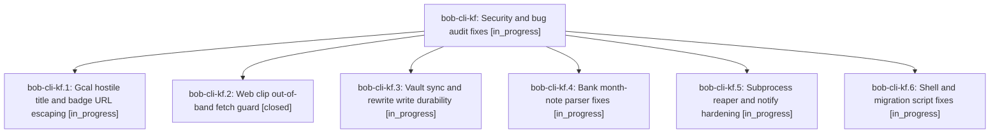

# Bead: bob-cli-kf — Security and bug audit fixes

[Bead Pages](../README.md) / bob-cli-kf

**Status:** ◐ in_progress · **Type:** ▸ plan · **Tier:** epic
**Owner:** `bryanbugyi34@gmail.com` · **Created by:** [bbugyi200.athena.1bj](https://github.com/bobs-org/bob-cli--agents/blob/main/sessions/bbugyi200.athena.1bj.md) · **Assignee:** `bob-cli-kf.land`
**Created:** 2026-11-11 13:33:44 EST
**Plan:** [202611/security\_audit\_fixes.md](https://github.com/bobs-org/bob-cli--plans/blob/main/202611/security_audit_fixes.md)

<!-- sase:links:start -->

## Links

| Relation | Artifact | Why |
| --- | --- | --- |
| implemented-by | [plan:202611/security_audit_fixes.md][1] | derived from the plan's `bead_id:` frontmatter field |

[1]: https://github.com/bobs-org/bob-cli--plans/blob/main/202611/security_audit_fixes.md

<!-- sase:links:end -->

## Description

Confirmed findings from a five-area audit (gcal sync injection, web-clip SSRF guard gaps, vault-sync data-loss races, bank parser bugs, subprocess and script defects) are fixed with regression tests.

## Phases

| Bead | Title | Status | Size | Created | Agents | Commits |
|---|---|---|---|---|---:|---:|
| [bob-cli-kf.1](bob-cli-kf.1.md) | Gcal hostile title and badge URL escaping | ◐ in_progress | small | 2026-11-11 | 1 | 0 |
| [bob-cli-kf.2](bob-cli-kf.2.md) | Web clip out-of-band fetch guard | ✓ closed | medium | 2026-11-11 | 1 | 1 |
| [bob-cli-kf.3](bob-cli-kf.3.md) | Vault sync and rewrite write durability | ◐ in_progress | medium | 2026-11-11 | 1 | 0 |
| [bob-cli-kf.4](bob-cli-kf.4.md) | Bank month-note parser fixes | ◐ in_progress | small | 2026-11-11 | 1 | 0 |
| [bob-cli-kf.5](bob-cli-kf.5.md) | Subprocess reaper and notify hardening | ◐ in_progress | small | 2026-11-11 | 1 | 0 |
| [bob-cli-kf.6](bob-cli-kf.6.md) | Shell and migration script fixes | ◐ in_progress | small | 2026-11-11 | 1 | 0 |

## Lineage

## Agents

| Agent | Bead | Commits |
|---|---|---:|
| [bbugyi200.athena.bob-cli-kf.1](https://github.com/bobs-org/bob-cli--agents/blob/main/agents/bbugyi200.athena.bob-cli-kf.1/README.md) | [bob-cli-kf.1](bob-cli-kf.1.md) | 0 |
| [bbugyi200.athena.bob-cli-kf.2](https://github.com/bobs-org/bob-cli--agents/blob/main/agents/bbugyi200.athena.bob-cli-kf.2/README.md) | [bob-cli-kf.2](bob-cli-kf.2.md) | 1 |
| [bbugyi200.athena.bob-cli-kf.3](https://github.com/bobs-org/bob-cli--agents/blob/main/agents/bbugyi200.athena.bob-cli-kf.3/README.md) | [bob-cli-kf.3](bob-cli-kf.3.md) | 0 |
| [bbugyi200.athena.bob-cli-kf.4](https://github.com/bobs-org/bob-cli--agents/blob/main/agents/bbugyi200.athena.bob-cli-kf.4/README.md) | [bob-cli-kf.4](bob-cli-kf.4.md) | 0 |
| [bbugyi200.athena.bob-cli-kf.5](https://github.com/bobs-org/bob-cli--agents/blob/main/agents/bbugyi200.athena.bob-cli-kf.5/README.md) | [bob-cli-kf.5](bob-cli-kf.5.md) | 0 |
| [bbugyi200.athena.bob-cli-kf.6](https://github.com/bobs-org/bob-cli--agents/blob/main/agents/bbugyi200.athena.bob-cli-kf.6/README.md) | [bob-cli-kf.6](bob-cli-kf.6.md) | 0 |
| [bbugyi200.athena.bob-cli-kf.land](https://github.com/bobs-org/bob-cli--agents/blob/main/agents/bbugyi200.athena.bob-cli-kf.land/README.md) | [bob-cli-kf](README.md) | 0 |

## Commits

| Repo | Commit | Subject | Bead | Committed |
|---|---|---|---|---|
| bob-cli | [`0a7fce2`](https://github.com/bobs-org/bob-cli/commit/0a7fce2b399ae9865d6bc36670517f5d6893fbe3) | fix(web-clip): guard out-of-band fetches and CSS/SVG clip sinks | [bob-cli-kf.2](bob-cli-kf.2.md) | 2026-11-11 13:51:43 EST |
