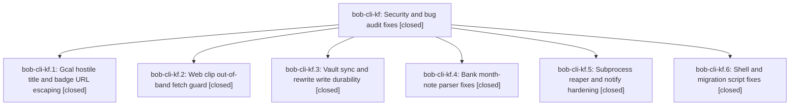

# Bead: bob-cli-kf — Security and bug audit fixes

[Bead Pages](../README.md) / bob-cli-kf

**Status:** ✓ closed · **Resolution:** done · **Type:** ▸ plan · **Tier:** epic
**Owner:** `bryanbugyi34@gmail.com` · **Created by:** [bbugyi200.athena.1bj](https://github.com/bobs-org/bob-cli--agents/blob/main/sessions/bbugyi200.athena.1bj.md) · **Assignee:** `bob-cli-kf.land`
**Created:** 2026-11-11 13:33:44 EST · **Closed:** 2026-11-11 16:17:08 EST
**Plan:** [202611/security\_audit\_fixes.md](https://github.com/bobs-org/bob-cli--plans/blob/main/202611/security_audit_fixes.md)

<!-- sase:links:start -->

## Links

| Relation | Artifact | Why |
| --- | --- | --- |
| implemented-by | [plan:202611/security_audit_fixes.md][1] | derived from the plan's `bead_id:` frontmatter field |

_Plus 1 automatic references — see [Referenced By](#referenced-by)._

[1]: https://github.com/bobs-org/bob-cli--plans/blob/main/202611/security_audit_fixes.md

<!-- sase:links:end -->

## Description

Confirmed findings from a five-area audit (gcal sync injection, web-clip SSRF guard gaps, vault-sync data-loss races, bank parser bugs, subprocess and script defects) are fixed with regression tests.

## Notes

[2026-11-11T20:44:52Z · bob-cli-kf.land] Lander verification (bob-cli-kf.land): no child bead carried a PROPOSED FOLLOW-UP entry. Lander triage of its own findings: (1) DECLINED new task: subprocess_runner still joins the stdin writer thread without a deadline; it was already unbounded before this epic and only matters if a payload larger than the pipe buffer meets an escaped grandchild holding stdin. Callers send small JSON. (2) DECLINED new task: stale #[cfg_attr(not(test), allow(dead_code))] on bank month.rs planners now used by ensure/ack (canonical_template, now_created_stamp, plan_insert_day, plan_tick_row). These belong to the active bank epic bob-cli-kd, whose kd.4 import phase is still wiring the remaining planners. (3) DECLINED: gcal escape_badge_url leaves non-ASCII line separators (U+2028/U+0085) unencoded. bob's line parsing and CodeMirror split only on CR/LF, so rows stay single-line. (4) RESOLVED in favor of kf.6: kf.6's drop_all return in capture_targets::append_record_targets reverts the 'retain partial results' comment-level choice made by 6e421597 (k3.4.1 land), because the plan's code baseline predated it. The reviewer's drop_all decision rejected even config_fallback, matches the completion provider, and contradicts no doc (docs/records.md's partial-scan rule covers records list/check, not capture-targets). Kept as implemented. (5) Integrated by lander: moved vault_git.rs's test module below is_ignored. The items_after_test_module clippy error from 1a9b6828 (the outside check-ignore fix for kf.3's regression) was failing CI lint and macOS lint on master. just check now passes locally. (6) Remaining epic-caused defects are planned as a lander-authored tale: vault_rewrite per-file stale rollback and hint, clobber recheck refresh, abort-preservation filter, drain grace, tracker splitlines/mode, and bank ensure line vs kf.4 day-end.

[2026-11-11T21:17:08Z · bob-cli-kf.land] Tale kf-landing-repairs complete. Phases verified against source: kf.1 gcal title collapse and badge-URL encoding; kf.2 web-clip guarded fetch, CSS escape, SVG order, cache_scope honored; kf.3 literal pathspecs via git_command_literal, fsync, union-merge temp+rename, abort preservation; kf.4 bank heading, BOM, planners; kf.5 bounded drain, kill before reap, sleep cap; kf.6 notify --no-timeout, tracker CRLF and atomic apply, drop_all honored. Lander integration edits: vault_git.rs test-module order fixing the clippy items_after_test_module CI/macOS lint break; capture_targets drop_all conflict with 6e421597 resolved for the reviewer drop_all decision. Six repairs in this tale, each with a regression test failing before and passing after: (1) vault_rewrite write_planned_files rolls back earlier writes on per-file stale/write failure and formats the command-name hint; (2) clobber quarantine refreshes the conflict copy from live bytes instead of skipping; (3) abort preservation copies only unmerged or worktree-dirty entries; (4) PIPE_DRAIN_GRACE 250ms to 2s with sleep-8/<4s bounds tests; (5) tracker split_text_lines splits only on CRLF/CR/LF and atomic_write_text preserves file mode; (6) bank ensure line uses month::next_row_line after free-note children. just check passes (fmt, clippy gate, full workspace suite; one transient detached-grandchild drain flake passed on rerun and on the final full run), tracker migration tests 13/13 pass, just check-web-clip-adapter passes. Follow-up triage: no PROPOSED FOLLOW-UP entries; stdin-join, bank dead-code-attr, badge U+2028 items declined with reasons on the epic.

## Phases

| Bead | Title | Status | Size | Created | Agents | Commits |
|---|---|---|---|---|---:|---:|
| [bob-cli-kf.1](bob-cli-kf.1.md) | Gcal hostile title and badge URL escaping | ✓ closed | small | 2026-11-11 | 1 | 1 |
| [bob-cli-kf.2](bob-cli-kf.2.md) | Web clip out-of-band fetch guard | ✓ closed | medium | 2026-11-11 | 1 | 1 |
| [bob-cli-kf.3](bob-cli-kf.3.md) | Vault sync and rewrite write durability | ✓ closed | medium | 2026-11-11 | 1 | 1 |
| [bob-cli-kf.4](bob-cli-kf.4.md) | Bank month-note parser fixes | ✓ closed | small | 2026-11-11 | 1 | 1 |
| [bob-cli-kf.5](bob-cli-kf.5.md) | Subprocess reaper and notify hardening | ✓ closed | small | 2026-11-11 | 1 | 1 |
| [bob-cli-kf.6](bob-cli-kf.6.md) | Shell and migration script fixes | ✓ closed | small | 2026-11-11 | 1 | 1 |

## Lineage

## Agents

| Agent | Bead | Commits |
|---|---|---:|
| [bbugyi200.athena.bob-cli-kf.1](https://github.com/bobs-org/bob-cli--agents/blob/main/agents/bbugyi200.athena.bob-cli-kf.1/README.md) | [bob-cli-kf.1](bob-cli-kf.1.md) | 1 |
| [bbugyi200.athena.bob-cli-kf.2](https://github.com/bobs-org/bob-cli--agents/blob/main/agents/bbugyi200.athena.bob-cli-kf.2/README.md) | [bob-cli-kf.2](bob-cli-kf.2.md) | 1 |
| [bbugyi200.athena.bob-cli-kf.3](https://github.com/bobs-org/bob-cli--agents/blob/main/agents/bbugyi200.athena.bob-cli-kf.3/README.md) | [bob-cli-kf.3](bob-cli-kf.3.md) | 1 |
| [bbugyi200.athena.bob-cli-kf.4](https://github.com/bobs-org/bob-cli--agents/blob/main/agents/bbugyi200.athena.bob-cli-kf.4/README.md) | [bob-cli-kf.4](bob-cli-kf.4.md) | 1 |
| [bbugyi200.athena.bob-cli-kf.5](https://github.com/bobs-org/bob-cli--agents/blob/main/agents/bbugyi200.athena.bob-cli-kf.5/README.md) | [bob-cli-kf.5](bob-cli-kf.5.md) | 1 |
| [bbugyi200.athena.bob-cli-kf.6](https://github.com/bobs-org/bob-cli--agents/blob/main/sessions/bbugyi200.athena.bob-cli-kf.6.md) | [bob-cli-kf.6](bob-cli-kf.6.md) | 1 |
| [bbugyi200.athena.bob-cli-kf.land](https://github.com/bobs-org/bob-cli--agents/blob/main/sessions/bbugyi200.athena.bob-cli-kf.land.md) | [bob-cli-kf](README.md) | 3 |

## Commits

| Repo | Commit | Subject | Bead | Committed |
|---|---|---|---|---|
| bob-cli | [`0a7fce2`](https://github.com/bobs-org/bob-cli/commit/0a7fce2b399ae9865d6bc36670517f5d6893fbe3) | fix(web-clip): guard out-of-band fetches and CSS/SVG clip sinks | [bob-cli-kf.2](bob-cli-kf.2.md) | 2026-11-11 13:51:43 EST |
| bob-cli | [`1f691b1`](https://github.com/bobs-org/bob-cli/commit/1f691b197bb53446bc2c40f30dfaebde7e66aeb9) | fix(sync): harden vault sync and rewrite write durability | [bob-cli-kf.3](bob-cli-kf.3.md) | 2026-11-11 13:54:25 EST |
| bob-cli | [`2c104b9`](https://github.com/bobs-org/bob-cli/commit/2c104b9e1e3a2553294e8cc7a5cd7d1c0e823fda) | fix(gcal): collapse hostile titles and encode badge URL whitespace | [bob-cli-kf.1](bob-cli-kf.1.md) | 2026-11-11 13:55:14 EST |
| bob-cli | [`7b3f351`](https://github.com/bobs-org/bob-cli/commit/7b3f3512204e3c8fd394597d50d4491879e29f03) | fix(subprocess): bound pipe draining and harden notify sleeps | [bob-cli-kf.5](bob-cli-kf.5.md) | 2026-11-11 14:10:33 EST |
| bob-cli | [`757e36b`](https://github.com/bobs-org/bob-cli/commit/757e36bb0d758031e2eaf2c065d1662577034583) | fix(bank): validate out-of-month headings, BOM frontmatter, planner anchors | [bob-cli-kf.4](bob-cli-kf.4.md) | 2026-11-11 14:11:54 EST |
| bob-cli | [`4771047`](https://github.com/bobs-org/bob-cli/commit/4771047e8bcc12a59b9c1dd723d078b5ffbdab84) | fix(scripts): persist notify, harden tracker apply, restore git globs | [bob-cli-kf.6](bob-cli-kf.6.md) | 2026-11-11 15:10:57 EST |
| bob-cli | [`6e3d883`](https://github.com/bobs-org/bob-cli/commit/6e3d88370351cc416301817fab6dab01761d5bd2) | fix(git): move vault\_git tests after is\_ignored | [bob-cli-kf](README.md) | 2026-11-11 15:46:34 EST |
| bob-cli | [`03a0aba`](https://github.com/bobs-org/bob-cli/commit/03a0aba291407d13453ad6d28beff0bd199970dd) | fix(kf): land six epic-caused defect repairs with regression tests | [bob-cli-kf](README.md) | 2026-11-11 16:21:35 EST |
| bob-cli--plans | [`bob-cli--plans@21b0e34`](https://github.com/bobs-org/bob-cli--plans/commit/21b0e34f0e1c9f10fa9bad6394e92df3fabd622c) | docs(kf): mark security audit epic plan done | [bob-cli-kf](README.md) | 2026-11-11 16:22:06 EST |

<!-- sase:referenced-by:start -->

## Referenced By

| Relation | Artifact | Why | Uses |
| --- | --- | --- | ---: |
| read-by | [agent:bob-cli-kf.land][1] | Need the parent link | 2 |

[1]: https://github.com/bobs-org/bob-cli--agents/blob/main/sessions/bbugyi200.athena.bob-cli-kf.land.md

<!-- sase:referenced-by:end -->
