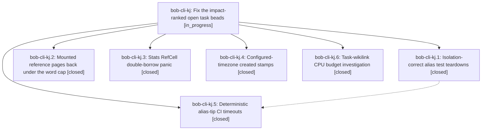

# Bead: bob-cli-kj — Fix the impact-ranked open task beads

[Bead Pages](../README.md) / bob-cli-kj

**Status:** ◐ in_progress · **Type:** ▸ plan · **Tier:** epic
**Owner:** `bryanbugyi34@gmail.com` · **Created by:** [bbugyi200.athena.1bm](https://github.com/bobs-org/bob-cli--agents/blob/main/sessions/bbugyi200.athena.1bm.md) · **Assignee:** `bob-cli-kj.land`
**Created:** 2026-11-11 17:20:03 EST
**Plan:** [202611/impact\_ranked\_bead\_fixes.md](https://github.com/bobs-org/bob-cli--plans/blob/main/202611/impact_ranked_bead_fixes.md)

<!-- sase:links:start -->

## Links

| Relation | Artifact | Why |
| --- | --- | --- |
| implemented-by | [plan:202611/impact_ranked_bead_fixes.md][1] | derived from the plan's `bead_id:` frontmatter field |

_Plus 1 automatic references — see [Referenced By](#referenced-by)._

[1]: https://github.com/bobs-org/bob-cli--plans/blob/main/202611/impact_ranked_bead_fixes.md

<!-- sase:links:end -->

## Description

The three red verification gates every landing re-triages (macOS CI, bob-cli docs-check, the bob-plugins wikilink perf budgets) are green again and the two diagnosed user-facing bugs are fixed, so beads bob-cli-jx, -jy, -h9, -jz, -jr, -k8, -f8, and -hp can be closed with verified evidence.

## Phases

| Bead | Title | Status | Size | Created | Agents | Commits |
|---|---|---|---|---|---:|---:|
| [bob-cli-kj.1](bob-cli-kj.1.md) | Isolation-correct alias test teardowns | ✓ closed | small | 2026-11-11 | 1 | 0 |
| [bob-cli-kj.2](bob-cli-kj.2.md) | Mounted reference pages back under the word cap | ✓ closed | medium | 2026-11-11 | 1 | 0 |
| [bob-cli-kj.3](bob-cli-kj.3.md) | Stats RefCell double-borrow panic | ✓ closed | small | 2026-11-11 | 1 | 1 |
| [bob-cli-kj.4](bob-cli-kj.4.md) | Configured-timezone created stamps | ✓ closed | small | 2026-11-11 | 1 | 1 |
| [bob-cli-kj.5](bob-cli-kj.5.md) | Deterministic alias-tip CI timeouts | ✓ closed | large | 2026-11-11 | 1 | 0 |
| [bob-cli-kj.6](bob-cli-kj.6.md) | Task-wikilink CPU budget investigation | ✓ closed | large | 2026-11-11 | 1 | 0 |

## Lineage

## Agents

| Agent | Bead | Commits |
|---|---|---:|
| [bbugyi200.athena.bob-cli-kj.1](https://github.com/bobs-org/bob-cli--agents/blob/main/agents/bbugyi200.athena.bob-cli-kj.1/README.md) | [bob-cli-kj.1](bob-cli-kj.1.md) | 0 |
| [bbugyi200.athena.bob-cli-kj.2](https://github.com/bobs-org/bob-cli--agents/blob/main/sessions/bbugyi200.athena.bob-cli-kj.2.md) | [bob-cli-kj.2](bob-cli-kj.2.md) | 0 |
| [bbugyi200.athena.bob-cli-kj.3](https://github.com/bobs-org/bob-cli--agents/blob/main/sessions/bbugyi200.athena.bob-cli-kj.3.md) | [bob-cli-kj.3](bob-cli-kj.3.md) | 1 |
| [bbugyi200.athena.bob-cli-kj.4](https://github.com/bobs-org/bob-cli--agents/blob/main/agents/bbugyi200.athena.bob-cli-kj.4/README.md) | [bob-cli-kj.4](bob-cli-kj.4.md) | 1 |
| [bbugyi200.athena.bob-cli-kj.5](https://github.com/bobs-org/bob-cli--agents/blob/main/sessions/bbugyi200.athena.bob-cli-kj.5.md) | [bob-cli-kj.5](bob-cli-kj.5.md) | 0 |
| [bbugyi200.athena.bob-cli-kj.6](https://github.com/bobs-org/bob-cli--agents/blob/main/sessions/bbugyi200.athena.bob-cli-kj.6.md) | [bob-cli-kj.6](bob-cli-kj.6.md) | 0 |
| [bbugyi200.athena.bob-cli-kj.land](https://github.com/bobs-org/bob-cli--agents/blob/main/agents/bbugyi200.athena.bob-cli-kj.land/README.md) | [bob-cli-kj](README.md) | 0 |

## Commits

| Repo | Commit | Subject | Bead | Committed |
|---|---|---|---|---|
| bob-cli | [`04cba0f`](https://github.com/bobs-org/bob-cli/commit/04cba0fad559471e17415f71811e21c8baf8f740) | fix(capture): stamp created/captured in the configured timezone | [bob-cli-kj.4](bob-cli-kj.4.md) | 2026-11-11 18:09:34 EST |
| bob-cli | [`3ba40fc`](https://github.com/bobs-org/bob-cli/commit/3ba40fc5444e0b593f5805d9af6742bfd989b953) | fix(stats): drop HomesEngine resolver borrow before remember | [bob-cli-kj.3](bob-cli-kj.3.md) | 2026-11-11 18:42:28 EST |

<!-- sase:referenced-by:start -->

## Referenced By

| Relation | Artifact | Why | Uses |
| --- | --- | --- | ---: |
| read-by | [agent:bob-cli-kj.2][1] | epic scope | 1 |

[1]: https://github.com/bobs-org/bob-cli--agents/blob/main/sessions/bbugyi200.athena.bob-cli-kj.2.md

<!-- sase:referenced-by:end -->
